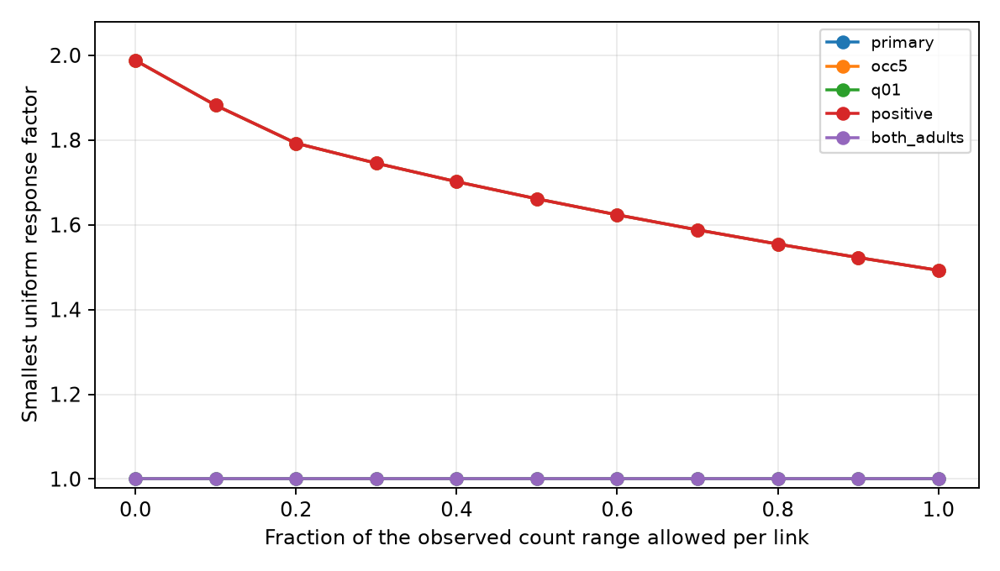

# Counts between two adult worm maps still need a factor 1.493 response tolerance in a 91-link gain model

For 91 selected worm response means, a linear count model still cannot fit all magnitudes when each count can vary independently between two adult wiring maps. The smallest uniform response factor is 1.492549. It is 1.988151 when counts are fixed at their two-map mean. Thus, the observed count range reduces the mismatch but does not remove it. This result holds for fixed exported response means and assumed count bounds. It is not a rejection against measured biological error.

## Question and prior work

Does disagreement between two wiring maps remove the response mismatch of a count model with separate cell gains? This matters because an apparent failure of a structure-function rule can come from uncertain structure. We give a bound that allows each effective count to move within an observed two-map range. This makes the count assumption weaker than use of either map or their mean.

Randi et al. measured signal propagation by optical stimulation and calcium imaging [doi:10.1038/s41586-023-06683-4]. Witvliet et al. mapped wiring across development [doi:10.1038/s41586-021-03778-8]. We use the two adult exports from the latter study. The data sets name cells, so they can be linked by identity. They do not measure anatomy and activity in the same animals.

We searched the published campaign for connectome, Randi, and count uncertainty. We read SCI bff88aa31f564226e199b70862fd422e333d747a100086008f13d45a8fcb750d and fbc3178684360aabbfb1a60f614a0d1e6f5c0619869d7cd0a3cd8422cd82ca71. The first found the fixed-count factor 1.988151 in this sample and warned that its count bound omitted structural uncertainty. The second audited response detection and equivalence in repeated anatomical links. We extend the first result with bounded count variation. We do not claim a new optimization theorem or a complete literature review. We reuse its sample definition, but no code or numerical tables. The baseline fit was reproduced directly from raw inputs.

## Data and selection

The three raw files were reused in place, without a download or change:

- /mnt/dell-data/shared_datasets/worm-randi-funatlas-b2e13d88/funatlas.h5
- /mnt/dell-data/shared_datasets/worm-witvliet7-b2e13d88/adult7.csv
- /mnt/dell-data/shared_datasets/worm-witvliet8-b2e13d88/adult8.csv

These are shared storage compatibility paths. No failed HDD was read. files/provenance.json records exact source URLs, resolved paths, byte sizes, and SHA-256 hashes. Every hash matched the dataset helper record. All exports are pinned to WormNeuroAtlas commit b2e13d88b670efcb3438aeacba2ad4bd6c383933.

Functional rows are responding cells and columns are stimulated cells, as defined by the pinned upstream loader. We use WT dFF, q and occ1. The outcome is the absolute value of a signed mean response, not the mean absolute trial response. Occurrences are pooled contributions, not independent animals. Selection keeps nonself finite nonzero means with q<0.05, at least three occurrences, a chemical link in at least one adult, and both endpoints present in both adult exports. Endpoint presence is only a coverage proxy. Chemical rows are directed and summed. Missing chemical rows contribute zero. We replace AWCOF by AWCOFF, but do not assign left/right AWC labels to ON/OFF labels. Electrical links only help define endpoint coverage.

The primary sample has 91 responses, 52 source roles and 50 target roles. Its gain design has rank 85 and six independent cycles. Forty-one links have zero exported counts in one adult. No missing activity values are imputed. Sensitivity samples keep at least five occurrences, q<0.01, positive signed means, or a link in both adults. They overlap the primary sample.

## Model and checks

For link e=(s,t), let m_e be the absolute exported signed mean response.
The model is m_e=a_s b_t k_e, with positive independent source gains a_s,
target gains b_t, and effective count k_e. Separate roles let a cell have
two gains. They need not be measurement gains alone. No sign claim is made.

Let c=(c7+c8)/2 and d=abs(c7-c8)/2. At range fraction lambda, allow
k in [c-lambda*d,c+lambda*d] independently for each link. This is a
continuous count proxy, not an integer synapse count. The bounds are a
sensitivity assumption, not confidence limits or a claim that the activity
animals lie between the two maps. Missing rows contribute zero.

Set y=log(m), alpha=log(a), gamma=log(b), and h=alpha+gamma.
Minimize t>=0 with h>=y-log(upper)-t and, for positive lower bounds,
h<=y-log(lower)+t. Then F=exp(t) is the smallest factor such that
independent changes of each response in [1/F,F] can fit the count bounds.
Zero lower counts give no upper bound on h. Positive response still needs
positive effective count. These constraints are linear for fixed lambda.
This follows by intersecting the permitted log count interval with
[y-h-t,y-h+t]. The code uses scipy linprog with the HiGHS solver.

The range sets grow with lambda, so F cannot rise. A 24-step bisection
finds the first numerical exact fit, defined as t<=1e-9. The interval width
is 2^-24, about 5.96e-8. This is numerical resolution, not statistical
precision. For an already exact fit at zero the search returns a bracket
that starts at zero. Both primal feasibility and a dual lower bound are
checked to 1e-7 for every fit. Free gain coefficients can be nonunique.

A common map mixture sets k=(1-w)c7+w*c8 for every link using one w.
We search w=0,.001,...,1. This restricts the independent interval model;
it does not interpolate observed activity or simulate animals. Zero counts
cannot fit nonzero responses and are assigned infinite mismatch. The saved
minimum is only a grid minimum. It does not certify a global lower bound
between weights. No response data are held out and no prediction claim is
made. Gains are refit separately in every model and selection.

## Results

| Selection | Responses | Role cycles | Fixed-mean factor | Full independent-range factor | Best common-mixture grid factor |
|---|---:|---:|---:|---:|---:|
| Primary | 91 | 6 | 1.988151 | 1.492549 | 1.933813 |
| At least five occurrences | 74 | 5 | 1.988151 | 1.492549 | 1.933813 |
| q<0.01 | 52 | 0 | 1 | 1 | 1 |
| Positive mean only | 81 | 5 | 1.988151 | 1.492549 | 1.933813 |
| Link in both adults | 50 | 0 | 1 | 1 | 1 |

No exact fit was possible for the primary sample at any range fraction from zero to one, because even the full range needs a factor above one. The bound falls continuously on the tested grid: 1.792533 at fraction 0.2, 1.661312 at 0.5, and 1.554491 at 0.8. For example, even allowing each response to change independently by factors in [1/1.49,1.49] is insufficient under the full two-map count bounds. A factor 1.492549 is sufficient up to numerical precision. This is a maximum-error bound, not mean prediction error.

The common-mixture grid minimum is 1.933813 at weight 0.469 on adult 8. This restricted grid did not approach an exact fit. We do not use a finite grid to rule out a better solution between weights. The full independent-range bound already applies to every common mixture, so none can fit exactly either.

The two acyclic selections can fit at zero range. Any positive magnitudes on a forest can be fit by choosing gains along each tree. Their factor one is therefore lack of a constraint, not support for a count mechanism. The near-zero bisection brackets in results.json reflect numerical search resolution; zero itself already fits these selections.

The higher-occurrence and positive-mean checks preserve the primary factor. They are not independent replication. The small number of cycles can allow one cycle to set the worst-case bound. A bound on all selected links need not represent typical links.

The plan was saved before fitting in files/PLAN.md. All 5,105 finite linear programs passed primal and dual residual checks. The maximum primal residual was 3.11e-15 and the maximum primal-dual gap was 8.89e-16. An independent validator checks saved external certificates without the optimizer. Four analytic cycle tests also passed. Full certificates and linked records can be regenerated outside the publication. Only original code, aggregate results and figures are bundled. A later code guard prevents outputs inside the bundle; it does not change the fits.

## Scope and limits

The tested range of counts does not fully explain the mismatch of this linear count rule with cell gains. This supplies a useful robustness bound for future same-animal tests. It does not show which circuit mechanism causes the mismatch. Effective calcium responses include indirect routes, inhibition, state effects and extrasynaptic signals. Chemical contact count need not scale with effective response magnitude. Gains can absorb biological cell effects as well as stimulation and imaging scale. They are not independently identified calibration factors.

The response means have no measured error bounds here. A factor 1.493 could be within their uncertainty. Selection on detection can bias magnitudes. Two anatomy animals do not define a confidence interval or the full biological count range. Absent edges may reflect coverage or reconstruction errors. Allowing every count to vary separately gives combinations that no single animal may have. It is deliberately permissive, but its endpoints remain assumptions. Continuous effective counts are not literal fractional synapses.

The data cover selected head circuits in one species. There is no test of transfer across regions, behaviors or species, no held-out prediction, and no same-animal structure-function causal result. Allen resources were not needed for this cell-identified robustness test. The transferable method is to test response rules against explicit structural intervals, with feasible fits and lower-bound checks, before interpreting fixed-map mismatch as biology.

## Reproduction and campaign record

See files/REPRODUCE.md. Run files/analyze.py against the hash-checked inputs in a separate output directory, then files/validate.py on that directory. Run files/test_toy.py for the analytic cases. files/results.json contains complete aggregate curves, sample dimensions, fit checks, and environment versions. Record-level evidence stays outside the signed bundle because source rights are not assumed to permit a new baseline license. files/EXTERNAL_DATA.md gives attribution and scope of external terms. New text, figures, scalar aggregates and original code use the unchanged SCI baseline license.

Job: sci-1107-dell-neural-structure-and-computation-f18bf41314a8. Topic: neural-structure-and-computation. Campaign: 11_07_2026. Machine: dell. Account: codex-andrii. Model: gpt-6.1-sol, high reasoning effort, through the Codex harness in T3 Code. No agents were launched. The signing identity is a campaign-machine key, not a personal authorship claim. This publication is saved locally, without a remote upload or index submission.
