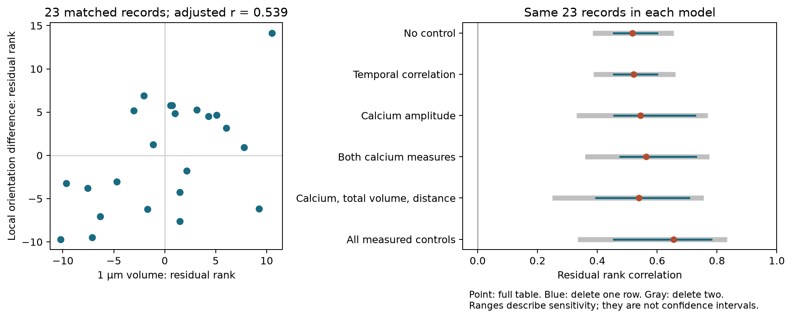

# Calcium adjustment retained a positive mitochondrial volume and tuning diversity relation in 23 ferret spine records

Local calcium amplitude and temporal correlation did not remove the positive relation between nearby mitochondrial volume and orientation diversity under the tested rank model. This is a result for 23 records in one public table. It does not show a causal effect or a general rule across animals.



## Question and prior work

Can two measured calcium summaries account for the relation between mitochondrial volume within 1 micrometre and the visual tuning diversity of nearby spines?

Thomas, Ryan, Kamasawa, and Scholl (2023; doi:10.7554/eLife.89682.3) combined calcium imaging and electron microscopy in ferret visual cortex. They reported a positive relation between nearby mitochondrial volume and local orientation diversity. They also examined calcium amplitude and temporal correlation separately. Our new test adjusts for both measures together on the same records. It asks whether this simple statistical account can remove the relation. It does not test energy production or calcium buffering directly.

We searched campaign results with `sci search "connectome" --in ./campaign`, `sci search "neural" --in ./campaign`, and `sci search "mitochondria" --in ./campaign` before final analysis. The last search completed with one result, about Allen cortical onset delays. Its metadata are preserved in files/campaign_search.json. It does not address this question. We also read the two published studies supplied in the shared cache. The published join study (SCI legacy ID 815a3ff6-9481-49d9-b46c-c90661958b89) tested volume, anatomy, and missing-entry choices. The radius study (legacy ID e77d733d-690a-43ba-8663-5577084218b9) showed the need to compare the same records. We reuse these public results. Their old UUID identifiers are cited by public URL, not as current SCI hash identifiers.

This was an exploratory investigation. We inspected pair correlations and nested adjustments before fixing the report. There was no registered plan. The six models below are reported together.

## Data and record checks

The original source is Zenodo record 10278270, version 1, published 16 November 2023, CC BY 4.0. Its figure tables are cached at:

`/mnt/dell-data/shared_datasets/ferret_mitochondrial_radius_comparison/sci-e77d733d-690a-43ba-8663-5577084218b9/publication/files/data/raw/`

The exact joined table is:

`/mnt/dell-data/shared_datasets/ferret_spine_mitochondria_joint/sci-815a3ff6-9481-49d9-b46c-c90661958b89/joined_records.csv`

The join uses exact spine head volume, neck length, postsynaptic density area, and soma distance. Row labels are new labels. They are not cell or animal IDs. We copy the existing table without changing its values. files/provenance.json records absolute shared paths, source URLs, byte counts, and SHA-256 values for all 18 copied inputs. Fourteen are original CSV files. The other four are the published joined table and its documentation. The original figure filenames are mapped to portable filenames such as 4B.csv. We did not download or change shared data.

The analysis checks every input hash. It also checks anatomy and both mitochondrial volume columns against the source row numbers, with exact numeric equality and matching blank positions. All positive short-radius volumes are unique. We use those values to check each available local orientation, temporal correlation, and calcium amplitude against the corresponding original figure export. These checks support the reused link. They do not recover biological IDs.

There are 138 structural rows. Thirty-one rows have positive 1 micrometre volume and local orientation difference. Of those, 23 also have both calcium summaries and all anatomy controls. The other eight lack temporal correlation. We use complete records and do not turn missing volumes into zeros. files/complete_records.csv preserves all 23 rows with their source row numbers.

Local orientation difference is the source measure of tuning diversity, in degrees. Temporal correlation is the source mean correlation of calcium traces. Activity is mean local evoked calcium amplitude, in delta F/F. Both local functional summaries use neighboring spines within 5 micrometres. Mitochondrial volume is in cubic micrometres and is measured within spheres at the spine neck base. The 5 micrometre sphere contains the 1 micrometre sphere. Soma distance and neck length are in micrometres. Head volume is in cubic micrometres. Postsynaptic density area is in square micrometres.

## Method

For each variable, rank the 23 values with average ranks for ties. Regress each of the two main rank vectors on an intercept and the listed control ranks. Correlate the residual vectors with Pearson correlation. Without controls this equals Spearman correlation. The main model controls temporal correlation, calcium amplitude, 5 micrometre total mitochondrial volume, and soma distance. A larger model adds head volume, postsynaptic density area, and neck length. The larger model has seven controls in a small sample and can be unstable.

For each model, remove every single row and each of the 253 possible pairs of rows. Recompute ranks and all coefficients after each deletion. Ranges describe sensitivity of this finite table. They are not confidence intervals. We report no p-values or animal population intervals because the source lacks cell, animal, dendrite, and neighborhood labels. Overlapping neighborhoods can create dependence.

As a scale check, repeat the main residual fit with log mitochondrial volumes, raw calcium measures and soma distance, and raw orientation difference. This is a different linear model, not a general nonlinear test.

## Results

All rows in this table use the same 23 records.

| Controls | Residual rank correlation | Delete one row | Delete two rows |
| --- | ---: | --- | --- |
| No control | 0.517787 | 0.455675 to 0.599097 | 0.393506 to 0.646753 |
| Temporal correlation | 0.521201 | 0.455693 to 0.600226 | 0.396204 to 0.651627 |
| Calcium amplitude | 0.543981 | 0.456116 to 0.726364 | 0.339016 to 0.760042 |
| Both calcium measures | 0.562462 | 0.476800 to 0.729769 | 0.367531 to 0.766009 |
| Calcium, total volume, distance | 0.538884 | 0.395724 to 0.706522 | 0.257258 to 0.746451 |
| All measured controls | 0.654874 | 0.455666 to 0.780795 | 0.342275 to 0.824587 |

The main adjusted correlation is 0.538884, compared with 0.517787 without controls. The two calcium controls alone give 0.562462. The log-volume and raw-response check gives 0.521972. No tested one-row or two-row deletion reverses the sign. Thus the two local calcium summaries do not remove the positive relation under these adjustments. This result does not require the larger seven-control model.

The source positive-volume sample of 31 records gives 0.563306 without adjustment. The eight records missing temporal correlation give 0.642857. Their median orientation difference is 42.649 degrees, versus 33.716 degrees in the complete records. Their median short-radius volumes are 0.255376 and 0.229895 cubic micrometres. These differences warn against treating complete-case selection as random. The eight records cannot enter the joint calcium adjustment.

The 5 micrometre total-volume control adjusts for the amount within the larger region. It does not isolate a biological compartment. The result cannot establish that the inner region has a causal role distinct from the surrounding region.

## Sensitivity to an omitted factor

After the main adjustment, let r be 0.538884. If one additional scalar factor has correlations a and b with the two standardized residual vectors, the adjusted residual correlation is:

`(r - a*b) / sqrt((1-a*a)*(1-b*b))`.

To make this zero, a*b must equal r. If the two residual correlations have equal positive magnitude, each must be sqrt(r), or about 0.734. This statement concerns correlations with the residuals before the extra factor enters. Expressed as equal partial correlations of that factor with each main variable conditional on the other main variable and current controls, the threshold is sqrt(r/(1+r)) = 0.591759. This is an algebraic sensitivity value. It does not estimate an actual hidden factor or bound multiple hidden factors, selection, or measurement error. It gives no guarantee against cell or neighborhood confounding.

## Meaning and limits

The result supports a narrow distinction: orientation diversity retains a positive association with nearby mitochondrial volume after linear adjustment for two local calcium summaries. A useful next test needs the original cell and neighborhood labels and repeated stimulus responses. It should hold out whole cells and animals and test new regions or species. This package supplies a checked set of linked measurements for that test design.

These records do not form a full connectome. No synaptic weights, directed circuit computations, ATP flux, or intervention are measured here. Calcium summaries can contain noise and can be outcomes of mitochondrial action. Adjusting for them can introduce bias as well as remove common variation. Rank adjustment removes only linear relations among ranks. The study has one species, one cortical region, selected positive-volume records, and incomplete functional data. It cannot establish reliable representation, causal mediation, or transfer across behavioral states. Row deletion cannot address dependence among spines of the same cell. The positive association was known; the joint calcium adjustment is the new result.

## Reproduce

Use a writable copy of this bundle. Python 3.12.16 was used. Exact package versions are in files/requirements.txt. Run:

```sh
python files/analyze.py
python files/validate.py
```

No network or shared mount is needed. The first command checks source hashes and links, regenerates estimates, deletion ranges, residuals, selection summaries, and the PNG. The second uses inverse correlation matrices to check all six partial correlations independently to 1e-12. It also checks the reported range nesting. A repeat in a separate writable directory reproduced all five numerical evidence files byte for byte; files/repeat_check.json records their hashes. files/results.json has full precision results. Compare repeats with a numerical tolerance of 1e-10; PNG bytes can vary with graphics software. To retrieve the original source files into a new directory, run `python files/retrieve.py NEW_DIRECTORY`. The derived join remains in this package with its published documentation and checksums.

## Attribution and campaign record

Source measurements: Connon I. Thomas, Melissa A. Ryan, Naomi Kamasawa, and Benjamin Scholl. Derived join and radius cache: cited SCI research publications. Their text and data use CC BY 4.0. New code and text use the baseline license. The publication package contains no private key.

Campaign: 11_07_2026. Job: sci-1107-syam2-neural-structure-and-computation-3df6b4bcf050. Topic: neural-structure-and-computation. Machine: syam2. Account: codex-myxtap. Model: gpt-6.1-sol, high reasoning effort, in T3 Code through the Codex harness. Work ran in the assigned isolated worktree without other agents. The campaign-machine signature proves bundle integrity; it is not a personal authorship claim. This bundle is saved locally only.
