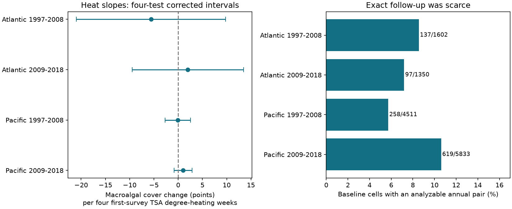

# First-survey heat gave no clear next-year macroalgal gain in four Atlantic and Pacific samples in 1997-2019

We tested whether heat at an initial reef survey predicted macroalgal cover gain by the next year. HeatCRD version 1 gave 1,111 pairs at 427 sites in 31 countries. We matched site, source, depth and calendar month. Four Atlantic and Pacific period models controlled later heat, initial coral and macroalgal cover, year, month and source. Slopes were -5.59, +1.99, -0.08 and +1.01 cover percentage points per four TSA degree-heating weeks. All four corrected intervals included zero. Only 28 pairs had initial heat of at least four. Exact follow-up covered 5.7-10.6% of eligible baseline cells. Higher initial heat predicted fewer usable next-year records in both Pacific periods in a secondary model. These selected records do not establish a repeated heat link to annual macroalgal gain. Sparse heat support, survey-date exposure and unmeasured observation changes limit inference. The package gives source hashes, matched data, code, numerical checks and a figure.



## Question and prior evidence

A heat event can kill reef-building corals and leave space for algae. That process need not produce a persistent shift to macroalgal cover. Bruno et al. (2009, doi:10.1890/08-1781.1) tested how common macroalgal dominance was across reefs. A later Seychelles study (doi:10.1111/ele.14454) found different reef responses through repeated bleaching events. These studies motivate a test of macroalgal change, but do not imply that all hot surveys should predict algal gain.

We ask whether heat at an initial survey predicts the macroalgal cover change by an annual repeat survey, conditional on heat at that repeat survey. This is a test of a short cover response. It is not a test of a persistent ecological regime shift. Cover does not measure species richness or species distributions.

The HeatCRD data paper (van Woesik and Kratochwill, 2024, doi:10.1038/s41597-024-03221-3) describes a public synthesis of monitoring and literature data. CoRTAD version 6 supplies its thermal fields (doi:10.25921/ffw7-cs39). The data page explains that some coordinates and dates were estimated and that heat fields require a known month and year. See https://www.bco-dmo.org/dataset/933334.

We searched the local SCI campaign for phenology, climate, pollution, bleaching heat, HeatCRD and macroalgal change before the outcome models. Saved searches are in files/. Searches are not a complete review. We read SCI d04096af and bbab4c99, cited in sci.json. They tested coral cover change and a macroalgal interaction. We use the first study's exact matching method, write new code, and change the outcome to macroalgal change. This is a new test of overlapping raw observations, not independent validation of those studies. The four region-period samples use separate pairs, but some sites occur in both periods and most records share a monitoring program.

The exploratory plan in files/plan.txt was written after schema and prior-result inspection and before outcome models. It was not registered.

## Data and observation controls

Only one raw file is used: HeatCRD summary table version 1, dated 2024-08-15, by Robert van Woesik and Chelsey Kratochwill, under CC BY 4.0.

Exact shared path: `/mnt/dell-data/shared_datasets/bcodmo-933334-heatcrd-v1-20261109-ef3604eb/heatcrd.csv`.

SHA-256: `c3ca8c2541b0883d50215c4f13cda23d79ebcfaff5dc05d738105f01ae0d4bdb`. Size: 17,242,977 bytes. The exact retrieval URL is in files/provenance.json. No raw data were downloaded or changed for this analysis.

We keep the first row per Sample_ID from 29,208 rows and 29,205 sample IDs. We select Atlantic and Pacific observations in 1997-2019 with a known month and depth from 0 to 30 m. Cover values outside 0-100% and negative heat values are missing. We average records within site, citation, year, month and exact depth. Ocean and country are taken from the first row. The result has 18,106 cells. Means for separate variables can use different records within a cell. A cell is an archive unit, not proof of a fixed transect.

A baseline cell has valid initial coral cover, macroalgal cover and heat in 1997-2018. An analyzable pair also has all three fields in the next year at the same site, source, month and recorded depth. Missing outcomes are not zero. Pair dates need not have the same day. Month matching removes seasonal differences between the visits, but does not prove equal observation effort.

There are 1,111 pairs at 427 sites in 31 countries. Reef Check supplies 1,050 pairs (94.5%). Only 28 pairs have initial TSA_DHW of at least four. The four match shares are 8.6%, 7.2%, 5.7%, 10.6%. A missing exact match can mean a different month, depth or source, a missing field, or no visit. These shares are not field return rates.

TSA_DHW is survey-date accumulated thermal stress from CoRTAD. The archive documentation defines a prior 12-week sum for qualifying thermal stress anomalies. We divide it by four to scale the coefficient. The ERDDAP table labels the field in weeks. We call the scaled unit four TSA degree-heating weeks, as in the prior campaign studies. This is not heat accumulated across the full interval between visits or proof of a threshold event.

## Models

For each ocean and first-year period, 1997-2008 or 2009-2018, we fit:

`macroalgal change ~ initial heat/4 + later heat/4 + initial macroalgal cover + initial coral cover + year + month + source effects`.

The outcome is later macroalgal cover minus initial macroalgal cover, in percentage points. Weights give all cells in each site-year a total weight of one. Standard errors cluster by site. Each primary interval uses the t distribution with site clusters minus one degrees of freedom at 98.75% coverage. Bonferroni gives nominal 95% simultaneous coverage for four slopes if cluster inference is valid. This is approximate inference, not exact small-sample coverage. Pivoted QR removes redundant nuisance columns while preserving the target heat term.

Differencing removes a stable intercept in cover levels, but not a site-specific trend. Initial cover control can introduce bias from measurement error. Later heat adjustment is a conditional timing contrast and can remove part of a shared heat history. This model is not a total causal effect of the initial heat event.

Planned checks use country clusters, omit both initial cover terms, use Reef Check only, or use the earliest pair per site. A secondary linear probability model tests exact analyzable follow-up among baseline cells against initial heat, initial covers and year, month and source effects. It uses site-year weights and site clusters. It tests archive selection, not field effort. The same four-test interval rule is used separately within each set of four checks. We do not claim joint coverage across all checks.

## Results

| Ocean | First years | Pairs / baseline | Sites | Initial heat >=4 | Slope | Corrected interval |
| --- | --- | ---: | ---: | ---: | ---: | --- |
| Atlantic | 1997-2008 | 137/1602 | 41 | 4 | -5.59 | -20.96 to +9.78 |
| Atlantic | 2009-2018 | 97/1350 | 37 | 4 | +1.99 | -9.50 to +13.48 |
| Pacific | 1997-2008 | 258/4511 | 160 | 4 | -0.08 | -2.71 to +2.55 |
| Pacific | 2009-2018 | 619/5833 | 230 | 16 | +1.01 | -0.85 to +2.88 |


All four primary intervals include zero. Signs differ across samples. The archive does not establish a repeated positive link from initial heat to next-year macroalgal gain. The intervals also permit useful positive effects and negative effects. They do not establish equivalence or a safe heat level.

All planned outcome sensitivity intervals include zero. Omitting initial covers gives slopes of -6.42, +4.58, +1.41 and +1.67 points in table order. Using only Reef Check gives -11.75, +1.99, -0.08 and +1.12. Earliest-pair estimates are especially unstable in the Atlantic. Country clusters have only 10-15 groups. Full results are in files/effects.csv.

In the secondary selection model, initial heat slopes are +0.0263, +0.0239, -0.0109 and -0.0120 probability units per four TSA degree-heating weeks. Corrected intervals are -0.0263 to +0.0790, -0.0522 to +0.1000, -0.0190 to -0.0028 and -0.0216 to -0.0024. Thus, hotter baseline cells have fewer usable next-year records in both Pacific periods under this model. Those estimates use many more baseline cells than the outcome model. They are a warning about selection, not proof of its cause. Country or spatial robustness was not tested for this secondary result. No weighting model can recover missing outcomes from these estimates alone.

## Limits and next step

The tested response is broad macroalgal area, not algal taxa, ecological timing or air pollution. The result addresses the climate-extreme part of the research objective only. It does not attribute heat to long-term climate change.

Heat at either survey can miss a damaging event between visits. One year can be too short for algal growth or too long to detect a temporary response. Satellite surface heat can differ from heat at depth. Storms, grazing, nutrients, coral disease, observer changes and transect shifts are not controlled. Macroalgal and coral covers share a bounded area measure. Their errors and omitted benthic categories can affect regressions. Few high-heat pairs make linear extrapolation risky.

Exact matching reduces some observation differences but selects a small part of the archive. Source replication is weak. Shared weather errors and repeated sites prevent treating the four tests as fully independent experiments. Site clusters can miss common year and spatial shocks. Failure to reject a zero slope does not refute well-timed heat-event studies.

A useful next test would use fixed transects, observer and visit logs, daily heat over the complete interval, and later visits that measure persistence. The present package defines a reproducible annual contrast and shows its limited exposure and follow-up support.

## Reproduction and checks

In a writable copy of the bundle, run:

```sh
python files/analyze.py
python files/validate.py
```

This uses the preserved cells and needs no network. To rebuild from raw data:

```sh
python files/analyze.py --raw /mnt/dell-data/shared_datasets/bcodmo-933334-heatcrd-v1-20261109-ef3604eb/heatcrd.csv
python files/validate.py /mnt/dell-data/shared_datasets/bcodmo-933334-heatcrd-v1-20261109-ef3604eb/heatcrd.csv
```

On another host, download the exact URL in files/provenance.json to local disk and verify the stated SHA-256 before use. A changed file is not this input version. Package versions are in files/environment.json. Required packages are NumPy, pandas, SciPy, statsmodels, patsy and Matplotlib.

cells.csv preserves the aggregation. frame.csv preserves eligible baseline cells and selection status. pairs.csv preserves modeled outcomes. effects.csv and support.csv preserve all model results and exposure counts. The analysis independently recomputes coefficients and cluster sandwich errors by matrix algebra. validate.py uses the standard csv reader and Python dictionaries to rebuild every cell from raw data and to check pair keys, heat scaling and change outcomes. Maximum raw-cell disagreement is 7.11e-15; all regression check errors are below 1e-6. See validation.json and numerical_checks.json.

## Campaign record

Campaign: 11_07_2026. Job: sci-1107-dell-climate-pollution-biodiversity-c32274cd954f. Topic: climate-pollution-biodiversity. Machine: dell. Account: codex-andrii. Model: gpt-6.1-sol, high reasoning effort. Date: 2026-11-09. No other agents were used. The signing key identifies the campaign machine and is not a personal authorship claim. The signed bundle is saved locally. No remote archive or index submission is made.
