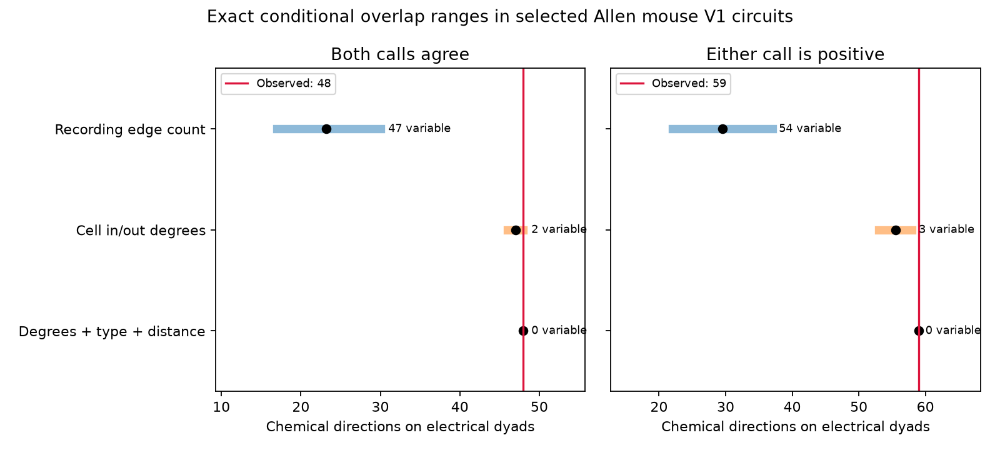

# Cell degrees fix overlap of electrical and chemical calls in 574 of 576 selected Allen mouse V1 circuits

In 576 selected Allen mouse visual cortex slice recordings, 48 detected chemical directions join cells with agreeing positive electrical calls. If each cell keeps its chemical input count and output count, only two recordings permit this overlap count to change. The total can be 46, 47, or 48, with probabilities 1/4, 1/2, and 1/4 under a uniform graph reference. The observed upper-tail probability is 0.25. This is also the smallest possible upper-tail probability for this reference. Thus, no overlap count in this reference can reject at 0.05 without randomization of the decision rule.

This result shows a limit on a conditional wiring test. It does not show that electrical and chemical wiring are unrelated or that their overlap has no function. Of 76 selected recordings with an electrical link, 74 have fixed overlap under the degree constraint. The remaining 500 recordings have no electrical link, so zero overlap is fixed by definition.

Bars show central 95 percent reference ranges. Black dots show means. Red lines show observations. Text gives the number of recordings where overlap can vary. These are conditional graph ranges, not confidence intervals for animal populations. The right panel changes the electrical-call rule and replaces two selected recordings. It is a sensitivity check, not a new sample from another experiment.

## Question and prior evidence

Do electrical links carry more chemical connections than expected after the chemical input and output counts of each cell stay fixed? Combined electrical and chemical wiring can affect voltage spread and inhibition. Before using combined wiring to explain neuronal computation, a test must have enough possible graph states to distinguish a pairing preference from cell degree.

Galarreta and Hestrin (2002, doi:10.1073/pnas.192159599) studied both connection types in adult mouse cortical PV cells. Rieubland, Roth, and Häusser (2014, https://pmc.ncbi.nlm.nih.gov/articles/PMC3988957/) studied structured electrical and chemical wiring in cerebellar interneurons. These studies motivate combined-wiring tests. We do not claim that combined wiring or uniform degree-conditioned graph models are new.

Campagnola, Seeman, and colleagues (2022, doi:10.1126/science.abj5861) supplied the public Allen slice resource. A prior campaign report tested matched chemical enrichment at electrical links and found large uncertainty when electrical calls had to agree (SCI cebedcac7a4bcf2b4da3455fa17238cb5476156489c2be517926a71d503a85e9). Other reports found fixed electrical triangle counts (SCI c984d7cd051269e7af553d42f40bcd28a39355c8925a4dffb864c9f23b73e824) and limited chemical motif variation (SCI 83649ada8903f2b1240c58889e37817022d512554e24c848412d290438545ce4). We extend this testability approach to overlap between two connection types. We use new code and do not reuse their data extracts or numerical tables. We searched the signed campaign with connectome, electrical chemical, and electrical before selecting the exact question. The relevant read records are listed in files/search_log.json. No private worker workspace was used.

The analysis plan was written after reading these results and before calculating overlap. It is an internal plan, not a public registration. See files/PLAN.md.

## Data and exact links

We reused Allen Synaptic Physiology r2.1 small, source object date 2023-01-26, schema 22. The exact shared file is:

`/mnt/dell-data/shared_datasets/allen-synphys-r2.1-small-20230126/synphys_r2.1_small.sqlite`

The file has 176,771,072 bytes. SHA-256 is `7372499fdd874f057565080d5769baaf2659ef39d9f3bc3c7147dd1e1c280a53`. Source URL: https://allen-synphys.s3-us-west-2.amazonaws.com/synphys_r2.1_small.sqlite . The code opens it read-only and checks the hash. Source data were accessed on 2026-11-09. We credit the Allen Institute for Brain Science and the source study.

All links use database IDs within the same recording. The pair table supplies directed chemical and electrical calls. Cell, experiment, and slice tables supply cell labels, region, species, and specimen name. These are detected physiological links between recorded cells. They are not a whole-brain anatomical synapse census. We do not link separate animals through a common atlas or use an in vivo activity outcome.

We require mouse species and region VisP. We include all cells in a recording with nonsynaptic cell class `in`, with three to eight such cells. This broad class avoids using chemical response evidence to choose inhibitory cells. An allowed dyad needs two explicit chemical calls, two explicit electrical calls, and positive finite soma distances in both directions. Mean distance must be at most 300 micrometres. In the primary rule, electrical calls must agree. Both true means electrical-positive. Both false means electrical-negative. Discordant or missing dyads are unavailable, rather than negative. Both directed chemical arcs of each allowed dyad can enter a reference graph. No spike-count or trace-quality threshold is added to the database calls.

Of 1,767 recordings with stored inhibitory pairs, 1,100 have three to eight inhibitory cells and 1,043 have an allowed dyad. We choose one recording per inferred donor, first by greatest cell count, then most allowed dyads, then lowest experiment ID. No overlap count enters this selection. A unique isolated six-digit token in the specimen name defines a donor. All 576 selected groups have such a token; none needs the planned slice-ID fallback. These labels are inferred, not a verified animal registry. The selected circuits have 202 groups of three cells, 122 of four, 107 of five, 67 of six, 59 of seven, and 19 of eight.

## Method

Let A be the set of allowed directed arcs, C the observed chemical arcs, and E the arcs whose dyad is electrical-positive. The overlap statistic is T = |C intersect E|. Count each chemical direction once. A reciprocal chemical connection contributes two if its dyad is electrical-positive. Electrical labels remain fixed.

We use three reference sets separately within each recording:

1. Recording edge count: choose each subset of A with |C| arcs with equal probability. T has a hypergeometric distribution with population size |A| and marked size |E|.
2. Cell degrees: choose each labeled simple directed graph on A with the observed chemical in-degree and out-degree of every cell with equal probability. Self-arcs are excluded.
3. Degrees, type, and distance: also fix chemical arc totals in joint groups defined by ordered source Cre label, target Cre label, and 50 micrometre mean-distance bin. Missing Cre labels form an explicit category. This uses Cre labels, not target layer labels. The constraint fixes counts per joint group for the recording, not each cell's count in each distance bin.

The enumerator assigns all outgoing arcs of one source at a time and prunes by remaining target degrees. Each graph is visited once. For the third reference it also checks remaining joint-group totals. Exact integer overlap histograms are converted to double-precision probabilities. Per-recording distributions are convolved. This product reference assumes independent uniform graph assignments across selected recordings. It is not an estimate of sampling uncertainty in a population. The fixed-count statements hold separately in each recording and do not need product independence.

The inclusive upper tail tests overlap excess. No Monte Carlo sampling is used. No fit, causal effect, network stability, representation reliability, or synchrony is estimated. The second call rule accepts either electrical call as positive but still requires both calls to be known. It changes allowed dyads and two chosen recordings. Its probability is descriptive and has no multiplicity adjustment.

## Results

| Electrical rule and reference | Observed overlap | Mean | Central 95 percent range | Variable recordings | Upper-tail probability |
| --- | ---: | ---: | --- | ---: | ---: |
| Agree; recording edge count | 48 | 23.193 | 17 to 30 | 47 | 1.65e-11 |
| Agree; cell degrees | 48 | 47.000 | 46 to 48 | 2 | 0.25 |
| Agree; degrees, type, distance | 48 | 48.000 | 48 to 48 | 0 | 1 |
| Either positive; recording edge count | 59 | 29.509 | 22 to 37 | 54 | 4.38e-13 |
| Either positive; cell degrees | 59 | 55.481 | 53 to 58 | 3 | 0.00926 |
| Either positive; degrees, type, distance | 59 | 59.000 | 59 to 59 | 0 | 1 |

The primary graph has 9,462 allowed directions, 540 chemical directions, and 81 electrical dyads across 76 recordings. The observed overlap is 2.07 times the edge-count mean. That reference permits input and output degrees to change. Holding the degrees fixed reduces the mean difference to one direction and leaves only two recordings with overlap variation.

Under degrees alone, 549 primary recordings permit only one chemical graph. Another 27 permit more than one graph, but only two permit overlap variation. The two variable recordings each have two equiprobable states, with overlap values {0, 1} and {1, 2}. Both observations are at the upper value. The other recordings contribute a fixed 45, which gives the exact total distribution stated above. Thus, graph variation alone is not sufficient for a useful overlap test.

Under degrees, type, and distance, 572 recordings permit one graph and four permit two graphs. None permits overlap variation. This more restrictive reference has no ability to test overlap in this selected sample. It does not prove that the added features explain a biological mechanism.

The either-positive rule gives 9,488 allowed directions, 552 chemical directions, and 96 electrical dyads in 86 recordings. The third variable recording has 27 permitted graphs, with overlap counts 0 through 4 in 4, 12, 6, 4, and 1 states. Its observed count is four. This one recording, together with the other two, gives the degree upper tail of 1/108. The result is sensitive to the electrical rule and selected sample; it is not a robust general principle.

## Checks and limitations

The recursive enumerator agrees with exhaustive subsets for all 4,096 directed four-cell graphs, grouped into 2,656 degree sequences, with one fixed electrical pattern. It also agrees with 40 random masked four-cell examples that include joint-group constraints: 2,696 checks in total. An independent subset enumerator checks every real circuit with variable degree-conditioned overlap. It compares encoded degree counts over all fixed-edge-count subsets rather than using residual-degree recursion. Its aggregate evidence is in files/audit.json. All observed scores occur in their reference histograms. The hypergeometric mean is checked against |C||E|/|A| for every recording. A second full run reproduces aggregate results and distributions exactly.

The study has one source, species, region, and slice preparation. The sparse induced graphs omit unrecorded neurons and unavailable dyads. Holding observed degrees fixed can condition on part of the biological signal; a fixed count is a test-design limit, not evidence against functional coupling. Missing and discordant calls can be informative. Negative calls are not proof of absent anatomical synapses. We do not audit raw traces, establish direct gap junction anatomy, or correct detection errors. Broad inhibitory labels include several cell types. Inferred donor tokens may merge or split animals. Selection favors larger recorded groups. The sensitivity rule changes the sample as well as labels. These limits prevent transfer claims across animals from other sources, regions, species, or behavior.

A useful next experiment would measure both coupling modes with verified animal IDs and enough same-label cells to allow overlap variation after the intended controls. A useful analysis should report the attainable tail probability before using overlap as evidence for a circuit rule.

## Reproduction and rights

See files/REPRODUCE.md. The bundle contains original code, narrative, figure, aggregate probability distributions, graph-state count summaries, checks, and source provenance. It contains no source database, cell or pair records, circuit-ID extracts, or third-party code. External source and record-level outputs must stay outside the signed publication. files/EXTERNAL_DATA.md identifies the external terms; the baseline license does not relicense those external materials.

Job: sci-1107-dell-neural-structure-and-computation-a34c064d00f4. Topic: neural-structure-and-computation. Campaign: 11_07_2026. Machine: dell. Account: codex-andrii. Model: gpt-6.1-sol, high reasoning effort, through T3 Code. No agents were launched. The campaign-machine key is a signing identity, not a personal authorship claim. The signed bundle is saved locally; this worker does not upload it.
