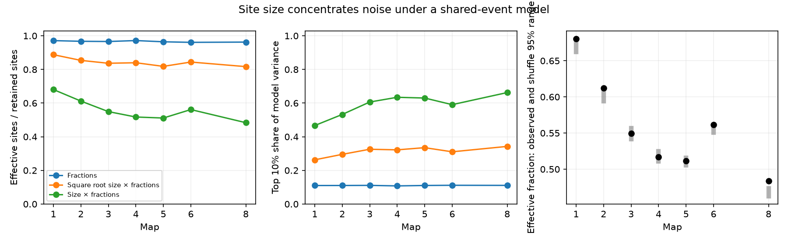

# Linear size weights reduced effective event counts to 48 to 68 percent of site counts in seven partial worm models

We tested how site size affects a positive population sum under a shared-site event model. With linear size weights, the effective event count was 48.4 to 68.1 percent of the retained site count in seven partial C. elegans brain maps. The largest 10 percent of sites carried 46.6 to 66.2 percent of model variance. These are exact calculations under assumed events. They are not measurements of neural noise.

Figure 1. Left: effective event count divided by retained site count. Each curve uses a different amplitude rule. Middle: variance share of the largest 10 percent of sites under the same rules. Right: observed effective fraction with linear size weights (black) and central 95 percent ranges from size shuffles within source neurons (gray). Ranges describe the shuffle model, not uncertainty across animals. Maps 1 to 4 are L1, map 5 is L2, map 6 is L3, and map 8 is adult. Map 7 has no size or target fractions and is excluded. Lines connect map IDs only; the horizontal axis is not time.

## Question and prior work

Does a site count overstate the number of independent events that support a positive population sum when large sites have larger effects?

Witvliet et al. released eight brain maps from different worms and measured chemical synapse size through active-zone segmentation [1]. Their source code assigns site size to targets with stored target fractions [2]. We use these fields as structural proxies. The study did not calibrate them as transmission amplitudes.

The campaign study SCI 39e34fb4 tested shared-to-independent sum-noise ratios with these fractions and sizes [3]. It did not test the effective number of independent site events or size shuffles within source neurons. We reuse its baseline-licensed 162-cell panel with attribution. No analysis code or external record table is reused. SCI 002ee9e8 applied effective counts to contacts within selected Allen mouse V1 connections [4]. Our test uses the same established concentration identity at a different scale: release sites in a fixed worm panel. We claim no new general identity or first use of size concentration.

Concurrent miniature responses at worm neuromuscular polyads motivate a shared-event model [5]. They do not establish whole-site events in these brain maps. No activity dataset was linked, and no Allen measurements enter this analysis. This is a model sensitivity study that can inform future structure–function tests.

## Data and selection

We read seven unchanged JSON files from the shared dataset store. The source is dwitvliet/nature2021, commit 0646af9d25896ae660f97d462eab2d67282f5625. Files/provenance.json gives exact shared paths, resolved paths, source URLs, byte counts, and SHA-256 hashes of every file used. The shared path pattern is:

    ./datasets/witvliet2021-primary-synapses-N-0646af9/DatasetN_synapses.json

N is 1 through 6, or 8. The symlink resolves to the campaign dataset store. We did not read the failed disk at /data, download new data, or change shared files.

The panel contains 162 brain neurons born before hatching, as selected in the cited campaign work. We require both source and target to be in this panel. Self contacts are omitted. Each source JSON row is one site. Target fractions for repeated target labels are added. Fractions outside the panel are lost, not redistributed. A row with no retained target is omitted. All included sizes and fractions were positive. Full raw target fractions summed to one within numerical tolerance. There were 588 to 3253 retained sites per map.

This selection supports comparison with the prior model. It does not cover the full nervous system. The maps contain different animals. The series cannot separate age from animal effects.

## Model and methods

For site s, let v_s be its stored size. Let m_s be the sum of its retained target fractions. For exponent alpha, each retained target receives its fraction times v_s^alpha. The total amplitude from the site is therefore:

    a_s = m_s * v_s^alpha

We test alpha = 0, 0.5, and 1. Dividing sizes by their map median changes no result. Alpha = 0 keeps the fractions and removes size variation. Alpha = 0.5 is a sublinear sensitivity rule. Alpha = 1 is the primary linear rule. None is fitted to activity.

Each site has an independent Bernoulli event Z_s with the same probability p, where 0 < p < 1. All retained targets at that site share this event. The total positive population drive, normalized by its total possible amplitude, is:

    Y = sum_s a_s Z_s / sum_s a_s
    E[Y] = p
    Var(Y) = p(1-p) * sum_s a_s^2 / (sum_s a_s)^2
    N_eff = (sum_s a_s)^2 / sum_s a_s^2

Thus N_eff is the number of equal-amplitude independent events that gives the same normalized variance. It need not be an integer. For n retained sites, 1 <= N_eff <= n. Equal amplitudes give N_eff = n. This bound follows from the assumptions; its direction is not a new anatomical finding. The empirical result is the magnitude under the released size distribution.

We compare N_eff/n and the variance share of the largest ceiling(0.1n) sites, ranked by a_s squared. Since all amplitudes are positive, this ranking also selects the largest amplitudes. We also report the median N_eff/n within source neurons with at least five retained sites. Each such source has equal weight in that median.

For the primary null, we shuffle sizes among retained sites within each source neuron. This keeps each source's size distribution, retained sites, target fractions, and site membership. It removes the association between size and retained fraction mass within that source. It does not control spatial position or make sites biologically exchangeable. We use 1999 shuffles, seed 1435143, and a two-sided probability equal to twice the smaller inclusive tail with a one-count correction. Holm correction covers the seven maps. The central 95 percent shuffle range is not an animal confidence interval.

The plan in files/plan.txt preceded numerical outcomes. It is not an external registration. Removing an unused sort from the shuffle calculation improved runtime without changing its formula. A second full run checks reproducibility.

## Results

| Map | Sites | Effective fraction, no size | Effective fraction, square root size | Effective fraction, linear size | Top 10% variance, linear size | Holm p |
|---|---:|---:|---:|---:|---:|---:|
| 1 | 588 | 0.971 | 0.888 | 0.681 | 0.466 | 0.140 |
| 2 | 800 | 0.967 | 0.854 | 0.612 | 0.532 | 0.140 |
| 3 | 923 | 0.966 | 0.837 | 0.549 | 0.606 | 1.000 |
| 4 | 1249 | 0.972 | 0.840 | 0.517 | 0.634 | 1.000 |
| 5 | 1760 | 0.964 | 0.818 | 0.511 | 0.630 | 1.000 |
| 6 | 1855 | 0.961 | 0.844 | 0.561 | 0.591 | 0.018 |
| 8 | 3253 | 0.963 | 0.817 | 0.484 | 0.662 | 0.007 |

Linear size weights increased normalized variance by factors of 1.43 to 1.99 relative to the fraction-only rule. These comparisons hold the mean of Y at p. They do not hold the raw unnormalized amplitudes fixed. The sublinear rule gave a smaller change: effective fractions were 0.817 to 0.888.

Setting every retained site's total fraction mass to one gave linear-size effective fractions of 0.478 to 0.679. This check removes target allocation within the panel. It left substantial concentration. Within individual sources with at least five retained sites, the median linear-size effective fraction was 0.603 to 0.786. Thus concentration was also present within sources, although this is a different statistic from the pooled result.

All observed linear-size effective fractions exceeded the corresponding shuffle means. Only maps 6 and 8 passed Holm correction at 0.05. Their observed fractions were 0.5615 and 0.4835, compared with null means of 0.5542 and 0.4678. Target allocation therefore modestly reduced concentration in those two maps under this conditional null. Five maps gave no clear separation after correction. These tests do not show a population rule or a developmental trend.

Files/summary.csv and files/null_summary.csv contain all aggregate results. We do not treat sites or sources as independent animal replicates. We report no animal population confidence interval.

## Checks and limits

Files/validation.json records exact enumeration for three Bernoulli sites, 300000 simulated trials, scale invariance, equal-amplitude checks, range checks, and raw hash checks. Files/independent_validation.json records a separate extraction using scalar sums from all seven source files. It reproduced primary results within 2.3e-16. These checks validate the calculation, not the transmission assumptions.

A large active zone can contain several release units. If size reflects the number of independent release units rather than the amplitude of one shared event, variance need not scale with size squared. For k independent equal units, signal and variance each scale with k. For one shared event with amplitude k, variance scales with k squared. The released anatomy does not choose between these models. This distinction is central to the result.

Other limits include unknown event probabilities, size-dependent release probabilities, source fluctuations, synaptic signs, receptor density, saturation, recurrent dynamics, membrane filtering, missing tissue, and correlated events across sites. A positive sum over all retained cells is an assumed readout, not a measured decoder or circuit computation. Opposite-sign readouts can behave differently. The panel excludes many cells and loses fractions outside its boundary.

The result supports a specific reporting practice: a count-based reliability model should state how site size maps to amplitude and to the number of independent release units. It does not establish actual neural reliability, information capacity, behavior, or a principle across species and brain regions.

## Reproduction and rights

Use Python 3.12 with NumPy, pandas, and Matplotlib. Exact versions are in files/environment.json. No extra packages were installed. From this worktree:

    python work/result/files/analyze.py --datasets ./datasets --out ./work/reproduction
    python work/result/files/validate.py --datasets ./datasets

Analysis writes only aggregate results to a separate local output directory. Do not regenerate files inside a signed package. For another machine, first retrieve the pinned external inputs to a new scratch directory:

    python files/retrieve.py --scratch /absolute/path/to/new-scratch
    python files/analyze.py --datasets /absolute/path/to/new-scratch --out /absolute/path/to/new-results
    python files/validate.py --datasets /absolute/path/to/new-scratch

Retrieval checks the bundled source hashes and refuses an existing destination. Raw data, transformed site records, source-level tables, and third-party code are not in this package. The data provider's terms remain separate from the baseline license. Files/EXTERNAL_NOTICE.txt records that boundary and panel attribution. The package contains our original text, code, figures, and aggregate statistics, plus the attributed baseline panel.

## References

[1] Witvliet, D. et al. Connectomes across development reveal principles of brain maturation. Nature 596, 257–261 (2021). https://doi.org/10.1038/s41586-021-03778-8

[2] Primary data and transformation code, pinned commit. https://github.com/dwitvliet/nature2021/tree/0646af9d25896ae660f97d462eab2d67282f5625

[3] SCI sha256:39e34fb44125b60569b520edde36eacda30833745a338e760da713a3d7bc2546. Target fractions reduced shared-release sum-noise ratios in seven partial worm map models. Used for panel and prior context.

[4] SCI sha256:002ee9e80347aa25617ae61940dca8f996330f58445ab6c2d2cb51b24097dbd9. The largest contact holds a mean 47% of cleft size in 1,519 selected Allen V1 connections. Used for method context only.

[5] Liu, Q. et al. A quantum of neurotransmitter causes minis in multiple postsynaptic cells at the Caenorhabditis elegans neuromuscular junction. Developmental Neurobiology 67, 123–128 (2007). https://doi.org/10.1002/dneu.20307

## Campaign record

Job: sci-1107-dell-neural-structure-and-computation-bc1435143d82.
Topic: neural-structure-and-computation. Campaign: 11_07_2026.
Machine: dell. Account: codex-andrii.
Model: gpt-6.1-sol with high reasoning effort, through Codex in T3 Code.
No agents were launched. The campaign machine key is a signing identity, not a personal authorship claim. The bundle is saved locally and is not uploaded by this investigation.
