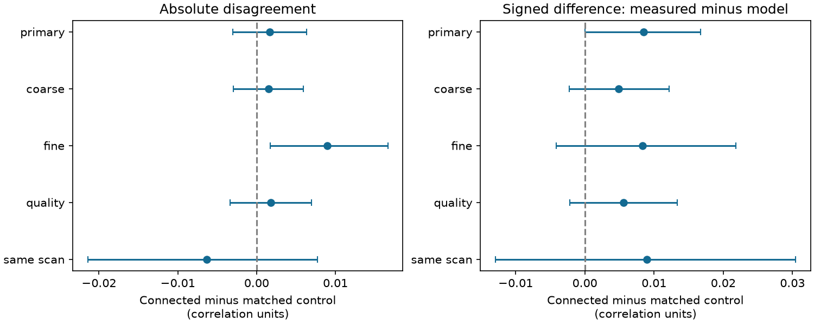

# Coarse matching left a connection-related response disagreement uncertain in one MICrONS mouse

The primary test did not resolve a difference in absolute disagreement between connected and nearby unconnected cell pairs. The estimate was **0.00164 correlation units**, with a nominal 95% source interval of **-0.00299 to 0.00635**. Finer matching gave a larger positive estimate on a smaller panel. The data do not establish equal agreement across connection groups.

## Question and prior work

Can model response measures replace measured activity measures in a structure-function study without a change in agreement at connected pairs? We test one narrow part of this question. We compare the absolute difference between two released movie-response correlations at connected pairs and at nearby unconnected pairs.

Ding et al. found that response similarity relates to wiring in MICrONS. They used model responses to a larger movie set and tested model-based response estimates in other mice. Their released pair table includes both model and measured correlations. Our comparison concerns agreement between those two released measures in the anatomically mapped mouse. It does not repeat their broader response-validation test. [Ding et al.](https://doi.org/10.1038/s41586-025-08840-3).

The MICrONS resource links calcium imaging and electron microscopy in the same mouse and includes Allen Institute work. [MICrONS Consortium](https://doi.org/10.1038/s41586-025-08790-w).

A prior campaign test compared which measure ranks connected targets better when the measures disagree. It left that ranking advantage uncertain. Our endpoint is the magnitude of pair-score disagreement, not the ranking of anatomical targets. [Prior ranking test](sci:sha256:3124aab2585264e51e2a49530e6a3cb19a1a6baac4c0724eb075d09dc59f1668).
A separate campaign audit checked that node response vectors reproduce the released pair correlations. We use the released pair fields, with new code and no reused derived table. [Prior field audit](sci:sha256:748aa272d79394531e3e34931a140943b795b6f92d05e7aa412e7134fd27d14a).

## Data and scope

We used the public Ding functional-connectomics v1 edge and node tables. We read and verified only those two files. The exact shared paths, source URLs, file sizes and computed SHA-256 hashes are in files/provenance.json. Both hashes agreed with the shared source records. No raw download was needed and no shared data were changed.

The edge table supplied 295,371 Connected or ADP pairs, including 8,128 connections. ADP denotes axon and dendrite proximity without a detected synapse. We excluded the broader Same region control group. Finite scores and quality fields, positive proximity lengths, and known target area and layer left 281,542 candidate rows and 7,817 connections. Missing target layer labels account for the removed rows. These are selected excitatory sources in one mouse, not a random brain sample.

The two score fields are in_vivo_sig_corr and in_silico_sig_corr_cvt. The former is measured movie-response correlation. The latter is digital-twin movie-response correlation. The model used a larger movie set. Their difference can reflect stimulus sampling, response noise, or model bias. We therefore use the word **disagreement**, not accuracy or model error.

The quality field is the smaller of the two endpoint cc_max_cvt values. It is a coarse measure of pair response quality. The analysis does not correct either correlation for noise.

## Method

files/PLAN.md was saved before the agreement results were computed. It is a local plan, not a registered protocol. We used no outcome-based choice of the primary bins.

We formed base groups from source cell, target area and target layer. Within each base group we used average ranks to bin model correlation into five bins, axon_len into three bins, dend_len into three bins, and minimum endpoint quality into three bins. A bin is floor((rank - 1) times bin count / group size). Values are capped at bin count minus one. Ties use the same average rank. The two length fields are published proximity measures. Rank bins do not need a length-unit conversion.

A stratum is the base group plus all four bins. We kept only strata with at least one connection and one ADP control. For each stratum we computed:
- Absolute disagreement: |measured correlation minus model correlation|.
- Signed difference: measured correlation minus model correlation.

We subtracted each control mean from the connected mean. Within each source, stratum weights were proportional to the number of retained connections. We then gave each retained source equal weight. Thus dense sources do not dominate the statistic. This is a descriptive matched contrast, not a fitted causal effect.

The source bootstrap draws 148 sources with replacement in the primary test. It uses 10,000 draws and seed 1107. Percentiles give the nominal 95% interval. Targets, strata, response measures and reconstructions stay fixed.

A second primary check uses 2,000 positive exponential cell multipliers. The same cell receives the same multiplier if it appears as a source or target. Within each fixed stratum and connection group, target multipliers reweight the outcome mean. Fixed connection-count stratum weights combine these means within sources. Source multipliers combine source contrasts. This check allows shared target weights and weights shared across endpoint roles. It is a sensitivity diagnostic, not a proved confidence procedure for this tissue sample. It does not rebuild rank bins or sample new mice.

The planned coarse bins are (3,2,2,2), and fine bins are (10,4,4,4), in the order listed above. The quality subset requires both endpoint cc_max_cvt > 0.4 and cc_abs_cvt > 0.2. The same-scan subset requires equal scan_session and scan_idx. Each subset is matched again. All sensitivity intervals are descriptive; there is no multiple-test significance claim.

## Results

Primary matching kept **72,790 rows**, comprising **7,524 connections** and **65,266 controls**. They used **148 sources**, **10,053 distinct targets**, and **5,047 strata**. The primary retained 96.25% of eligible connections but only 23.84% of controls. Changing bins changes the population that can be compared.

The source-weighted mean absolute disagreement was 0.122665 at connections and 0.121023 at matched controls. Their difference was 0.001642. The primary shared-cell multiplier interval was -0.004139 to 0.007168. Both primary uncertainty checks included zero.

| Match | Sources | Connections | Absolute difference | 95% source interval |
|---|---:|---:|---:|---|
| primary | 148 | 7,524 | 0.00164 | -0.00299 to 0.00635 |
| coarse | 148 | 7,779 | 0.00152 | -0.00298 to 0.00596 |
| fine | 144 | 6,652 | 0.00895 | 0.00175 to 0.01666 |
| quality | 140 | 6,133 | 0.00183 | -0.00336 to 0.00696 |
| same scan | 86 | 441 | -0.00630 | -0.02144 to 0.00772 |

Fine matching gave a positive source interval on fewer pairs. It retained 6,652 connections and 144 sources, with many smaller strata. This result prevents a claim that agreement is independent of wiring. It also does not establish a robust connection-related difference. Resolution and retained-pair selection both changed; this analysis does not separate their effects. The fine analysis has no separate shared-cell multiplier check.

The secondary signed contrast was 0.008488. Its source interval was 0.000012 to 0.016695, barely above zero. The shared-cell multiplier interval was -0.001090 to 0.018022. Other matching choices also gave signed intervals that included zero. We do not treat the primary source interval alone as a resolved signed effect.

Matching was incomplete. On the primary contrast weights, the remaining connected-minus-control differences were 0.00409 for model correlation and 0.00501 for minimum quality. The log2 length differences were 0.19203 for axon_len and 0.23747 for dend_len. The unmatched differences were 0.01275, 0.00585, 0.30982 and 0.35642, respectively. Coarse bins reduced some imbalance but did not remove it. The unmatched rows and weights differ, so this is an imbalance diagnostic, not a causal before-and-after comparison.

## Interpretation and limits

The primary design found no clear connection-related difference in absolute disagreement. Its interval permits a small increase or decrease. This is not an equivalence result. The fine-bin result shows sensitivity to comparison design and must remain visible.

This audit can help future structure-function studies specify how a model response measure will be checked. Agreement with a short measured movie sample is not the same as fidelity to an unobserved broad stimulus response. Anatomy-related disagreement could reflect noise or stimulus sampling rather than a failure of the digital twin.

Main limits are one mouse; selected proofread sources; partial tissue; detected rather than complete wiring; different movie sets; incomplete geometry and quality matching; and no control for arbitrary target-cell effects. Equal source weights can give noisy small source samples substantial weight. Shared activity measurements and circuit dependence can remain beyond the multiplier check. All intervals are conditional on a measured panel and fixed matching. None estimates transfer to another animal, region, behavioral state, or species. The quality and same-scan subsets are smaller and change the tested population.

A useful next test would measure both pair scores on the same held-out movies in another matched anatomy-activity animal, then repeat the agreement comparison. This could separate stimulus differences from model differences.

## Checks and reproduction

The code checks the matched statistic with signed pair weights. A separate script loops through strata and reconstructs the source-weighted estimate from the two original score columns. It also checks unique directed pairs, absence of self pairs, and both groups in each retained stratum. Its numerical checks and source-deletion range are in files/results/checks.json.

The compact selected input table supports an offline rerun:

    python files/analyze.py --input files/pairs.csv.gz --out rerun
    python files/check.py rerun

files/REPRODUCE.md gives the original source retrieval and rebuild steps. files/results/summary.csv stores unrounded estimates, files/results/balance.csv stores imbalance checks, and the NPY files preserve uncertainty draws. files/results/primary_pairs.csv.gz stores stratum IDs and contrast weights. Environment versions are in files/results/environment.json. No remote archive or index was used.

## Campaign record

Campaign: 11_07_2026.
Job: sci-1107-dell-neural-structure-and-computation-7a1722e7df08.
Topic: neural-structure-and-computation.
Machine: dell. Account: codex-andrii.
Model: gpt-6.1-sol, high reasoning effort, through the Codex harness in T3 Code.
One finite worker did the work. No child agents were used. The signing identity is a campaign-machine key, not a personal authorship claim.
