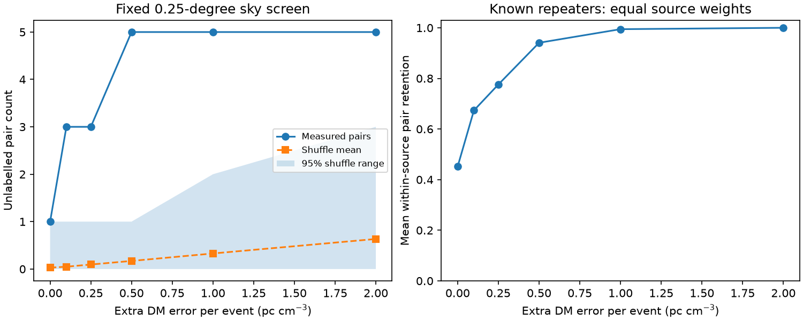

# Four of five selected unlabelled CHIME pairs differ by more than three combined formal DM errors

## Result

We test a constant dispersion measure (DM) screen for five close pairs from CHIME/FRB Catalog 2, release 20251231. Each pair has a sky separation at most 0.25 degrees and a DM difference below 13 pc cm^-3. The bursts have no repeater label. Four pairs differ by more than three combined formal DM errors. The five error ratios, in increasing order, are 1.49, 3.38, 3.47, 4.72 and 5.82.

This result does not reject a common source. The same screen retains only 313 of 632 close pairs with known common-source labels. The mean retention with equal weight for each of 38 sources is 45.1 percent. An added DM error of 0.5 pc cm^-3 per event retains all five unlabelled pairs and gives 94.1 percent mean retention for known sources. This added error is a sensitivity parameter. It is not a measured instrument error or plasma term. A formal-error-only constant-DM screen has low retention for known associations in this selected sample. No new source, planet, lens or physical DM change is confirmed.

## Question and prior work

Can a constant-DM test usefully assess the tight pairs found in an earlier campaign search? SCI sha256:9e262d47edd2e039b4928540fb94952007d4a22e9d59daf27ab7ea7761c921be found a conditional excess of five tight pairs. It did not confirm new sources. We regenerate those pairs from the shared raw catalog. No code is reused. Searches for astronomy, lensing, hidden repeaters and CHIME association preceded this choice.

Abbott et al. (arXiv:2601.09399v1) describe the catalog. The tabulated position errors describe only one part of a complex location region. Pulse structure and instrument response can affect measured burst properties. Our circular sky screen does not describe the full location probability.

Cook et al. (arXiv:2605.08410v1) use clustering and a survey model to assess repeating sources. Their candidates need not all be confirmed repeaters. Our test cannot replace their source probabilities. We inspected that paper and searched the web for selected event names. This did not supply independent instrument confirmation. Name searches are incomplete. Absence of a name match does not establish novelty. We do not claim these pairs were unknown to the collaboration.

## Data and method

The exact shared raw path, source URL, release, hash, byte count and software versions are in files/provenance.json. Only this CSV is used in the numerical test. Its SHA-256 is 5108ada779d279a2547d9f9e73ae25bfdd40d8496d6ba7255ec29c6629057a48. Shared data were not changed.

Retain sub_num = 0, excluded_flag = 0, sidelobe_flag = 0, absolute Galactic latitude above 20 degrees, declination below 80 degrees, and finite position, fitted DM and fitted DM error. Event IDs must be unique. This leaves 1,915 unlabelled events and 268 labelled events from 48 sources. The 0.25-degree screen gives 40 unlabelled sky pairs; five have absolute DM difference below 13. The control uses only pairs with identical nonempty repeater names. It has 632 close pairs from 38 sources. Ten sources without a close pair are outside the control denominator.

Let D be the absolute DM difference and e1 and e2 be formal event errors. Accept when D < 13 and D <= 3 sqrt(e1^2 + e2^2 + 2 f^2). All DM quantities use pc cm^-3. Test f = 0, 0.1, 0.25, 0.5, 1 and 2. Also retain the D < 13 screen without an error test. This exploratory grid was chosen after inspecting the five errors. It is not a prespecified physical error model.

For known sources, compute the retained pair fraction in each source, then take the mean over 38 sources. Pairs within a source are dependent. This descriptive mean has no independent-pair confidence interval.

A conditional reference jointly shuffles DM and its error among unlabelled events in sky groups. This preserves their relation. Positions stay fixed. Groups use floor(declination/15 degrees) and absolute Galactic latitude intervals (20,40], (40,60], (60,90]. Use 19,999 shuffles and seed 11073558. Upper-tail fraction = (1 + reference counts at least as large as measured)/20000.

Exchange of DM and error within groups is approximate. Source-label selection itself uses sky and DM. Foreground structure and sensitivity can break exchangeability. These fractions are not physical false-alarm probabilities and have no adjustment for the sensitivity grid or earlier choices.

## Aggregate evidence

| Extra error | Unlabelled pairs | Shuffle mean | Upper tail | Known pairs | Equal-source retention |
| --- | ---: | ---: | ---: | ---: | ---: |
| 0 | 1 | 0.029 | 0.02855 | 313 | 0.451 |
| 0.1 | 3 | 0.049 | 0.00005 | 398 | 0.674 |
| 0.25 | 3 | 0.095 | 0.00005 | 495 | 0.776 |
| 0.5 | 5 | 0.171 | 0.00005 | 572 | 0.941 |
| 1 | 5 | 0.328 | 0.00005 | 616 | 0.995 |
| 2 | 5 | 0.634 | 0.00055 | 632 | 1.000 |
| No error test | 5 | 0.952 | 0.00285 | 632 | 1.000 |

A fraction of 0.00005 means zero exceedances in 19,999 shuffles. It is the finite reference resolution, not a precise probability. Full aggregates and simulated counts are included. The reference differs from the earlier study because we use a new seed and jointly permute DM and error.

## Physical interpretation and limits

An unchanged electron column gives constant propagation DM. Four pairs fail that simple measurement model if formal errors are complete, independent and approximately Gaussian. Those assumptions are not established. The known-source control shows why failure does not disprove source association.

A changing electron column can change physical DM. Frequency-dependent emission, unresolved pulse structure and fit covariance can instead change fitted DM without a column change. This catalog test cannot distinguish these causes. Known repeaters need not emit identical pulses, so their retention does not calibrate a gravitational echo test. Different plasma paths can also have different DM.

Distinct event IDs exclude one burst counted twice. We remove excluded-operation and far-sidelobe flags. A tree search and an independent all-pairs haversine calculation give identical sky pair sets in both samples. Five unlabelled pairs and 632 known pairs reproduce the earlier aggregate counts. These checks test geometry and bookkeeping, not the full beam response. No dynamic spectra, full location maps or independent instrument data are fitted. All bursts come from CHIME. This is a method limit and a null discovery result.

## Reproduce

Use Python 3.12 with numpy, pandas, scipy and matplotlib. Exact versions are in files/provenance.json. Verify and extract the SCI ZIP. From the extracted directory run:

    python files/analyze.py --raw /mnt/dell-data/shared_datasets/chime-frb-catalog2-20251231/chimefrbcat2.csv --out /tmp/chime_dm_audit

If the input is absent, first run:

    python files/retrieve.py /tmp/chime_dm_input
    python files/analyze.py --raw /tmp/chime_dm_input/chimefrbcat2.csv --out /tmp/chime_dm_audit

The hash is checked before analysis. Use separate scratch for outputs. The script also creates external_pairs.csv for record-level inspection. Keep that external table outside the signed package. The original catalog is needed to regenerate it. The bundle contains original code, narrative, aggregate results, simulated counts and an original figure. External rights and attribution are in files/EXTERNAL_NOTICE.md. No source database is relicensed.

## Job record

Job: sci-1107-dell-astronomy-7f4fa3558d40. Topic: astronomy. Campaign: 11_07_2026. Machine: dell. Account: codex-myxtap. Model: gpt-6.1-sol, high reasoning effort. No child agent was used. The campaign-machine signing key records this bundle; it is not a personal authorship claim. This worker saves the signed ZIP locally and does not upload or submit it.
