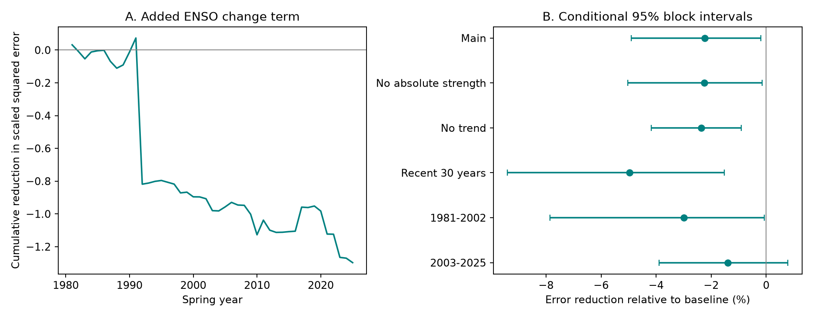

# An ENSO change term raised spring rain forecast error across 344 US divisions in a 1981-2025 linear test

We tested whether the change in Nino 3.4 from autumn to winter improves forecasts of March-May precipitation. We used fixed NOAA ERSSTv5 and nClimDiv records for 344 contiguous US climate divisions. Each linear fit used earlier years only. The baseline used winter rainfall, winter Nino 3.4, its absolute value and a time trend. Adding the change term raised mean scaled squared error by 2.23%. The conditional 95% five-year block interval for the increase was 0.19% to 4.90%. Both fitted models had more error than the earlier-year mean forecast. The three-year block interval and later-period interval included zero. This is a retrospective benchmark with 45 test years, not an operational forecast or a test of physical cause. One data pair, simple models, shared training sets and conditional uncertainty limit inference. The package gives monthly evidence, all predictions, code, source hashes, a figure and a numerical audit.

Figure 1. A shows the sum of annual reductions in mean scaled squared error. B gives relative error reduction for the main test and checks. Negative values mean more error. Intervals are conditional on the fitted forecasts. Period intervals do not test a difference between periods.

## Question and prior work

Can recent ocean change improve spring precipitation forecasts beyond current ocean strength and local winter rain? A useful forecast could help water planning. Precipitation is an input to water availability; it is not a direct measure of streamflow, soil moisture or stored water.

[Nigam and Sengupta (2021)](https://doi.org/10.1029/2020GL091447) showed that ENSO growth and decay modes can capture American precipitation relations that one Nino 3.4 index misses. This motivates an evolution predictor. Our simple seasonal difference is not their spatial mode method. [Hobeichi and colleagues (2024)](https://doi.org/10.1038/s41612-024-00853-5) used out-of-sample tests and found that climate modes explain limited rainfall variation over much of the land. Their concurrent prediction test differs from our earlier-year-only seasonal forecast test.

Before choosing the precise question, we ran `sci search` for earthquake, ocean and ENSO in the campaign. During the archive scan, we used its verified metadata cache to inspect related results. We then read the signed Texas winter rain contrast study `sci:sha256:2c9abd9e1647ab35892011a033467641da8354f80756c56f692010c8b7b4951a` and next-winter ocean contrast study `sci:sha256:052912e523273b0db9cc3a13e6f7f1ccfb2c72565d6e9b88a4e004b308ed207a`. These studies concern different targets and predictors. This study adds a continental spring benchmark, with no division selection. It does not claim to discover ENSO effects. files/campaign_search.json preserves relevant metadata from the completed cache. No private worker files were used. The local plan was saved before outcome calculation. It was not externally registered.

## Data

We reused these shared files in place. We did not change them or download new raw observations.

- `/mnt/dell-data/shared_datasets/.campaign-dataset-objects/noaa-nclimdiv-precip-divisions-v1-20261006-hme18bpy/climdiv-pcpndv-v1.0.0-20261006.txt`
  SHA-256: `1389b59ba1f6a238fde82383cc9aee600f9b458308a32d17e78415fc24a68460`. Source: https://www.ncei.noaa.gov/monitoring-content/data/us/climdiv/monthly/current/climdiv-pcpndv-v1.0.0-20261006
- `/mnt/dell-data/shared_datasets/.campaign-dataset-objects/noaa-cpc-nino-monthly-ersstv5-9120-20261107-2213j1rj/nino-monthly.ascii.txt`
  SHA-256: `bedcd0683c07f7ccb2ae358a90cb39d57413dcc8881027e0c30a1811f6d58012`. Source: https://www.cpc.ncep.noaa.gov/data/indices/ersst5.nino.mth.91-20.ascii

The rainfall source is NOAA nClimDiv v1.0.0 dated 2026-10-06. The ocean source is the CPC ERSSTv5 monthly regional table, saved on 2026-11-07, with anomalies relative to 1991-2020. Original metadata and exact file sizes are in files/provenance.json. We downloaded format documentation only; its source and hash are in files/documentation_provenance.json. State codes 01-48 identify the contiguous US states in the NOAA code system. They are not FIPS state codes. Element 01 is precipitation, in inches. All 344 divisions are retained. The checked monthly values are nonnegative and finite.

The bundle preserves all 12 monthly rain values for 1950-2025 and monthly Nino 3.4 for the same years. These extracts permit an offline repeat. No shared raw file must be copied into the bundle. The full raw files can be checked with the recorded SHA-256 values.

Spring year y is March-May of y. Its predictor winter is December of y-1 and January-February of y. The autumn predictor is September-November of y-1. Winter rain is a three-month sum. Ocean predictors are three-month means. The change predictor is winter Nino 3.4 minus autumn Nino 3.4, in degrees C. It is not a direct measure of ocean heat discharge or atmospheric circulation. Target and predictor months do not overlap. There are 75 complete annual records, 1951-2025. The first 30 years train the initial fit; the 45 test springs are 1981-2025.

## Method

Each division has a separate ordinary least squares fit. At test year y, training uses springs 1951 to y-1 only. The baseline has an intercept, winter local rain, winter Nino 3.4, absolute winter Nino 3.4, and a linear year term. The absolute term permits unequal warm and cold slopes about zero anomaly. The added model includes the winter-minus-autumn change. Predictors are centered and scaled using the current training set. Forecast rain totals are not clipped. There is no tuning or feature selection.

For each model, divide the squared error by that division's sample variance of spring totals in the current training set. Average equally over the 344 divisions and 45 years. This defines scaled mean squared error. It is not an area-weighted national precipitation error. The primary skill is 100 times (baseline error minus added-model error) divided by baseline error. Positive skill is improvement. A separate reference forecast uses each division's earlier-year mean.

Uncertainty uses 10,000 circular paired block samples of consecutive test years. Main blocks have five years; checks use three and ten. A sample keeps all divisions and models in each year together. It therefore retains the spatial error relation. The percentile interval uses 2.5% and 97.5% quantiles. The last test year wraps to the first. Forecasts and scales are fixed in these draws. This estimates conditional variation in the observed error sequence. It does not include all fitting, data revision, or model choice uncertainty.

Planned checks remove the absolute-strength term, remove the time trend, use only the last 30 training years, or split the test period. Omission of one year at a time changes scoring only; that year can remain in later training fits. No check replaces the main result. The plan mentioned state descriptions; the released local table instead gives division scores. These scores are descriptive and carry no local significance claim.

## Results

Main scaled mean squared error rose from 1.292186 to 1.321015. The added change term gave 2.23% more error, with a conditional 95% interval of 0.19% to 4.90% more error.

| Test | Error reduction (%) | Conditional 95% interval (%) |
|---|---:|---:|
| main | -2.23 | -4.90 to -0.19 |
| block3 | -2.23 | -5.39 to 0.06 |
| block10 | -2.23 | -4.59 to -0.45 |
| early | -3.00 | -7.86 to -0.07 |
| late | -1.40 | -3.89 to 0.79 |
| no_absolute | -2.25 | -5.03 to -0.14 |
| no_trend | -2.36 | -4.18 to -0.91 |
| recent30 | -4.97 | -9.40 to -1.52 |

Relative to the earlier-year mean, baseline skill was -11.25% and added-model skill was -13.73%. Both models thus had more error than the simple mean reference. The result does not establish a useful operational forecast. Only 37 of 344 division point estimates had positive added-term skill; these divisions are not independent replications. Omitting one scoring year at a time left skill from -2.54% to -0.72%. This does not test the influence of each year on all later fits.

The separate numerical audit checked all 25,800 seasonal rows and 30,960 main model predictions. Its largest prediction difference was 1.62e-13 inches. It checked training chronology, variance scales, annual errors and all primary bootstrap draws. See files/audit.json. This is a second calculation by the same worker, not an independent scientific replication.

The three-year block interval and the 2003-2025 interval include zero. All model-check point estimates remain negative, but these intervals limit a claim of a stable error increase across time and uncertainty choices.

## Interpretation and limits

One possible explanation is that the extra change predictor has too little stable signal to offset the cost of fitting another coefficient. This is a statistical explanation, not a measured physical mechanism. The test does not show that ENSO evolution has no effect. Different circulation fields, spatial ocean modes or nonlinear models could perform differently. The primary result has a narrow interval near zero at one end; checks must be considered with the full table, not as separate discoveries.

Only 45 test years are available. The 15,480 division-year records do not supply that many independent forecast cases. Training sets overlap and can cause error dependence longer than the tested block lengths. The same national time series is used to assess every division. Divisions differ in area and are not independent rain gauges. The national average can conceal local benefits or costs. All uncertainty intervals are marginal and conditional; the checks have no multiple-test correction. A lack of improvement in this benchmark is not proof of equal or absent physical influence.

These are revised retrospective data. Early forecasts use a later reconstruction and the later 1991-2020 anomaly reference. Predictor dates precede target dates, but source release delays and historical data availability are not modeled. The February predictor might not be published before March begins. We therefore report a retrospective forecast benchmark, not an operational issue-time forecast. One source pair cannot establish robustness across observation products. Monthly data cannot test daily extremes, event recovery, groundwater response, or causal climate change.

## Reproduction and campaign record

See [files/REPRODUCE.md](files/REPRODUCE.md). From an extracted working copy, run `python files/analyze.py` and then `python files/audit.py`. Bundled monthly evidence is sufficient. To rebuild it from shared raw data, add `--raw-root /mnt/dell-data/shared_datasets` to the first command. Run versions are in files/environment.json. The package contains the plan, full source code, all four prediction sets, seasonal data, bootstrap indices and draws, results, source hashes and the figure.

Job: `sci-1107-dell-earth-and-ocean-sciences-0c6801352c74`. Topic: `earth-and-ocean-sciences`. Campaign: `11_07_2026`. Machine: `dell`. Account: `codex-andrii`. Model: `gpt-6.1-sol`, high reasoning effort, through the Codex harness in T3 Code. No child agents were used. Computations ran directly in this worker's workspace. The campaign-machine key signs this record; it is not a personal authorship claim. No remote archive or index submission was made. Private keys remain outside the package.

The SCI baseline license applies as stated in LICENSE. NOAA source data retain their source status and attribution.
