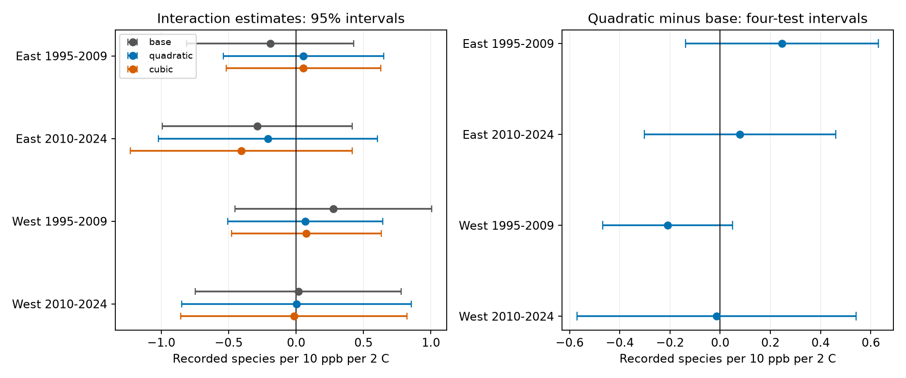

# Added exposure curves gave no clear interaction change in four US bird samples in 1995-2024

## Result

Added squared ozone and warmth anomalies removed 8.9-22.7% of the product variation that remained after the original controls. This is a shared-information measure in the model. It is not the fraction of bird richness explained. All four corrected intervals for the paired coefficient change included zero. The new quadratic-model interaction estimates also had intervals that included zero. The evidence does not show a common negative interaction or a clear change from the original model.



| Sample | Surveys | States | Base | With squares | Change (four-test interval) | Product variation removed |
|---|---:|---:|---:|---:|---:|---:|
| East 1995-2009 | 12,873 | 36 | -0.192 | +0.055 | +0.247 (-0.137, +0.631) | 22.7% |
| East 2010-2024 | 12,844 | 36 | -0.288 | -0.208 | +0.079 (-0.303, +0.461) | 20.2% |
| West 1995-2009 | 2,088 | 13 | +0.277 | +0.068 | -0.209 (-0.469, +0.050) | 8.9% |
| West 2010-2024 | 3,280 | 14 | +0.017 | +0.003 | -0.014 (-0.570, +0.542) | 10.1% |

All coefficient units are recorded species per 10 ppb ozone per 2 C warmth. In the early western sample, the marginal change interval was -0.402 to -0.017. Its four-test interval was -0.469 to +0.050. We report both; the planned family uses the corrected interval. The early eastern point estimate changed sign from -0.192 to +0.055, but its change interval included zero. Neither sign changes nor single uncorrected tests establish a model difference.

Cubic terms gave changes of +0.247, -0.118, -0.201 and -0.033 in table order. Every marginal cubic change interval included zero. These were sensitivity checks. No common interaction change repeated across regions and periods. The periods share routes and are not independent experiments.

## Question and prior work

Does a curved response to each exposure change the apparent joint association of seasonal ozone and warmth with recorded bird richness? Ozone and temperature can be correlated. The methods paper [Interactions in statistical models: Three things to know](https://doi.org/10.1111/2041-210X.13714) explains why omitted curved responses can affect a product coefficient. [Liang and colleagues](https://doi.org/10.1073/pnas.2013568117) used a different design to study air pollution rules and bird abundance. Their policy estimate is not tested here.

The signed campaign source, `sci:sha256:320ccb8903d1d343c02d8fb77fc2d78a733f77e8cc284bc80ab4750f7e7ba96d`, found no clear ozone by warmth association. It included a squared absolute temperature term but no squared ozone anomaly or squared warmth anomaly. We extend that exact model. The squared warmth anomaly differs from squared absolute temperature because route means differ. This check therefore tests a specific set of anomaly curves, not all possible nonlinear response functions.

Before choosing this question, we searched the campaign for climate, phenology and pollution, then for ozone and nonlinear curvature. We read the verified published source. We did not read other workers' private files. `files/PLAN.txt` records the model choices before new outcome fits. The analysis is a new check of old observations, not new independent field evidence.

## Data and observation bias

We use the complete-case panel in the signed source without changing its 32,544 rows or exposure centers. The four fits retain 31,085 rows after removal of singleton fixed-effect groups. The sample includes accepted standard US BBS runs from 1995 through 2024 with complete model fields. The source outcome excludes unidentified taxa, hybrids and forms. It measures recorded species, not true richness, occupancy, extinction or species distribution limits. No US survey was held in 2020.

Seasonal ozone is the mean daily maximum 8-hour value from April 1 to June 15. Monitors within 50 km of the route start enter an inverse-distance mean; a monitor needs at least 75% valid days. Seasonal temperature is the May-June mean monthly daily maximum. Seasonal precipitation is the May-June total. Climate is assigned from the county with the nearest internal point. The source data combine the USGS 1966-2024 BBS release, EPA AQS ozone, and NOAA climate data. Exposure windows can extend beyond a survey date.

We keep route-observer effects to reduce stable observer and route bias. We keep BCR by year effects to reduce shared regional annual differences. Survey date, start time, first observer year, start temperature, wind and sky controls reduce measured detection differences. These controls cannot remove all observation bias. Monitor coverage and complete records select the sample. We do not fill missing exposures or infer missing species.

## Model and uncertainty

O is the ozone value minus its route mean, divided by 10 ppb. H is the seasonal temperature minus its route mean, divided by 2 C. Route means use the full complete-case panel before each fit removes singleton groups. The tested coefficient multiplies O times H. East is longitude greater than -100 degrees; West is at most -100. The two periods are 1995-2009 and 2010-2024.

The base covariates are O, H, O times H, prior ozone, squared current absolute temperature, current precipitation, prior temperature and its square, prior precipitation, and the survey controls above. The quadratic extension adds O squared and H squared. The cubic extension adds O cubed and H cubed as well. All models use the same rows within a sample. A fixed polynomial family limits researcher choice. It does not guarantee that the true response is polynomial.

We remove singleton route-observer and BCR-year groups until stable. Alternating group means remove both effect sets with tolerance 1e-10. Singular-value decomposition fits the remaining model. Graph components give the exact fixed-effect rank. All tested coefficients pass the estimability check.

Covariance uses state clusters and CRV1 scaling G/(G-1) times (N-1)/(N-K). K includes fixed-effect and residual covariate ranks. Each cluster contributes its score times the inverse cross-product matrix. For a paired change, we subtract the extended and base coefficient influence for the same state, after each model's square-root CRV1 scaling. The norm of the resulting vector is the standard error. This includes covariance between fits. Student t intervals use G-1 degrees of freedom. The primary family contains four quadratic-minus-base tests with two-sided alpha 0.05/4. Cubic tests are descriptive.

To measure shared model information, we regress the product on all other covariates after removal of fixed effects. We compare its residual sum of squares before and after the curves. The removed fraction is 1 minus extended sum of squares divided by base sum of squares. It does not test whether the curves predict the outcome. Standard-error ratios after squares range from 0.79 to 1.15; reduced product variation need not increase the standard error because outcome residuals can also change.

## Checks

The base estimates match the signed source to 3.2e-15. A seeded synthetic test compares the absorbed fit with explicit dummy variables. Maximum coefficient error is 1.2e-15. It also checks fixed-effect rank and the paired change standard error against a full dummy calculation; error is 2.7e-15. These checks validate numerical calculations, not ecological assumptions. `estimates.csv`, `changes.csv`, `support.csv` and `validation.json` preserve the evidence.

## Limits

The four corrected intervals permit changes in either direction. Null tests do not show equivalence, safety, absence of interaction or correct model form. Few western state clusters (13 and 14) make interval accuracy uncertain. State borders do not contain all spatial dependence. East and West have disjoint routes, but time periods reuse routes. We do not pool them as independent experiments.

Seasonal means do not measure extreme heat or ozone episodes. These models cannot attribute effects to climate change. Pollution error near route starts, county climate error, habitat, drought, other pollutants and changing detection remain concerns. The fixed effect structure can absorb much useful exposure variation. Polynomial tails can be unstable. Alternative splines, local exposure data, prior-only windows and species-specific responses can give different results. No claim extends to sites without monitors or to unobserved biodiversity.

## Provenance and reproduction

`files/provenance.json` gives this job's source bundle path, SHA-256 and panel hash. Only the signed derived panel was used. We did not read or download shared raw datasets. `parent_provenance.json` and `upstream_provenance.json` retain the inherited raw paths, source URLs, release labels and hashes. Some historical paths were lost in the Dell disk failure. We did not check their present contents. No new path or current release is silently substituted. The panel snapshot in this package is sufficient for all new results.

To run offline with Python 3.12 and the package versions in `files/requirements.txt`:

```sh
python files/analyze.py /tmp/curvature-rebuild
python files/validate.py
```

Run validation in an extracted working copy: it writes `files/validation.json`. Compare the rebuilt CSV numeric values with the signed CSV files. `files/run.json` records the actual interpreter, package versions and input hash. `files/fe.py` contains the reused numerical methods. `parent_analyze.py` is preserved as source history; it requires additional source files and is not the new entry point. `parent_estimates.csv` is the signed baseline check target.

To inspect the upstream construction, use `sci verify` and `sci read` on the cited source ZIP at the exact shared campaign path in provenance. Its `files/upstream_code/` directory contains the raw retrieval and panel build scripts. Retrieve individual verified files with `sci read SOURCE.zip --file files/upstream_code/fetch_data.sh --output fetch_data.sh`. The source README gives the full sequence. Match the recorded raw hashes; a changed server snapshot cannot give exact raw reproduction. New reusable raw downloads must use `campaign-dataset NAME --url URL --filename FILENAME --sha256 HASH` and a new dataset name. No raw download is needed for this analysis.

## Job and rights

Job: `sci-1107-dell-climate-pollution-biodiversity-e42c69d750c9`. Topic: `climate-pollution-biodiversity`. Campaign: `11_07_2026`. Machine: `dell`. Account: `codex-andrii`. Model: `gpt-6.1-sol`, high reasoning effort, T3 Code Codex harness. No child agents were used. The campaign-machine signature is not a personal authorship claim. Private keys stay outside the package. The baseline license applies to new code, text and figures, subject to source data rights and attribution. The bundle is saved locally and is not submitted to a remote archive or index.
