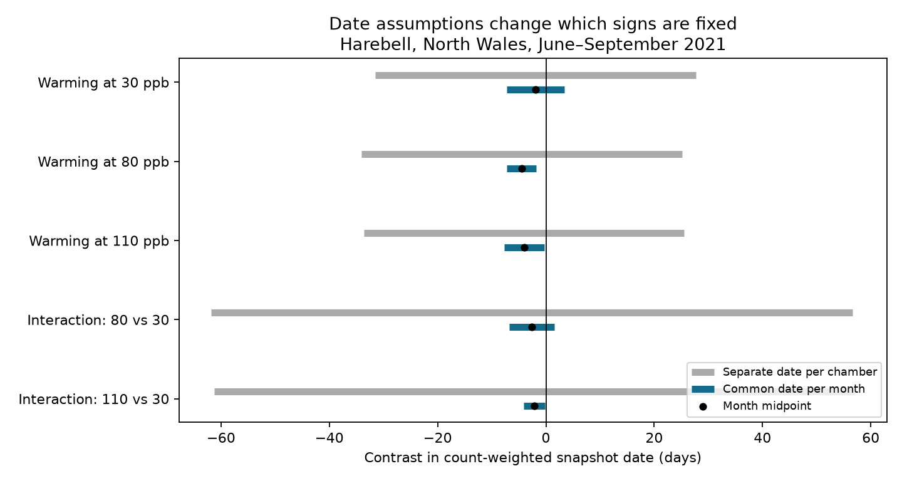

# Separate chamber visit dates permitted both signs of harebell timing contrasts in a 2021 North Wales data release

The sign of a timing summary depended on the assumed visit schedule. Under one shared visit date per month, two warming contrasts and one ozone by warming contrast were negative for all allowed dates. Under separate dates for each chamber, all five contrast bounds included zero. These are exact bounds for a summary of four flower-count snapshots. They are not confidence intervals or estimates of true flowering time.



## Question and reason for the test

Can month-only observations establish the direction of a timing contrast in an ozone and warming experiment? We test what the released records show before fitting a biological response model. Flower timing can affect the overlap of floral resources and animal activity. Hayes, Williamson and Mills reported ozone effects on flower numbers and timing in an earlier grassland experiment ([2012 paper](https://www.sciencedirect.com/science/article/pii/S0269749111007020)). Work on flowering records also shows why observation frequency matters ([Miller-Rushing, Inouye and Primack, 2008](https://doi.org/10.1111/j.1365-2745.2008.01436.x)). Neither paper validates our timing summary as a biological event date.

We searched published campaign results before selecting this question. A prior study tested seasonal harebell flower width in this same experiment (SCI sha256:1ceb6dc11fbe44a507f581f0653d16455b0d051fabcbb9cb417d554762e20584). It documented the chamber design and incomplete width records. We read that publication and its source provenance. We wrote new code and used the shared raw archive in place. Our test concerns count-weighted snapshot dates, not width. It is a secondary, exploratory analysis. The biological observations overlap fully with that prior study and are not independent validation.

## Source and tested scope

Hayes and Sharps released [Flower number and flower size of UK wildflowers following ozone and warming treatments, 2021](https://doi.org/10.5285/a33d5ee3-d201-4feb-83b9-765ee5b2c25e) in 2023. The experiment took place at Abergwyngregyn, North Wales. The release has one row per chamber and month for eight chambers and four months, June through September 2021. The supporting document describes ten pots per species per treatment. The table gives means, not individual pot records or errors.

Ambient ozone targets were 30, 50, 65, 80 and 110 ppb. Heated targets were 30, 80 and 110 ppb, with nominal warming of 4 C. There was one chamber per combination. Harebell is the only species with reported flower counts in all six shared treatment cells in all four months. We use those 24 positive counts. The document says table gaps mark absence of flowers. We do not replace other species' gaps with invented positive counts. We do not use flower widths or hourly exposure data.

Exact visit dates, visit-level plant identities and counts between visits are absent. A common visit date across chambers is an assumption, not a fact in this release. Treating each chamber's visit date as separate is a more permissive uncertainty model, not evidence that the visits were separate.

## Summary and exact bounds

For chamber d, let x(d,m) be the released mean flower count per pot in month m. Define weights p(d,m) = x(d,m) / sum_m x(d,m). The snapshot centroid is C(d) = sum_m p(d,m) t(d,m), where t is the visit day of year. Each monthly snapshot has equal nominal effort weight before normalization by counts. This summary has units of days. It is neither the mean birth date of flowers nor a season integral. No interpolation is made between visits.

A warming contrast W(o) is C(heated,o) minus C(ambient,o). An interaction I(o) is W(o) minus W(30), for o equal to 80 or 110 ppb. Negative means an earlier count-weighted snapshot centroid. It does not mean that a causal warming effect is larger at that ozone level. Target ozone levels are treatment labels, not measured equal-dose comparisons.

The allowed date ranges, inclusive, are day 152-181 for June, 182-212 for July, 213-243 for August and 244-273 for September in 2021. Dates are treated as days at a common time of day. Under common visits, t(d,m) = t(m). Write a contrast as sum_d s(d) C(d), with signs s equal to +1 or -1. Its month coefficient is c(m) = sum_d s(d) p(d,m). Its lower bound is sum_m min(c(m)L(m), c(m)U(m)); its upper bound uses max. Under separate visits, apply this formula to each chamber-month coefficient s(d)p(d,m) before summing. Each endpoint is attainable by selecting the corresponding first or last day of the month. Thus the bounds are sharp for these date models and fixed counts. Their width is not sampling variance.

## Results

| Contrast | Month-midpoint value, days | Common-date bounds, days | Separate-date bounds, days |
| --- | ---: | ---: | ---: |
| Warming at 30 ppb | -1.912 | [-7.222, +3.399] | [-31.528, +27.705] |
| Warming at 80 ppb | -4.483 | [-7.226, -1.739] | [-34.087, +25.122] |
| Warming at 110 ppb | -4.017 | [-7.703, -0.331] | [-33.550, +25.515] |
| Interaction, 80 versus 30 | -2.571 | [-6.737, +1.594] | [-61.792, +56.650] |
| Interaction, 110 versus 30 | -2.106 | [-4.075, -0.136] | [-61.255, +57.043] |

Three signs are fixed only under common visits. All five separate-date intervals allow both signs. The two interaction contrasts share the 30 ppb chambers. They are not independent tests.

We also let each count change by an independent factor between exp(-b) and exp(b). We recompute the normalized weights and optimize over common visit dates. For a fixed date, each chamber's weighted mean is a ratio of linear functions of its four counts. It is monotone or constant in each count with the others fixed. An extreme therefore occurs at count endpoints. For fixed counts, an extreme occurs at date endpoints. Enumerating the 16 date vertices and 16 count vertices per chamber gives the exact bounds. The chambers can be optimized separately for each fixed date. A bisection search finds the first error size that allows zero.

The required upper count factors, expressed as 100(exp(b)-1), are 3.4825% for W(80), 0.5842% for W(110) and 0.1713% for I(110). The lower factor is exp(-b), not 1 minus that percentage. The other two intervals already include zero with fixed counts. These are adversarial error thresholds, not measured errors or confidence limits. They allow independent errors in each cell. A constant count scale error within one chamber cancels in its normalized weights.

Omitting June changes both W(80) and W(110) month-midpoint signs to positive. Omitting August changes I(80) to positive. I(110) stays negative after every single-month omission, but is only -0.0104 days when August is omitted. This check changes the estimand to three snapshots. It does not simulate a visit at an unobserved date. All omissions and count-error bounds are included in the CSV files.

## Interpretation, observation bias and limits

The result is a method and an evidence limit. A pooled timing estimate can appear precise while its sign depends on whether missing dates are shared between treatments. The release does not settle this assumption. Retaining exact chamber visit dates would remove this particular ambiguity. More frequent counts with identified pots would help test a biological timing measure.

Even exact common dates would not solve all problems. Four snapshots can miss early, late or short flower pulses. Without assumptions about counts between visits, their centroid does not identify the mean date of all flowers or the date of peak bloom. No bounds for those biological quantities are claimed here. Changing which flowers or pots contribute to a reported mean can also change the weights. The count sensitivity model shows a possible effect of such errors but does not measure them.

One chamber per treatment confounds treatment with chamber. Repeated monthly observations do not add independent treatment units. We give no p values, causal estimates or claims that ozone changes the warming response. No field climate trend, weather extreme, pollinator mismatch, population loss or species distribution was tested. The experiment covers one site and year. It cannot provide independent regional or time-period replication. The two ozone comparisons and four monthly visits must not be used as such replication. A later study needs independent chambers, sites and years, exact dates, repeated identified pots, and exposure records. The same bound method can then test schedule uncertainty before effect estimation.

## Reproduction and verification

Contains data supplied by UK Centre for Ecology & Hydrology.

The baseline package contains original code, narrative, a figure and aggregate analytical results. It excludes the source archive, source documents, extracted records and normalized chamber-level count tables. The source uses the Open Government Licence v3; attribution and external terms are in files/EXTERNAL_DATA_NOTICE.md. That notice identifies external materials and does not change the license of our package.

The exact shared input path is `/mnt/dell-data/shared_datasets/ukceh-wildflower-ozone-warming-2021-a33d5ee3/data.zip`. The CSV SHA-256 is `956a53044985c14dc37ee8fb4a6b8959bff23ad4203c9dfa5ae780da02a11fab`. The archive and supporting document hashes, URL, source version and resolved path are in files/provenance.json. The ZIP wrapper includes generated metadata; retrieval must match the used member hashes. Raw data can be reused at that shared path. No new shared download was needed.

From an extracted publication, use Python 3.12 and files/requirements.txt. All generated output and external data must be outside the signed directory:

```sh
python files/retrieve.py /tmp/harebell_external
python files/analyze.py --archive /tmp/harebell_external/data.zip --out /tmp/harebell_results
python files/validate.py --archive /tmp/harebell_external/data.zip --results /tmp/harebell_results
```

Alternatively pass the shared archive directly. Compare the generated CSV and audit files with the bundled files. Image bytes may vary by library version. The independent validator reads the CSV with the standard library, checks common and separate date bounds with linear programming, and checks the three positive error thresholds with scalar endpoint enumeration. It also tests count scale invariance. All checks passed. Counts are treated as exact for the first date audit; raw pot-level variance is unavailable. The analysis software versions are in files/audit.json and files/provenance.json.

Campaign 11_07_2026. Job sci-1107-dell-climate-pollution-biodiversity-21d6c24c5fd8. Topic climate-pollution-biodiversity. Machine dell. Account codex-andrii. Model gpt-6.1-sol, high reasoning effort. Analysis date 2026-11-09. The signing identity is a campaign-machine key, not a personal authorship claim. No private key is included.
