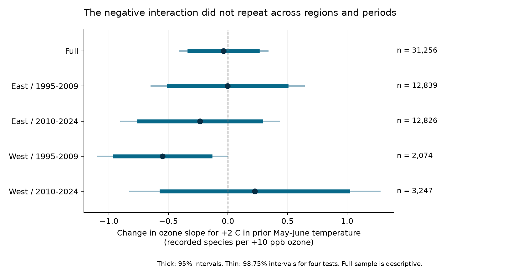
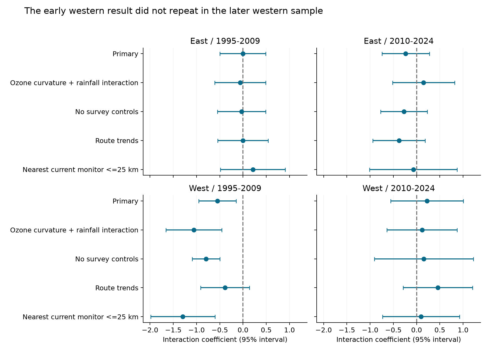
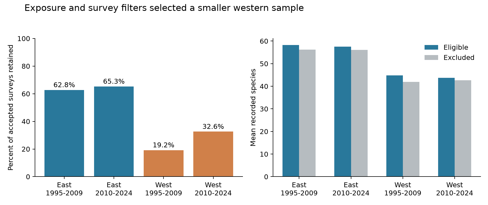

# A negative ozone and temperature interaction did not repeat in US bird surveys in 1995-2024

We tested whether a warmer previous May-June period made the association of previous May-September ozone with next-year recorded bird richness more negative. We used a published US Breeding Bird Survey panel and added survey temperature and duration controls. The full model had 31,256 surveys on 2,020 routes. We tested four separate region and period samples. The early western interaction was -0.55 recorded species per 10 ppb ozone and 2 C warming. Its four-test interval was -1.09 to -0.01. The later western estimate was +0.23, with an interval of -0.82 to +1.27. Both eastern intervals included zero. Route trends reduced the early western estimate to -0.39, with a 95% interval of -0.91 to +0.14. Thus, a common negative interaction did not repeat. This does not show that ozone and warming are safe for birds. Exposure and survey filters retained 19-33% of accepted western surveys and 63-65% of eastern surveys. Coarse seasonal weather, monitor changes, habitat change, and detection bias limit inference. The study tests seasonal mean temperature, not extreme heat or climate-change effects. The package has all model inputs, code, figures, source hashes, and offline checks.



## Question and prior work

Does prior seasonal warmth make an ozone association with next-year bird richness more negative? A main ozone slope can hide an association that occurs only in warmer years. We test this possible explanation for the weak average ozone results in the campaign. We test recorded richness. We do not estimate bird population size, survival, or occupancy.

Liang and colleagues (2020) reported negative ozone associations with US eBird counts and benefits from air quality rules ([paper](https://pmc.ncbi.nlm.nih.gov/articles/PMC7733844/)). Reif and colleagues (2023) reported a weak overall association with later mountain bird population growth and a stronger result for alpine species ([paper](https://doi.org/10.1016/j.scitotenv.2023.162711)). Sanderfoot and Gardner (2021) showed that smoke can change the probability of bird observations ([paper](https://doi.org/10.1093/ornithapp/duab028)). Smoke and ozone are different exposures. This work shows why observation conditions need attention.

The signed campaign source `sha256:2603c41c0fe979d3cf70d08c3bdfb1b052386c2cee04f2e9e054d5c5fa10d6a2` tested average ozone slopes in BBS counts. Its weak later richness result motivated the present test. The four-state publication `sha256:eee5c6480fa55ee48ff901c2b6e9c4bf5507d74a880cbe97812ce9967b5e8522` tested a shorter ozone window and documented sample selection. We read those results and searched the campaign for climate, pollution, biodiversity, phenology, ozone, temperature, and interaction before fitting this study. We also searched external prior work. This is a new test on reused data. It is not a new data replication of the source publication.

A final campaign search also found `sha256:fb8dc263088d828ad4663b9a9277ffaf616acb3e560c70a4de805a1300364e79`. That study tested survey-start temperature and prior-date ozone in 2005-2024. It found no clear interaction. The present question uses previous-year seasonal weather and ozone and includes 1995-2004. The studies share biological source data. We read that publication before signing; it did not change the models.

We saved `files/ANALYSIS_PLAN.md` before the first new outcome fit. We chose the question after reading prior results. The study is exploratory and was not preregistered. All planned models are reported. No child agents were used.

## Data and sample

The direct published input is `files/data/panel.csv.gz` from the source publication. We verified its complete signed bundle before extraction. The exact file is preserved as `files/source_panel.csv.gz` (SHA-256 `d9d5e301b3de2faa4083180ed134794ae183671e6e3ce8b1513c4c94b4600b2a`; use `files/provenance.json` as the exact hash record). The inherited panel has BBS counts and survey records, EPA ozone window means, and NOAA county weather. The upstream count code removes unidentified taxa, hybrids, and named forms from richness. It sums reported counts for the abundance outcome. We did not repeat a species-level audit.

We add start and end temperature, end weather, and end time from `/mnt/dell-data/shared_datasets/usgs-bbs-2025-weather/Weather.csv`. This is the USGS BBS 1966-2024 data release of 2025, doi:10.5066/P14SNUV4. Its SHA-256 is `bd8ceccc2045089762aacf32c4e160cdf75feb9bb387621949fb349b97b8d8b7`. Its exact source URL, size, shared path, and download record are in `files/provenance.json`. No new data were downloaded. `files/weather_evidence.csv.gz` preserves the source weather fields for all rows that link to the inherited panel.

The inherited EPA measure is the mean daily maximum 8-hour ozone value, in parts per billion (ppb). It uses the 2015 ozone standard. The source uses a coverage rule of site-day rows on at least 75% of calendar days. It counts rows for this rule and averages the nonmissing concentrations; we did not recheck raw missing values. Route exposure is an inverse-distance-weighted mean of monitors within 50 km of the route start. Previous exposure covers May 1 to September 30 in year t-1. Current exposure covers April 1 to June 15 in year t. The source prefers event type None to Included and removes Excluded summaries. It averages instruments within a site. Its code does not add a daily observation-percent filter. The preserved panel rounds numeric fields to five significant digits. We use that exact version.

The inherited NOAA temperature is the mean of May and June monthly mean daily maximum temperatures. Precipitation is the sum of May and June totals. Both are attached from the county with the nearest 2020 Census internal point to the route start. This is an approximate county assignment. We convert temperature from F to C. Temperature covers only two of the five ozone months. The test therefore concerns a partial seasonal overlap. It cannot measure a daily heat wave.

The source uses BBS standard protocol 101 in the lower 48 states. We keep accepted runs in 1995-2024 with complete exposures and county weather. There were no 2020 surveys in this panel. We require start temperature from -10 to 40 C, end temperature from -10 to 45 C, valid temperature units, day of year 121-212, start time 02:00-08:00, duration 180-480 minutes, wind codes 0-5, and valid sky codes at both ends. We keep missing assistant status as a separate class. See `build.py` for the exact rules. We then remove singleton route-observer and region-year effects until no singletons remain.

The eligible panel has 32,458 records before singleton removal. The full model uses 31,256 surveys on 2,020 routes. Each region-period fit removes its own singletons. Thus, the four cell counts do not sum to the full model count. East means longitude greater than -100 degrees. West means longitude at or below -100 degrees. The periods are 1995-2009 and 2010-2024. The four cells have no shared route-year records. They share source methods and broad environmental influences. The same routes can occur in both periods. This is not a test across four independent data systems.

## Model and uncertainty

For each route, we subtract its eligible full-period mean from previous ozone and previous temperature. We divide ozone change by 10 ppb and temperature change by 2 C. Call these variables O and H. We fit the product O times H with both main terms. The product coefficient is the change in the ozone slope for 2 C more prior May-June temperature. A negative value is consistent with a more negative ozone slope in warmer years. It is not the total effect of changing both exposures. A zero product coefficient can occur with a nonzero main ozone slope.

The primary model has a separate intercept for each route-observer combination and each Bird Conservation Region by survey year. These terms control fixed route and observer differences and common regional annual changes. Controls are current ozone; prior temperature squared; current temperature and its square; current and prior precipitation; survey day and its square; start time; duration; start and end temperature; wind and sky classes at both ends; assistant class; and the observer's first BBS year indicator. Current temperature and both precipitation terms also use route means. Route means stay fixed across the split models. They use no outcome information.

We fit ordinary least squares after repeated projections on the two sets of intercepts. We stop when the maximum scaled update is below 1e-11. We calculate state-cluster CRV1 standard errors. The finite-sample factor is G/(G-1) times (N-1)/(N-K), where K includes the regressor rank and exact intercept rank. The intercept rank comes from the number of connected components in the two-group graph. Intervals use a Student t reference with G-1 degrees of freedom. Western samples have only 13 or 14 state clusters, so these intervals need caution. State clustering permits dependence within a state, but not all dependence between states.

We report 95% intervals and 98.75% intervals for the four primary interaction tests. A common negative pattern required negative estimates and corrected intervals below zero in all four cells. The full-sample estimate is descriptive. Sensitivity checks are exploratory. Their intervals do not correct for all searches in this study or the campaign. In the route-trend check, the degrees-of-freedom count adds one slope for every route. This is an upper bound because some slopes are redundant with regional year terms. It makes those errors slightly conservative. This implementation detail was not specified in the saved plan.

## Results

The units below are recorded species per 10 ppb ozone and 2 C prior seasonal warming.

| Sample | Surveys | Routes | States | Interaction | 95% interval | Four-test interval |
|---|---:|---:|---:|---:|---|---|
| Full | 31,256 | 2,020 | 48 | -0.038 | -0.325 to +0.248 | -0.408 to +0.332 |
| East / 1995-2009 | 12,839 | 1,348 | 36 | -0.003 | -0.497 to +0.491 | -0.644 to +0.638 |
| East / 2010-2024 | 12,826 | 1,339 | 36 | -0.234 | -0.746 to +0.278 | -0.899 to +0.431 |
| West / 1995-2009 | 2,074 | 291 | 13 | -0.551 | -0.952 to -0.149 | -1.091 to -0.010 |
| West / 2010-2024 | 3,247 | 414 | 14 | +0.225 | -0.557 to +1.007 | -0.824 to +1.274 |


The early western corrected interval excludes zero by only 0.010 species at its upper end. This result passes the specified four-test rule for that one cell. The later western estimate is positive and uncertain. Both eastern estimates are uncertain. The criterion for a common negative pattern failed. We did not run a formal test that the four coefficients differ. Failure to repeat is not proof of a regional or period difference.

The full estimate was -0.038 (95% interval -0.325 to +0.248). At a temperature anomaly of zero, the fitted full-sample main ozone slope was -0.362 species per 10 ppb. The interaction result therefore does not establish a zero ozone association. The outcome and exposure scale also limit transfer to prior eBird studies.

## Planned checks



| Check | East 1995-2009 | East 2010-2024 | West 1995-2009 | West 2010-2024 |
|---|---:|---:|---:|---:|
| primary | -0.003 | -0.234 | -0.551 | +0.225 |
| nonlinear_drought | -0.058 | +0.150 | -1.056 | +0.116 |
| no_survey | -0.031 | -0.271 | -0.797 | +0.156 |
| route_trends | -0.000 | -0.378 | -0.387 | +0.458 |
| near_monitor | +0.213 | -0.070 | -1.294 | +0.096 |
| secondary_abundance | -0.004 | -0.007 | -0.022 | +0.036 |


`nonlinear_drought` adds previous ozone squared and ozone times previous precipitation. Rainfall is a limited proxy for water conditions; it is not a drought index. `no_survey` uses the same filtered sample but removes survey controls. `route_trends` adds a linear year slope for every route. `near_monitor` requires the nearest current-window monitor to be within 25 km. The last rule does not check the distance of the previous-window monitors. `secondary_abundance` uses log(1 + total birds); its coefficient has different units from richness.

The early western richness estimate stayed negative in all checks. It was -0.387 with route trends (95% interval -0.912 to +0.139). All later western richness estimates stayed positive and uncertain. The secondary abundance interaction intervals included zero in all four cells. The early western result is a candidate for a larger study with stable exposure fields. It is not evidence for general combined damage from heat and ozone.

## Selection and exposure support



| Region | Period | Accepted | Eligible | Percent | Richness: eligible | Richness: excluded |
|---|---|---:|---:|---:|---:|---:|
| East | 1995-2009 | 21,320 | 13,380 | 62.8 | 58.23 | 56.22 |
| East | 2010-2024 | 20,464 | 13,359 | 65.3 | 57.58 | 56.13 |
| West | 1995-2009 | 11,578 | 2,226 | 19.2 | 44.81 | 41.93 |
| West | 2010-2024 | 10,713 | 3,493 | 32.6 | 43.73 | 42.62 |


The eligible western share was much smaller than the eastern share. Eligible records also had higher mean richness than excluded records in each cell. These gaps can reflect geography, habitat, monitor placement, missing fields, or survey practice. They do not identify a selection mechanism. We do not use these differences to correct the estimates. The target population is the selected sample.

The central 90% of prior-temperature anomalies was about -3.24 to +2.13 C in the early West and -2.57 to +2.22 C in the later West. The corresponding ozone ranges were -4.50 to +6.77 ppb and -5.52 to +4.06 ppb. The main 10 ppb scale exceeds most single annual anomalies. It is a reporting unit, not a claim that a 10 ppb shift is typical. About 36% and 28% of western records had both anomalies above zero. These shares were 33% and 16% in the eastern periods. The temperature-ozone correlations ranged from 0.08 to 0.38. Support changed with period, which limits direct comparison of the coefficients.

After removing fixed effects and all controls, the standard deviation of the product was 0.13-0.23 across the cells. It remained identified in each model. `results.csv` has the support ranges, correlations, cluster counts, conditional slopes, and all uncertainty intervals.

## Limits and use

This design cannot separate detection, bird activity, movement, species turnover, and population change. One annual roadside count is not an occupancy model. Survey controls and route-observer effects reduce some bias. They cannot remove changes in observer skill, road noise, survey selection, or all ecological timing changes. Richness can stay constant while abundance or species composition changes.

The inherited ozone averages can change when the monitor network changes. They are not route-level exposure measurements. The 50 km radius, route-start position, instrument averaging, coarse county climate, and rounded derived values add measurement error. The prior weather and ozone windows differ. Unmeasured habitat change, land use, daily extremes, migration conditions, and other pollutants can confound an interaction. Slow trends can also alter the product of centered exposures. The route-trend check addresses only linear route trends.

The results neither establish a causal joint effect nor show that warming and ozone are harmless. They do not test extreme heat, climate-change attribution, air quality policy, or species distribution shifts. The useful result is a limit on a simple, transferable interaction explanation in this public sample. The package also gives a reproducible way to check that explanation while preserving survey controls and sample-selection evidence.

## Reproduction and checks

The main analysis is fully offline after package extraction. It needs Python and the versions in `files/requirements.txt`; `files/environment.json` records the actual versions. No source keys or credentials are included. On this campaign host:

```sh
python3 -m venv /tmp/interaction-env
/tmp/interaction-env/bin/pip install -r files/requirements.txt
PYTHON_BIN=/tmp/interaction-env/bin/python bash files/REPRODUCE.sh /tmp/interaction-reproduced
```

The script keeps library threads at one and uses `campaign-compute` for each substantial step. Outside the campaign, replace that limiter only with the local permitted resource runner. The output path must differ from the verified package. The script rebuilds the panel from preserved source evidence, fits all models, validates the primary models, draws figures, and compares numeric outputs with the publication.

`validate.py` uses a separate sparse LSMR projection for all five primary designs. It checks coefficients and state-cluster errors with Statsmodels. Maximum errors were below 3e-15 for coefficients and 5e-14 for standard errors. It also recovers a known synthetic interaction of -0.75 and checks rank, coefficients, and cluster covariance against a full-rank dummy design. The first synthetic check used a redundant dummy column and failed in the reference fit. We removed the redundant reference column. No real-data model changed. All final checks passed. `validation.json` gives the evidence.

A second run uses only preserved weather rows and the source panel. Its numeric outputs are checked against the first run in `reproduction_check.json`. `build_audit.json` records the original direct input hashes. Rebuilt input file hashes differ when a compact evidence subset replaces the full raw file; the analysis records must still agree.

To rebuild added survey conditions from the shared raw source, run:

```sh
OPENBLAS_NUM_THREADS=1 OMP_NUM_THREADS=1 MKL_NUM_THREADS=1 campaign-compute -- /tmp/interaction-env/bin/python files/build.py /mnt/dell-data/shared_datasets/usgs-bbs-2025-weather/Weather.csv /tmp/interaction-raw-rebuild
```

`python3 files/retrieve.py` prints the exact retrieval command and expected weather hash. The source publication, its verified panel, and the raw-source attribution are separate levels of provenance. `files/upstream/` preserves the original count, exposure, and weather join code, source README, and all 38 raw-object URLs and hashes. Those upstream raw objects were not read or rehashed in this job. For a complete upstream rebuild, follow the verified source publication and compare all hashes. A changed mutable EPA or NOAA file must not silently replace the documented snapshot.

## Job and rights

Campaign: `11_07_2026`. Job: `sci-1107-hp-climate-pollution-biodiversity-b51bdcdd5df3`. Topic: `climate-pollution-biodiversity`. Machine: `hp`. Account: `codex-andrii`. Model: `gpt-6.1-sol`, high reasoning effort, through the Codex harness in T3 Code. This investigation used no child agents. The campaign-machine key signs the package. It is not a personal authorship claim.

The SCI baseline license applies to the new text, figures, derived evidence, and code. Reused campaign material has the same baseline license. Public USGS, NOAA, EPA, and Census data retain source attribution. Private keys stay outside the package. The publication is stored in the local campaign archive. It is not uploaded or submitted to a remote archive or index.
