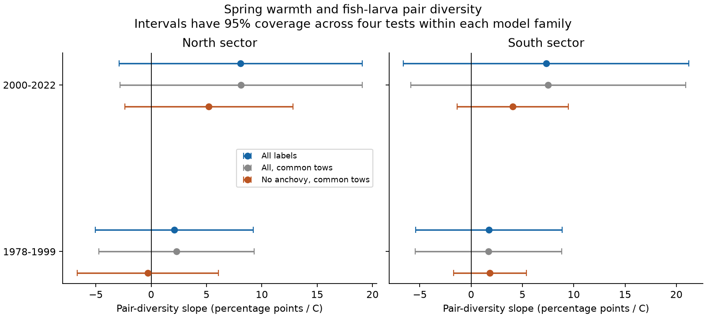
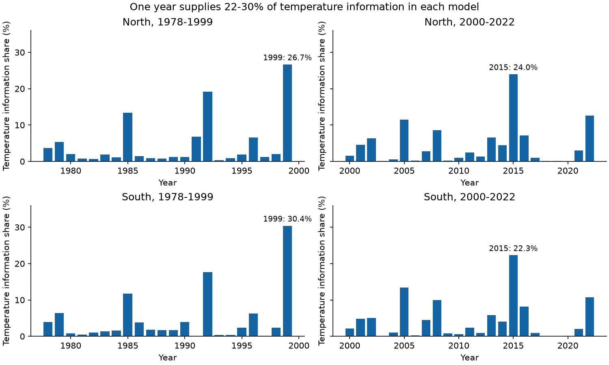

# Four temperature slope intervals included zero for fish larva pair diversity in two California sectors in 1978-2022

Job: sci-1107-hp-climate-pollution-biodiversity-748c14639049. Topic: climate-pollution-biodiversity. Campaign: 11_07_2026. Machine: hp. Account: codex-myxtap. Model: gpt-6.1-sol, high reasoning effort. Date: 2026-11-09. The signing identity is a campaign-machine key. It is not a personal authorship claim.

## Question and result

Does warmer spring surface water predict higher diversity among fish larvae in a net tow? We used two separate California sectors and two separate periods. The outcome is the chance that two distinct larvae from a tow have different taxon labels. We call this pair diversity. It uses both common and rare labels. It is not a pure measure of evenness or the number of species.

We retained 2,086 spring tows from CalCOFI. All four fitted warmth slopes were positive. All four intervals, adjusted for four tests, included zero. These data do not establish a common temperature link. The intervals also allow substantial positive links. The result does not show that warming has no effect on biodiversity.

| Sector | Period | Tows | Stations | Years | Slope, percentage points per C | Adjusted 95% interval |
| --- | --- | ---: | ---: | ---: | ---: | --- |
| North | 1978-1999 | 389 | 21 | 22 | +2.09 | -5.05 to +9.23 |
| North | 2000-2022 | 413 | 23 | 22 | +8.09 | -2.88 to +19.06 |
| South | 1978-1999 | 619 | 32 | 21 | +1.74 | -5.39 to +8.86 |
| South | 2000-2022 | 665 | 33 | 22 | +7.31 | -6.60 to +21.21 |



The pair measure needs only two larvae. A rule that required at least 20 larvae retained 1,429 tows under the same station-support design. Thus, the primary rule retained 657 more tows. This gain does not prove that it removes all sample bias. The two rules also change the stations with enough years for a model.

## Prior work and scope

Thompson et al. (2022, doi:10.1111/gcb.16010) reported unusually high fish larva richness during the 2014-2016 marine heatwave. That result concerns richness. Our pair measure gives more weight to common taxa. It can therefore answer a different question.

Two campaign studies used the same source archive. Study dc8b0fcb8d4e tested taxon responses to warm events. Study b125a08d6f68 tested a temperature change in day-night richness contrasts. We used their grid and spring selection as a design reference. We wrote new analysis code. We searched the campaign for CalCOFI, concentration and Simpson before fitting. We found a prior spatial-turnover study, ee50cdb26490, but no test of the within-tow pair-diversity warmth slope. We do not claim that these archive records are new or independent of those studies.

Files/design.md gives rules written before the first fitted result. This is an exploratory study, not a registered study. The northern and southern samples have separate tows. The two periods have separate years. The sectors share water masses, broad weather, taxon practice and a survey system. They are not independent ocean experiments. We tested no air pollutant. We did not estimate human-caused warming, a species range shift, fish recruitment, or a loss of populations.

## Tests of explanations

Anchovy can dominate the catch. We removed Engraulis mordax, recalculated pair diversity and compared both outcomes on the same tows. The all-label minus no-anchovy slope differences were +2.60, +2.92, -0.14 and +3.45 percentage points per C, in the table order above. All four adjusted intervals included zero. Removing anchovy changes the target assemblage. This check does not establish an anchovy mechanism.

All four intervals still included zero with a 20-larva minimum, quadratic time control, station-specific linear trends, no volume control, and a covariance estimate with two annual lags. The station-trend slopes were +1.21, +7.52, +1.78 and +7.32. Excluding 1997-1998 and 2014-2016 gave slopes of +2.52, +6.89, +2.22 and -0.72. Their intervals included zero. The later southern sign therefore depends on the joint inclusion of these warm-event years.

One planned diagnostic added log catch size as a control. The later southern slope was +7.42, with an adjusted interval of +1.34 to +13.50. The other three diagnostic intervals included zero. Catch size can itself respond to temperature and capture conditions. Its control changes the target relation and can introduce bias. This positive diagnostic result does not replace the primary result. Correction applies to four tests within each model family, not to the complete set of checks.

Leaving out one year at a time gave primary slope ranges of -1.00 to +4.98, +5.79 to +11.70, -0.21 to +3.76 and +3.88 to +11.24. These ranges are influence checks, not confidence intervals. The largest single-year share of residual temperature information was 26.7%, 24.0%, 30.4% and 22.3%, respectively. The early peak was 1999 and the later peak was 2015 in both sectors. The number of tows overstates the number of separate temperature contrasts.



## Data and selection

We used the shared NOAA SWFSC CalCOFI snapshots retrieved on 2026-11-09 and the NOAA PSL ERSSTv5 snapshot retrieved on 2026-11-08. No new raw data download was needed. Exact paths, source URLs, sizes and SHA-256 hashes are in files/provenance.json. The shared inputs are:

- datasets/calcofi-erddap-ichthyoplankton-tows-20261109/tows.csv
- datasets/calcofi-erddap-larvae-counts-1951-2023-20261109/lrvcnt.csv
- datasets/ersst-v5-psl-sst-mnmean-20261108-olen/sst.mnmean.nc

Use starboard bongo tows: tow type CB, net location S. Keep actual March-May dates in 1978-2022, lines 76.7, 80, 83.3, 86.7, 90 and 93.3, and station numbers 26-90. North uses the first three lines. South uses the last three. For each year choose the nominal cruise month nearest April, then the cruise with most eligible tows, then the lower cruise code. Keep the earliest tow at each line and station in that cruise. All 2,147 selected tows have the same reported 0.505 mesh value. This is a gear-consistent spring sample, not the complete archive.

Sum positive integer counts by tow and scientific-name label. A label absent from the count table is treated as zero. Names can identify a species, genus or family. We do not merge names into a stable historical taxonomy. A station needs at least ten retained years in its sector and period. We require valid time and location and positive sampled volume times sorted fraction. Each retained tow has equal weight. Neither the number of larvae nor the number of pairs is a regression weight.

Before the station-support rule, there are 411, 427, 640 and 669 selected tows in the four samples. Counts below two remove 6, 11, 4 and 4 tows. These include 2, 4, 2 and 1 zero catches. No selected tow fails the position, time or volume checks. The station-support rule removes 36 further tows in total. Coverage counts are in files/coverage.csv. Empty and one-larva catches have no pair outcome; they are not assigned zero diversity.

## Calculation and inference

For a tow with total count N and count n_i for each label, the outcome is:

`D = 100 * [1 - sum_i n_i*(n_i-1) / (N*(N-1))]`.

It is the exact percentage of distinct larva pairs in that catch with different labels. Under independent equal-probability capture from a fixed assemblage, it is also an unbiased estimate of population Gini-Simpson diversity. Net capture does not ensure that assumption. The statistic is bounded from 0 to 100 and can be noisy for small catches. We avoid the reciprocal transform, which would introduce another small-sample bias. Simpson (1949), doi:10.1038/163688a0, gives the original concentration measure. Tiffeau-Mayer (2024), doi:10.1103/PhysRevE.109.064411, discuss finite-count estimation and sampling uncertainty. We use year clusters for model inference, rather than treating larva pairs as independent survey units.

Spring sea surface temperature is the mean of March, April and May monthly ERSSTv5 values. Grid centres are 32 and 34 N and 124, 122, 120 and 118 W. We weight cells by cosine latitude. Both sectors share this regional series. Values are calculated in float64. The early range is 13.43-16.19 C; the later range is 13.72-16.27 C. This broad seasonal mean is not a tow temperature or a daily heatwave measure. Some spring days occur after a tow. We estimate a seasonal association, not a forecast or a strictly prior exposure effect.

Separate ordinary least-squares models use:

`D = station effects + spring SST + linear year trend + day of year + day of year squared + daylight class + log effective volume + error`.

Day of year is centred at 100 and divided by 30. Year is centred at 2000 and divided by 10. Effective volume is sampled volume times proportion sorted. Daylight class uses NOAA solar equations with UTC tow start time and location. Day has solar elevation above +6 degrees; night is below -6 degrees; the rest is twilight. The equations use 366 days in leap years. The model includes night and twilight indicators. This does not model the full tow duration, lunar light, or species-specific net avoidance.

We use year-cluster covariance with factors G/(G-1) and (n-1)/(n-k), where G is the number of sampled years, n is the tow count and k is the design rank. Intervals use t with G-1 degrees of freedom and the 0.99375 quantile. This gives nominal 95% coverage over four slopes under the model and cluster assumptions. It does not make the tests independent. The additional lag check uses Bartlett weights 2/3 and 1/3 on calendar-year score lags one and two. It uses the same small-sample factor and t rule. Dependence beyond two years remains possible.

Year information share is the sum of squared SST values after removal of the other controls in that year, divided by this sum over all tows. It measures design information for the SST slope. It is not the fraction of ecological variation explained. The same residual calculation gives slope contributions that sum to the fitted slope. Files/year_contributions.csv contains these aggregate model quantities.

## Limits

There are only 21 or 22 sampled years in each primary model. Unmeasured water transport, oxygen, food supply and spawning patterns can covary with SST. A common time trend and station effects cannot remove all such changes. Coarse SST, taxon labels, sorting, larva behaviour, selected stations and the fixed spring cruise can bias the results. Richness gains can occur while common taxa remain dominant. Pair diversity therefore cannot confirm or refute a richness response. The analysis is conditional on catching at least two larvae. It does not estimate the biodiversity of empty tows or unsampled sites. Wide intervals, rather than close agreement with zero, limit the main inference.

## Reproduce and inspect

Use Python 3.12 and the packages in files/requirements.txt. From the worktree run:

```sh
OPENBLAS_NUM_THREADS=2 OMP_NUM_THREADS=2 python work/result/files/analyze.py --datasets ./datasets --output ./work/reproduce
OPENBLAS_NUM_THREADS=2 OMP_NUM_THREADS=2 python work/result/files/validate.py --datasets ./datasets --output ./work/reproduce
```

After extraction on another machine, use a separate scratch directory:

```sh
python files/fetch.py /absolute/scratch/data
OPENBLAS_NUM_THREADS=2 OMP_NUM_THREADS=2 python files/analyze.py --datasets /absolute/scratch/data --output /absolute/scratch/results
OPENBLAS_NUM_THREADS=2 OMP_NUM_THREADS=2 python files/validate.py --datasets /absolute/scratch/data --output /absolute/scratch/results
```

The source files are evolving endpoints. Fetch stops if a response differs from the exact snapshot hash. It can use the NOAA CoastWatch mirror only if its bytes match. If a source has changed, use the recorded shared snapshot; this publication does not contain that snapshot. No random draws are used. Two numerical-library threads reduce overhead; they are not a campaign limit. All output paths must be outside the signed publication.

Files/estimates.csv gives every fitted specification and its intervals. Files/leave_year_out.csv gives every primary year-omission slope. Files/validation.json gives 12 independent checks. They cover raw-count totals, an alternate pair formula, exact pair enumeration, the rarefaction-at-two identity, separate statsmodels fits and cluster covariance, a separate SST sum, solar-time signs, annual information accounting, and paired anchovy slope differences. One initial check found a 2.4e-6 C float32 summation difference. We changed SST calculation to float64 and repeated the complete analysis. All final checks passed. This correction changed no displayed result at two decimals.

External raw data, source metadata snapshots, selected cruises, tow panels, taxon count panels and model matrices are excluded from the bundle. Reproduction regenerates them in separate scratch. Files/NOTICE.md identifies external sources and terms. The bundled work contains our code, narrative, figures, fitted aggregate results, provenance records and checks. The exact SCI baseline LICENSE applies to that work.
