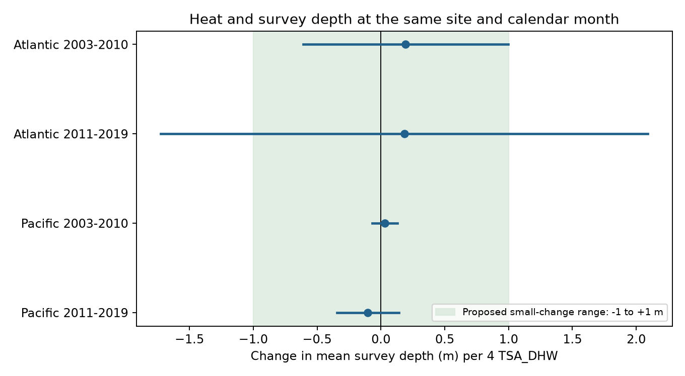

# Heat gave no clear link to survey depth in four Atlantic and Pacific coral samples in 2003-2019

## Question and result

Does the depth of a coral survey change with heat dose, even at the same site and in the same calendar month? If surveys move deeper during heat events, this could affect a test of depth as a refuge from bleaching. A change in sampling depth is one possible source of observation bias. It is not itself evidence of coral movement or loss.

We tested four separate ocean-period samples. None gave a clear directional slope. Both Pacific adjusted intervals were within an illustrative range of -1 to +1 m per four heat-dose units. The later Atlantic data could not exclude changes larger than this range. This is a test of one survey process, not proof that bleaching estimates are free from bias.

## Prior work and question choice

The [data descriptor](https://doi.org/10.1038/s41597-022-01121-y) explains the merged survey archive and its environmental fields. [Source parameter definitions](https://www.bco-dmo.org/dataset/773466/description) define the heat dose and depth field. We use the Reef Check part to limit protocol variation.

A [campaign depth study](sci:sha256:4a789955ad022aafa7fda357e761144e3c74ab8788fe72415b219ba6fe1192b4) compared bleaching at matched depths. A [response-availability study](sci:sha256:945de7479a461a348a68d4f339ceb82c41bea114bfb49409e9addf20c882b5a7) tested whether heat predicted a reported bleaching percentage. We test depth selection over time, which is a different observation process. These studies share raw records; they are not independent validation data.

We searched published campaign results before the precise question was chosen. Search files are included. An initial plan to test study weights in a warming meta-analysis stopped when public Dryad file routes returned HTTP 403 or 401. No data from that plan enter these results. We then selected this question from the shared coral archive. The four sample definitions, same-month controls and illustrative one-metre range were set before the first successful model run. This was not a registered analysis. The heat-cap sensitivity was added after the first results showed high maximum heat values.

## Data and sample

We used BCO-DMO 773466 version 2, dated 2022-10-14. The exact CSV has 41,361 rows. Reef Check has 28,821 rows and 14,475 distinct sample identifiers. Rows for different substrate measures can repeat one survey. All fields used here agreed within each sample identifier, including missing values. We kept one row per identifier.

We selected the Atlantic and Pacific, years 2003-2019, depth 0-30 m, a valid calendar month, and nonnegative values of both heat fields. We required both fields so the alternate-heat check used a common initial sample. We did not require a bleaching percentage. There were 10,581 eligible distinct samples.

We averaged distinct samples within site, year and month. The resulting panel has 8,461 site-month records. Each month has equal weight. The main outcome is the mean depth. The minimum and maximum depth are separate checks. The heat value is the sample mean for that month. More frequently surveyed sites still contribute more records.

Each fit keeps only site-calendar-month groups with at least two records within its own period. This requires visits in different years and holds seasonal timing fixed at the month level. It gives 3,288 model records in total. Counts per cell are below. Each ocean is fitted separately in 2003-2010 and 2011-2019. These samples have separate years. The full eligible panel shares 61 Atlantic and 247 Pacific sites across periods. Oceans have different sites but share a survey programme and can share global climate events. These are separate scope checks within one archive, not fully independent experiments.

## Model and uncertainty

The fitted model is:

`mean_depth = site_calendar_month + year + slope * (TSA_DHW / 4) + error`

The slope is a change in recorded survey depth in metres per four TSA_DHW units. Positive means deeper surveys. TSA_DHW is a surface thermal stress sum over the previous 12 weeks when the anomaly is at least 1 C. The alternate SSTA_DHW field uses a different reference temperature. Neither measure is the temperature experienced by each coral at depth. The scale of four is for reporting; it does not assert equivalence to a different operational warning product.

Alternating projections remove the two sets of fixed effects to tolerance 1e-11. A direct sparse indicator model checks each main slope. The largest slope difference is less than 3e-13. This verifies numerical agreement, not the scientific model.

Intervals use ecological-region cluster scores, a G/(G-1) variance factor, and Student t critical values with G-1 degrees of freedom. Each main interval has coverage target 98.75%, for a Bonferroni family coverage target of 95% across four tests. The CSV also gives nominal 95% intervals. There is no fixed-effect leverage correction. Six or seven Atlantic clusters give weak support for this approximation. Climate events can also cause errors to correlate across regions.

## Estimates

| Ocean and period | Months | Sites | Regions | Months at heat >= 4 | Slope (m) | Adjusted interval (m) |
|---|---:|---:|---:|---:|---:|---:|
| Atlantic, 2003-2010 | 241 | 68 | 7 | 6 | +0.193 | -0.610 to +0.996 |
| Atlantic, 2011-2019 | 268 | 76 | 6 | 3 | +0.184 | -1.723 to +2.091 |
| Pacific, 2003-2010 | 951 | 309 | 26 | 95 | +0.031 | -0.067 to +0.129 |
| Pacific, 2011-2019 | 1828 | 413 | 22 | 72 | -0.102 | -0.342 to +0.139 |


All four adjusted intervals include zero. This supports an uncertain or small association under this model. It does not establish exactly zero change.

The Pacific estimates are +0.031 and -0.102 m per four heat-dose units. Both adjusted intervals lie within -1 to +1 m. This range describes a proposed sampling change, not a proven harmless level of bias in bleaching results. A smaller depth change could still matter for some communities. The early Atlantic interval reaches +0.996 m, only just inside this range. Its minimum- and maximum-depth checks extend above +1 m. We therefore make no robust one-metre claim for the Atlantic.



Only 6 and 3 Atlantic months have TSA_DHW at least four, versus 95 and 72 Pacific months. The Atlantic median survey depths are 7.5 and 8.95 m; Pacific medians are 4.5 and 5.9 m. The linear slopes mainly describe the common low-heat conditions. They do not validate behaviour during rare, severe marine heatwaves. Exact year and heat coverage is in `support.csv`.

## Checks and limits

The analysis uses one broad survey programme, removes repeated substrate rows, gives each month equal weight and controls site-calendar-month and year. This limits several sources of observation bias. It cannot control unrecorded changes in observer, effort, transect placement or coral composition.

The minimum- and maximum-depth Pacific estimates are close to zero in both periods. Using the alternate heat field gives +0.038 and +0.012 m. Removing months with any day-15 date gives +0.003 and -0.107 m. Day 15 can be an imputed date, but can also be a real date.

Removing months above 12 TSA_DHW gives Pacific estimates of +0.016 and -0.160 m. Requiring every included sample in a month to have a valid bleaching percentage gives +0.047 and -0.128 m. Their adjusted intervals still include zero and remain within the illustrative one-metre range. This filter is an audit of reporting selection; it is not the main sample.

Leaving one region out gives main Pacific point estimates from +0.011 to +0.063 m in the early period, and -0.151 to -0.061 m in the late period. Atlantic ranges are +0.034 to +0.490 m and -0.521 to +0.580 m. The signs of these checks do not establish nonzero effects. All 28 model fits and 61 region-omission results are saved. Sensitivity intervals use the same four-test critical value for comparison; they do not have simultaneous coverage across all sensitivity analyses.

An independent standard-library script rebuilds all 8,461 month means, depth limits and sample counts from the raw file. The maximum mean difference is zero. This check and the separate model algorithm address computation errors. They do not correct nonrandom sampling.

The study conditions on a recorded return visit in the same month. It cannot test whether heat changes which sites are visited at all, whether a visit moves to a different month, or whether unvisited depths have different bleaching. A mean depth can also hide changes in the sampled depth distribution. Linear slopes can miss threshold effects. Assigned surface heat can differ from local heat; its error can reduce slopes toward zero. Regions have uneven heat and sample support. The 0-30 m limit excludes deeper reefs. No pollution exposure, species loss, ecological timing or causal effect of climate change is measured here.

## Reproduce and inspect

Exact shared source:

`/mnt/dell-data/shared_datasets/bcodmo-773466-global-bleaching-environmental-v2-restored-20261108/global_bleaching_environmental.csv`

SHA-256: `78cc014b1e7887f26f4c44a40d4d9213212f3c6217541c6a1b69e723b61bfacb`; bytes: 16772400. The file was read in place and was not changed. `provenance.json` gives source URL, version, credit and retrieval steps. The package contains the derived panel, not a duplicate of the shared raw file.

From an unpacked publication, use Python 3.12 and the packages in `files/requirements.txt`. Exact versions are in `files/environment.json`.

```sh
python files/analyze.py
python files/analyze.py --raw /path/to/global_bleaching_environmental.csv
python files/validate.py /path/to/global_bleaching_environmental.csv
```

The first command reproduces all fits and the figure from the supplied panel. The second rebuilds the panel from raw data and rejects any different hash. The third checks aggregation with a separate implementation. Run in a writable copy of the bundle; these commands write derived output beside the scripts. A new hash must not be silently substituted.

Job: `sci-1107-dell-climate-pollution-biodiversity-5429053060d3`. Topic: `climate-pollution-biodiversity`. Campaign: `11_07_2026`. Machine: `dell`. Account: `codex-andrii`. Model: `gpt-6.1-sol`, high reasoning effort. Date: 2026-11-08. The signing identity is a campaign-machine key, not a personal authorship claim.
