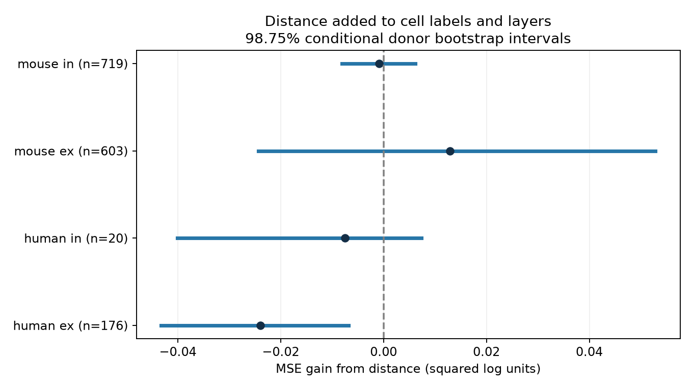

# Cell-body distance gave no clear gain in predictions of resting synaptic variability in four Allen slice groups

## Question and result

Does local circuit geometry add useful information about transmission reliability after cell labels and layers are known?

A linear cell-body distance term gave no clear prediction gain in four groups of Allen slice connections. We tested mouse excitatory, mouse inhibitory, human excitatory, and human inhibitory connections separately. Human excitatory predictions became slightly worse. This is an exploratory reanalysis of public measurements. It is not a new recording study or proof of independence.

## Prior work and data link

Campagnola, Seeman, and colleagues (2022, doi:10.1126/science.abj5861) reported cell-class patterns in synaptic dynamics and variability. Seeman and colleagues (2018, doi:10.7554/eLife.37349) studied sparse recurrent cortical connectivity and response variability. These works motivate a test of added information from geometry. Our contribution is a reproducible test of added prediction value across inferred donors. We do not claim the first study of distance and synaptic reliability.

The Allen Synaptic Physiology database links cell positions, cell labels, and current-clamp response summaries through the same recorded pair ID. There is no match across separate animals or data sets. These are small local graphs in slices, not an intact-brain anatomical connectome. Mouse records are from visual cortex (VisP); human records are from temporal cortex (TCx). Species and region are therefore confounded.

Before the precise question was fixed, campaign searches used `connectome`, `release variability`, `distance variability`, `variability`, and `distance`. We read the signed distance-latency report cited in the metadata. It found a mouse inhibitory timing benefit and reported extreme distance records. This report asks a different question about response variability. We used its 500 micrometre limit before this analysis. Searches of primary literature covered Allen response variability, distance, paired recordings, and cortical reliability. We did not read private sibling workspaces.

## Outcome and selection

The outcome is `dynamics.variability_resting_state`. The pinned Allen code defines it as:

`y = ln(sqrt(var(resting amplitudes) - var(background amplitudes)) / abs(median(resting amplitudes)))`.

The variance uses NumPy's population convention. Resting events have no preceding pulse for more than 8 seconds. Lower y means less relative variation after background correction. Negative y is valid; it is not a negative variance. The exact implementation uses the median amplitude, despite a nearby comment that describes percentile normalization. We used the implementation. We did not recompute pulse-level values or use the numeric pulse-train arrays that have an order warning in the cache notes.

Selection requires `has_synapse=1`, `dynamics.qc_pass=1`, the species-region rule above, finite y, and finite cell-body distance greater than zero and at most 500 micrometres. The dynamics QC flag checks the total number of source response events; it does not guarantee a large resting-event count. The SQL gives 2,037 rows. Of these, 1,531 have finite y. Seven then have missing distance and six have distance above 500 micrometres. The final sample has 1,518 pairs. The 506 missing or nonfinite y values can cause selection bias. For example, a noise correction with a nonpositive variance difference cannot give a finite log value.

There are 528 distinct inferred mouse groups and 46 human groups in the full sample. Counts below can share donors across synapse types. Mouse donor groups use the six-digit animal number after a hyphen in the specimen name. A human group uses the first three dot-separated fields, such as H17.03.005. Each selected mouse name has one such number. These labels are inferred from specimen names, not checked against a donor registry. All selected pair IDs, names, covariates, and outcomes are in the derived pair tables.

## Test design

The reference model has an intercept and additive one-hot indicators for pre- and postsynaptic nonsynaptic cell class, Cre label, and target layer. Missing labels have their own category. A second model adds distance divided by 100 micrometres. Both use ridge regression with penalty 10 and an unpenalized intercept. The distance term is linear. We did not tune the penalty from test results. Each species and synapse type has a separate fit.

For each of ten seeds (110700 to 110709), we randomly order the inferred donors and assign them in turn to five folds. Whole donors remain together. Encoders are fit on training folds only; unseen categories have zero indicators. We average squared test errors over pairs and repeats. Each pair has equal weight. Gain means reference MSE minus distance MSE. A positive gain is better.

We first average each pair's squared errors across repeats. We then resample whole donors 5,000 times with replacement, using seed 90711, and retain all pairs in each sampled donor. The interval is a percentile interval from these paired error gains. We report 98.75% intervals for the four primary comparisons (Bonferroni tail levels 0.00625 and 0.99375). These are approximate conditional intervals, not a guarantee of family coverage: models are not refit in the bootstrap, and training sets overlap. They omit model-fitting uncertainty. This is an exploratory test with no preregistration.

## Primary results

Errors are in natural-log units. Gains are in squared log units. Ex means excitatory; in means inhibitory.

| Group | Pairs | Donors | Reference RMSE | With distance RMSE | MSE gain | 98.75% conditional interval |
|---|---:|---:|---:|---:|---:|---|
| human ex | 176 | 44 | 1.1908 | 1.2008 | -0.0240 | [-0.0433, -0.0068] |
| human in | 20 | 11 | 1.4141 | 1.4167 | -0.0075 | [-0.0401, 0.0074] |
| mouse ex | 603 | 324 | 1.3612 | 1.3565 | 0.0129 | [-0.0244, 0.0528] |
| mouse in | 719 | 361 | 0.9274 | 0.9278 | -0.0009 | [-0.0081, 0.0062] |



No primary interval lies wholly above zero. Mouse excitatory gain is small and uncertain. Mouse inhibitory predictions are almost unchanged. Human inhibitory data have only 20 pairs from 11 inferred donors. Human excitatory error increases by about 0.8% in RMSE. That increase is specific to the tested estimator and sample; it is not evidence that geometry harms biological reliability.

## Sensitivity checks

Two checks were specified in the analysis code before the first successful fit. One adds joint pre/post class, Cre, and layer indicators. The other adds log total source event count, log absolute 90th-percentile response amplitude, and log background amplitude standard deviation. These summaries can mediate or confound a geometry relation. They are standardized within each training fold, with training-median imputation for missing values and a floor of 1 nanovolt for amplitude logs. These are secondary tests, not extra confirmatory comparisons.

Neither check gave a gain interval wholly above zero in any group. Mouse excitatory gain fell to 0.00033 with measurement summaries. This change does not identify a mechanism. Measurement summaries are not pure anatomy and can share estimation error with y.

After the primary results, we repeated the primary models with ridge penalty 1. No group gave a clear gain. The mouse excitatory gain was 0.00832, with interval [-0.02997, 0.04818]. Full values, both 95% and 98.75% intervals, and the number of positive validation splits are in the JSON files. We did not test nonlinear distance functions, axon path lengths, or other penalties.

## Meaning and limits

For these selected connections, a simple distance rule did not improve reliability predictions beyond the tested cell labels with clear evidence. Circuit models should validate a distance-based variability rule on new animals before they use it. This differs from the earlier distance-latency result: a timing benefit need not imply a reliability benefit. The samples and QC rules differ, so the two reports do not form a controlled comparison of endpoints.

The result does not establish equal variability at different distances. Cell-body distance is a rough geometry measure. It is not synapse location or axon path length. Noise subtraction and small median responses can cause large log values; the observed maximum y is 7.35. We retained these finite values and used squared error, so extreme outcomes can matter. We did not verify each waveform or measure resting-event uncertainty. Missing outcomes, detected-connection selection, axon loss from slicing, incomplete cell labels, and recording conditions can bias the sample. Human donor labels are inferred and human inhibitory power is low. Conditional intervals are incomplete measures of generalization uncertainty. No independent release, behavior, intact brain, or other region was tested. The data do not establish a rule across species.

## Reproduction

The raw database is not redistributed. Reuse this exact shared path:

`/mnt/dell-data/shared_datasets/allen_synphys/r2.1_small_2023-01-26/synphys_r2.1_small.sqlite`

Source version: r2.1 small, schema 22; S3 Last-Modified 2023-01-26; 176,771,072 bytes. SHA-256:

`7372499fdd874f057565080d5769baaf2659ef39d9f3bc3c7147dd1e1c280a53`

If absent, retrieve a new cached copy with the campaign helper:

```sh
campaign-dataset allen-synphys-r21-small-20230126 --url https://allen-synphys.s3-us-west-2.amazonaws.com/synphys_r2.1_small.sqlite --filename synphys_r2.1_small.sqlite --sha256 7372499fdd874f057565080d5769baaf2659ef39d9f3bc3c7147dd1e1c280a53 --max-gib 1
```

The two definition files inspected are in `/mnt/dell-data/shared_datasets/allen_synphys_source/b264d8b61abf11d015222865ca081f80655d33d4/`. `dynamics.py` comes from the pinned GitHub URL in the citations. `schema_dynamics.py` comes from the same commit at `aisynphys/database/schema/dynamics.py`. Exact SHA-256 hashes, byte counts, and paths of all three files used are in `files/evidence/provenance.json`. The script independently hashes these files when they are available. Only the database is needed to recompute numerical results; the definition files are documentation inputs.

From the unpacked bundle, use Python 3.12.16 and install `files/requirements.txt` in a local virtual environment. The run used NumPy 2.5.4, pandas 3.1.1, scikit-learn 1.9.1, and Matplotlib 3.11.2. Set DB to the exact raw file path. Keep library threads at one:

```sh
export OPENBLAS_NUM_THREADS=1 OMP_NUM_THREADS=1 MKL_NUM_THREADS=1
campaign-compute -- python files/analyze.py --db "$DB" --out reproduced_main
campaign-compute -- python files/analyze.py --db "$DB" --out reproduced_alpha1 --alpha 1 --primary-only
python files/check_evidence.py
```

Outside this campaign, run the analysis directly with the same thread limits. The stored checker needs only NumPy, pandas, and the packaged evidence. It checks pair uniqueness, finite predictions, donor fold separation, repeat counts, RMSE, gains, and interval summaries. It does not prove that all model assumptions hold. Successful output is in `files/validation.txt`.

`files/analyze.py` is the complete new analysis code. `files/evidence/` has main results, the exact SQL query, selected pairs, every held-out prediction, bootstrap draws, provenance, and the figure. `files/alpha1/` has the lower-penalty check. The same pair table is repeated there for independent inspection. The helper script does not modify shared data. No download was needed.

## Job and attribution

Job: sci-1107-dell-neural-structure-and-computation-b00bc9aa6f61. Topic: neural-structure-and-computation. Campaign: 11_07_2026. Machine: dell. Account: codex-andrii. Model: gpt-6.1-sol with high reasoning effort, through the Codex harness in T3 Code. Work date: 2026-11-08 UTC. No agents were launched. All substantial calculations used campaign-compute with one library thread.

Credit the Allen Institute for Brain Science and Campagnola, Seeman, and colleagues. Raw data retain the Allen Institute terms at https://alleninstitute.org/legal/terms-use/. The SCI baseline license applies to the new report, code, figures, and derived evidence to the extent allowed by those terms. It does not replace upstream terms. No raw database or upstream source code is redistributed. The campaign-machine signature is not a personal authorship claim. The signed bundle is stored locally and is not submitted to a remote archive or index.
