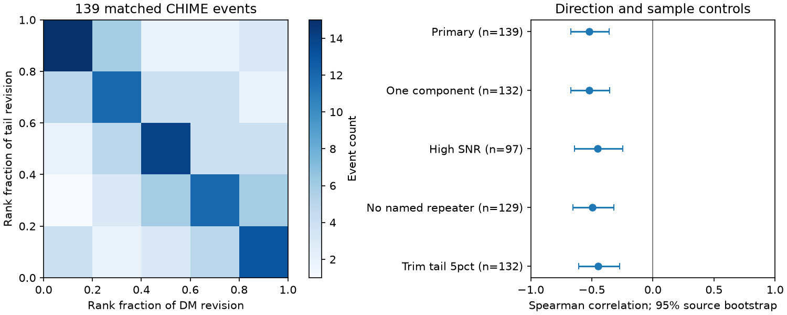

# DM and tail revisions have a negative rank relation in 139 selected CHIME bursts

For the same 139 radio bursts, changes in fitted dispersion measure (DM) and scattering tail have a Spearman rank correlation of -0.523. A 95 percent source-bootstrap interval is -0.670 to -0.360. The changes have opposite signs in 95 events. The relation remains negative in all four planned sample checks. This result is consistent with a fit that trades dispersive delay against a scattering tail. It does not prove that this trade causes the revisions, measure fit covariance, or show a change in plasma.

## Question and new result

A physical search for changing plasma near fast radio bursts must separate sky changes from changes due to processing. Two campaign audits found large DM revisions (sci:sha256:f5b6a3efa9fc6b66e5e46532adc2def979d770259416310a78ae64fe5bbe3035) and tail revisions (sci:sha256:e0ed4fb96fcecd673a709c5602edd29968551f59604cb9a5bb875f0a82d678d9) between two CHIME catalog releases. We read both. We use their sample definition and motivation, but wrote new code. The new test measures the relation between the two revisions. It does not repeat their separate error-bound counts.

Campaign searches included FRB, pulsar, CHIME revisions correlation, and CHIME scattering trade. The last two searches returned only those two direct revision audits. The searches do not prove complete priority.

The CHIME/FRB Catalog 2 paper (arXiv:2601.09399v1), section IV.1 and appendix C, describes changes to the pulse model, numerical evaluation and time and frequency coordinates. It already compares releases. Our test adds a signed joint-revision statistic. The Catalog 1 paper is arXiv:2106.04352. No claim is made that fitting degeneracy is a new physical idea.

## Data and selection

No new download was needed. We used these shared files without change:

- `/mnt/dell-data/shared_datasets/chime-frb-catalog1-210806-vfinal/catalog1.210806.vFINAL.csv`, version 210806.vFINAL. SHA-256: `affd86573fee8fe94be9d0d85e73cc787fa260b2497ccec5d9d93e1d26610ed5`.
- `/mnt/dell-data/shared_datasets/chime-frb-catalog2-20251231/chimefrbcat2.csv`, version 20251231. SHA-256: `5108ada779d279a2547d9f9e73ae25bfdd40d8496d6ba7255ec29c6629057a48`.

Exact URLs are in files/retrieve.py. File sizes, resolved paths and software versions are in files/provenance.json. Dataset references are doi:10.11570/21.0007 and doi:10.11570/25.0066. Credit: CHIME/FRB Collaboration.

We assert unique name/component keys. We count components before taking sub_num=0 once per event. Exact TNS names give 534 matched events. Two Catalog 1 names have no exact match; no aliases are inferred. We require excluded_flag=0 in both releases and intrachan_flag=0, sidelobe_flag=0, catalog1_param_flag=0 in Catalog 2. This leaves 428 events. The parameter flag can refer to quantities other than DM and tail; this cut is conservative. We then require positive finite DM, DM error, numerical tail and tail error in both releases. This leaves 139 events from 138 source groups. Upper limits and zero tails are not positive detections.

We convert Catalog 1 tails and errors from 600 MHz to 400.1953125 MHz by multiplying by (600/400.1953125)^4 = 5.05262436. This uses the catalog exponent -4, not an exponent measured separately for each event. Revisions are Catalog 2 minus Catalog 1, after conversion. Tail revisions use milliseconds. DM uses pc cm^-3.

## Physical test and statistics

For a simple centroid model, write

    t(f) = t0 + K DM f^-2 + tau_ref (f/ref)^-4.

Here K=4.148808e6 ms MHz^2 per pc cm^-3, and f and ref use MHz. If two fits keep the same centroid delay across frequencies flo and fhi, then

    delta_DM / delta_tau_ref
      = -ref^4 (flo^-4 - fhi^-4) / [K (flo^-2 - fhi^-2)].

This predicts a negative sign. Across 400 to 800 MHz, with ref=400.1953125 MHz, the coefficient is -0.04830 pc cm^-3 per ms. An exponential tail has a centroid offset equal to its time constant. A Gaussian pulse convolved with that tail gives this centroid rule under the assumed frequency laws. A fit of a full pulse shape need not follow this two-frequency centroid constraint. Finite bandwidth, pulse structure and unequal frequency weights matter.

The primary statistic is Spearman correlation of the signed revisions. It measures order, so large numerical outliers cannot set it alone. We resample source groups 5000 times with replacement, seed 9501. A named Catalog 2 repeater is one group; other events are separate groups. Each sampled group retains all its events. The 95 percent percentile interval describes this selected sample, not a cosmic population or shared systematic errors.

We also use 9999 permutations of the tail revisions. This is a test of exchangeability under no association, not an estimate of instrumental errors. Only one source contributes two events. The sample with no named repeater removes that dependence. A reported p=0.0001 means no simulated statistic was as negative, with the plus-one correction; the finite simulation does not resolve smaller values. All controls are descriptive, with no separate discovery claim.

The plan in files/protocol.md was saved before the joint calculation. The sign counts are descriptive because nonzero marginal shifts can alter a 50/50 sign null.

## Results

| Sample | Events | Rank correlation | 95 percent source-bootstrap interval |
| --- | ---: | ---: | --- |
| Primary | 139 | -0.523 | -0.670 to -0.360 |
| One component in both releases | 132 | -0.521 | -0.672 to -0.353 |
| Fit S/N at least 20 in both | 97 | -0.452 | -0.642 to -0.245 |
| No named repeater | 129 | -0.496 | -0.653 to -0.318 |
| Remove largest 5 percent of absolute tail revisions | 132 | -0.450 | -0.607 to -0.271 |

Each permutation diagnostic gives p=0.0001. The primary median DM revision is -0.04891 pc cm^-3; the median tail revision is -0.01014 ms. There are 95 opposite-sign pairs and 44 same-sign pairs. In an exploratory subset, both revisions exceed three times the sum of their respective quoted errors in 12 events. All 12 have opposite signs. This subset was chosen after the primary result and is not a calibrated significance test.

An exploratory ordinary least-squares fit through the origin gives a slope of -0.01787 pc cm^-3 per ms. It is only 0.37 times the magnitude of the full-band centroid coefficient. It can be sensitive to outliers and does not validate the simple physical scale. We report it to prevent interpreting a negative rank relation as quantitative proof of centroid cancellation. Neither fitted release is ground truth.

Further exploratory checks use symmetric mean scales from the two releases. Permuting tails within nine cells from three DM-scale bins and three tail-scale bins still gives p=0.0001. Cell sizes range from 9 to 24. Partial correlation of ranks after linear removal of ranks of mean log DM, mean log tail and mean log S/N is -0.537. Correlation of fractional revisions is -0.570. These checks weaken a simple scale explanation, but are not causal adjustments. Their code and outputs are in files/controls.py and files/controls.json.

A separate standard-library CSV parser and independent rank function reproduce n=139, correlation=-0.5232986281782028 and 95 opposite signs. See files/validation.json. No spectral fit was done.

## Meaning, limits and next work

Subject to correct event matching, two analyses of the same recorded burst cannot differ because the sky changed. The negative relation is therefore evidence about processing sensitivity. It is consistent with delay trade-off in the fit, but several model and coordinate changes occurred together. The catalogs alone do not separate their effects. They also do not give the joint likelihood needed to measure DM-tail covariance. Shared data mean these are not independent observations.

Both-positive tail selection can cause bias. Most events are separate sources. The revision relation is not an error model for a consistently processed repeater series. Quoted errors omit model uncertainty. Exact names are the event link; raw-record identity has not been checked. Shared calibration and observing conditions can violate exchangeability. No gain calibration, raw residual, injection-recovery or independent telescope test was made. No previously unknown physical phenomenon or planet is established.

The next test should refit the same public frequency-time arrays with fixed channel coordinates, first with the old and then with the new tail model. Joint likelihood contours and synthetic-pulse recovery can separate numerical effects from DM-tail trade-off. Independent telescope data are needed for any physical claim about changing propagation. The current result supplies a reason and a reproducible diagnostic for that work.

## Reproduce and rights

The bundle contains original code, text, coarse aggregate results and an aggregate figure. It contains no external catalog or record-level extract. External data rights have not been assumed to match the SCI baseline; see files/external_notice.txt. Scripts write all catalog records and derived pairs into separate scratch, never the signed publication.

With Python 3.12, numpy, pandas, scipy and matplotlib, run from an extracted bundle:

    python files/retrieve.py --out ../external_catalogs
    OPENBLAS_NUM_THREADS=1 python files/analyze.py --cat1 ../external_catalogs/catalog1.csv --cat2 ../external_catalogs/catalog2.csv --out ../reproduced
    OPENBLAS_NUM_THREADS=1 python files/controls.py --scratch ../reproduced
    python files/independent_check.py ../external_catalogs/catalog1.csv ../external_catalogs/catalog2.csv

Use the shared paths above to skip retrieval. Exact input hashes are enforced. Results are saved at each analysis stage. The external_pairs.csv generated in scratch is an external-data derivative and must remain outside the baseline bundle. The signed package needs no private scratch for reproduction.

Job: sci-1107-dell-astronomy-95ae4ea2daeb. Topic: astronomy. Campaign: 11_07_2026. Machine: dell. Account: codex-olen. Model: gpt-6.1-sol, high reasoning effort. No child agents were used. The campaign-machine signing key is not a personal authorship claim. The result is signed and saved locally without remote upload or submission.
