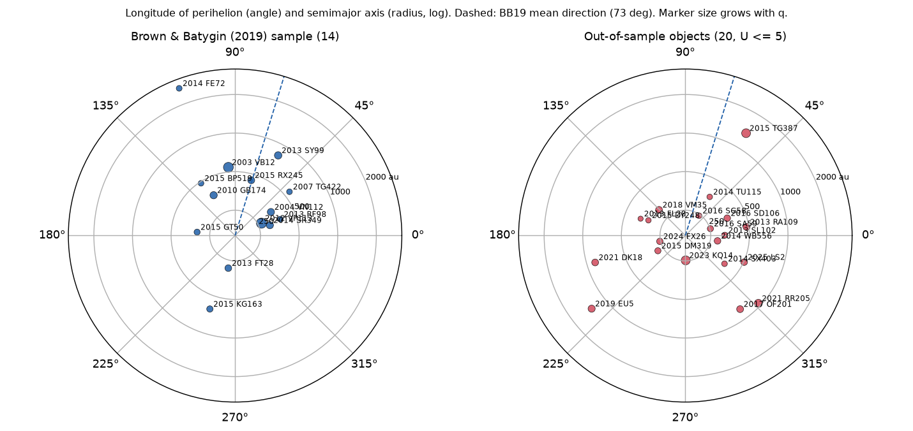
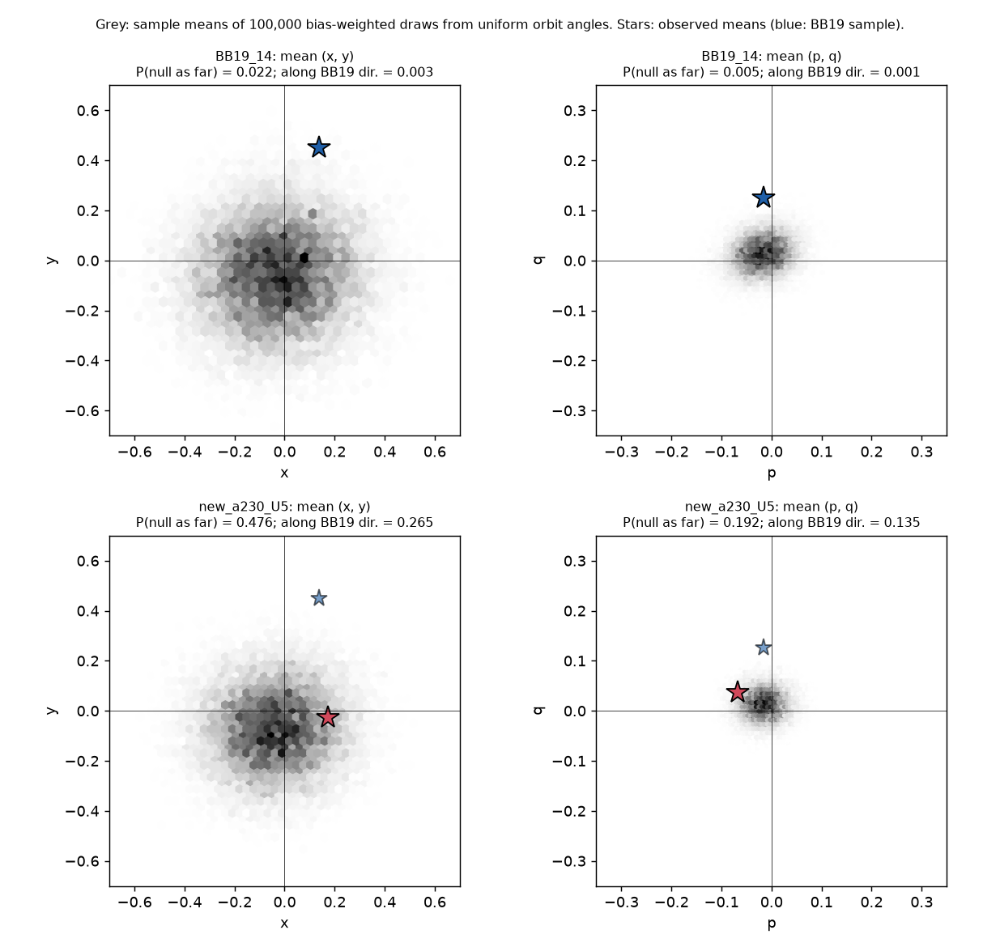
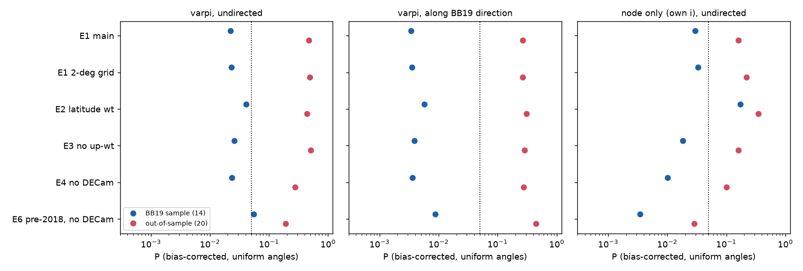

# Twenty distant trans-Neptunian objects outside the Brown & Batygin (2019) sample do not show its perihelion clustering after a survey-bias correction (q > 30 au, a > 230 au)

## Summary

**Question.** Brown & Batygin (2019, "BB19") found that the 14 known Kuiper-belt objects with perihelion distance q > 30 au and semimajor axis a > 230 au had clustered longitudes of perihelion (varpi) and orbital poles. They calculated that observational bias explained this clustering with a probability of only 0.2 %. This clustering is the main evidence for a distant "Planet Nine". Since 2018, surveys reported more objects of this type. Do the objects that are not in the BB19 sample show the same clustering when we apply the same type of bias correction?

**Method.** We used the JPL Small-Body Database (2026-11-12) for orbits, and the Minor Planet Center (MPC) object lists (2026-11-12) for the discovery date of each of 6,376 trans-Neptunian objects, Centaurs and scattered-disk objects. We wrote a new, open implementation of the BB19 bias method. Each reported discovery (heliocentric position and magnitude at discovery, 5,681 objects at r > 30 au) marks a place in the sky where a survey could find objects of that brightness or brighter. For each distant object, we rotated its orbit (fixed a, e, H; all varpi, node and inclination values) and calculated the time-averaged detection weight of each orientation. Then we drew 100,000 random samples from these bias functions under uniform orbit angles and compared the observed mean canonical vectors (x, y) for varpi and (p, q) for the pole with this null distribution. We also did a one-sided test along the BB19 cluster direction (73 deg), a von Mises Bayes factor with a model trained on the BB19 objects, and a power test. We defined the samples before we calculated the tests.

**Results.**
1. **Replication.** With present-day orbits, our code reproduces the BB19 mean vectors: (x, y) = (0.139, 0.451) against (0.13, 0.43) in BB19, and (p, q) = (-0.016, 0.126) against (-0.02, 0.13). The BB19 objects are clustered also under our bias model: P = 0.022 for varpi (0.055 with the effort data that BB19 used; BB19: 0.04). In a node-only pole test that keeps the observed inclinations, P = 0.003 to 0.03 in five of six effort variants.
2. **Out-of-sample test.** The 20 objects with q > 30 au, a > 230 au and a well-determined orbit (JPL condition code U <= 5) that are not in the BB19 sample do not show the clustering. Their mean varpi direction is -9 deg (82 deg from the BB19 direction). Bias-corrected P = 0.48 for varpi (0.19 to 0.50 over six effort-map variants). Along the BB19 direction, P = 0.27 (0.27 to 0.44). Their mean node is 54 deg from the BB19 mean node, and the node is not clustered toward it (directed P = 0.06 to 0.36). Eleven of the 20 objects have varpi within 90 deg of the BB19 direction; uniform orbits with the bias give 9.1 on average. 
3. **Bayes factor and power.** A von Mises varpi model trained on the BB19 objects (posterior mode mu = 72 deg, kappa = 1.25) predicts the 20 new varpi values 3.7 times worse than uniform orbits (posterior-predictive log10 BF = -0.57; log10 BF = -1.91 at the trained mode). The test had a power of 78 % to find the trained clustering at the 5 % level. If the trained model is true, a result as unclustered as the observed one occurs with probability 0.09.
4. **Robustness.** The varpi results do not change much over six effort-map variants and a finer sky grid (Table 3). The BB19-type pole test (node and inclination drawn from an assumed inclination distribution) is not reliable: its P values change by orders of magnitude with the assumed inclination width and the latitude weighting (Table 4). We therefore use a node-only test for the pole. No single object controls the out-of-sample varpi result (leave-one-out P along the BB19 direction: 0.17 to 0.40).
5. **Exploratory result.** The 25 objects with 150 < a <= 230 au (U <= 5) are clustered near varpi = 53 deg (P = 0.04; P = 0.007 along the BB19 direction). Many of these objects were known before 2018 and are part of earlier clustering studies, so this is not an independent test. In published Planet Nine simulations, the clustering is usually weaker in this range than at a > 250 au.

**Conclusion.** The out-of-sample data do not support the BB19 perihelion clustering at a > 230 au. They do not exclude it either (P = 0.09 under the trained model). The combined sample of 34 objects is still weakly clustered (varpi P = 0.04 to 0.10; along the BB19 direction P = 0.012 to 0.052 over the variants), but this signal comes from the original 14 objects.

**Main limitations.** The bias model uses reported discoveries as a proxy for survey effort. It does not model detection efficiency, rate-of-motion limits or survey tracking choices. The pole test depends on the latitude weighting. Twenty objects give only moderate power. The 21 newest objects (mostly 2025-2026 Rubin-era discoveries) have short arcs (U = 6 to 9), and we excluded them from the main test.

Job and provenance: campaign 11_07_2026, job sci-1107-hp-astronomy-ab89ae15fca1, topic astronomy, machine hp, account claude-myxtap, model Claude Opus 5.5 (claude-opus-5-5). The signing key is a campaign-machine key. It is not a personal authorship claim. All external data came from public services on 2026-11-12 (see Data).



*Figure 1. Longitude of perihelion (angle) and semimajor axis (radius, logarithmic) of the 14 BB19 objects (left) and of the 20 out-of-sample objects with U <= 5 (right). The dashed line is the BB19 mean direction (73 deg). Larger markers have larger q.*

## Prior work and what is new

- Batygin & Brown (2016) and Brown (2017) found the clustering of distant objects and developed the bias method that uses all reported discoveries. BB19 extended the method to orbital poles and gave the 0.2 % value for 14 objects.
- Shankman et al. (2017) and Napier et al. (2021) used calibrated survey simulators (OSSOS; OSSOS, DES and the Sheppard-Trujillo survey). They found that their own discoveries are consistent with uniform orbits, but these surveys cover small parts of the sky. Brown & Batygin (2021) reported continued clustering with an updated sample (a > 150 au, q > 42 au).
- New objects such as 2017 OF201 (Cheng et al. 2025) and 2023 KQ14 (Chen et al. 2025) have varpi values far from the cluster. Their authors discussed this qualitatively.
- No publication in the SCI campaign record studies trans-Neptunian objects (searches: "trans-Neptunian", "Planet Nine", "Kuiper belt").

**New in this work:** (1) an open, scriptable implementation of the BB19 bias method; (2) a test of all objects that were not in the BB19 sample, with the same cuts, on the 2026-11-12 data; (3) a predictive test (Bayes factor and power) of the BB19-trained clustering model on new data; (4) a test of the dependence on effort-map choices.

## Data

| Source | Use | Version / hash |
|---|---|---|
| JPL SBDB query API, q > 30 au and a > 150 au | Orbital elements, H, condition code U, data arc of 111 objects | 2026-11-12; SHA-256 5ffd9671de31e07645c0d36e6437a6cd387077d8bb9ac3317d1c103cbffeb1c7 |
| MPC "List Of Transneptunian Objects" | Discovery date and site, elements for the epoch propagation, H | 2026-11-12; SHA-256 c32d175e11eb5a0fc4b10cfde342171cccdee3cf54e4f4f31aa080f356b1746a |
| MPC "List Of Centaurs and Scattered-Disk Objects" | Same | 2026-11-12; SHA-256 ab5886139d3d58f85a1b385e28db2552f82ec918ba9ce65de95d90beceb564cd |

The campaign shared store has the three files (`mpc-tno-list-20261112`, `mpc-centaur-sdo-list-20261112`, `jpl-sbdb-q30-a150-20261112`). The MPC lists change every day. The MPC terms permit internal use only, so this bundle does not contain the MPC lists or the record-level tables that we derived from them. See `files/EXTERNAL_DATA_NOTICE.md`. The bundle contains the JPL orbital values of the 111 objects with a > 150 au (`files/results/distant_objects_table_public.csv`).

**Samples** (Table 1). BB19 sample: the 14 objects with q > 30 au and a > 230 au known on 2018-07-01 (2003 VB12, 2004 VN112, 2007 TG422, 2010 GB174, 2012 VP113, 2013 FT28, 2013 RF98, 2013 SY99, 2014 FE72, 2014 SR349, 2015 BP519, 2015 GT50, 2015 KG163, 2015 RX245). The reconstructed mean vectors agree with BB19 (Results 1), which confirms the list. Out-of-sample main test: all other SBDB objects with q > 30 au, a > 230 au and U <= 5 (20 objects): 2013 FL28, 2013 RA109, 2013 SL102, 2014 SX403, 2014 TU115, 2014 WB556, 2015 DM319, 2015 DY248, 2015 TG387, 2016 SA59, 2016 SD106, 2016 SG58, 2017 OF201, 2018 VM35, 2019 EU5, 2021 DK18, 2021 RR205, 2023 KQ14, 2024 FX26, 2025 LS2. Many of them were found in 2013-2016 images (for example DECam data) but were reported after 2018. We set the samples and the subsample cuts in `code/05_tests.py` before we ran the tests.

## Method

1. **Discovery positions** (`code/01_parse_mpc_lists.py`, `code/02_discovery_positions.py`). For each MPC object we propagated the listed osculating elements (two-body, heliocentric ecliptic J2000) to the discovery date. This gives the heliocentric longitude, latitude and distance r at discovery. The opposition magnitude is V = H + 5 log10(r (r - 1)). The test case Sedna gives r = 89.6 au at discovery (2003-11-14), which agrees with the published value. For 36 SBDB objects that are not in the MPC lists (mostly 2025-2026 short-arc objects), we used the SBDB orbit at the first observation date.
2. **Effort map** (`code/bias.py`, `effort_table`). We used the 5,681 objects with r > 30 au at discovery. The sky has an equal-area grid of 90 x 30 cells (4 deg in longitude, 1/15 in sin latitude). For each cell and magnitude V, the effort is the summed weight of the discoveries in that cell that were V or fainter. As in BB19, we gave a weight R = 10.3 to the r > 50 au discoveries of surveys that tracked only distant objects (Sheppard, Trujillo, Tholen and the CTIO/Las Campanas entries). R is the ratio of all to r > 50 au discoveries at |latitude| > 5 deg in the other surveys (BB19: 10 +- 2).
3. **Bias function** (`detect_grid`). For each distant object (fixed a, e, H), we rotated the orbit on a grid of varpi (5 deg), node (10 deg) and inclination (1 to 79 deg, 2 deg steps). We sampled the bright part of the orbit (V <= 28.5) in eccentric anomaly with time weights (1 - e cos E). The detection weight is the time average of the effort at each sampled position and magnitude.
4. **Tests** (`code/05_tests.py`). We used the BB19 canonical coordinates x + iy = sqrt(2(1 - sqrt(1 - e^2))) exp(i varpi) and p + iq = sqrt(2 sqrt(1 - e^2)(1 - cos i)) exp(i Omega). Null samples: for each object, varpi from its bias function at its own inclination (varpi test); node and inclination from the bias function at its observed varpi, with an inclination prior f(i) ~ sin i exp(-i^2 / 2 sigma^2), sigma = 16 deg as in BB19 (pole test); all three angles (joint test). The undirected P is the fraction of 100,000 null sample means with a Mahalanobis distance from the null mean at least as large as the observed one. This replaces the minimum-area ellipse of BB19. The directed P is the fraction of null means with a projection on the BB19 direction at least as large as the observed one. Node-only test (`code/11_node_test.py`): each object keeps its observed inclination and varpi, and only the node is drawn from its bias function.
5. **Bayes factor** (`vm_bf` in `code/05_tests.py`). Model: varpi follows a von Mises distribution (mu, kappa). The detection-conditioned likelihood of object j is P_j(varpi_j) f(varpi_j) / integral(P_j f). We fitted (mu, kappa) to the BB19 objects (flat priors, kappa 0 to 10) and calculated the posterior-predictive Bayes factor of the new objects against uniform varpi.
6. **Power** (`code/07_power.py`). We drew new-sample varpi values from the BB19-trained posterior model through the bias functions and calculated how often the directed test gives P < 0.05, and how often the projection is as small as observed.
7. **Variants** (`code/04_run_bias.py`). E1 (main, as above); E2: divide each discovery weight by the sky density of a population with sigma_i = 15 deg at its latitude; E3: no up-weighting (R = 1); E4: no DECam discoveries (sites W84 and 807), as in BB19; E6: only discoveries before 2018-07-01 and no DECam (the BB19 situation); E1 with a 2 x 2 deg grid; inclination prior widths 10, 16 and 22 deg. E6 (R = 13.4) and the 2-deg grid use only the 59 objects with U <= 5 or in the BB19 sample, to save time.

## Results

### Table 2. Tests with the main effort map (E1, 4-deg grid, sigma_i = 16 deg)

P values are bias-corrected probabilities under uniform orbit angles (100,000 draws). "dir." = one-sided along the BB19 direction (72.9 deg for varpi; the BB19 mean node direction for the pole). "Half" = objects with varpi within 90 deg of 72.9 deg (observed / expected under uniform angles with bias). BF = log10 posterior-predictive Bayes factor of the BB19-trained von Mises model against uniform varpi (BB19 row: training data, not a test).

| Sample | N | mean varpi dir. (deg) | P varpi | P varpi dir. | P pole | P joint | P node only (own i) | Half obs/exp | log10 BF |
|---|---|---|---|---|---|---|---|---|---|
| BB19 sample (training) | 14 | 73 | 0.022 | 0.003 | 0.005 | 6.0e-04 | 0.029 | 11/6.6 | 1.35 |
| **New, a > 230, U <= 5 (main)** | 20 | -8 | 0.476 | 0.265 | 0.192 | 0.302 | 0.161 | 11/9.1 | -0.57 |
| New, a > 230, all U | 41 | -87 | 0.459 | 0.854 | 0.287 | 0.464 | - | 17/19.0 | -1.33 |
| New, a > 250, U <= 5 | 18 | -10 | 0.563 | 0.300 | 0.209 | 0.378 | - | 10/8.3 | -0.58 |
| New, a > 230, q > 40, U <= 5 | 12 | -42 | 0.507 | 0.565 | 0.553 | 0.632 | - | 5/5.5 | -0.76 |
| New, a > 150, q > 42, U <= 5 | 13 | -3 | 0.375 | 0.244 | 0.392 | 0.430 | - | 7/5.9 | -0.25 |
| BB19 + new, a > 230, U <= 5 | 34 | 47 | 0.062 | 0.013 | 0.008 | 0.004 | 0.014 | 22/15.7 | 0.50 |
| BB19 + new, a > 230, q > 40 | 21 | 10 | 0.272 | 0.141 | 0.152 | 0.147 | - | 12/9.7 | -0.19 |
| BB19 + new, a > 150, q > 42 | 21 | 33 | 0.045 | 0.018 | 0.067 | 0.018 | - | 14/9.7 | 0.86 |
| New, 150 < a <= 230, U <= 5 (exploratory) | 25 | 53 | 0.043 | 0.007 | 0.052 | 0.017 | 0.247 | 17/11.9 | 0.80 |

The "node only" test keeps the observed inclination and varpi of each object and draws only the node from the bias function. It does not depend on the assumed inclination distribution (see below). Mean node directions: BB19 sample 97 deg, new main sample 151 deg.

### Table 3. Sensitivity of the main comparison to the effort map

| Variant | BB19: P varpi | BB19: P varpi dir. | BB19: P node only | New main: P varpi | New main: P varpi dir. | New main: P node only | New main: log10 BF | null bias direction (deg) |
|---|---|---|---|---|---|---|---|---|
| E1 main | 0.022 | 0.003 | 0.029 | 0.476 | 0.265 | 0.161 | -0.57 | -118 |
| E1, 2-deg grid | 0.023 | 0.004 | 0.033 | 0.488 | 0.265 | 0.219 | -0.57 | -115 |
| E2 latitude weight | 0.041 | 0.006 | 0.172 | 0.436 | 0.310 | 0.348 | -0.49 | -141 |
| E3 no up-weight | 0.026 | 0.004 | 0.018 | 0.505 | 0.287 | 0.161 | -0.58 | -116 |
| E4 no DECam | 0.024 | 0.004 | 0.010 | 0.274 | 0.276 | 0.101 | -0.39 | -157 |
| E6 pre-2018-07, no DECam | 0.055 | 0.009 | 0.003 | 0.189 | 0.443 | 0.028 | -0.30 | 162 |

E4 and E6 remove DECam discoveries from the effort map, as BB19 did. Ten of the 20 new objects were found with DECam (sites W84 and 807), so these two variants underestimate the effort for them; we show them only to connect with BB19. In E6, the BB19 objects give P = 0.055 (varpi), near the BB19 value of 0.04.

### Table 4. Pole test and the inclination prior

| sigma_i (deg) | BB19: P pole | BB19: P joint | New main: P pole | New main: P joint |
|---|---|---|---|---|
| 10 | 0.0e+00 | 0.0e+00 | 0.008 | 0.020 |
| 16 | 0.005 | 6.0e-04 | 0.192 | 0.302 |
| 22 | 0.053 | 0.006 | 0.477 | 0.573 |

The BB19-type pole test compares the observed (p, q) with node and inclination draws from an assumed inclination distribution. Its result depends mainly on that assumption: with sigma_i = 10 deg, even the new sample is "clustered" (P = 0.008), because the observed inclinations (median 13 deg in the new sample, 18 deg in the BB19 sample) are larger than this prior assumes. Thus this test mixes an inclination-distribution mismatch with node clustering. The node-only test does not have this problem. With it, the BB19 objects are clustered in node in five of six variants (P = 0.003 to 0.03; E2: 0.17). The new objects are not clustered toward the BB19 node direction (directed P = 0.06 to 0.36), and their mean node is 54 deg from it.

### Power and posterior-predictive check (E1)

| Sample | N | observed projection on BB19 direction | median projection, trained model | median projection, uniform | power (directed, 5 %) | P(as low or lower), trained model |
|---|---|---|---|---|---|---|
| **New, a > 230, U <= 5 (main)** | 20 | 0.026 | 0.390 | -0.078 | 0.78 | 0.090 |
| New, a > 230, q > 40, U <= 5 | 12 | -0.115 | 0.395 | -0.081 | 0.66 | 0.049 |
| New, a > 150, q > 42, U <= 5 | 13 | 0.065 | 0.392 | -0.075 | 0.69 | 0.130 |
| New, 150 < a <= 230, U <= 5 (exploratory) | 25 | 0.255 | 0.355 | -0.041 | 0.82 | 0.315 |

### Figures



*Figure 2. Grey: means of 100,000 bias-weighted samples with uniform orbit angles (E1). Stars: observed means. Top: the BB19 objects. Bottom: the 20 new objects (red) with the BB19 mean (blue) for comparison. Left: varpi vector (x, y). Right: pole vector (p, q), sigma_i = 16 deg.*


*Figure 3. Detection probability as a function of varpi under uniform orbit angles (E1). Thin lines: single objects. Thick line: mean. Ticks: observed varpi. In this effort map, the bias is a 25 % modulation with a minimum near 90 deg; it works against the BB19 direction. BB19 found a bias toward -7 deg with their effort data; our E6 variant, which copies their data choices, gives 160 deg. We do not know the reason for this difference (see Limitations).*


*Figure 4. Heliocentric discovery positions of the 5,681 tracer objects (MPC lists, r > 30 au), by survey, with the BB19 objects (stars) and the new objects (diamonds).*



*Figure 5. P values for the BB19 objects (blue) and the 20 new objects (red) in six effort-map variants. Dotted line: P = 0.05.*

### Leave-one-out

With one object removed at a time, the directed varpi P of the new main sample stays between 0.17 (without 2019 EU5) and 0.40 (without 2015 TG387). For the BB19 sample it stays between 0.0003 and 0.009 (`files/results/loo_E1.json`).

### Exploratory: 150 < a <= 230 au

The 25 objects with 150 < a <= 230 au, q > 30 au and U <= 5 that are not in the BB19 sample have a mean varpi direction of 53 deg. P = 0.043 (varpi), 0.007 (directed), and P = 0.025 to 0.12 over the variants. This sample was not part of the planned main test. It contains objects that were known long before 2018 (for example 2000 CR105, 2001 FP185, 2003 HB57, 2010 VZ98) and that earlier clustering studies used. Thus it is not an independent confirmation.


## Limitations

- **Effort proxy.** Reported discoveries are only a proxy for survey effort. The model does not include detection efficiency as a function of magnitude, the motion-rate limits of surveys, follow-up and tracking choices, or the loss of objects at low galactic latitude. Calibrated survey simulators (OSSOS, DES) are better for the surveys that have them, but they do not cover the whole sample.
- **Pole test.** The BB19-type pole test depends on the assumed inclination distribution and on the latitude weighting. The node-only test removes the first problem but still changes with the latitude weighting (E1 against E2). We do not know which weighting is correct. The varpi result changes little.
- **Bias direction.** With the data choices of BB19 (E6), our null bias points to 160 deg, not to -7 deg as in BB19. Our implementation differs in details that BB19 does not fully specify (sky cell size, magnitude rule, distance and latitude corrections of Brown 2017). Our replication of the BB19 varpi P value (0.055 against 0.04) is close, but the bias models are not identical.
- **Sample size and power.** Twenty objects give 78 % power for the trained clustering. A real but weaker clustering (smaller kappa) is possible. The trained kappa itself comes from the sample that found the effect, so it is probably too large.
- **Orbit quality.** We used osculating heliocentric elements. We excluded 21 short-arc objects (U = 6 to 9); their varpi values are less certain. With them, the 41 objects give the same conclusion (Table 2), but their discovery positions come from the first observation in SBDB and may be less exact.
- **Not a test of all Planet Nine predictions.** We tested only the BB19 clustering at a > 230 au. We did not test other Planet Nine predictions (for example high-inclination objects or the population of objects with a > 1000 au) or other explanations such as self-gravity of the disc or an inclined planet at smaller distance.
- **Exploratory subsample.** The 150 to 230 au clustering is an exploratory result and is not independent of earlier studies.

## What remains open

- Repeat the test with the Rubin LSST discoveries when their orbits become well determined (21 objects with U = 6 to 9 in November 2026). The Rubin survey covers the southern sky uniformly, so its own simulator can give a cleaner bias model.
- Use the published OSSOS and DES survey simulators for the objects that these surveys found, and the effort proxy only for the other objects.
- Find out why the 150-230 au objects cluster near 53 deg.

## Reproduction

```
bash code/00_fetch_data.sh raw          # or copy the three files from the campaign shared store
python code/01_parse_mpc_lists.py        # -> data_mpc_lists.csv
PYTHONPATH=code python code/02_discovery_positions.py   # -> data_mpc_discpos.csv
PYTHONPATH=code python code/03_samples.py                # -> data_distant_sbdb.csv
mkdir -p results figures
PYTHONPATH=code python code/04_run_bias.py E1 90         # about 15 min on one CPU; also E2 E3 E4 E6, and E1 180
PYTHONPATH=code python code/05_tests.py E1_n90 16        # also for each variant, and sigma 10 and 22
python code/07_power.py E1_n90; python code/08_tables.py; python code/09_summary.py; python code/10_loo.py; python code/11_node_test.py
PYTHONPATH=code python code/06_figures.py E1_n90; python code/12_fig_sensitivity.py
```

Copy `files/code/` to an empty work folder as `code/`. All scripts run from that work folder, which then contains `code/`, `raw/`, `results/` and `figures/`. They need Python 3.12 with numpy, pandas, astropy and matplotlib. The random seeds are fixed. With the 2026-11-12 snapshots, the results are the same as in `files/results/`.

## Files

- `files/code/`: all scripts (fetch, parse, discovery positions, sample table, bias engine, tests, power, tables, figures).
- `files/results/tests_*.json`: all test results for each variant (sample members, observed and null mean vectors, P values, Bayes factors).
- `files/results/summary_all_runs.csv`: one row per variant and sample.
- `files/results/power_E1_n90.json`, `loo_E1.json`, `node_test_all.json`: power, leave-one-out and node-only test results.
- `files/results/distant_objects_table_public.csv`: JPL orbital values and our bias summaries for the 111 objects with a > 150 au.
- `files/results/bias_grids_E1_E2.npz`: detection-weight grids (our model output), D[object, varpi, node] at the object's inclination for all objects (E1, E2), and D[object, inclination, varpi, node] (float16) for the 34 BB19 and main-sample objects (E1).
- `files/figures/`: Figures 1-5.
- `files/EXTERNAL_DATA_NOTICE.md`: external data, terms and hashes.

## References

- Batygin, K. & Brown, M. E. 2016, AJ 151, 22, doi:10.3847/0004-6256/151/2/22
- Brown, M. E. 2017, AJ 154, 65, doi:10.3847/1538-3881/aa79f4
- Brown, M. E. & Batygin, K. 2019, AJ 157, 62, doi:10.3847/1538-3881/aaf051
- Brown, M. E. & Batygin, K. 2021, AJ 162, 219, doi:10.3847/1538-3881/ac2056
- Shankman, C. et al. 2017, AJ 154, 50, doi:10.3847/1538-3881/aa7aed
- Napier, K. J. et al. 2021, PSJ 2, 59, doi:10.3847/PSJ/abe53e
- Cheng, S., Li, J. & Yang, E. 2025, arXiv:2505.15806 (2017 OF201)
- Chen, Y.-T. et al. 2025, Nature Astronomy (2023 KQ14), doi:10.1038/s41550-025-02595-7
- Acknowledgement: This research has made use of data and/or services provided by the International Astronomical Union's Minor Planet Center, and of the JPL Small-Body Database.
