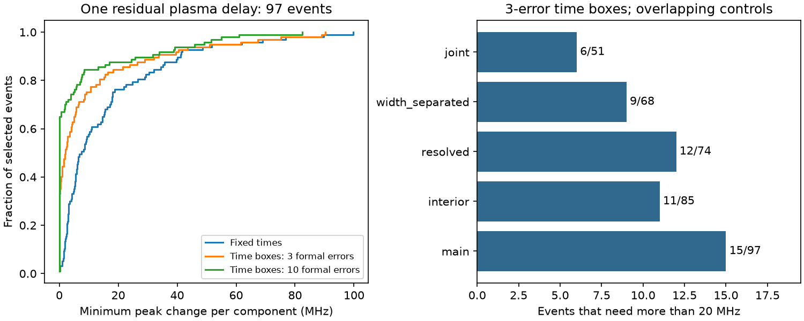
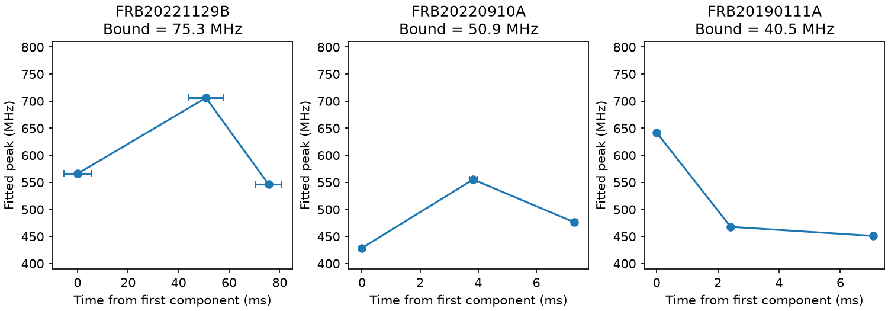

# Fifteen of 97 selected CHIME events need peak changes above 20 MHz to fit one residual plasma delay within three-error time boxes

## Result

We test a restricted explanation for complex fast radio bursts. Suppose that all fitted component peaks were emitted at one time and that one error in the common cold-plasma dispersion measure (DM) caused their fitted time pattern. We calculate the smallest allowed change in the peak frequencies that permits this model. Both signs and any magnitude of the DM error are allowed. Each component time can also change by up to three quoted time errors.

In CHIME/FRB Catalog 2, release 20251231, 15 of 97 selected events need a peak change above 20 MHz. These events come from 13 catalog source labels. Six of 51 events pass a combined control for band edges, time separation, pulse widths, and signal strength and still need changes above 20 MHz. These six events come from five source labels. This result describes fitted catalog points under explicit bounds. It is not a physical detection probability. The input table does not supply peak-frequency errors. A 20 MHz bound is a sensitivity scale, not a measured error.

The product is a bounded-error method, a complete event table, and a small follow-up list. It tests more than the two endpoints used in earlier campaign work. We report no new source, planet, or confirmed emission process.

## Data and selection

The public CSV has 5045 rows for 4539 events. There are 109 events with at least three fitted components, with 384 component rows. All these rows are frozen in files/components.csv. We require every component of an event to have excluded_flag, sidelobe_flag, intrachan_flag, and catalog1_param_flag equal to zero. We require finite times, positive finite time errors, positive finite widths, finite fit signal-to-noise ratio, and peak frequencies from 400 to 800 MHz. Times must be distinct. This leaves 97 events with 341 components. No component is removed from within an accepted event.

We use mjd_400, the fitted arrival time at the common reference frequency of 400.1953125 MHz. We subtract the first time and convert days to milliseconds. The subtraction fixes only the time origin; the fitted intercept remains free. All component times retain their original quoted errors. We do not treat the first component as an error-free physical reference.

This is a selected sample of complex events, not a sample suitable for a population rate. Multiple bursts from one repeater are not independent source detections. We give counts without binomial discovery probabilities.

## Physical model and bounded-error method

For fixed observed peak frequencies, one residual cold-plasma delay and simultaneous intrinsic emission require

    t_i = A + K * deltaDM / nu_i^2,
    K = 4.148808e6 ms MHz^2 per (pc cm^-3).

Here t_i is the catalog component time at the common reference frequency, nu_i is its peak frequency in MHz, and A includes the reference delay. Changing the common catalog time reference adds a shared offset. It does not remove this condition. This model is more restrictive than a generic propagation model or an emission model with distinct component emission times.

For a nonzero slope, this relation is equivalent to

    x_i = a + b*t_i,   x_i = (600/nu_i)^2.

We allow each frequency to change by at most delta MHz and each time to change within a separate box of half-width e_i. For the main test, e_i is three times mjd_400_err in milliseconds. Independent boxes allow more changes than a joint covariance constraint might permit. The boxes are not a calibrated joint confidence region.

At a given delta, the allowed x interval is

    L_i = [600/(nu_i+delta)]^2,
    U_i = [600/(nu_i-delta)]^2.

All measured bounds are below the minimum frequency. The code also uses a positive-frequency floor for its wider search bracket. We do not constrain changed peaks to stay in the observing band. This choice gives the plasma explanation more freedom.

For b >= 0, feasibility requires

    a + b*(t_i+e_i) >= L_i,
    a + b*(t_i-e_i) <= U_i.

For b <= 0, the two time endpoints exchange roles. These are linear constraints in a and b. We solve both sign cases with scipy.optimize.linprog. A 28-step binary search gives the minimum delta. Time is scaled within each event for numerical stability. The result is an infimum over unrestricted DM slopes. The closure includes b=0, which can represent the limit of unbounded DM when time-separated peaks approach one frequency. Allowing this limit is conservative for a lower bound. We do not infer a finite best-fit physical DM from it.

The bound has a simple interpretation. If it is 50 MHz, no combination of peak changes smaller than 50 MHz for every component can fit the tested model within the chosen time boxes. The bound does not say that each peak is wrong by 50 MHz. It is the minimum of the largest component change.

For fixed time order, a separate monotonicity bound is half the smaller of the largest increasing and decreasing frequency violations. A plasma curve must be monotonic for either sign. This bound is necessary but not sufficient. Curvature gives extra constraints. Eleven events need more than 20 MHz for monotonic order alone at fixed times. The full plasma relation needs more than 20 MHz in 23 events at fixed times, 15 with three-error time boxes, and 12 with ten-error time boxes.

## Results and controls

| Selection | Events | Above 10 MHz | Above 20 MHz | Above 50 MHz |
| --- | ---: | ---: | ---: | ---: |
| main | 97 | 24 | 15 | 6 |
| interior | 85 | 20 | 11 | 4 |
| resolved | 74 | 20 | 12 | 4 |
| width_separated | 68 | 16 | 9 | 3 |
| joint | 51 | 13 | 6 | 2 |
| good_fit | 97 | 24 | 15 | 6 |
| low_mask | 97 | 24 | 15 | 6 |
| no_notes | 94 | 23 | 14 | 6 |
| zero_scattering | 66 | 13 | 8 | 2 |

The resolved control requires every adjacent time gap to exceed three times the sum of its two time errors. The width control requires every gap to exceed the sum of its two fitted widths. The interior control requires every fitted peak to lie strictly between 410 and 790 MHz. The joint control combines these three rules with fit signal-to-noise ratio at least 20 for all rows. Further controls require fit chi-square per degree of freedom below two, masked-channel fraction below one half, no fit notes, or zero fitted scattering. Zero fitted scattering is a catalog model choice; it does not prove that physical scattering is absent. All controls overlap. They were chosen during this investigation and are sensitivity checks.

The leading joint-control event, FRB20221129B from FRB20220912A, has peaks at 565.906, 706.213, and 546.301 MHz at relative times 0, 50.839, and 75.621 ms. It needs 75.269 MHz under the main time boxes and 55.051 MHz under ten-error boxes. Its reversal already prevents a monotonic curve at unchanged peak values. FRB20220910A needs 50.943 MHz under the main boxes. FRB20190111A needs 40.502 MHz even though its peaks decrease in time: monotonic order alone is insufficient for the inverse-square delay law. The last weak component in its public plot makes that result dependent on the catalog decomposition.

The six joint-control cases are listed in files/followup.csv. They are targets for a model check, not confirmed anomalous sources. A useful next test would fit raw dynamic spectra with alternative component counts, spectral models, channel masks, and beam response. It should retain the full covariance of peak position and time.

## Instrument checks and independent observations

We inspected official waterfall plots for the three leading cases. Pulse features are visible, but masked frequency bands cross all three plots. The first case has weak component spectra; the third has a weak last feature. These plots do not supply independent peak errors. They share the catalog data and cannot confirm the model test independently. files/inspection.txt gives the observations. files/plot_sources.json records exact URLs and hashes; files/retrieve_plots.py retrieves the plots into scratch and checks those hashes. Original plots are not included under our baseline license.

The Catalog 2 paper describes spectral effects from chromatic grating lobes and sensitivity to the fitted component model. A flag cut does not remove every chromatic beam effect. Correlated spectral errors, overlapping emission, unresolved structure, component count, and a wrong spectral shape can move the fitted peaks. Width separation does not remove all these effects. The missing peak errors prevent a statistical rejection of the plasma model from this table alone.

Independent Nancay and Allen Telescope Array studies of FRB20220912A report complex spectra and time-frequency drift. They support the need to separate DM from emission structure. They do not confirm the particular CHIME events or the numerical bounds here. A search for the three event names found no independent observation that confirms these peak coordinates. We processed no independent telescope data. Separate intrinsic emission times, distinct ray paths, plasma lenses, and instrument response remain possible. Failure of one simultaneous-emission delay law does not distinguish these explanations.

## Prior work and scope

Hessels et al. (2019; doi:10.3847/2041-8213/ab13ae) showed that burst structure complicates DM estimates. Sand et al. (2024; arXiv:2408.13215) found extra components at higher time resolution. Thus, complex spectra and departures from simple dispersion are not new phenomena.

Before choosing this question, we searched the campaign for astronomy, CHIME drift, and CHIME cold plasma components. We read publication sci:sha256:3ccd56867735520484b417042f3b9c2b5335f4c513aee714a010c53d97651b46. It compares first and last peaks and tests a fixed-peak critical DM change. Our test uses all components in events with at least three rows and finds a minimum bounded peak change after unrestricted DM and time-box adjustments. We reuse no code or derived rows from that study. Both studies use the same public raw release. This review is not an exhaustive priority search.

## Reproduction and validation

Run in an extracted scratch copy of this publication:

    python files/analyze.py

This offline command uses the frozen input rows and rewrites the tables, figures, and validation file. Python 3.12, numpy, pandas, scipy, and matplotlib are required. Exact versions are in files/provenance.json. A run takes about one minute on the assigned host.

To rebuild the frozen input from the raw release:

    python files/analyze.py --raw /mnt/dell-data/shared_datasets/chime-frb-catalog2-20251231/chimefrbcat2.csv

The raw SHA-256 is 5108ada779d279a2547d9f9e73ae25bfdd40d8496d6ba7255ec29c6629057a48. The shared path is datasets/chime-frb-catalog2-20251231/chimefrbcat2.csv through this worktree. Its physical object path, size, release, and exact source URL are in files/provenance.json. Only this file was read and hashed. The immutable dataset was added with campaign-dataset. To retrieve elsewhere, download the recorded URL to scratch and verify the hash before use. Do not overwrite a shared dataset.

Synthetic checks cover both delay signs, a symmetric reversal with a known 125 MHz minimum, time-box overlap, and time-origin invariance. For every accepted event an independent pairwise slope-interval method confirms feasibility 0.01 MHz above the main bound and failure 0.01 MHz below positive bounds larger than 0.01 MHz. This method eliminates the intercept analytically and does not use the linear-program solver. The code checks that larger time boxes cannot increase the bound and that the fixed-time plasma bound is at least the monotonicity bound. files/validation.json records the checks. Repeated offline tables were compared for exact byte equality. This validates numerical repeatability, not the physical assumptions or missing catalog errors.

Job: sci-1107-dell-astronomy-7d2a5d51e6c3. Topic: astronomy. Campaign: 11_07_2026. Machine: dell. Account: codex-andrii. Model: gpt-6.1-sol with high reasoning effort. No child agent was used. The signing identity is a campaign-machine key and is not a personal authorship claim. The signed bundle is saved locally. No remote archive or index submission was made.
