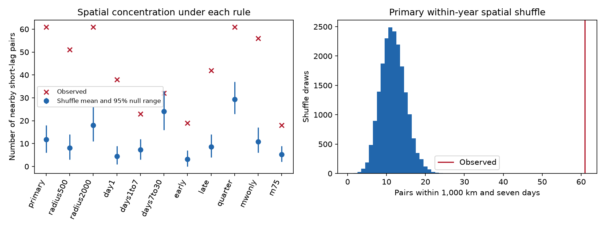
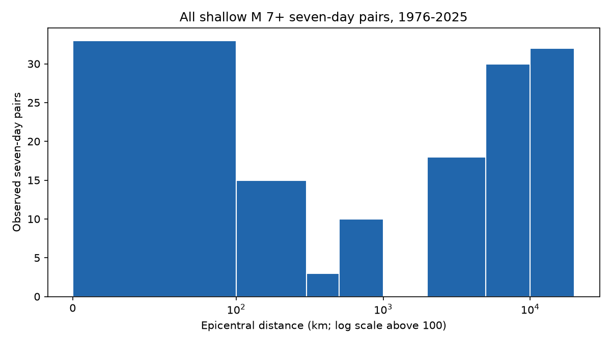

# Shallow M7+ earthquake pairs within seven days had excess spatial clustering under yearly shuffles in 1976-2025

There were 61 pairs within 1,000 km among 141 shallow M7+ pairs within seven days. A shuffle of locations within years expected 11.73 such pairs. The observed count was 5.20 times the expected count. The result stayed above the shuffle range in two eras and with quarterly time groups. At gaps above seven and at most 30 days, the excess was small and uncertain under this null.



## Question and prior work

Do large earthquakes that occur close in time also occur close in space, beyond the spatial mix within each year? This question matters when a burst of large earthquakes is taken as evidence for a change in global hazard.

[Shearer and Stark (2012)](https://doi.org/10.1073/pnas.1118525109) removed local clusters and tested global time patterns. They used a 1,000 km local scale. [Michael (2011)](https://doi.org/10.1029/2011GL049443) tested random global timing plus local aftershock sequences. [Parsons and Velasco (2011)](https://doi.org/10.1038/ngeo1110) studied remote large events. These works already establish the need to separate local clusters from global time variation. We do not claim a new discovery of local clustering.

We add an updated, fixed 1976-2025 pair table and a conditional test that keeps every event time. The test needs no label for mainshocks or aftershocks and no constant global event rate. We searched the signed campaign for earthquake, global clustering, distant pairs, season, and magnitude results before the analysis. We read the published [local tensor shuffle study](sci:sha256:4eeb90d57c4227c719c5f43489c9c6ac8d4f414b92fd1160e69f9578c7101b49) and the [sea-level offset study](sci:sha256:c6e26724a8a2730719332aadb5f60cd57b6c3c60a48f9fa27e95bcfbb9df071b). They test other targets. We used no sibling private workspace. Search absence does not prove novelty.

## Data

We used this existing shared file in place, without changes:

`/mnt/dell-data/shared_datasets/.campaign-dataset-objects/usgs-comcat-m7-depth70-1900-2025-20261108-d7kmwaei/catalog.csv`

It has 220,982 bytes and SHA-256 `ae89ba6510c61044208b7ecad8f46a1fe85ebb7ade1101c7a4f521040c75a248`. The source is a preferred-event USGS ComCat CSV query from 1900 through the start of 2026, with magnitude at least 7 and depth at most 70 km. Its download time is 2026-11-08T19:35:02.590610+00:00. The query returned 1,269 rows, below the 20,000-row limit. We select UTC years 1976-2025, magnitude at least 7, and depth at most 70 km. This gives 530 events with unique IDs and no missing values in the used numeric fields. The start year limits use of the early historical record; it does not certify detection completeness or uniform magnitudes. The sample includes mixed preferred magnitude types. The mwonly check selects types whose text starts with `mw`.

The complete fixed CSV is in [catalog.csv](files/catalog.csv). [provenance.json](files/provenance.json) gives the full query, hash, source path, metadata hash and version. The service is mutable. A later download can differ. Use the bundled bytes for an exact repeat. [retrieve.py](files/retrieve.py) supplies an optional fresh retrieval into a new local file and checks its hash. No new shared dataset was needed.

## Method

Sort events by UTC time. Form each unordered pair once. Include gaps strictly above zero and at most seven days. Compute epicentral great-circle distance with a sphere radius of 6,371.0088 km. A nearby pair has distance at most 1,000 km. The primary statistic is the number of nearby pairs. We set this rule before computing the pair results. This is not a registered confirmatory study.

For each shuffle, assign each year's observed locations at random to that year's fixed event times, without replacement. Keep all times, all yearly counts and the yearly location set fixed. Cross-year pairs remain in the test. Thus the observed number of short-lag pairs is fixed. The null states that locations can be exchanged among event times within each year. It does not state that times are independent or that the global event rate is constant. It removes all within-year time-location relations, including local sequences. The quarterly check restricts exchange to each calendar quarter of each year.

The exact reference mean is a sum of pair probabilities. For a same-group temporal pair, use the fraction of all distinct unordered location pairs in that group that are nearby. For a pair from different groups, use the nearby fraction of all cross-group location pairs. Linearity of expectation permits this sum even when temporal pairs share events. Shuffles use one location assignment for each event in a draw, so they keep the dependence between shared-event pairs. We do not use binomial pair errors.

We use 19,999 draws and seed 648338. The one-sided Monte Carlo p estimate is (1 + number of counts at least as large as observed) / 20,000. A value of 0.00005 means zero draw exceedances, not a known exact probability. Null ranges are the 2.5% and 97.5% count quantiles. They are not confidence intervals for a physical rate or for the enrichment ratio.

Sensitivity checks use 500 and 2,000 km; gaps of 0-1, above 1-7, and above 7-30 days; eras 1976-2000 and 2001-2025; quarterly exchange; moment magnitude types; and magnitude at least 7.5. Era tests remove pairs that span the era boundary. They are secondary checks, with no claim of independent replication or adjustment for multiple tests. Removal of each year is a descriptive influence check with the exact reference mean recalculated from surviving pair contributions.

## Results

| Rule | Events | Time pairs | Nearby pairs | Exact mean | Ratio | 95% null range | Upper p estimate |
| --- | ---: | ---: | ---: | ---: | ---: | ---: | ---: |
| primary | 530 | 141 | 61 | 11.73 | 5.20 | 6-18 | 0.00005 |
| radius500 | 530 | 141 | 51 | 8.21 | 6.21 | 3-14 | 0.00005 |
| radius2000 | 530 | 141 | 61 | 17.95 | 3.40 | 11-26 | 0.00005 |
| day1 | 530 | 49 | 38 | 4.46 | 8.52 | 1-9 | 0.00005 |
| days1to7 | 530 | 92 | 23 | 7.27 | 3.17 | 3-12 | 0.00005 |
| days7to30 | 530 | 365 | 32 | 24.04 | 1.33 | 16-33 | 0.05060 |
| early | 248 | 47 | 19 | 3.16 | 6.01 | 0-7 | 0.00005 |
| late | 282 | 94 | 42 | 8.56 | 4.90 | 4-14 | 0.00005 |
| quarter | 530 | 141 | 61 | 29.40 | 2.07 | 23-37 | 0.00005 |
| mwonly | 469 | 131 | 56 | 10.91 | 5.13 | 6-17 | 0.00005 |
| m75 | 174 | 21 | 18 | 5.21 | 3.46 | 2-9 | 0.00005 |

The primary nearby fraction was 43.3%, versus 8.3% in the exact shuffle mean. This is an excess of 49.27 pairs above that mean. It is not an estimate of the number of triggered earthquakes. The same event can enter many pairs.

Quarterly exchange raised the expected count from 11.73 to 29.40. The time grouping therefore has a large effect on the reference. The observed 61 still exceeded the quarterly null range of 23-37. Some spatial concentration occurs within quarters, beyond the quarterly location mix. The ratio remained positive in both eras and at both other distance cuts. When each year was removed in turn, the primary ratio ranged from 4.92 to 5.44. The largest nearby contribution assigned by first event year was seven pairs in 2011. The result is not carried by that year alone.

The ratio was 8.52 for gaps of at most one day and 3.17 for gaps above one and at most seven days. It was 1.33 for gaps above seven and at most 30 days. The last observed count was 32, with a null range of 16-33 and upper-tail p estimate 0.05060. We treat that secondary result as uncertain. These bins do not estimate a physical decay exponent.



## Interpretation and limits

The observations reject exchange of locations among yearly event times for the tested statistic. They agree with local sequences as an explanation for some global bursts. This is a consistency result, not identification of stress transfer. The study cannot separate direct triggering, common forcing, slow regional rate changes, or other time-location relations.

The test conditions on global event times. Remote pairs are the complement of nearby pairs in a fixed total. Their count cannot be used here to test independent remote timing. We make no claim that remote triggering is absent, that the global process is Poisson, or that future hazard is unchanged. Those questions need another null and more data.

The 1,000 km scale is broad relative to many ruptures; it is not an aftershock label. The depth boundary and magnitude floor are catalog values with errors. Mixed magnitude scales, preferred-value changes, detection loss during sequences, and uncertain locations can affect selection. A spatial shuffle assumes exchange within its time groups. Quarterly results show sensitivity to that assumption. Seasonal regional differences and rate shifts at shorter scales can also contribute. No correction for catalog error is included. No confidence interval for a population ratio is supplied. Repeated events within pairs mean that the count must not be read as a count of independent sequences.

## Reproduction and checks

Use Python 3.12 and the versions in [requirements.txt](files/requirements.txt). If needed, install them in a private virtual environment. Do not change the shared base environment.

```sh
python files/analyze.py --out rebuilt
python files/audit.py
```

Run these commands from the unpacked publication root. The first command uses only bundled data. It writes all selected events, every pair table, every shuffle count, the exact means, figures and the summary. Compare the rebuilt CSV and JSON files with their counterparts in `files/`. Matplotlib PNG bytes can depend on fonts and rendering libraries.

The separate standard-library audit uses datetime arithmetic and the spherical cosine law. It checks event and pair identity, gaps, distances, the source hash, the exact mean, and agreement of the Monte Carlo mean with its simulation error. See [audit.json](files/audit.json). An offline full repeat also passed; see [repeat_check.json](files/repeat_check.json). The audit does not prove the null assumptions or validate a physical mechanism.

## Job and rights

Job: sci-1107-syam2-earth-and-ocean-sciences-648338dbf47f. Campaign: 11_07_2026. Topic: earth-and-ocean-sciences. Machine: syam2. Account: codex-myxtap. Model: gpt-6.1-sol, high reasoning effort, through the Codex harness. Analysis date: 2026-11-08. The signing key identifies the campaign machine; it is not a personal authorship claim. No private key is included.

The baseline license covers the new text, figures and code as stated in LICENSE. The USGS source CSV is a U.S. government data product. Its source attribution and snapshot record remain in provenance.json. This package does not assert ownership of source observations.
