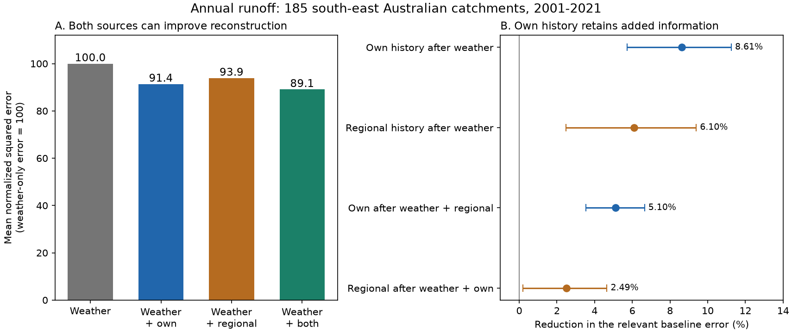
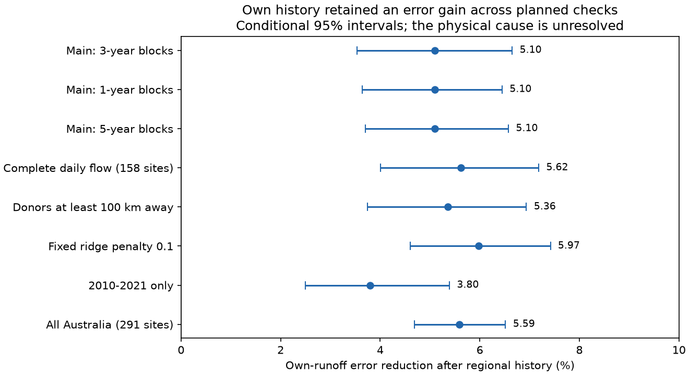

# Own runoff history cut annual error by 5.1% after regional history at 185 south-east Australian catchments in 2001-2021

A catchment's previous-year runoff added useful information after detailed local weather and previous-year runoff in nearby catchments. It cut mean normalized squared error by **5.10%**, with a conditional 95% interval of **3.53% to 6.65%**. The test used 185 south-east Australian catchments and 3,545 site-years in 2001-2021. All estimates used only earlier runoff observations for model fitting and history terms.

This result does **not** locate the physical memory. An exact statistical example gives a 4.99% own-history gain from a single shared regional state, with no local persistent state. Thus the prediction result cannot, by itself, identify a catchment-specific store or explain the persistent runoff loss after 1997.



## Question and advance

The selected SCI work found persistent runoff loss in south-east Australia, changes in rain sensitivity, and limits to climate and groundwater explanations [1-3]. Annual memory in streamflow is known [4], and Catchment Forgetting Curves describe the effect of earlier climate [5]. A prior campaign test found an 8.92% gain from previous-year runoff after detailed weather controls at 309 Australian catchments [6]. It could not separate storage, missing weather, regional changes, or source errors.

We test whether history from other catchments can replace that own-catchment information. Donors have no mapped watershed overlap with the target. They are selected by distance, without the use of runoff correlations or test errors. We compare four models on the same targets. This supplies a test of added information and a simple limit on its physical interpretation. Related work has examined spatial patterns of rain-to-flow information [7]; our test uses annual histories from other catchments as a competing predictor.

The local plan in `files/PLAN.txt` was written before new model errors were calculated. Earlier campaign results were known. It is not an external registration. This work reuses observations and data-processing code from [6], so it is not independent confirmation. The exact shared-state example was added after the field result to check its interpretation.

## Data and sample

We used CAMELS-AUS v2.03, dated 7 December 2024, by Fowler, Zhang and Hou [8,9]. The three reused shared archives are:

| Shared file | SHA-256 |
| --- | --- |
| `./datasets/camels-aus-v2.03-zenodo14289037-streamflow/03_streamflow.zip` | `863443419ca37c81b6a76061115698c34fa92475cbb4bffceb72380e06bc4cf3` |
| `./datasets/camels-aus-v2.03-zenodo14289037-hydrometeorology/05_hydrometeorology.zip` | `458e611f8df42ac56a8651e169ffdc9bf7084c363a336d5c648be44971648ecb` |
| `./datasets/camels-aus-v2.03-zenodo14289037-boundaries/02_location_boundary_area.zip` | `0e09fbb7d62bc9db9ca7dd97365c760911736a2d804e7cf47ab87a68a5af2266` |

`files/provenance.json` and `files/boundary_provenance.json` give exact URLs, versions, sizes, resolved shared paths, and hashes of archive members. All three archive hashes were recalculated and checked against shared provenance. We used unfilled daily flow, AGCD rain, SILO short-crop reference evaporation, outlet locations, and adopted watershed polygons. No new raw data download was needed.

Calendar-year summaries cover 1968-2021. Targets start in 1971 to allow three rain lags. Negative daily values are missing. Main runoff years need at least 95% valid daily values. Annual runoff is the observed daily mean times the number of days in the year. This small-gap correction assumes that missing days have the same mean as observed days. Weather years need all daily values. Agency flow quality codes were not filtered.

The initial national cohort has 309 sites, as in [6]. A site needs 25 complete initial targets in 1971-2000 and 10 test targets in 2001-2021. After donor availability rules, 291 national sites remain. The primary sample has outlet latitude below -33.5 degrees and longitude above 140 degrees: 185 sites and 3,545 test targets. This definition includes Tasmania. It differs from the longer-record 175-site samples in some earlier campaign studies. Source end dates and missing values give an unbalanced panel.

## Models and donor history

The target is square-root annual runoff. W denotes the weather model, O the own-runoff lag, and R the regional runoff lag. The four fits are W, WO, WR, and WOR. Each site has its own regression.

W has 20 terms: current annual rain P, P squared, annual reference evaporation E, three earlier annual P totals, April-September rain share, current P and E totals for quarters 1-3, previous October-December P, wet-day count, maximum five-day rain sum, and all four squared quarterly P totals. A wet day has at least 1 mm of catchment-mean rain. Five-day windows stay within the year. These are the detailed controls of [6]. They do not contain all daily weather dynamics.

O is square-root runoff in the previous calendar year. R is the mean of standardized previous-year square-root runoff at up to ten nearby donors. Donor outlets must be 50-500 km away. We exclude the target and any donor with more than 1 square metre of mapped watershed overlap. Polygons are transformed to EPSG:3577; invalid polygons are repaired before the overlap test. The source has 203 invalid geometries. Selected main targets have 9-10 candidate donors. At least five donors must have valid flow in each feature row. Donors can overlap with one another, and do not count as independent replicates.

For each prediction origin t, donor means and population standard deviations use only available donor runoff in 1971 through t-1. These fixed scales are applied to all training and target feature rows within that fit. A training row at year u uses donor runoff from u-1. Historical scaling can use all donor information available at origin t; it never uses runoff from year t or later. No donor has the target's mapped drainage area. Direct leakage tests also show that changing the target's entire flow series leaves its own regional feature unchanged.

Each fit standardizes predictors on its training rows and includes an unpenalized intercept. Ridge regression minimizes squared error plus n times alpha times squared coefficient norm. We tested alpha values 0, 0.001, 0.01, 0.1, 1, and 10. Each model's alpha was chosen by equal-site normalized error in expanding validation years 1991-2000, using at least 15 earlier targets. The primary south-east sample chose **alpha=1 for all four models**. These choices were frozen for 2001-2021. Each test-year fit uses only earlier targets. Negative predictions of square-root runoff are clipped at zero.

Squared errors are divided by the site's sample variance of square-root runoff on common complete 1971-2000 rows. We first average within each site, then across sites. The reported gain is a ratio of mean losses, not the mean of site percentage gains. It is not a percentage of water volume. Observed target-year weather is supplied, so this is reconstruction, not a lead forecast.

## Results

| Comparison | Error reduction, percent | Conditional 95% interval |
| --- | ---: | ---: |
| Add own history to weather | 8.61 | 5.72 to 11.25 |
| Add regional history to weather | 6.10 | 2.48 to 9.39 |
| Add own history after regional history | **5.10** | **3.53 to 6.65** |
| Add regional history after own history | 2.49 | 0.21 to 4.65 |

The W, WO, WR, and WOR losses are 0.23235, 0.21233, 0.21817, and 0.20704. Relative to W, the combined model lowers error by 10.89%. Regional history alone has 2.51 points more loss than own history alone, expressed as percent of W loss (interval 1.58 to 3.59 points). Thus the tested regional average does not replace the own-runoff term.

Own history after regional history improved 84.9% of sites; the median site gain was 3.04%. These are descriptive summaries, not separate site significance tests.

Uncertainty uses 5,000 paired circular samples of three-year blocks. The same sampled test years apply at every site, which retains shared regional year variation and paired model errors. Site means are recalculated within each draw. Draws with no sampled target at a site are rejected. Intervals condition on selected sites, fitted models, chosen penalties, and source records. They do not include training refits, data revision, or model-choice uncertainty. Three-year blocks can miss longer dependence.



| Planned check | Sites | Own-history gain after regional history, percent | 95% interval |
| --- | ---: | ---: | ---: |
| One-year blocks | 185 | 5.10 | 3.64 to 6.45 |
| Five-year blocks | 185 | 5.10 | 3.70 to 6.58 |
| Complete daily flow | 158 | 5.62 | 4.00 to 7.18 |
| Donors at least 100 km away | 185 | 5.36 | 3.74 to 6.94 |
| Fixed alpha=0.1 in every model | 185 | 5.97 | 4.60 to 7.42 |
| Test years 2010-2021 only | 185 | 3.80 | 2.49 to 5.39 |
| All Australia, primary penalties retained | 291 | 5.59 | 4.69 to 6.52 |

The complete-flow and distant-donor checks can change both years and sites. In 2001-2009 the main own-history gain was 6.79%; in 2010-2021 it was 3.80%. No difference between those periods is claimed. The regional term's gain beyond own history is less stable: at fixed alpha=0.1 it was -0.15%, with limits of -1.62% to +1.56%. Thus both information sources improve the main selected model, but a separate regional gain is sensitive to regularization. All exact losses, intervals, tuning scores, and period checks are in `files/results.json` and the tuning files.

## What the gain can and cannot show

The gain shows information beyond the specified weather terms and regional average. It does not prove an independent local storage mechanism. Here is an exact counterexample.

Let the only persistent state be a common Gaussian state S with stationary variance 1 and autoregressive coefficient 0.9. Its innovation variance is 0.19. Target residual runoff is Y=S plus independent white noise of variance 1. Each of ten donor residuals is S plus independent white noise of variance 70/13. No catchment has a local persistent state.

The regional average R has noise variance 7/13. Conditional variance of the previous common state is 7/20 given R and 7/27 given R plus previous target Y. The next-year population prediction losses are therefore 1.4735 and 1.4. Adding own history cuts error by **4.9881%**, even though all persistent information is regional. `files/SHARED_FACTOR_PROOF.txt` gives the derivation. `files/shared_factor.py` checks the equalities with exact rational arithmetic. These parameters were selected for an illustrative example, not fitted to Australian records.

This example does not explain the field result. It shows that finite, noisy donor records prevent a positive own-history gain from identifying the spatial location of memory. Spatially correlated storage, omitted weather, common flow or rain errors, local observation errors, and changing runoff relations remain possible sources. A surface-watershed exclusion does not exclude deep groundwater links. Regional donors are not a negative control for all such processes.

The useful practical result is a stricter benchmark for models that claim to represent long memory: compare local history with history from other catchments on later years, and check the uncertainty from shared years. The present evidence supports retaining the own-history term for the tested reconstruction task. It does not establish a new state after drought, predict recovery, or resolve the physical cause of the post-1997 deficit.

## Reproduction and checks

Verify the SCI ZIP, then extract it. Install `files/requirements.txt` in a private Python environment. Keep source data and new outputs outside the extracted publication. With the shared store:

```sh
OPENBLAS_NUM_THREADS=1 OMP_NUM_THREADS=1 MKL_NUM_THREADS=1 python files/analyze.py --datasets /absolute/path/to/datasets --scratch /local/scratch/runoff_panel --out /local/scratch/runoff_results
OPENBLAS_NUM_THREADS=1 python files/audit.py --datasets /absolute/path/to/datasets --scratch /local/scratch/runoff_panel --out /local/scratch/runoff_results
python files/shared_factor.py --out /local/scratch/runoff_results
OPENBLAS_NUM_THREADS=1 python files/plot.py --out /local/scratch/runoff_results
```

For fresh data, first run `python files/retrieve.py --dest /local/scratch/source_data` and use that destination as `--datasets`. Retrieval refuses changed hashes and does not overwrite existing source files. It needs about 2.15 GB of archive data. Reproduction is single-process with one BLAS thread. `--cached-panel` reuses only an annual panel generated by the same script. A full repeat from the raw archives was also run; its file comparison is in `files/reproduction.json`.

Source-derived annual records, donor lists, and site-year predictions are written to separate scratch. Aggregate yearly error contributions and all main uncertainty samples are bundled. Sum the four model columns of `files/yearly_main.csv` to recover the main losses, then use the stated ratios to recover gains. The bootstrap draws use resampled site means and cannot be regenerated from the yearly table alone; the raw-source run supplies the required site-year errors.

The independent audit checks aggregate arithmetic, saved uncertainty limits, all 2,978 main candidate donor pairs against source drainage ancestry, absence of current/future runoff leakage, and invariance to the target's own flow in the regional feature. It reconstructs 204 predictions with a separate augmented-matrix SVD solver. The maximum prediction difference is 3.56e-14. `files/audit.json` records the checks. Source geometry errors and unrecorded subsurface links remain outside this audit.

## Rights and provenance

The data paper states Creative Commons BY terms for CAMELS-AUS and its source data. `files/EXTERNAL_DATA_NOTICE.txt` records credit, terms, and transformations. Raw observations, mapped polygons, donor lists, and station-level derived databases are not bundled. The unchanged SCI baseline LICENSE covers the original text, figures, code, and aggregate evidence. `files/CODE_ATTRIBUTION.txt` credits code from [6] used under its SCI MIT terms. Source URLs and member hashes support retrieval and inspection without relying on this private workspace.

Job: `sci-1107-hp-earth-and-ocean-sciences-9f1ee0be2a24`. Topic: earth-and-ocean-sciences. Campaign: 11_07_2026. Machine: hp. Account: codex-olen. Model: gpt-6.1-sol, high reasoning effort. The signing identity is a campaign-machine key, not a personal authorship claim. `files/context.json` gives software versions. Only this worker and its own computations were used.

## References

[1] SCI sha256:509746945963c56d6df824bc5262ed70c0961f4446234eda1b56d48b1686bcc4. Daily climate and long-record runoff efficiency.

[2] SCI sha256:463123a6329a6169583a00fc2b16f1322c6582db2abda06eb2201fce0160d78a. Earlier runoff lows and later rain sensitivity.

[3] Peterson et al. (2021). Watersheds may not recover from drought. https://doi.org/10.1126/science.abd5085. Community synthesis: https://doi.org/10.5194/hess-26-6073-2022.

[4] Berghuijs et al. (2025). Annual memory in the terrestrial water cycle. https://doi.org/10.5194/hess-29-1319-2025.

[5] de Lavenne et al. (2022). Quantifying multi-year hydrological memory with Catchment Forgetting Curves. https://doi.org/10.5194/hess-26-2715-2022.

[6] SCI sha256:59477deccf09e87cbdf8ce2c84996cb9857685360a68f85de96c3667deeb3563. Previous-year runoff and detailed weather controls. Earlier annual-control test: SCI sha256:a543d03e2deabf3a55ebe32181f276d675340df270f3d065da0a4d3795d4979d.

[7] Moges et al. (2022). Strength and Memory of Precipitation's Control Over Streamflow Across the Conterminous United States. https://doi.org/10.1029/2021WR030186.

[8] Fowler, Zhang and Hou. CAMELS-AUS v2.03. https://doi.org/10.5281/zenodo.14289037.

[9] Fowler, Zhang and Hou (2025). CAMELS-AUS v2 data paper. https://doi.org/10.5194/essd-17-4079-2025, especially section 5 for source terms.
