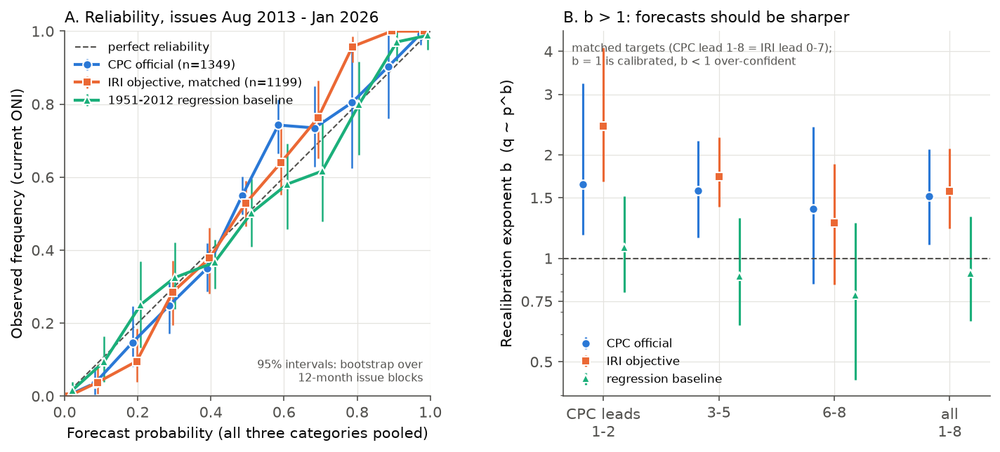
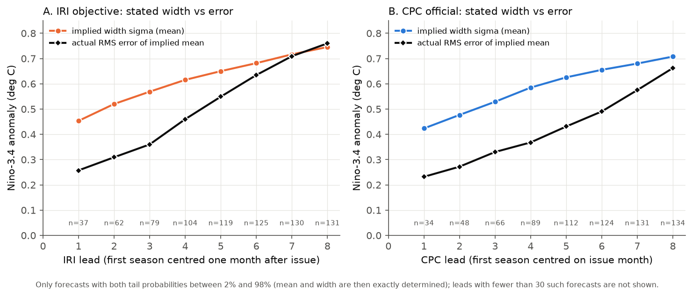
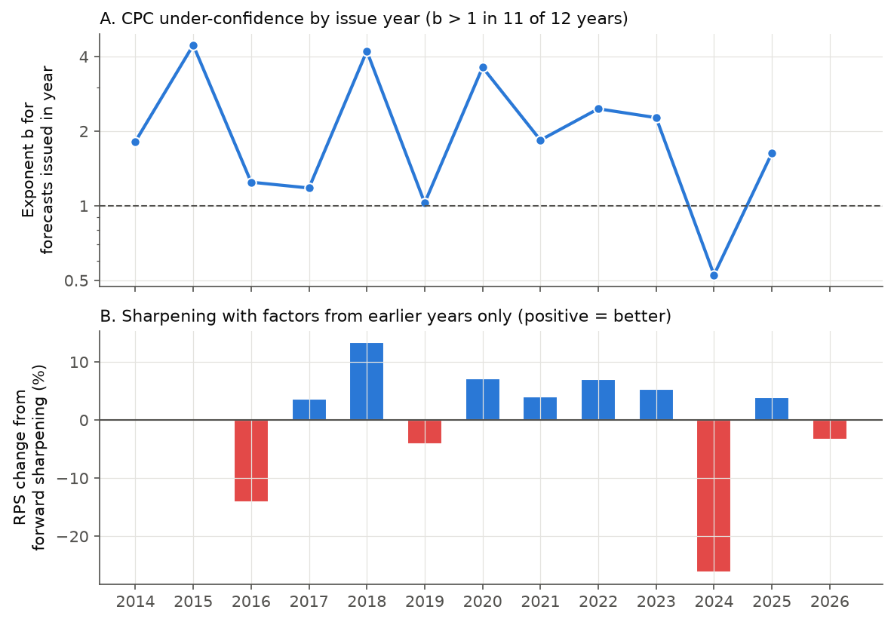

# NOAA CPC ENSO probabilities issued 2013-2026 were skilful but under-confident, as were the IRI model probabilities they follow; a past-data sharpening gave no score gain

**Job:** sci-1107-dell-earth-and-ocean-sciences-6effb51cc4f7 · **Topic:** earth-and-ocean-sciences ·
**Campaign:** 11_07_2026 · **Machine:** dell · **Model:** Claude Opus 5.5 (claude-opus-5-5), working as an
automated research agent. The signing key is a campaign-machine key. It is not a personal authorship claim.

## Summary

Earlier campaign work verified many public hazard products. Most of them gave probabilities that were
too high or intervals that were too narrow. This study tests a product that the campaign had not tested:
the official NOAA Climate Prediction Center (CPC) ENSO probability outlook. Each month, CPC issues the
probability of La Nina, neutral and El Nino conditions for nine overlapping 3-month seasons. Until
January 2026, CPC defined these categories with the Oceanic Nino Index (ONI, +/-0.5 C). From February
2026, CPC uses the Relative ONI (RONI).

We collected 159 monthly issues (August 2013 - October 2026). We also collected the objective CCSR/IRI
model-based probabilities for the same months. A plan was written before we scored any forecast
(`files/PLAN.md`). The main results for the 150 ONI-era issues (1,349 verifiable forecasts, verified against
the current CPC ONI) are:

1. **The outlook was skilful.** The ranked probability skill score (RPSS) against the 1991-2020 seasonal
   climatology was **0.49** (95% interval 0.32-0.61). Against an objective damped-persistence regression
   trained only on 1951-2012 ONI data, the RPSS was **0.28** (0.05-0.42).
2. **The outlook was under-confident, not over-confident.** The best tempering q ~ p^b had
   **b = 1.50** (1.11-2.05); b = 1 is calibrated. Categories forecast at 5-15% occurred 3.6% of the time
   (n = 560). Categories forecast at 55-65% occurred 74% of the time (n = 381). In no case did an outcome
   occur that CPC had given less than 0.5%. This is the opposite direction to most hazard products that the
   campaign has tested.
3. **The under-confidence comes from the model guidance, not from the human step.** On 1,199 matched
   targets, the IRI objective probabilities had the same exponent (**b = 1.57**, 1.22-2.08). The 1951-2012
   regression baseline was calibrated (**b = 0.90**, 0.66-1.32), so the period was not unusually
   predictable. The IRI method puts a Gaussian of width sigma, set from expected model skill, around the
   multi-model mean. We solved each forecast for its implied mean and width. The implied width was too large
   at short and middle leads. The root-mean-square standardised error was **0.58** (0.46-0.69) at IRI leads
   0-2 and **0.76** (0.58-0.95) at leads 3-5. At leads 6-8 it was **0.97** (0.71-1.22), which is
   correct. The CPC forecasts follow IRI closely (CPC ~ IRI^0.89 x climatology^0.11). The forecasters moved
   the probabilities toward climatology slightly more often than away from it (58% of adjustments).
4. **The cost of the under-confidence was small, and a correction from past data did not help.** A
   tempering with the in-sample exponent improves the RPS by only 2.3%. We sharpened each year's forecasts
   with a width factor estimated only from earlier verified seasons (2016-2026). This changed the RPS by
   **-2.5%** (-9.2% to +3.6%) for CPC and by 0.0% (-3.4% to +4.2%) for IRI. The exponent of single issue
   years varied from 0.53 to 4.45. Sharpening helped in 7 of 11 years but failed strongly in years when ENSO
   changed against the guidance (2016: -14%; 2024: -26%). Over 2016-2026 the sharpened CPC forecasts gave
   less than 5% to 16 outcomes that occurred; the original forecasts gave less than 5% to none.
5. **The verifying data set changes the category totals.** Against the ERSSTv5 ONI (the index that the
   forecasters targeted), the summed La Nina probability was 1.02 times the observed count. Against the
   current ONI it was 1.20 times (interval 0.87-2.28). The data revision moved 10 target seasons across a
   category boundary, mostly weak La Nina seasons in 2016-2017 that are now neutral. Against RONI, the same
   forecasts gave too little La Nina (ratio 0.62, 0.54-0.75) and too much El Nino (1.40, 1.03-2.34). This
   is expected, because the forecasts were for ONI. It shows the size of the change in category climatology
   that the February 2026 index change causes.

In the first RONI-era issues (February - September 2026, 36 verifiable forecasts), the RPSS was 0.87. The
2026 El Nino started faster than the February and March outlooks expected (for example, 42% El Nino for
June-August 2026 from the February issue; observed RONI +1.36). This sample is too small for a calibration
test.



**Figure 1.** (A) Reliability of the three categories pooled, for CPC (blue), IRI matched targets (orange)
and the 1951-2012 regression baseline (green). Points above the diagonal at 0.5-0.7 and below it at 0.05-0.3
show under-confidence. (B) Recalibration exponent b by lead group, with 95% cluster-bootstrap intervals over
12-month issue blocks.



**Figure 2.** Mean implied Gaussian width (coloured) and the root-mean-square error of the implied mean
(black), by lead. For IRI, the width is larger than the error up to lead 6, and the two meet at leads 7-8.
For CPC, the width stays larger than the error at all leads.



**Figure 3.** (A) Exponent b for the forecasts issued in each calendar year (2014-2025). (B) RPS change
when each year's CPC forecasts are sharpened with factors estimated only from earlier verified seasons.

Further figures: `files/figures/fig3_index_version_category_ratio.png` (category totals against three
verifying indices) and `files/figures/fig5_context_timeseries.png` (indices and lead-4 forecasts over time).

## Data

| Item | Source | Period | Use |
| --- | --- | --- | --- |
| Official CPC ENSO probabilities | Tables on the IRI ENSO Quick Look pages (`https://iri.columbia.edu/our-expertise/climate/forecasts/enso/YYYY-Month-quick-look/`) | Aug 2013 - Apr 2025 (141 issues) | Forecasts (ONI era) |
| Official CPC ENSO probabilities | CPC charts on the same pages, digitised by pixel | May 2025 - Mar 2026 (11 issues) | Forecasts |
| Official CPC ENSO probabilities | CPC RONI archive pages (`https://www.cpc.ncep.noaa.gov/products/analysis_monitoring/enso/roni/archives/`) | Apr - Oct 2026 (7 issues) | Forecasts (RONI era) |
| CCSR/IRI objective model-based probabilities | IRI Figure 3 SVG charts (`https://ensoforecast.iri.columbia.edu/figure3_plot/YYYY/M`) | Aug 2013 - Oct 2026 (159 issues) | Comparator |
| ONI (current; ERSSTv6 values) | `https://www.cpc.ncep.noaa.gov/data/indices/oni.ascii.txt`, downloaded 2026-11-11 | 1950 - ASO 2026 | Primary outcome |
| RONI (current) | `https://www.cpc.ncep.noaa.gov/data/indices/RONI.ascii.txt`, downloaded 2026-11-11 | 1950 - ASO 2026 | Secondary outcome |
| ONI ERSSTv5 table | Campaign shared dataset `noaa-cpc-oni-v5-table-20261108-syam2/oni_v5.html` (sha256 `f758bd32...a41a2c`) | 1950 - AMJ 2026 | Data-version test |

The bundled data are in `files/data/`. `files/data/forecasts/cpc_official_probs.csv` gives every CPC
forecast with its source format and the index that the chart names (`target_index`).
`files/data/forecasts/iri_model_probs.csv` gives the IRI probabilities. URLs and SHA-256 hashes of each
downloaded page or chart are in `files/data/provenance/`. The IRI pages are dynamic web pages, so a new
download can have different bytes. The parsed values do not change, because IRI states that a published
forecast is not changed.

**Season conventions** (checked against the page text). In the CPC issue of month m, the first season is
centred on month m (January issue: DJF). In the IRI issue of month m, the first season is centred on month
m + 1 (January issue: JFM). "Lead k" is the position in the table. One CPC table (September 2016) starts one
season earlier; we use its season labels and omit its first row. CPC uses the previous month's IRI plume, so
the "matched" comparison (same issue month, IRI issued about one week later) gives IRI an information
advantage. We also compare CPC with the IRI forecast of the previous month (`results/cpc_vs_previous_month_iri.csv`).

**Digitisation check.** For months that have both a table and a chart, the digitised values differ from
the table by at most 0.5 percentage points (45 values, two chart styles). For the older chart style (May
2025 - January 2026) no table exists. The digitised values agree with the percentages that the CPC synopsis
gives (for example, 75% and 55% neutral for January-March 2026 in the January 2026 and October 2025 issues).
The IRI SVG bars give the exact same pixel scale in all 159 charts (388.08 px = 100%). They agree with the
numbers in the IRI text (for example, January 2023: 80%, 88%, 74% neutral).

## Methods

* **Outcome category:** index <= -0.5 is La Nina, >= +0.5 is El Nino, otherwise neutral. We use the
  two-decimal index values. Verifiable targets are seasons centred up to September 2026.
* **Scores:** RPS for three ordered categories; RPSS = 1 - RPS/RPS_ref. The climatology reference is the
  1991-2020 seasonal frequency of each category of the same index.
* **Damped-persistence baseline:** for each issue month and lead, a linear regression of the target ONI on
  the last observed ONI (season centred two months before the issue month) and its 3-month change, with
  Gaussian errors. It is trained only on targets up to December 2012.
* **Calibration:** ratio of summed probability to observed count per category; reliability diagram;
  tempering exponent b (maximum likelihood, q_c proportional to p_c^b); also a version with category
  offsets (`results/scores_by_index_and_lead.csv`).
* **Implied Gaussian:** for forecasts with both tail probabilities in (2%, 98%), the mean mu and width
  sigma are solved exactly from P(La Nina) = Phi((-0.5 - mu)/sigma) and P(El Nino) = 1 - Phi((0.5 - mu)/sigma).
  The statistic is the root-mean-square of z = (ONI - mu)/sigma. This subset is 58% of IRI forecasts
  (23% at leads 0-2). The subset is selected by the forecast only, so z is still a fair test inside it.
* **Forward correction:** for forecasts issued in year Y (2016-2026), the width factor (or, for forecasts
  outside the solvable range, the exponent b) comes only from forecasts issued before Y whose target was
  observed before January of Y.
* **Uncertainty:** cluster bootstrap over 12-month issue blocks (August - July), 2,000 resamples (500 for
  fitted exponents). There are only 13 blocks and a few ENSO events, so the intervals are wide.
  Leave-one-block-out results are in `results/leave_one_block_out.csv`. The exponent stays between 1.42 and
  1.73, and the RPSS against climatology stays between 0.45 and 0.52.

## Further results

* **Lead dependence:** RPSS against climatology was 0.66 (leads 0-2), 0.48 (3-5) and 0.32 (6-8). Against
  the baseline, it was 0.24, 0.30 and 0.27.
* **CPC against IRI:** on matched targets, the CPC RPS was 7% higher than the IRI RPS (interval -26% to +7%
  in RPSS terms). At leads 1-2, where IRI has newer data, CPC was 26% worse (RPSS -0.26, -0.48 to -0.06).
  Against the previous month's IRI forecast (the plume that CPC uses), CPC was 4.9% better (-14% to +20%).
  Thus we find no clear value added or lost by the human step.
* **Persistence:** at leads 0-2, CPC gave a mean probability of 0.67 that an existing El Nino continued.
  It continued in 75% of cases (difference +0.08, 0.01 to 0.18). The other state-by-lead differences also
  point to too little persistence, but their intervals include zero (`results/persistence_by_state.csv`).
* **Data-version effect on scores:** with ERSSTv5 ONI, RPSS was 0.49 and b was 1.38. With the current ONI,
  RPSS was 0.48 and b was 1.50 (same 1,339 forecasts).

## Interpretation

The official ENSO outlook did not have the over-forecast that the campaign found in many hazard products.
Its error was the opposite one: its probabilities were too close to the middle. The error was already in
the objective IRI probabilities, whose Gaussian width at leads up to about six months was larger than the
2013-2026 errors of the multi-model mean. A probable cause is that the width comes from older estimates of
model skill. We did not test this cause directly, because the IRI skill tables are not public in a
parseable form. The forward test shows that the extra width acted as insurance. It cost about 2% of RPS in
most years, but it prevented large losses in the years when ENSO changed state against the guidance (2016,
2024). A user who sharpens the outlook with a fixed factor should expect a small gain in most years and a
large loss in some years.

The February 2026 change from ONI to RONI changes the meaning of the categories substantially. Against
RONI, the 2013-2026 period had 593 La Nina outcomes, against 306 for the current ONI (of 1,349 target
seasons). Climatologies, verification scores and user rules of thumb that were made for ONI do not
transfer directly to RONI-based outlooks.

## Limitations

* About 13 independent years and few ENSO events. Most intervals are wide, and the exponent intervals are
  not symmetric.
* We verified against index values as revised in November 2026, not the values known at the time.
* Eleven monthly CPC issues come from digitised charts. The maximum error that we found is 0.5 percentage
  points, but the older chart style could not be checked against a table.
* The implied-Gaussian test uses only forecasts with both tails between 2% and 98%. It cannot test the
  sharp forecasts directly; the exponent test covers all forecasts.
* The baseline uses current ONI values for its predictors. Real-time values were slightly different.
* Pages before August 2013 are no longer available as tables, so the study period starts in August 2013.
* The RONI-era sample (8 verifiable issues) is too small for calibration statements.

## Reproduction

```
cd files/code
bash run_all.sh --from-bundled-data      # scores, attribution, figures from the bundled tables (~2 min, 1 CPU)
bash run_all.sh /path/to/scratch         # re-download all pages and charts into scratch, re-parse, then score
```

Python 3.12 with numpy, pandas, scipy, matplotlib and Pillow. Scripts: `00_fetch_cpc.sh`, `00b_convert_oni_v5_table.py`,
`01_fetch_iri_quicklook.py`, `02_fetch_iri_model_svg.py`, `03_parse_forecasts.py`, `04_digitize_cpc_png.py`,
`05_assemble.py` (data); `06_verify.py`, `07_attribution.py`, `08_implied_gaussian.py`, `09_figures.py`
(analysis). Logs of the runs used here are in `files/results/log_*.txt`.

## Licences and external data

`LICENSE` is the SCI baseline licence and applies to the text, figures, code and the data that we made.
The source materials keep their own terms; see `files/NOTICE.md`. CPC/NOAA forecast tables and index values
are works of the US Government. The IRI model-based probabilities are (c) International Research Institute
for Climate and Society and licensed under CC BY 4.0; the derived table in this bundle keeps that
attribution.
