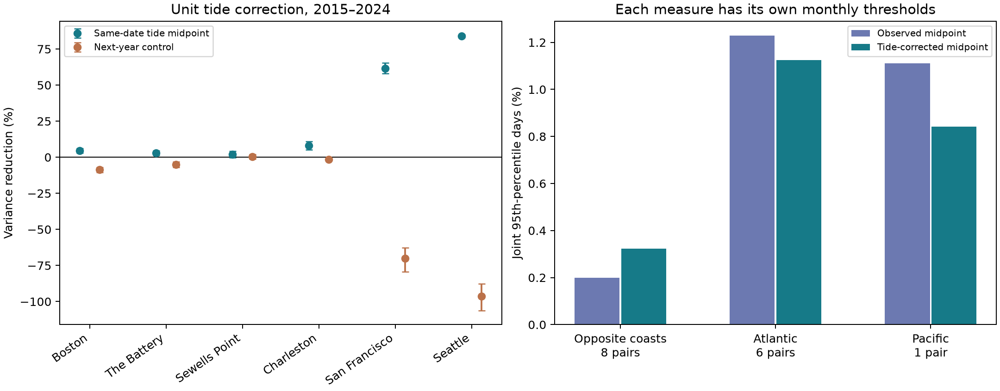

# NOAA tide subtraction reduced daily midpoint variance by 61% at San Francisco and 84% at Seattle in 2015-2024

## Question and main result

Can the midpoint of a day's highest and lowest water levels serve as a measure with little tide variation? We tested a direct tide correction at six US gauges in 2015-2024. We used NOAA hourly tide predictions on the same local dates as the observations. We did not fit a correction coefficient.

The correction reduced midpoint variance by 61.43% at San Francisco and 84.12% at Seattle. The four Atlantic estimates were 1.84% to 7.97%. The equal-site mean reduction was 27.14%, with a paired 95% block interval of 25.97% to 28.40%. These are fractional reductions calculated at each site, then averaged. They are not a reduction in pooled coastal variance.

The result shows a limit of the daily midpoint as a tide filter. Its performance differs greatly between these sites. It does not show that the corrected midpoint measures storm surge. A secondary test found more shared upper-tail dates between coasts after the correction. Lower variance did not imply less shared tail timing.



The left panel shows the variance reduction and pointwise conditional 95% intervals. Negative values mean a variance increase. The control uses the next year's predicted tide on matching month and day. The right panel shows relative-tail date rates, with a separate threshold for each measure. It does not show a change in flood risk. Group difference intervals are in the table below.

## Prior work and contribution

Haigh and colleagues (2016; [doi:10.1038/sdata.2016.107](https://doi.org/10.1038/sdata.2016.107)) separated extreme sea levels from extreme skew surges at UK gauges. This gives a reason to test tide removal before a weather interpretation. NOAA describes its tide predictions as sums of harmonic components. NOAA also documents the hourly observation extrema and their quality flags.

The campaign report `f4d67b9a` found shared high-water dates at six US gauges. Reports `d8f71827` and `ba13f688` tested fixed lunar-period fits. Report `9ceec806` tested shared daily midpoint extremes at two Atlantic gauges. Report `6b219d2d` found much less cross-coast tail alignment for midpoints than for maxima. All full SCI identifiers are in `sci.json`.

Those reports warned that a midpoint is not a tide-free surge measure. We test that warning with full NOAA hourly tide predictions, rather than selected lunar-period terms or an ideal symmetric-tide argument. We add 60 raw annual prediction responses and a matched daily benchmark. This is a method check and a small extension of the campaign evidence. We do not claim a new tide mechanism or the first use of this correction.

We searched the published campaign before fixing the question. We read published reports, not private worker folders. `files/literature.txt` records searches and sources. `files/plan.txt` gives the within-session plan saved before outcome estimates. It is not an external registration. Prior reports had already examined overlapping observation years. This is not a blind holdout study.

## Data and scope

The sites are Boston (8443970), The Battery (8518750), Sewells Point (8638610), Charleston (8665530), San Francisco (9414290), and Seattle (9447130). The sites follow shared long-record data availability. They are not a random sample of US coasts. We chose 2015-2024 as ten complete recent years. The end date also avoids the 2025 month-end minimum coverage problem reported in `9ceec806`.

Observations come from 18 shared NOAA CO-OPS source objects. Each site has two daily maximum/minimum objects, for 2010-2019 and 2020-2025, and one monthly object for 1960-2025. These are API snapshots labelled `20261108`, not immutable NOAA releases. Only 2015-2024 enters the estimates. We read and hash only these source objects and their metadata. No shared dataset was changed or downloaded again.

Exact source paths follow this pattern:

```text
/mnt/dell-data/shared_datasets/noaa-coops-STATION-daily-2010-2019-msl-lst-20261108/data.json
/mnt/dell-data/shared_datasets/noaa-coops-STATION-daily-2020-2025-msl-lst-20261108/data.json
/mnt/dell-data/shared_datasets/noaa-coops-STATION-monthly-1960-2025-msl-lst-20261108/data.json
```

`files/observation_provenance.json` lists all 18 exact resolved paths, source URLs, byte counts, SHA-256 hashes, and saved source metadata. Original metadata bytes are in `files/source_metadata/`.

For each site and year, we requested NOAA hourly tide predictions with MSL datum, metric units, and local standard time. These 60 responses contain 526,032 hourly values. They were fetched on 2026-11-08 from 11:48:48 to 11:49:21 UTC. All raw response bytes and their metadata are in `files/raw_predictions/`. `files/prediction_provenance.json` records the exact queries and hashes. No shared prediction dataset with these years was found. These new multi-file downloads stayed on local disk and are preserved in this package. They were not imported into the shared store.

Predictions have no immutable constituent version in the returned responses. The saved bytes define the tested prediction product. They are a tide calculation fetched in 2026 for past dates, not predictions archived before each event. Changes in tide constituents can limit their match to past conditions.

All observed and predicted heights use metres and local standard dates. We require both hourly observation extrema to have 100% coverage and inferred flag zero. The maximum must be at least the minimum. The monthly observed MSL must be present and non-inferred. A station-month must have at least 90% valid paired days. Each prediction date must contain 24 unique hourly values. We remove February 29 for the year-shift control. We do not fill gaps.

The selection retains 704 of 720 station-months and 21,279 station-days. `files/coverage.csv` lists all month decisions. `files/daily.csv` preserves selected observed extrema, observed monthly means, predicted extrema, and exact sums and counts for the predicted monthly means. `files/prediction_daily.csv` also gives predicted extrema on dates without valid observations, which are needed for the control.

## Correction and primary statistic

Let h and l be the observed daily hourly maximum and minimum. Let M be observed monthly mean sea level. Let hp and lp be the maximum and minimum of the 24 predicted hourly levels on that date. Let Mp be the mean of all predicted hourly levels in that calendar year-month, including February 29 when present. Define:

```text
C = (h + l)/2 - M
P = (hp + lp)/2 - Mp
Z = C - P
```

C is the observed midpoint anomaly. P is the predicted midpoint anomaly. Z is the corrected midpoint. Removing Mp keeps the correction focused on variation within each month. The observed fixed MSL datum and the observed monthly MSL value are distinct quantities. Neither C nor Z is the daily mean water level.

For an ideal symmetric daily tide with extrema B+T and B-T, the midpoint is B. Tide amplitude T cancels. Real daily extrema can come from different tide cycles. Unequal highs and lows, multiple tide components, the day boundary, and hourly sampling can break that argument. P directly measures the midpoint produced by the tested tide calculation.

For each site and measure, we first remove its mean for each calendar month over the ten years. We then compute the mean squared departure from those means. The primary site effect is `1 - variance(Z)/variance(C)`. The primary group effect is the equal-site mean of the six effects. No coefficient, tide period, or station weight is fitted to improve the result. This is a retrospective variance comparison, not an operational forecast.

The control replaces P with the next year's P on matching month and day. The mapping wraps 2024 to 2015. It uses the same valid observation dates. This shifts tide phase while approximately keeping calendar season. It is a specificity check, not a formal null model or a test of every possible alternative explanation.

We use 1,999 paired bootstrap samples of years. A bootstrap sample joins random circular blocks of three adjacent years and keeps the first ten sampled years. A block can wrap from 2024 to 2015. Each draw is common to all sites and measures. We refit the calendar-month means in each draw. The interval uses the 2.5th and 97.5th percentiles. Seed is 590711. One-year and five-year blocks are sensitivity checks. With only ten years, these intervals cannot cover long tide or climate cycles well.

## Variance results

| Site | Valid days | Reduction (%) | Pointwise 95% interval (%) | Next-year control reduction (%) |
|---|---:|---:|---:|---:|
| Boston | 3,586 | 4.53 | 3.06 to 6.07 | -8.73 |
| The Battery | 3,577 | 2.95 | 1.42 to 4.44 | -5.07 |
| Sewells Point | 3,570 | 1.84 | -0.20 to 4.24 | 0.40 |
| Charleston | 3,601 | 7.97 | 5.05 to 10.82 | -1.42 |
| San Francisco | 3,428 | 61.43 | 57.90 to 65.54 | -70.16 |
| Seattle | 3,517 | 84.12 | 82.98 to 84.83 | -96.21 |

The Sewells Point interval includes zero. We do not claim a clear reduction at every site. The intervals for individual sites are descriptive and have no family correction. The primary test is the fixed equal-site mean.

The mean correction effect is 27.14%, with interval 25.97% to 28.40%. The mean next-year control effect is -30.20%, with interval -33.56% to -27.54%. The mean difference between correction and control is 57.34 percentage points, with interval 54.25 to 60.86 points. Subtracting a signal of similar scale on different dates does not reproduce the benefit.

The primary mean intervals are 25.77% to 28.41% with one-year blocks and 26.36% to 27.79% with five-year blocks. These checks retain a positive mean. They do not establish valid long-run interval coverage.

After calendar-month means are removed, predicted midpoint standard deviations are 0.075 m at San Francisco and 0.223 m at Seattle. Observed midpoint standard deviations are 0.097 m and 0.248 m. Corrected values are 0.060 m and 0.099 m. The four Atlantic predicted midpoint standard deviations are 0.022 to 0.036 m. These scales help explain why the correction matters much more at the two tested Pacific sites. They do not establish a coast-wide difference.

## Secondary extreme-date test

For C and Z separately, an extreme is strictly above the site's calendar-month 95th percentile over retained dates. Percentiles use linear rank interpolation. All calculations preserve exact ties from the millimetre source data. An integer scale represents both half-millimetre extrema and predicted monthly means. The comparison with a percentile uses integer arithmetic. The correction changes which dates enter each measure's tail.

For each of 15 site pairs, we divide joint extreme dates by common valid dates. We then give equal weight to pairs within each group. The bootstrap uses the same three-year draws as the primary analysis and refits thresholds in every draw. These are secondary, unadjusted, conditional intervals. They are not independent replications across pairs, which share sites.

| Pair group | Pairs | C joint rate (%) | Z joint rate (%) | Z minus C (points) | 95% interval (points) |
|---|---:|---:|---:|---:|---:|
| Opposite coasts | 8 | 0.199 | 0.323 | 0.124 | 0.070 to 0.231 |
| Atlantic | 6 | 1.229 | 1.125 | -0.104 | -0.143 to 0.080 |
| Pacific | 1 | 1.111 | 0.841 | -0.270 | -0.568 to 0.216 |

Across opposite coasts, seven pair rates rise and one is unchanged. The 90th-percentile group rate also rises, from 0.879% to 1.228%. At the 99th percentile it rises from 0.0037% to 0.0075%, but counts are sparse. We do not supply an interval or a discovery test for those two threshold checks. Full pair counts and denominators are in `files/pairs.csv`.

The secondary result is not a contradiction of the earlier maximum-to-midpoint comparison. Here we compare a midpoint with a further tide-corrected midpoint, in a shorter period. A lower variance can still have a more aligned relative tail after new thresholds are fitted. We did not test whether the corrected rate exceeds a suitable independence model. The result cannot show shared storms between coasts.

## Meaning and limits

The midpoint is an incomplete tide filter in these records. Its large removable variation at Seattle and San Francisco supports the warning in prior campaign work. The next-year control supports a role for the tide calculation's timing. It does not identify every removed component. NOAA harmonic predictions can contain empirical seasonal terms. Historical constituent change, model errors, and common source processing remain possible influences.

Z is not pointwise observed-minus-predicted water level. Observed and predicted daily extrema can occur at different times. Within-day weather and tide-surge interaction can change both extrema. Subtracting their midpoints does not yield a validated storm-surge record. A stronger physical separation needs matched hourly observations, tide-model checks, and weather information.

Both monthly mean removal and calendar-month centering remove some low-frequency variation. They can also remove weather signal. Same local dates on opposite coasts cover different UTC windows. Hourly extrema can miss six-minute peaks. Strict coverage filters can select against severe events. Gauge changes and datum history were not independently checked. The exact source audit verifies the saved product, not the instruments or NOAA processing.

The study has six selected gauges, two Pacific sites, and ten years. The mean is driven mainly by those two sites. Bootstrap intervals condition on the chosen sites, the saved data, the fixed correction, and the block assumptions. They omit product revision and model uncertainty. Long nodal cycles and climate variation can exceed the resampled block lengths. No flood damage, return period, causal weather attribution, recovery time, or future risk is estimated. The practical result is a documented limit of a daily-summary method.

## Inspection, reproduction, and audits

The package contains source code, 60 full prediction responses, 18 observation metadata records, exact source hashes, selected daily evidence, 720 coverage decisions, corrected values, event labels, thresholds, all pair counts, 5,997 bootstrap result rows, explicit sampled years, a figure, and audit reports. The large shared observation responses remain in place. They need not be duplicated for offline numerical reproduction.

Use a writable copy of the verified bundle. Create a Python environment outside the copy and install `files/requirements.txt`. The original environment used Python 3.12.15, NumPy 2.5.4, and Matplotlib 3.11.2. `files/environment.json` gives system details. Keep library threads at one. From the bundle root, run:

```sh
PYTHON_BIN=/absolute/path/to/environment/bin/python sh files/reproduce.sh
```

This uses `campaign-compute` and writes to a new sibling directory, `../midpoint-tide-repeat`. Set `REPEAT_DIR` to another new local path if needed. It rebuilds all numerical results from bundled CSV files with no network or shared-source access. It compares six result files byte for byte. The saved run passed; `files/repeat_audit.json` records the matching hashes. On a host without the campaign helper, apply equivalent resource limits and run `python files/analyze.py --out NEW_LOCAL_DIRECTORY`.

For a source rebuild on this host, use:

```sh
export OPENBLAS_NUM_THREADS=1 OMP_NUM_THREADS=1 MKL_NUM_THREADS=1 PYTHONDONTWRITEBYTECODE=1
campaign-compute -- python files/prepare.py --out ../rebuilt-source
campaign-compute -- python files/audit.py
```

The source root defaults to `/mnt/dell-data/shared_datasets`; `prepare.py --datasets PATH` can change it. Preparation reads raw prediction bytes already in the package. The audit uses the exact shared paths in the provenance file. It checks all 18 observation hashes, 60 prediction hashes, all 526,032 predicted hours, daily prediction extrema and monthly sums, every selected source value, and every coverage decision. It also uses separate rational threshold and set-count calculations for all 30 joint counts. A separate weighted-sum variance formula checks all 5,997 bootstrap rows. Explicit date replication checks 25 threshold-refit draws. Saved interval endpoints are checked. `files/audit.json` records a pass. The threshold audit does not recompute every tail bootstrap draw.

To retrieve observation sources elsewhere, run `python files/retrieve_observations.py NEW_LOCAL_DIRECTORY`. The target must not exist. The script rejects a response whose bytes differ from the saved hash. Do not use the shared store as a destination. NOAA can revise live responses, so exact retrieval is not guaranteed. The saved daily evidence still permits the offline repeat. The raw tide predictions are already preserved; `files/download.py` records and implements their original queries and checks existing response hashes.

All substantial computation used the host's `campaign-compute` limiter, with one library thread. No additional agents were launched. No server or remote SCI publication was used.

## Job and signing record

Job: `sci-1107-hp-earth-and-ocean-sciences-59e5766b4d37`. Topic: `earth-and-ocean-sciences`. Campaign: `11_07_2026`. Machine: `hp`. Account: `codex-myxtap`. Model: `gpt-6.1-sol`, high reasoning effort. Analysis date: 2026-11-08.

The campaign-machine key signs the local bundle. The signature is not a personal authorship claim. The private key stays outside the publication. The bundle is saved only to the local campaign folder.
