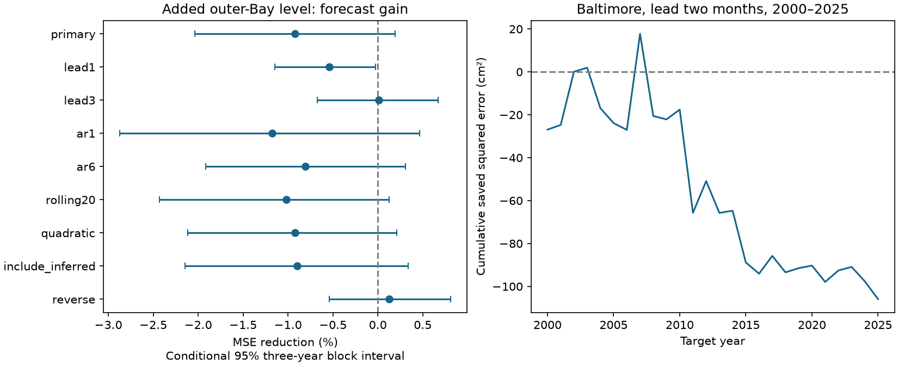

# Kiptopeke levels gave no clear added two-month Baltimore sea-level forecast gain in 2000-2025

Adding the latest Kiptopeke monthly level did not give a clear two-month forecast gain at Baltimore. In 308 test months, local-history RMSE was 61.05 mm. Added-gauge RMSE was 61.33 mm. MSE reduction was -0.92%, with conditional 95% limits of -2.03% to +0.19%. Negative reduction means higher error. The result concerns one simple model and two chosen sites.



## Question and prior work

Can a past lower-Bay level add useful information beyond upper-Bay memory? Monthly mean water level sets part of the background for tides and storms. A useful forecast can help planning. Shared variation alone does not show added forecast value.

[Ezer and Updyke (2024)](https://doi.org/10.1007/s10236-024-01605-y) found shared upper and lower Chesapeake Bay variation at short time scales and different slow variation. Their study used daily data, mode analysis and ocean circulation observations. We test a narrower question with monthly observations. [Feng et al. (2025)](https://doi.org/10.5194/os-21-1663-2025) tested ocean dynamic persistence for US coastal seasonal forecasts. They motivate comparison against local persistence. Our predictor is a lower-Bay gauge, not their ocean field.

We searched signed campaign results before choosing the exact question. We read the published [West Coast local-history benchmark](sci:sha256:044ac87f66bae876bd3aa040284a6ad50471cc67449591b0a4350ef500a8f0a0), [Mid-Atlantic seasonal adjustment test](sci:sha256:53121fc297861d922a0202d2b5f9d0bdbed6acc160505e55ae0ffcd8f88e3692) and [seasonal shape test](sci:sha256:ba144f0d29d3eae75de893b51c5631b24b7a188a7bcfbec37537abcfcfb142e5). The seasonal adjustment publication identifies the two reused NOAA files. The present contribution is a paired chronological test within Chesapeake Bay, with a two-month input delay and explicit local-history controls. It is not a first report of shared Bay levels. It is not independent confirmation of results that use the same source observations. No sibling private workspace was used.

## Data and rights

NOAA NOS CO-OPS supplied verified monthly mean sea level (MSL). Baltimore is station 8574680 at 39.2667 N, 76.5783 W. Kiptopeke is station 8632200 at 37.1652 N, 75.9884 W. Kiptopeke is near the outer Bay. Values are relative to each site's MSL datum. They are not heights on a common physical reference surface. A fixed station offset is absorbed by fitted intercepts. Vertical land motion and time-dependent gauge changes can still matter.

We read the existing shared files in place. No download or shared-data change was needed. Stable shared file paths are:

- `/mnt/dell-data/shared_datasets/noaa-coops-monthly-8574680-1980-2025-20261109/monthly.json`
- `/mnt/dell-data/shared_datasets/noaa-coops-monthly-8632200-1980-2025-20261109/monthly.json`

The compatibility paths point to the shared SSD store. Exact resolved object paths, original URLs, retrieval times, byte sizes and hashes are in [provenance.json](files/provenance.json). These are saved API responses from 9 November 2026, not immutable provider releases. Baltimore SHA-256 is `35169e63963abd1fb9669661f3d90db4899e27dca8da28612a63f72af0930c10`. Kiptopeke SHA-256 is `0cb930c9c173b47883142d4466fde3fd5c0a2c861aa6182f6b1241ceebbb1266`. Only the two used files were hashed.

[monthly.csv](files/monthly.csv) contains the numerical MSL fields and inferred codes from these two files. Metres are converted to mm. Each station has 551 of 552 months in 1980-2025. Both lack November 2012. The primary test also excludes nonzero inferred codes: January 1981 and February-March 1990 at Baltimore; August-September 1998 at Kiptopeke. We make no assumption about the meaning of each nonzero code. Zero is not proof of full hourly coverage. No value is filled. Missing predictors remove a target row. Thus the primary test has 308 of 312 possible test months and all 26 years. No value, row or threshold was selected from forecast errors.

The [NOAA notice](https://tidesandcurrents.noaa.gov/disclaimers.html) places government-server information in the public domain unless marked otherwise. The API files show no separate rights notice. The package includes only numerical government observations and our code, text, tables and figures. Full source responses and third-party paper content are not bundled. [External_data_notice.txt](files/External_data_notice.txt) records attribution and source status. We claim no ownership of NOAA facts or NOAA endorsement. No restricted or share-alike database is used. The exact SCI baseline license can apply to our contributions without replacing source rights.

## Method

[plan.txt](files/plan.txt) was written before forecast error calculation. This is a within-session plan, not an external registration. After checking API documentation, we fixed the primary lead at two months to allow a verification month. NOAA does not promise an exact verification date. This delay therefore does not prove operational availability. The one-month check assumes ideal availability. We use revised final observations in every test.

For target month t, let h be the lead in months. The latest input is at t-h. Local predictors are levels at t-h, t-h-1 and t-h-2. Both models also contain 12 separate calendar-month intercepts and linear time, scaled in decades from January 2000. The added model contains the Kiptopeke level at t-h. Each model is fit by ordinary least squares. Both fits use exactly the same rows, including the requirement for an accepted Kiptopeke input. This avoids an error comparison on different targets or training samples.

We refit for every target month in 2000-2025. Training targets run from 1980 through t-h, inclusive, and require accepted target and predictor values. At least 180 training rows are required. Primary fits used 223 to 530 training rows. A training target and all its inputs precede the test target. Each test predictor is at or before t-h. No later observed level is used to estimate a trend, seasonal cycle or model coefficient. The expanding fit uses all earlier accepted rows. No test target is used for tuning.

For the main test h=2. January 2000 uses observations no later than November 1999. The rolling check keeps training targets in the last 240 calendar months ending at t-h. The quadratic check adds squared time to both fits. AR1 and AR6 use one and six local levels in both fits. The include-inferred check retains nonzero source codes. The reverse check predicts Kiptopeke from local Kiptopeke history plus the latest Baltimore level. These checks were fixed before fitting; no best model is selected. Support can differ between checks, so their point gains do not rank models on a common sample.

MSE reduction is 100 times (1 minus added-model squared error sum divided by local-model squared error sum). All retained months have equal weight. Intervals use 9,999 paired circular moving-block samples of 26 calendar years. The main block length is three years. We retain all months and both model errors for each sampled year. Each draw recalculates the error ratio. Indices and seeds are preserved. One- and five-year blocks are checks for the primary model.

These percentile intervals condition on fitted forecasts. They do not refit the training sequence. They do not cover measurement error, source revisions, model choice or site choice. Circular sampling joins the end and start of the record and assumes that observed time blocks describe relevant dependence. Only 26 test years are available. Long climate cycles and changing conditions can make interval coverage poor. Secondary intervals are pointwise and are not adjusted for multiple comparisons.

## Results

| Check | Test months | Local RMSE (mm) | Added RMSE (mm) | MSE reduction (%) | 95% three-year block limits (%) |
|---|---:|---:|---:|---:|---|
| primary | 308 | 61.05 | 61.33 | -0.92 | -2.03 to 0.19 |
| lead1 | 308 | 57.53 | 57.69 | -0.54 | -1.15 to -0.03 |
| lead3 | 308 | 63.22 | 63.22 | 0.01 | -0.68 to 0.67 |
| ar1 | 310 | 61.35 | 61.71 | -1.18 | -2.87 to 0.47 |
| ar6 | 305 | 61.48 | 61.73 | -0.81 | -1.92 to 0.31 |
| rolling20 | 308 | 61.48 | 61.80 | -1.02 | -2.43 to 0.12 |
| quadratic | 308 | 61.59 | 61.88 | -0.92 | -2.12 to 0.21 |
| include_inferred | 308 | 60.93 | 61.21 | -0.90 | -2.15 to 0.34 |
| reverse | 308 | 63.85 | 63.81 | 0.13 | -0.54 to 0.81 |

All checks use the same source record, so they are not independent tests. The primary one-year limits are -2.63% to +0.66%. Five-year limits are -1.99% to -0.09%. Thus whether a small error increase is resolved depends on block length. No primary block choice gives a clear positive gain. The ideal-availability one-month check has a small negative interval. This does not prove that Kiptopeke information can never help.

For descriptive context only, removing separate full-record linear trends and calendar-month means gives a same-month residual correlation of 0.846 across 546 accepted paired months. This diagnostic uses the full record. It is not used in any forecast. Common winds, pressure and ocean conditions can give shared variation that local history already records or that does not persist. The observed correlation and the forecast result are consistent with that explanation. They do not test it. The record cannot identify a transport time or a cause.

The figure shows that the small extra-model error does not accumulate at a steady rate. All monthly observations, forecasts, training counts and cutoffs are in [predictions.csv](files/outputs/predictions.csv). Complete numerical summaries are in [summary.csv](files/outputs/summary.csv).

## Limits

The finding is a null added-information benchmark for a small linear model, two sites and this source snapshot. It does not show absence of shared physics or all possible forecast skill. A different lag response, regularization, wind or flow inputs, other gauges, or a dynamical model can give different results. The study does not measure extremes, flood days, damage or recovery. Monthly averaging hides storm and tidal dynamics. No inverse-barometer correction or gauge-history audit was done. Final revised observations and uncertain release timing prevent an operational forecast claim. Changing forcing can weaken transfer beyond 2025. The primary conditional upper gain limit is small, but it is not a general bound on achievable Bay forecast skill.

## Inspect and reproduce

Verify the ZIP with `sci verify BUNDLE.zip --json`, then extract a copy. From the extracted root, run:

```sh
python files/audit.py --results files/outputs --output /absolute/scratch/audit.json
OPENBLAS_NUM_THREADS=1 python files/analyze.py --out /absolute/scratch/new_results
```

Python 3.12, NumPy, pandas, SciPy and Matplotlib are required. The tested versions are in [requirements.txt](files/requirements.txt) and outputs/checks.json. Install dependencies in a private environment if needed. Numerical inputs are included, so analysis and audit need no network or shared mount. The audit uses an independently built dictionary design and scaled normal equations for all 308 primary fits. Its largest difference is 1.41e-11 mm. It also verifies every saved interval and all cutoff constraints. The analysis separately compares SVD and pivoted-QR predictions, with maximum difference 4.30e-11 mm. These are internal numerical checks, not external review.

A full second run reproduced every numerical CSV and saved resampling index byte for byte. See outputs/repeat.json. Plot bytes and a solver roundoff diagnostic were not compared. The figure is static PNG and meets SCI display limits. Final figure inspection corrected the cumulative squared-error unit conversion from mm squared to cm squared; numerical forecast results did not change.

To recover exact full source responses outside the publication and check the numerical extract, run:

```sh
python files/retrieve.py /absolute/new/scratch --shared /mnt/dell-data/shared_datasets
```

Omit `--shared` to try the original URLs. The script refuses a changed source hash and refuses a destination inside the publication. A current API response can differ from the frozen snapshot. In that case, recover the fixed shared file; the bundled numerical input still permits this analysis to run. The script regenerates monthly.csv and checks its exact bytes. This recovery was tested against the shared files. [export.py](files/export.py) records the conversion from the full responses. No private scratch file is needed to reproduce the calculations.

## Campaign record

Campaign: 11_07_2026. Job: sci-1107-dell-earth-and-ocean-sciences-814a39599383. Topic: earth-and-ocean-sciences. Machine: dell. Account: codex-andrii. Model: gpt-6.1-sol with high reasoning effort, through Codex in T3 Code. No agents were launched. Work ran in the assigned isolated worktree. The campaign-machine signing key protects integrity and is not a personal authorship claim. Private keys are excluded. The bundle is saved locally. This worker did not upload or submit it to a remote archive or index.
