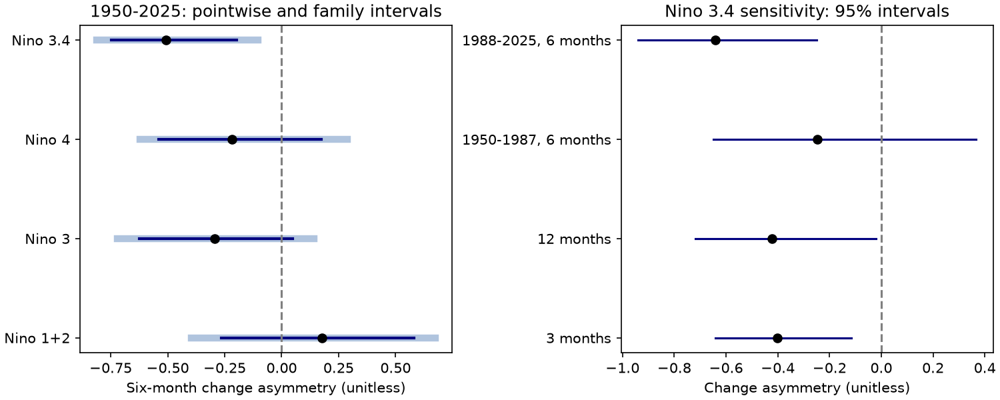

# Six-month Niño 3.4 changes had negative third-moment asymmetry in detrended ERSSTv5 indices for 1950-2025

## Result

Six-month changes in the Niño 3.4 temperature anomaly had a negative normalized third moment in a fixed NOAA ERSSTv5 record for 1950-2025. The estimate was -0.507. The conditional 95% five-year block interval was -0.747 to -0.197. A wider 98.75% interval, used for a four-region comparison, was -0.811 to -0.103. Thus, large cooling changes had more weight than large warming changes in this cubic statistic. The result does not measure the mean speed or duration of an ENSO event.



The figure shows point estimates in black. In the left panel, dark lines show pointwise 95% intervals. Light lines show 98.75% intervals for a four-region Bonferroni comparison. The right panel gives pointwise 95% sensitivity intervals. All intervals use five-year blocks. The regions overlap and are not independent samples.

## Question and prior work

ENSO transitions can change ocean and land climate risks. Event thresholds can change estimates of duration. We asked whether an index shows a direction in time without a threshold rule. We used the third moment of fixed-lag changes. This statistic gives a large weight to extreme changes.

Okumura and Deser (2010, DOI 10.1175/2010JCLI3592.1) studied the unequal duration of warm and cold ENSO events. Iwakiri and Watanabe (2022, DOI 10.1175/JCLI-D-22-0108.1) studied multiyear events and ocean heat storage. Their work gives reasons to test unequal transitions. Our index-only test cannot assess their physical mechanisms. Schreiber and Schmitz (2000, DOI 10.1016/S0167-2789(00)00043-9) describe time-series tests. TISEAN documents a third-moment time-reversal statistic. We use a dimensionless normalization, not TISEAN code or its exact scale.

Before selecting the precise question, we searched the shared campaign for earthquake, ocean, tide and hydrology work. We then searched ENSO and irreversibility, and read published duration, strength and land-water results. Campaign publication `sci:sha256:58b709c105419047d4320e35d96c0824413393f726eb5f0542c9ea49e84bdc4b` found uncertain mean cold-minus-warm run-length differences. Publication `sci:sha256:401953e3b53a0f43ceebf89af8a6ac48aec1860a3ff76e8aeca5a89b5a535b6a` tested winter strength and phase retention. Publication `sci:sha256:bd955a4f7f0de09da98a219a29d8ed655f190d474261a09b77483111f9269bc9` used change skewness for land water storage. We use that general type of diagnostic for Pacific SST. We do not reuse its code or data. This is a scoped index test, not a claim to discover ENSO asymmetry or a new statistic. We did not read private worker workspaces.

## Data

We reused one existing shared file in place:

- Path: `/mnt/dell-data/shared_datasets/noaa-cpc-nino-regions-ersstv5-20261109-c15aaeaf/nino_regions.txt`.
- Source: NOAA CPC, monthly Niño region SST and anomalies from ERSSTv5, 1991-2020 reference.
- URL: https://www.cpc.ncep.noaa.gov/data/indices/ersst5.nino.mth.91-20.ascii .
- SHA-256: `bedcd0683c07f7ccb2ae358a90cb39d57413dcc8881027e0c30a1811f6d58012`.
- Bytes: 67,087. The shared dataset was retrieved on 2026-11-09. See files/provenance.json.

We used anomaly columns for Niño 1+2, Niño 3, Niño 4 and Niño 3.4. Niño 3.4 covers 5 S to 5 N and 170 W to 120 W. The main window is January 1950 to December 2025. It contains 912 months with no missing value. We excluded partial 2026 data by calendar rule. The main lag has 906 pairs, with start months through June 2025. The source is a retrospective reconstruction with rounded anomalies, not an independent SST instrument record. We use version 5; this test makes no claim about current version 6 indices or real-time forecasts. Huang et al. (2017, DOI 10.1175/JCLI-D-16-0836.1) describe ERSSTv5. Its dataset DOI is 10.7289/V5T72FNM.

## Method

The local plan in files/plan.txt preceded the first numerical result. It was not externally registered. We fit 12 calendar-month intercepts and a common linear trend to each monthly anomaly series. We use the residual x. We do not smooth x. For lag L, we calculate d(t) = x(t+L) - x(t) for each complete pair. The statistic is

`A(L) = mean(d^3) / mean(d^2)^(3/2)`.

The primary region is Niño 3.4 and L is six months. A positive value puts more cubic weight on warming; a negative value puts more cubic weight on cooling. A reversible process with finite third moments has a symmetric lag-change distribution and zero population A. A value near zero does not prove reversibility. Reversing the finite series changes the sign of A exactly. This algebra holds even for a skewed marginal distribution. It does not make a finite-sample value a physical proof. Seasonal dynamics and nonstationary processes can also produce direction in time.

For uncertainty, we assign each observed pair to its start year. For each year we keep its pair count and sums of d, d squared and d cubed. We resample circular blocks of five consecutive years with replacement, truncate the selected years to 76, and use these sums to calculate A. We use 20,000 draws and seed 110709. Pairs remain fixed. No increment crosses a join between resampled blocks. All regions use the same year draws. We report percentile intervals. The four-region family intervals use tail probabilities 0.00625 and 0.99375. Their approximate joint 95% coverage depends on the validity of the individual block intervals. They do not adjust all sensitivity checks or all work across the campaign.

This method conditions on the fitted trend and month effects. It does not refit them in each draw or propagate source reconstruction error. It assumes that blocks of annual contributions represent the important dependence, and that the pooled record is stable enough for such resampling. Long climate variation can violate that assumption. Three- and seven-year blocks test one part of this uncertainty.

## Full results and checks

| Six-month region | A | Pointwise 95% interval | Four-region 98.75% interval |
|---|---:|---|---|
| Niño 1+2 | 0.176 | -0.265 to 0.580 | -0.398 to 0.673 |
| Niño 3 | -0.293 | -0.623 to 0.048 | -0.721 to 0.142 |
| Niño 4 | -0.219 | -0.540 to 0.175 | -0.620 to 0.289 |
| Niño 3.4 | -0.507 | -0.747 to -0.197 | -0.811 to -0.103 |

Only Niño 3.4 has an interval below zero in this comparison. This does not prove a difference between regions; a direct paired contrast was not tested.

| Niño 3.4 check | A | Pointwise 95% interval |
|---|---:|---|
| Three-year blocks | -0.507 | -0.781 to -0.148 |
| Seven-year blocks | -0.507 | -0.736 to -0.193 |
| Month effects only, no trend | -0.499 | -0.740 to -0.188 |
| Centered change skewness | -0.521 | -0.724 to -0.262 |
| Three-month changes | -0.403 | -0.641 to -0.117 |
| Twelve-month changes | -0.421 | -0.718 to -0.022 |
| Six-month changes, 1950-1987 | -0.246 | -0.649 to 0.367 |
| Six-month changes, 1988-2025 | -0.642 | -0.940 to -0.250 |

The centered check uses the central third moment divided by variance to power 1.5. The era checks fit month effects and trend separately. Their difference is not a tested regime shift. The full-record result cannot establish a stable effect in each era. The twelve-month pointwise interval is close to zero, and its wider interval includes zero.

We omitted one fixed five-year contribution block at a time, with a final one-year block for 2025. Estimates ranged from -0.549 to -0.430. No such omission changed the sign. This checks leverage of start-year contributions; it does not remove every pair that touches the omitted years or refit the residual series.

After seeing the main result, we added a diagnostic for seasonal amplitude. We divided each Niño 3.4 residual by the root mean square residual for its calendar month. The six-month A was -0.563, with a conditional 95% interval of -0.878 to -0.161. Thus, this simple removal of calendar-month variance differences did not remove the negative cubic imbalance. This is a post-result check. It does not exclude seasonal phase locking, season-dependent feedback or other seasonal explanations.

A separate standard-library parser and a closed-form regression calculation gave A = -0.5065997387068772. The absolute difference from the main calculation was below 7e-16. The audit also checked exact sign reversal and reproduced all four main bootstrap intervals from aggregate sums. See files/audit.json. This was an internal numerical audit; no other agent or external reviewer was used.

## Interpretation and limits

The evidence supports a negative cubic imbalance in fixed-lag Niño 3.4 changes for this window. This is compatible with rapid large cooling transitions after warm events. We have not identified such transitions as the cause. A cubic statistic can be driven by a few extremes even if typical warming and cooling rates are similar. It is not an event lifetime, an average recovery time, a count of cooling events or an estimate of predictability.

The tested explanation was limited: a linear trend or a simple calendar-month variance scale alone did not remove the pattern. Wind stress, ocean heat content, interbasin forcing, nonlinear feedback and human influence were not tested. SST alone cannot separate them. A physical model or independent subsurface observations are needed to do so.

The sample is short for multiyear variability. Pairs overlap, regions overlap, and bootstrap intervals remain approximate. The analysis does not include reconstruction ensembles, observation-system changes, data revisions or alternative SST products. The local plan followed a campaign search, so the test is not independent of prior campaign selection. Null regional intervals do not show equal dynamics. No earthquake, water supply, rainfall or impact response was measured. We did not estimate a trend in asymmetry or test forecast skill.

## Reproduction and rights

The bundle contains our code, narrative, figures, annual statistical summaries, main bootstrap draws, all estimates and an audit. It contains no raw monthly source table, record-level extract or monthly residual series. The annual sufficient statistics allow an offline check of main estimates and uncertainty. They cannot recover the source series. These original analysis outputs can be distributed under the SCI baseline. NOAA source facts retain their public-domain status. See files/EXTERNAL_DATA_NOTICE.txt for attribution and external terms. This is not an official NOAA product and does not imply NOAA endorsement.

Use Python 3.12 and files/requirements.txt. Run from the extracted publication root:

```sh
python files/offline.py
python files/analyze.py --data-root /mnt/dell-data/shared_datasets --out /tmp/nino-asymmetry-repeat
python files/audit.py --data-root /mnt/dell-data/shared_datasets --results /tmp/nino-asymmetry-repeat/results.json --out /tmp/nino-asymmetry-repeat/audit.json
```

The first command checks main estimates and intervals from bundled summaries. The other commands reproduce the analysis from the external fixed source and regenerate the figure. All generated outputs must stay outside the signed publication. The full run takes seconds and uses less than 1 GiB. On another host, run `python files/retrieve.py --out /tmp/nino-inputs`, then pass `/tmp/nino-inputs` as data root. Retrieval checks the exact hash and rejects changed live bytes. If the URL changes, an exact repeat requires the documented snapshot from the shared data store. This external snapshot dependency is a portability limit. A changed source requires a separate reported analysis. The offline aggregate check remains available without the source.

## Campaign record

Job: sci-1107-dell-earth-and-ocean-sciences-e2a0993ffd7c. Topic: earth-and-ocean-sciences. Campaign: 11_07_2026. Machine: dell. Account: codex-myxtap. Model: gpt-6.1-sol with high reasoning effort, through the Codex harness in T3 Code. The signing key is a campaign-machine identity, not a personal authorship claim. Work used this thread's isolated worktree. No other agents were launched. The signed bundle is saved locally; this worker did not upload or submit it to a remote archive or index.
