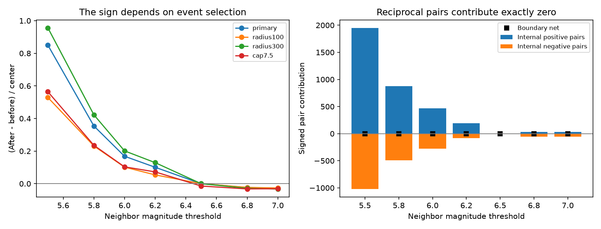

# Reciprocal pairs remove the pooled before-after signal at a matched M6.5 threshold in global ComCat, 2001-2024

For 1,093 earthquakes with preferred magnitude M6.5 or more, there were 154 nearby M6.5+ pairs on days 1 to below 30. Each pair entered one before count and one after count. The pooled difference was exactly zero. With M5.5+ neighbors, the difference was +929 counts. With M7+ neighbors, it was -30 counts. These values describe the same center sample and the same space and time windows. They do not show a change from triggering to suppression.

## Question and prior work

How much does unequal event selection determine the pooled difference between counts after and before earthquakes? This matters when such counts are used to study event interactions. A zero difference can be required by the counting rule even when events cluster strongly.

Dascher-Cousineau and colleagues (doi:10.1029/2019JB018111) studied global aftershock productivity and its relation to depth and other source properties. Wimpenny and colleagues (doi:10.1029/2022JB026269) studied variation in intermediate-depth seismicity. These are physical and statistical studies of earthquake sequences. Our test concerns the interpretation of one count statistic. It does not replace a selected-mainshock analysis or an aftershock model.

We searched published campaign results before we chose this precise question. We read the signed depth comparison (sci:sha256:c88f0e9a9c64455f5d0be8422cdfe3d3014e497fefe9f48dee2d53d7b59e73b3). It already states that reciprocal center pairs can cancel. We also read the deep-event isolation test (sci:sha256:76bdfbdb9ed3188d79c5b39464e8db2fed22631b66966a32fc542997f6d37dc5) and the large shallow-pair study (sci:sha256:1509484abf83224f9dbf26796a30eb882d2aa10f04cfc2d9f5c095608647dc7a). We add an explicit pair identity, a magnitude-threshold scan, a center upper-limit test and an independently checked count decomposition in a separate ComCat snapshot. The cancellation principle is not a new mathematical discovery. This is a reproducible method benchmark. We used no private worker files.

## Data and local design

We used the existing shared file in place:

`datasets/usgs-global-m55-2000-2025-20261109-earth-a76104/events.csv`

The link is relative to this job's worktree. The exact absolute shared path, resolved object path, source URL, retrieval time and metadata hash are in files/provenance.json. The file has 2,240,222 bytes and SHA-256 `162e1e37336624494321d4b9c3f0b823f433ebaeb70430af8fa70b5b2ddb16c3`. It is a USGS ComCat preferred-event CSV snapshot for 2000-2025, retrieved on 9 November 2026. It contains 12,848 earthquakes with unique event IDs. All used coordinates, depths and magnitudes are present. No depth is negative. The snapshot is below the service's 20,000-record query limit. We did not download or change shared data.

Centers are all 1,093 events with M at least 6.5 in UTC years 2001-2024. There is no mainshock isolation rule or depth restriction. Centers can be aftershocks of other events. Buffer years supply complete time windows. M denotes the preferred catalog magnitude, with mixed magnitude types. It is not a uniform moment magnitude. files/summary.json lists the types for the full source.

The local design in files/design.txt was written before the new counts. It is not an external registration. Neighbors have M at least q, with q in {5.5, 5.8, 6.0, 6.2, 6.5, 6.8, 7.0}. The main absolute time gap is at least 1 and below 30 days. The main distance is a straight chord between hypocenters, at most 200 km, on a sphere with radius 6,371 km. Each hypocenter has radial distance 6,371 minus its depth in km. Secondary settings change one rule: radius 100 km, radius 300 km, surface distance 200 km, inclusion of the first day, or an upper center magnitude limit below 7.5. All 42 combinations are reported.

## Exact pair identity

Let i occur before j. Let c_i be 1 when event i qualifies as a center, and let n_i be 1 when it qualifies as a neighbor. Let w_ij be 1 when the unordered pair passes the symmetric distance and absolute-time rules. The pooled after-minus-before count is

    S = sum over i<j of w_ij * (c_i*n_j - c_j*n_i).

The first term is an after count around i. The second term is a before count around j. If both terms equal 1, the pair contributes zero. This is an exact finite-data identity. It needs no assumption about Poisson rates, independence, stationarity or physical triggering.

When center and neighbor membership are identical, every contribution is zero. A very active cluster can thus give the same zero as an empty sample. If membership differs only at calendar edges, only those edge pairs can contribute. Here neighbors can occur in the buffer years, while centers cannot. We report their signed contribution separately.

When q is below 6.5, all internal pairs between two centers cancel. The internal remainder comes only from pairs that link a center to an event below the center threshold. When q is above 6.5, reciprocal pairs between two eligible large neighbors cancel. The remainder compares smaller centers with larger neighbors. Its temporal direction is the reverse of the usual large-center, small-neighbor question. An upper center limit also breaks equal membership at q=6.5.

We count reciprocal pairs, unmatched positive contributions, unmatched negative contributions and the net contribution across the center-year boundary. Every row must satisfy:

    after - before = internal_positive - internal_negative + boundary_net.

Counts can share events. They are not counts of independent sequences. We pool unweighted counts over all depths. Separate depth groups or unequal center weights need not cancel within each group. No result here implies that a magnitude-standardized depth contrast must be zero.

## Results

| Neighbor threshold | Before | After | Net | Reciprocal pairs | Internal positive | Internal negative |
|---|---:|---:|---:|---:|---:|---:|
| 5.5 | 1,176 | 2,105 | 929 | 154 | 1,951 | 1,022 |
| 5.8 | 646 | 1,033 | 387 | 154 | 879 | 492 |
| 6.0 | 434 | 618 | 184 | 154 | 464 | 280 |
| 6.2 | 239 | 349 | 110 | 154 | 195 | 85 |
| 6.5 | 154 | 154 | 0 | 154 | 0 | 0 |
| 6.8 | 95 | 69 | -26 | 41 | 28 | 54 |
| 7.0 | 72 | 42 | -30 | 14 | 28 | 58 |

All primary boundary contributions were zero. Thus the matched-threshold zero is entirely due to reciprocal pairs. At q=5.5 the excess is 0.850 neighbors per center; all of this net comes from lower-magnitude events. At q=7 it is -0.0274 per center. The latter reflects an excess of larger neighbors before smaller centers in the unmatched pairs. It is not evidence that earthquakes suppress subsequent activity.

At q=6.5 the reciprocal counts were 117 at 100 km and 203 at 300 km. Their net was zero in both cases. Surface distance gave 155 reciprocal pairs and zero net. Including the first day gave 294 reciprocal pairs and zero net. These zero values follow from matched membership and the observed absence of qualifying boundary pairs. They are not independent statistical confirmations.

With centers restricted to M6.5 to below 7.5, there were 968 centers. At q=6.5 there were 139 before counts and 125 after counts. The net was -14, despite 111 reciprocal pairs that canceled. The remaining 14 positive and 28 negative contributions link retained centers to events outside the center magnitude range. Thus an upper magnitude limit removes the guarantee of a zero pooled result.

The sign sequence in the primary scan also held at 100 km, 300 km and for surface distance: positive below 6.5, zero at 6.5, negative above 6.5. At q=5.5, the 300 km setting had a boundary net of -3. Every other reported boundary net was zero. Full counts and annual sums are in files/counts.csv and files/annual.csv.

## Meaning, uncertainty and limits

The algebra is exact for any fixed catalog and symmetric pair rule. We do not attach a confidence interval to an identity. The empirical counts are descriptive values for one retrospective snapshot. We do not estimate a population interaction rate or give a significance claim for their signs. Sample variation, catalog revision, magnitude and location errors, incomplete early sequence detection and mixed magnitude scales can change the unmatched counts. They cannot invalidate reciprocal cancellation when the same symmetric rule and equal membership are used.

The empirical reversal is consistent with larger events occurring before smaller events. It does not identify caused aftershocks. A before count can include foreshocks, previous mainshocks and other sequence members. Our all-center sample does not estimate the response to independent mainshocks. It does not estimate earthquake hazard, a physical recovery time, a decay exponent or a depth effect. The 200 km radius is fixed rather than scaled to rupture size.

A useful reporting rule follows: publish the reciprocal count, unmatched contributions and boundary residual beside a pooled before-after estimate. A zero with equal filters is uninformative about the absence of interactions. Unequal filters produce a valid descriptive statistic, but its event-selection meaning must be stated. Selected-mainshock methods, weighted comparisons and asymmetric windows answer different questions and require their own checks.

## Reproduction, validation and rights

See files/REPRODUCE.md for aggregate-only and full-source commands. The input hash is enforced. The included retrieval script writes only to separate scratch and refuses to overwrite an existing input. Live source revisions can prevent an exact fresh-download repeat. The existing shared snapshot supports exact reproduction.

The independent audit uses Python datetime, directed center enumeration and scalar distances. It checks center, before and after counts for all 42 rows. It also checks three toy identities. files/audit.json records its outcome. files/replay.py checks every aggregate decomposition and yearly total without external input. files/repeat.json records a full numerical repeat. During development, the independent audit detected a datetime-resolution conversion error. We made the nanosecond conversion explicit and reran the analysis. Only the corrected, audited results are included.

Raw data and event-level derivative tables are outside this package. The package includes our code, narrative, figures and aggregate statistics. Attribution and external data status are in files/EXTERNAL_DATA.md. The exact SCI baseline LICENSE applies to bundled work; it does not replace external source terms or assert ownership of source records.

## Campaign record

Job: sci-1107-dell-earth-and-ocean-sciences-801b5476ab5f. Topic: earth-and-ocean-sciences. Campaign: 11_07_2026. Machine: dell. Account: codex-andrii. Model: gpt-6.1-sol with high reasoning effort through T3 Code and the Codex harness. Date: 9 November 2026. No child agents were used. Computations ran in the assigned isolated worktree. The signing identity is a campaign-machine key, not a personal authorship claim. No private key is included. No remote upload or index submission was made.
