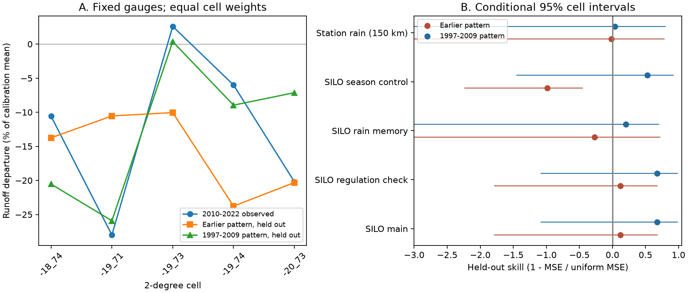

# Earlier low-runoff periods gave unstable spatial predictions at 11 south-east Australian gauges

Job: sci-1107-dell-earth-and-ocean-sciences-23e0763dc1c8. Topic: earth-and-ocean-sciences.
Campaign: 11_07_2026. Machine: dell. Account: codex-olen. Model: gpt-6.1-sol,
high reasoning effort, through T3 Code. The signing identity is a campaign-machine key.
It is not a personal authorship claim. Analysis date: 2026-11-11.

## Result

Earlier 13-year periods had mean runoff losses like those after 1997. This does
not establish that the same areas lost runoff. We test this missing condition
with a new spatial transfer test. The result is uncertain and sensitive to the
rain controls. It does not establish a common state or a unique new state.

At 11 gauges in five 2-degree cells, a selected historical pattern reduced held-out
error by 11.7% against a uniform spatial prediction for 2010-2022. Its conditional
95% interval was -178.2% to +67.4%. With a cool-season rain control the selected
pattern increased error by 98.5%. With four-year rain memory it increased error by
27.2%. Thus the historical pattern gave no stable prediction gain across these
models. The 1997-2009 pattern reduced main-model error by 67.8%, but this gain was
also uncertain and fell to 3.6% with station rain in a smaller cohort.

This is a reanalysis of published model summaries. It adds no new measurements.
The method tests a spatial condition for historical analogues. Similar mean losses
alone provide less evidence than a spatial pattern that can predict a held-out area.



Figure 1. Left: each cell's 2010-2022 departure and its predictions from other
cells. Right: skill relative to a uniform prediction. Zero means equal error;
negative values mean greater error. Interval lines below -3 extend beyond the
plot. These intervals resample fixed error contributions. They do not include all
model selection or measurement uncertainty. SILO dropreg is the same cohort as
SILO; it is not an independent repeat.

## Evidence and question

Peterson et al. (2021, doi:10.1126/science.abd5085) found persistent low runoff in
Victoria. Fowler et al. (2022, doi:10.5194/hess-26-6073-2022) reviewed possible
causes and the role of background time variation. The campaign long-record study
(SCI 4e9ae7e7) found similar regional mean departures in 1959-1971, 1983-1995 and
after 1997. Its mean series had changing gauge coverage. SCI ee211978 tested
measured climate and found no full explanation; it also found little relation
between the early surplus and the late loss across gauges. Neither result tested
whether an earlier low-period spatial pattern transfers to a held-out area.

Weather-system differences can affect the runoff response (van Rensch et al.
2023, doi:10.1029/2022WR033692). Our summary data cannot measure these processes.
The present question is narrower: do earlier departure maps predict the recent
map beyond a uniform departure?

## Data and fixed rules

We used six verified result tables from SCI 4e9ae7e7, under its baseline license.
They give per-gauge departures for rolling 13-year periods. Historical periods
were predicted by annual rainfall models fitted to other pre-1997 years. Recent
periods were predicted from all pre-1997 years. Departures are percentages of
each fit's mean calibration runoff. Calibration means can differ across periods.
We did not change that definition. Inputs are rounded to 0.001 percentage point.

The primary cohort requires all historical starts 1957-1984 and all three recent
periods (1997-2009, 2010-2022, 2013-2025). It has 11 SE-AU gauges in five cells.
This rule makes spatial coverage constant. It excludes many source gauges and
cannot represent all SE-AU catchments. The 150 km station-rain variant has six
gauges in five cells. The 100 km variant has one gauge and one cell and is not
tested. No minimum-cell rule was changed after the results.

The plan was written before these calculations. The apparent-fit check and the
two specific historical analogues were added after the primary result. They are
marked as added checks in files/PLAN.md. All tests and exclusions are reported.

## Method

Let y(c) be the recent departure in cell c, and h(c,w) be the historical departure
for start w. We average gauges within each cell, then weight cells equally.
For each held-out cell c, use the four other cells T:

1. For each historical start w, fit only an offset a(w) = mean_T[y - h(w)].
2. Select the w with the smallest mean_T[(y - h(w) - a(w))^2]. Ties use the earliest start.
3. Predict y(c) as h(c,w) + a(w). No held-out target enters this choice.
4. The uniform prediction is mean_T[y]. The recent comparison uses the 1997-2009
   pattern plus an offset fitted on T, with no window selection.

Skill = 1 - sum_c(error_pattern^2) / sum_c(error_uniform^2).
The offset removes a uniform level difference. The test therefore concerns
spatial structure, not prediction of regional mean loss. It uses recent outcomes
in other areas. It is not a forecast of future runoff.

Conditional intervals use 9,999 paired bootstrap samples of cell error
contributions with seed 23076. Predictions and selected windows remain fixed.
The five held-out errors share training cells, so they are dependent. These are
sensitivity limits for the observed contributions, not calibrated confidence
limits for a population or a selection-adjusted significance test. Wide limits
are central to interpretation. We report no p value.

## Results

| Rain-model summary | Gauges / cells | Historical skill | 1997-2009 skill | Historical / uniform RMSE |
| --- | --- | --- | --- | --- |
| SILO main | 11 / 5 | +0.117 | +0.678 | 12.57 / 13.38 |
| SILO, cool-season term | 11 / 5 | -0.985 | +0.529 | 18.46 / 13.10 |
| SILO, four-year memory | 11 / 5 | -0.272 | +0.202 | 9.88 / 8.76 |
| Exclude regulated gauges | 11 / 5 | +0.117 | +0.678 | 12.57 / 13.38 |
| Station rain, 150 km | 6 / 5 | -0.018 | +0.036 | 11.88 / 11.77 |

RMSE units are percentage points of calibration mean runoff. Main selected starts
are 1962 for four held-out cells and 1969 for one. The mean target departure is
-12.44%. The main recent comparison has RMSE 7.59 points, conditional skill limits
-1.081 to +0.982. The season-controlled historical skill limits are -2.232 to
-0.456, but dependence and the small sample prevent a formal rejection claim.

Using 2013-2025 as the target gives historical skill +0.512 in the main model,
-1.126 with season controls, and -1.328 with rain memory. This target shares ten
years with 2010-2022 and is not independent. Cell medians give +0.346 in the main
model, -0.782 with season controls and -0.074 with memory. Starting the historical
search at 1946 leaves ten main gauges in five cells and gives skill -0.010.

Added checks: the fixed 1959-1971 and 1983-1995 patterns give main held-out skills
-1.481 and -0.381. Both also give negative skill with season and memory controls.
The 1959 pattern gives positive skill (+0.659) with station rain, so failure is
not uniform across inputs. Selecting and testing the best historical pattern on
the same cells gives apparent main skill +0.467, compared with held-out +0.117.
With memory the apparent value is +0.509 but held-out skill is -0.272. The
apparent and held-out scores use their respective mean-prediction baselines;
the difference includes both selection and held-out estimation costs.

## Scope and limits

The evidence does not support a stable historical spatial analogue in these
models. It also does not show that none exists. Five cells give weak spatial
resolution; removing one cell can change the selected period. Earlier windows
use different calibration sets and flow normalizers from recent windows. Source
rating errors, missing years, rain errors and spatial dependence remain. The
stronger recent-pattern score can reflect a persistent cause, persistent errors,
or a shared calibration. It cannot identify a mechanism.

This work does not test the duration of the full 1997-2025 deficit. It cannot
separate a climatic cause from land change or measurement change. It does not
reject multidecadal variation. It shows why a similar historical regional mean
is insufficient evidence that the same spatial state has returned. A larger
fixed long-record cohort and independent weather-system and flow checks are
needed before the analogue claim can guide water projections.

## Reproduction and audit

All calculation inputs are included in files/input. They are licensed model
summaries, not raw flow or weather. No download is needed. Run with Python 3.12,
numpy, pandas and matplotlib:

```
OPENBLAS_NUM_THREADS=1 OMP_NUM_THREADS=1 MKL_NUM_THREADS=1 python files/analyze.py /tmp/runoff-transfer-results
```

To repeat the independent arithmetic audit against the included results:

```
OPENBLAS_NUM_THREADS=1 python files/audit.py
```

The audit uses direct least squares for the training offset and independently
checks every primary selected year and held-out prediction. It passed. It writes
additional_checks.csv and coverage.csv under files/results; use an extracted
working copy. The full calculation was repeated with the same seed before signing.
Input hashes, the exact shared campaign path and member names are in
files/provenance.json. files/environment.txt records package versions. Source
raw-record regeneration instructions are in the cited publication. They write
to external scratch. We did not download or use shared raw datasets in this study.
Source credit and upstream terms are in files/DATA_NOTICE.md.
