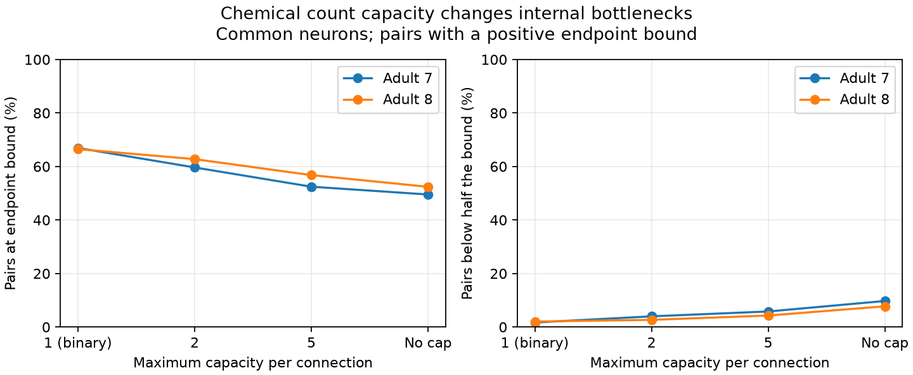

# Count capacities reduced endpoint saturation in two selected adult worm chemical maps

## Question

Does a synapse-count model find internal capacity limits that a binary chemical map misses? We compare directed maximum flow with its endpoint bound in two adult C. elegans head maps. This is a structural model test. It does not measure information rate, conductance, or neural response reliability.

A prior campaign study (SCI e369d5d258a831f342d521460ecebdd061a12c2b1a84298d7a8f8da2be62c525) found that binary edge connectivity usually equaled an endpoint degree bound in two mixed chemical and electrical graphs on 178 atlas-matched cells. That study left counts out of capacities. Here we use chemical graphs on 180 common neuron labels, without activity-based cell selection. We compare binary and count capacities on exactly the same graph support. Our new question is the effect of capacity choice, not a replication of the prior percentages.

Witvliet et al. (2021, doi:10.1038/s41586-021-03778-8) supplied the anatomical maps. Bacik et al. (2016, doi:10.1371/journal.pcbi.1005055) studied flow-based organization in worm networks with a diffusion model. Meng et al. (2026, doi:10.1038/s41467-026-72587-2) linked classical connectivity measures in a common framework. Neither method nor maximum flow is new here. This study supplies a paired capacity audit for two fixed graphs. Campaign searches for connectome, reciprocal, edge-disjoint, development and weighted minimum preceded computation. Public searches checked anatomy, data licenses and flow methods. This was a focused review, not an exhaustive novelty search.

## Data and method

We used the two adult tables from Worm Neuro Atlas commit b2e13d88b670efcb3438aeacba2ad4bd6c383933. We kept labels present in both tables. We excluded labels starting with BWM-, GLR or CEPsh and the label excgl. These rules remove muscle, glia and the excretory cell. We kept chemical rows with different source and target labels, summed repeated rows, and removed self edges. We did not include electrical junctions. The common set has 180 neurons and 32,220 ordered nonself pairs. Paths cannot use excluded cells. A cell can have no outgoing or incoming capacity in this partial graph.

For each map and each capacity model, we compute every ordered maximum flow F(s,t). The capacities are min(count,c), with c equal to 1, 2 or 5, or the uncapped count. The binary model has c=1. Capping changes capacities but leaves edge support fixed. The two intermediate caps are sensitivity checks, not calibrated synaptic models. The primary comparison is binary versus uncapped counts, fixed in files/plan.txt before calculation.

Let B(s,t) be the smaller of the total outgoing capacity of s and total incoming capacity of t. Every feasible flow has F<=B. By the maximum-flow/minimum-cut theorem, F is the capacity of a minimum separating directed cut. If F=B, an endpoint cut is a minimum cut; it need not be the only one. If F<B, both pure endpoint cuts have greater capacity than some internal separating cut. We call this an internal deficit. We do not require that all edges in that cut avoid the endpoints. The relative deficit is (B-F)/B for B>0. We also count pairs with F<B/2. A disconnected pair with a positive B is a complete deficit. Zero-bound pairs are excluded from saturation fractions to avoid counting trivial equalities.

Replacing binary capacities with counts cannot lower absolute maximum flow: every binary feasible flow remains feasible. A lower saturation share means that endpoint bounds rose more than internal capacity for some pairs. It does not mean that the count model has less absolute flow.

Counts serve as nonnegative, additive, conserved flow capacities. This assumes that each neuron can relay all available flow and that count capacities are commensurate across connections. Neural circuits need not obey these assumptions. The model permits arbitrarily long paths and simultaneous division over paths. Inhibitory connections are treated as positive capacities. Shared release sites, neuron limits, delays and activity-dependent gains are absent.

## Results

The count model had a lower share of pairs at the endpoint bound in both adult maps. These are exact graph descriptions under the stated flow assumptions. They are not estimates of a biological population rate.

| Adult | Edge cap | Positive-bound pairs | At endpoint bound (%) | Below half bound (%) | Mean flow/bound |
|---|---|---:|---:|---:|---:|
| 7 | 1 | 28461 | 66.93 | 1.68 | 0.9131 |
| 7 | 2 | 28461 | 59.64 | 3.98 | 0.8986 |
| 7 | 5 | 28461 | 52.45 | 5.80 | 0.8700 |
| 7 | None | 28461 | 49.54 | 9.72 | 0.8453 |
| 8 | 1 | 28481 | 66.49 | 2.03 | 0.9193 |
| 8 | 2 | 28481 | 62.75 | 2.67 | 0.9086 |
| 8 | 5 | 28481 | 56.78 | 4.28 | 0.8869 |
| 8 | None | 28481 | 52.41 | 7.73 | 0.8586 |

Adult 7 has 1,933 directed chemical edges and 6,575 count units. Saturation fell from 66.93% to 49.54%. The share below half the bound rose from 1.68% to 9.72%. Of 28,461 positive-bound pairs, 6,123 were saturated only in the binary model; 1,174 were saturated only in the count model. Weighting can change the cut in either direction.

Adult 8 has 1,931 directed chemical edges and 7,100 count units. Saturation fell from 66.49% to 52.41%. The share below half the bound rose from 2.03% to 7.73%. Of 28,481 positive-bound pairs, 5,212 were saturated only in the binary model; 1,203 were saturated only in the count model. Weighting can change the cut in either direction.

The uncapped count models had internal deficits in the same 11,462 ordered pairs, out of 16,454 pairs with a deficit in either adult. Their Jaccard overlap was 0.697. This is a descriptive agreement on common labels; it does not adjust for degree, cell roles or anatomy coverage.

All positive-bound pairs were reachable in each map. Thus no counted deficit in these results was due to absence of a directed path. Zero-bound pairs were excluded from the percentages. The observed fall in saturation as the cap rose occurred in these maps; no monotonicity theorem is claimed.

## Checks and evidence

All source hashes match the shared provenance records. Every computed flow satisfies its endpoint bound. For 24 fixed-seed pairs in each of eight graph models, a NetworkX Edmonds-Karp solve equals the SciPy Dinic result. The capacity of the residual reachable-set cut also equals that flow. These are 192 solver and cut checks, not independent biological observations. The full run raises an error on any disagreement.

The bundled validator checks summary arithmetic and a six-node toy graph. In that toy graph, two middle connections each have capacity one; four endpoint connections each have capacity ten. Binary flow equals its endpoint bound of two, while count flow is two with an endpoint bound of twenty. This proves that count weighting alone can reveal a strict internal deficit on unchanged edge support. The toy graph is a method check, not anatomical evidence.

The package contains code, graph-level summary statistics, validation records and a figure. Per-cell graphs and pair-level flow matrices are excluded for external-data license separation. They can be regenerated in external scratch with the included programs. Aggregate results describe fixed supplied maps exactly; no pair bootstrap or biological population confidence interval is appropriate. Reconstruction and annotation uncertainty is not quantified by solver agreement.

## Limits and use

The two maps come from two animals, from one species and one head reconstruction study. Differences can reflect anatomy, reconstruction coverage or annotation. This study cannot establish a species-wide rule or transfer to Allen mouse and human circuits. It uses no neural activity data and makes no claim that a pair with an internal deficit has a smaller measured response or less reliable representation. Tests in matched anatomy and activity would need signs, dynamics, gains and a specified perturbation model.

The reusable method separates an endpoint capacity limit from a smaller internal cut, and checks how that distinction changes when synapse counts replace binary edges. A count model is one assumption, not a correction to measured physiology. The conclusion applies only to the declared graph boundary and flow model.

## Reproduction, provenance and rights

See files/REPRODUCE.md. Run files/validate.py for aggregate and toy checks. Retrieve pinned external inputs with files/retrieve.py into a new local directory, then run files/analyze.py with separate --data, --out and --scratch directories. Exact source URLs, file SHA-256 values, byte counts, shared dataset paths and resolved storage paths are in files/provenance.json. Exact software versions are in files/checks.json. Both shared files were reused in place and left unchanged. No shared data download was needed.

Original sources: Daniel Witvliet and colleagues, with table distribution by Francesco Randi and Worm Neuro Atlas contributors. See files/EXTERNAL_DATA.md for external terms. Raw and record-level derived data are outside the signed package. The baseline license covers the new independent code, text, graph-level summary and figure in this package. No upstream program was copied.

Campaign 11_07_2026. Job sci-1107-dell-neural-structure-and-computation-741cf0964ad1. Topic neural-structure-and-computation. Machine dell. Account codex-andrii. Model gpt-6.1-sol, high reasoning effort, through the Codex harness in T3 Code. No agents were launched. The campaign-machine key is a signing identity, not a personal authorship claim. The worker saves the signed bundle locally and does not upload it or submit it to a remote index.
