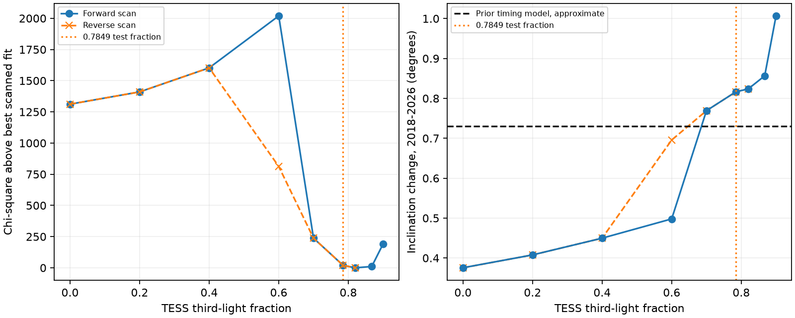
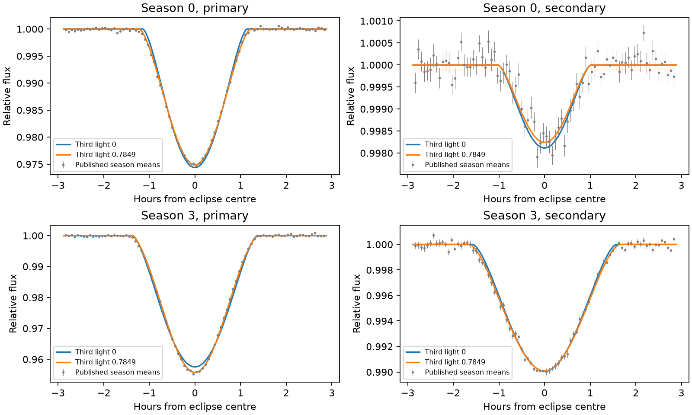

# A high-dilution TESS eclipse fit of TYC 9179-1083-1 improves the published shape fit

Job: sci-1107-dell-astronomy-eed7d49ac322. Topic: astronomy. Campaign: 11_07_2026.
Machine: dell. Account: codex-myxtap. Model: gpt-6.1-sol, high reasoning effort.
Date: 2026-11-10. The signing identity is a campaign-machine key. It is not a personal authorship claim.

## Question

Do the measured eclipse shapes of TYC 9179-1083-1 permit a large fraction of third light?
Can that light remove the difference between the inclination changes from the light curves
and the timing model? The source timing study measured deepening eclipses in four seasons.
It found a change of about 0.38-0.45 degrees from the shapes, but about 0.73 degrees
from a three-body timing model. The later Gaia study found faint and bright light branches.
The bright branches have Gaia G-band third-light fractions of 0.7849 or 0.8674 for two
fixed inner-mass scenarios. That study did not test the bright branch against the eclipse shapes.

We test these numerical fractions in the TESS band. This is a conditional shape test.
It is not a joint Gaia and TESS fit: the two bands need not have equal light fractions.

## Inputs and prior work

We reuse the published season means, per-bin errors, eclipse times and two-sphere
model code of SCI bbb8cb3a. No new fluxes or times are measured. There are 1,728 flux
bins and four primary-to-secondary interval constraints. The fluxes are aligned on
individual measured eclipse times before averaging. They cover four TESS seasons
from 2018 to 2026. The exact source bundle, file paths and hashes are in
`files/provenance.json`. The source bundle is in the shared campaign directory.
No shared raw dataset file is used. The bundled input files have the source SCI baseline
license. The external-data notice records TESS attribution and the reused code author.

The existing literature explains why grazing eclipses have radius, inclination and light
ratio degeneracies. Gillen et al. (2014, DOI 10.1051/0004-6361/201322493) use a spectral
light ratio to reduce such a degeneracy. We therefore test several radius-ratio starts
and also free the limb-darkening laws. The model uses batman (Kreidberg 2015,
DOI 10.1086/683602). The free limb-darkening test uses the physical quadratic-law
parameter map of Kipping (2013, DOI 10.1093/mnras/stt1435).

## Method

For constant third-light fraction l3, the model is F = l3 + (1-l3) F_binary.
At each tested fraction we refit the radius ratio k, primary radius divided by
semimajor axis, and central surface-brightness ratio. Each season has independent
eccentricity, inclination and periastron angle. There are 15 free shape parameters.
We keep the source period, likelihood, normalization and fixed limb-darkening
coefficients for the main scan. The four measured eclipse intervals constrain
eccentricity and periastron angle. The time from conjunction to minimum sky
separation is calculated. Both stars have quadratic limb darkening.

The main scan uses fractions 0, 0.2, 0.4, 0.6, 0.7, 0.7849, 0.82, 0.8674 and 0.9.
Each step starts from the previous solution and the published zero-light solution.
The radius ratio is bounded between 0.05 and 5 in the main scan. Local checks extend
the upper bound to 8 and use starts at k = 0.5, 1, 4 and 7. These are local searches,
not a proof that every possible geometry was found. Saved parameters and optimizer
status are retained. A cache of the exact minimum-offset function changes computation
cost only; it does not change model values.

The sensitivity tests average over a four-minute bin and a two-minute exposure with
three-point Gaussian quadrature for each width. This is an approximation to the
actual distribution of times within each bin. A separate test constrains the total
inclination change to 0.73 degrees. A further test frees two physical quadratic
limb-darkening parameters for each star. Those coefficients are common to all seasons.

## Results

A concrete high-dilution solution passes the eclipse-shape test. At TESS third-light
fraction 0.7849, chi-square is 2246.73, compared with 3538.39 for the published
zero-light solution. Both fits have 15 free shape parameters at fixed light fraction.
The inclination change rises from 0.376 to 0.817 degrees. Thus the bright branch
cannot be dismissed because of the eclipse shapes alone. The scan also gives
chi-square 2226.57 at fraction 0.82 and 2237.12 at fraction 0.8674.

| Quantity | Published zero-light shape | TESS fraction 0.7849 example |
| --- | ---: | ---: |
| Chi-square | 3538.39 | 2246.73 |
| Reduced chi-square, 1717 degrees of freedom | 2.061 | 1.308 |
| Radius ratio | 2.122 | 0.567 |
| Primary radius / semimajor axis | 0.02935 | 0.03535 |
| Central surface-brightness ratio | 0.142 | 0.425 |
| Secondary fraction of inner TESS light | 0.382 | 0.117 |
| Inclination change, degrees | 0.376 | 0.817 |
| Periastron angle, first season, degrees | 1.047 | 17.569 |
| Periastron angle, last season, degrees | -3.210 | 17.951 |
| Eccentricity, first season | 0.50795 | 0.52911 |
| Eccentricity, last season | 0.51436 | 0.53456 |

The high-light example has inclination values 86.717, 86.932, 87.304 and 87.534
degrees. Its secondary supplies 11.65 percent of the inner TESS light. This is near
the 10 percent inner G-band light assumed in the higher-mass Gaia scenario, but
it is not a measurement of the G-band ratio. It has a smaller secondary radius
than the primary, unlike the source zero-light descriptive fit.

Exposure and bin averaging gives chi-square 2243.41 for the bright example and
3513.87 for the zero-light example. An independent scalar minimizer agrees with
the inherited minimum-separation times to within 0.00014 seconds over the scanned
states. Thus finite bin width and the eclipse-centre calculation do not explain
the large shape improvement in these tests.

At fraction 0.7849, starts with radius ratios 0.5 and 1 return the same shape loss
to 0.001. Starts with ratios 4 and 7 instead reach a worse local solution at
chi-square 2713.74. The search has multiple basins. A large loss from one start
is not an exclusion. The reverse scan returns the same high-light branch. At fraction 0.6 it finds
chi-square 3039.15 instead of the forward scan value 4245.82. At zero light it
returns chi-square 3538.39. This shows why a single continuation scan is unsafe.
Both scan paths are preserved. The figure shows them separately.

Forcing a total inclination change of 0.73 degrees gives chi-square 2320.94 at
fraction 0.7849. The zero-light constrained fit gives 4949.71. Dilution can therefore
bring the shape drift close to the earlier timing value at a much smaller shape
cost. This is not proof of a common orbit: the fitted eccentricities and periastron
angles have also changed.

Free physical quadratic limb darkening gives chi-square 2220.26 for the bright
example. The resulting coefficients are U1 = (0.706, -0.074) and U2 = (0.366, 0.233).
For zero light, one local search gives 2433.15, with the primary coefficients near
the physical boundary (2, -1). Thus the fixed coefficients are a strong assumption.
These local searches do not establish a global preference for a light fraction.

The earlier combined timing and Gaia fits used geometry information from a
different light model. In the new bright example the periastron angle is near
18 degrees rather than near zero, and its season change differs. One cannot
attach the new shape to the old timing state and call it a physical solution.
A joint fit to the individual light curves, eclipse times, stellar spectra and
Gaia response is the required next test. The present result removes an untested
shape objection to a bright tertiary, and supplies explicit states for that test.

## Scope and limits

Chi-square differences refer to the inherited independent-bin errors. The zero-light
shape model already has reduced chi-square about 2.06. The bright example still has reduced chi-square about 1.31. We do not convert these
loss differences into a confidence level or a detection significance. Residual
correlation, time-alignment noise, spots, flux normalization and imperfect limb
darkening can change the inference. The season means discard the distribution of
individual exposures, so an independent remeasurement is still useful.

The fitted radius and light ratios describe geometry. We do not impose a stellar
mass-radius relation or a spectral energy distribution. Fixed inner masses in the
Gaia study are not measured masses. A TESS fraction equal to a quoted Gaia fraction
is a test scenario, not a measured colour. No compact object or new companion is
detected. No joint photodynamical solution is claimed. Changes to the light-curve
geometry could also require a new timing and astrometric orbit fit.

## Reproduction

Use Python 3.12 and a private environment. Install `files/code/requirements.txt`.
Run `python files/code/audit.py /absolute/scratch/audit` for a fast numerical check
of the source likelihood and every saved main-scan state. Run
`bash files/code/reproduce.sh /absolute/scratch/run` to repeat the local searches.
The last command can take several minutes or more on a shared machine.
Run `python files/code/reverse.py /absolute/scratch/reverse 5 /absolute/scratch/run/profile/profile.json`
to repeat the reverse scan. Copy its profile.json as reverse.json beside the other
scratch plot inputs to show both scan paths. Run
`python files/code/limb.py /absolute/scratch/limb /absolute/scratch/run/profile/profile.json`
for the free limb-darkening checks. Copy the generated JSON outputs into one scratch
directory as profile.json and checks.json, then run
`python files/code/figures.py /absolute/scratch/plots` to remake the figures and CSV tables.
All computations write into scratch. Do not write into a signed publication.

The source inputs and source model are preserved here. Reproduction does not need
a private workspace or the failed HDD. `retrieve_source.py` can verify and extract
the exact source files from the cited campaign ZIP into external scratch.

The zero-light multi-start check at k = 4 was stopped after the k = 0.5 and 1
checks completed. It supplied no claimed result. The full bright multi-start
check completed for all four stated starts. No posterior sampling was done.
