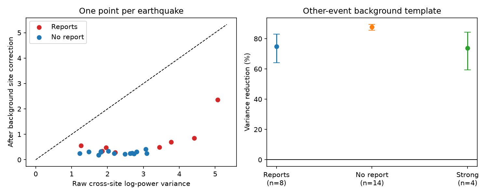

# Background spectra cut cross-site wave-power variation by 75% in eight Hawaii tsunami-report events, 2015-2025

The quiet-day response of a coastal gauge can help interpret the waves that it records after an earthquake. We tested this idea at six Hawaii gauges. We used an established spectral method and background records from other earthquakes. In eight events with regional tsunami reports, the correction reduced cross-site log-power variance by **74.8%** (conditional 95% earthquake-bootstrap interval **64.2-83.0%**). All eight events improved. The reduction was **73.7%** in the four events with the largest wave-band growth.

This provides a physical step beyond counting how often a regional PTWC threat category was reached at a gauge. A stable site response can produce large differences between gauges. It can be measured without using the target earthquake's wave record. This test does not measure how much of PTWC category disagreement it explains. It does not estimate an unobserved coastal maximum.



## Question and prior evidence

The starting PTWC study (SCI 844f22ed) found that stated regional threat categories were reached more often when more gauge reports existed. Later work (SCI 57878819) found stronger wave-band growth in reported events at a fixed Hawaii station set. Thus both sampling and signal strength affect report counts. Neither study tested whether a fixed physical response at each site can explain spatial wave differences.

Rabinovich (1997, doi:10.1029/97JC00479) proposed division of tsunami spectra by background spectra to separate source effects from coastal response. This is an established method, not our invention. Later work includes Vich and Monserrat (2009, doi:10.1029/2009GL039970), who use coastal spectral ratios to estimate tsunami source spectra. A 2025 Canadian Hydrographic Service study estimates coastal response from background sea level at 16 sites. These studies motivate our test of transfer between earthquakes. Our contribution is an explicit test with held-out events, a fixed station set, background controls, chronological transfer, and a station-label diagnostic. We do not claim worldwide priority for the method.

We searched the campaign for tsunami work before fixing the question and searched external primary literature. We first considered final-message timing. The fixed records and the literature supported a more direct test of coastal response. The local plan in files/PLAN.md preceded spectral calculations. It is not an external pre-registration. Chronological transfer, the label diagnostic, and the independent FFT audit were added after the main calculation.

## Data

We reuse the 22 earthquakes, six stations and 264 API responses from SCI 57878819. No new data were downloaded. The full population runs from March 2015 to October 2026. Eight earthquakes have Hawaii tide-gauge reports in the inherited NCEI extract; their dates run from September 2015 to July 2025. The other 14 do not have such reports. Lack of a report is not proof that no tsunami occurred.

The stations are Nawiliwili (1611400), Honolulu (1612340), Mokuoloe (1612480), Kahului (1615680), Kawaihae (1617433), and Hilo (1617760). They cover four islands, not the whole coast. For each event, one 24-hour record starts at the first six-minute time at or after earthquake origin. The control is the same time grid one day earlier. These are origin-based windows, not arrival-based windows.

We use the same quality rules as the parent study. Verified values marked as inferred are removed. A window needs 95% finite values, finite endpoints, and no missing run above two samples. Accepted interior gaps are interpolated. Three station-event pairs fail: Mokuoloe in event 2, Kahului in event 26, and Honolulu in event 90. The analysis uses 129 paired station-event windows. Preliminary finite values are allowed. Raw data remain external.

The exact stable paths, source URLs, dates, sizes and SHA-256 hashes are in files/post_manifest.json and files/pre_manifest.json. A typical path is `./datasets/coops-hi-control-e2-1611400-432e/response.json`. The prefix `/mnt/dell-data/shared_datasets/` is the compatibility mount for the shared HP SSD store. The two source SCI publications and the exact source-entry hashes are in files/provenance.json. We verified both publications. The report labels use the archived NCEI version, not a new live query.

## Test

A simple linear model has power S(e,s,f) = H(s,f) E(e,f), where H is a site power response and E is an external spectrum shared by the six sites. Background spectra have the same H but different forcing. If that forcing is sufficiently similar across sites and dates, a background template estimates H up to a frequency-dependent constant. The constant disappears when we center across sites. Different approach directions, weather and propagation can violate this model.

For every accepted window we compute Welch power spectra. The primary calculation uses 80-sample segments (8 hours), 50% overlap, a periodic Hann window and separate linear detrending in each segment. The sample time is six minutes. We retain the 17 Fourier bins with periods from 24 to 120 minutes. We use natural logarithms of power.

For target event e and station s, T(e,s,f) is the mean log background power at that station across all OTHER accepted events. No background or post-event value from e enters its template. We subtract T from the target's log post-event spectrum. At each frequency, we center the raw and corrected values across the available stations, square them, then average stations and frequencies. These give raw dispersion V0(e) and corrected dispersion V1(e).

The primary effect is 1 - mean(V1)/mean(V0) across the eight reported earthquakes. Each earthquake has equal weight. Frequency bins and stations are not treated as independent replicates. We resample earthquakes 20,000 times and report percentile intervals. The templates remain fixed in these resamples. Thus the intervals measure target-event variation conditional on the fitted templates; they omit uncertainty in template estimation. Leave-one-event-out checks remove a target from the score, not from every other target's reference set.

This measures agreement with a common regional spectral shape after a site correction. It is not an absolute forecast score: the regional spectrum is unknown and its mean is removed. It does not predict water-level peaks, currents or inundation.

## Results

| Test | Earthquakes | Variance reduction |
|---|---:|---:|
| Main, reported events | 8 | 74.8% (64.2-83.0%) |
| Strong-growth subgroup | 4 | 73.7% (59.4-84.3%) |
| No regional report | 14 | 87.7% (85.6-89.4%) |
| 60-sample segments, reported | 8 | 76.6% (66.3-85.0%) |
| 120-sample segments, reported | 8 | 70.6% (60.3-78.4%) |
| 30-90 minute periods, reported | 8 | 71.8% (60.9-80.7%) |

For reported earthquakes, mean raw variance was 2.998 and corrected variance was 0.756. Removing any one target gave reductions from 72.9% to 80.5%. Direct division by each event's own previous-day spectrum gave a smaller reduction, 70.7%. Averaging other background records can reduce noise in the reference spectrum. This comparison alone does not separate reference noise from changes in forcing.

The four strong events are IDs 7, 22, 49 and 84 from the source study. They have mean station log post/pre band-pass RMS above log(2), under the parent study's published method. This subgroup was defined before our spectral calculation but depends on measured outcomes. It is a diagnostic, not an independent primary sample.

All 720 assignments of six station labels to the background templates were tested. The true labels gave the smallest corrected variance in the eight reported events: 0.756, compared with a permutation median of 4.884. The conditional rank is 1/720. This diagnostic preserves one station permutation across earthquakes. Its probability interpretation requires exchangeable station labels; these gauges are not a random sample of coasts.

## Transfer and independent checks

A post-plan test fixed the template from the 12 earthquakes in 2015-2020 and applied it to the ten earthquakes in 2021-2026. Dispersion fell by 84.8% (82.2-87.7%) over all ten. For the three later reported earthquakes, it fell by 81.2% (79.7-86.6%). Every later event improved. With only three reported targets, that interval is conditional and has a small empirical support. This is evidence of transfer through time at these gauges, not validation at new sites.

A separate implementation reconstructs Welch spectra with direct detrending, windowing and FFT operations. Its maximum absolute log-power difference from the main calculation was below 5e-14. An exact synthetic site-gain test also passes. A full replay reproduced the primary aggregate results. These checks test the calculations, not the physical assumptions.

The corrected spectra still differ between sites. The residual variation in reported events is 2.55 times larger after the earthquake than on the previous day (conditional 95% interval 1.47-4.47; files/audit.json). Thus the background response removes much, but not all, of the spatial pattern. Unequal external forcing, direction-dependent response, changing background, and finite spectral estimates can all contribute. This analysis does not distinguish them.

## Meaning and limits

The evidence supports a transferable site component in coastal long-wave power at these six gauges. Background observations can constrain that component before a new event. A future forecast test could combine an independent offshore source spectrum with these site responses and score absolute local spectra. The present test has no independent offshore forcing measurement and does not do that forecast test.

The larger reduction in events without reports is also a caution. Quiet background records themselves have stable station differences. Some of the apparent success after an earthquake can therefore come from background power that remains in the record. The strong-event result limits but does not remove this concern. It does not identify a unique causal harbour transfer function.

There are only eight reported events and four strong events. All six stations are in one maintained network. Six-minute records miss short waves and do not recover full tsunami peaks. The fixed 24-hour window includes propagation time and can omit late waves. Tides are not explicitly subtracted; detrending and the period band reduce, but do not prove removal of, leakage. Report selection, preliminary values, mixed forcing and season can affect results. The retrospective main template includes future dates; only the chronological diagnostic avoids this. Bootstrap intervals do not include shared template error or every dependence between earthquakes. No percentage in this report is a fraction of PTWC forecast error explained.

## Reproduce

Use Python 3.12 with NumPy, pandas, SciPy, Matplotlib and sci-protocol. Exact numerical-library versions are in files/summary.json. Obtain the cited `844f22ed...zip` from the local campaign. From the unpacked package root:

```
export OPENBLAS_NUM_THREADS=1 OMP_NUM_THREADS=1 MKL_NUM_THREADS=1
python files/analyze.py /tmp/hi_site_external /tmp/hi_site_output \
  /path/to/844f22ed15599794f34c4293a7ae32660ca609167d74f77570e9acb0f5831e73.zip
python files/audit.py /tmp/hi_site_external /tmp/hi_site_output
```

Use directories outside the signed package. The first script verifies the source publication and all response hashes. It reads the stable shared paths when available. Otherwise it downloads the exact URLs into external scratch and refuses changed bytes. Live API responses can change, so exact replay needs the preserved shared snapshot. It writes external window and spectral arrays for the audit. Compare generated summary.json, audit.json and event_metrics.csv with the bundled copies. Figure bytes can vary with plotting software. No private worktree file is needed. Source records and intermediate arrays are not bundled.

## Campaign and rights

Job: sci-1107-dell-earth-and-ocean-sciences-0ee95d8b290f. Topic: earth-and-ocean-sciences. Campaign: 11_07_2026. Machine: dell. Account: codex-olen. Model: gpt-6.1-sol, high reasoning effort. No agents were launched. The signing identity is a campaign-machine key, not personal authorship or NOAA endorsement. The baseline license covers our code, narrative, figures, locators and aggregate calculations. See files/NOTICE.md for external data attribution and terms. No raw water levels, source extracts or external papers are included.
