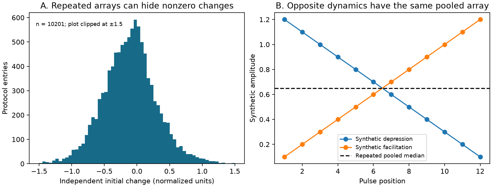

# All 12,187 finite pulse arrays in Allen Synaptic Physiology r2.1 repeat one summary across pulse positions

## Question and main result

Can the stored pulse arrays support tests of temporal response weights on measured cortical connections? No, for the inspected release. All 12,187 arrays with finite summaries at all 12 positions repeat exactly the same median, standard deviation, and count at every position. This prevents use of this field to identify depression or facilitation across a train.

The release has 3,287 dynamics rows and 12,770 protocol entries. Of these entries, 583 do not have 12 finite summary triples. These entries are outside the finite-array count; they are not a control sample of correct arrays. Repeated finite arrays occur in 2,080 dynamics rows. A separately computed initial response change is finite and nonzero in 10,201 entries with repeated arrays. Its absolute value exceeds 0.10 normalized units in 7,992 entries. The threshold is a descriptive scale, not a noise test.

This is a data audit and an information-loss result. It is not a new biological finding. It gives a reproducible check that can prevent false constant-weight circuit models. It also shows why these arrays cannot be repaired from pooled amplitude statistics alone.

## Prior work and scope

Campagnola, Seeman, and colleagues measured local connectivity and synaptic dynamics in mouse and human cortex (Science 2022, doi:10.1126/science.abj5861). Their data link response properties and connectivity through the same cell-pair identifiers in the same slice experiments. These links are suitable for local structure and function tests. They are not an intact-brain connectome or behavioral activity data.

Campaign searches covered connectome, neural structure, Witvliet, synaptic latency distance, recovery exponential, pulse_amplitudes, and pulse array. We read published reports SCI c33af30c, da6fdd69, and 02f7958b. These reports already flagged the pulse-array issue and used separately computed summaries. We do not claim discovery of the issue. Our contribution is a complete release audit, a proof of lost pulse-order information, an independent database check, and a tool that separates external evidence from publication files. We wrote new code and did not reuse their extracts or code. Search does not establish that this audit is the first of its kind.

We first considered a recovery-model test. Initial source inspection changed the question to the validity of pulse-position summaries. This is an exploratory audit, not a registered experiment.

## Data and audit rules

The input is Allen Synaptic Physiology r2.1 small SQLite, source last modified 2023-01-26. We reused this exact shared file:

`/mnt/dell-data/shared_datasets/allen-synphys-r2.1-small-20230126/synphys_r2.1_small.sqlite`

SHA-256: `7372499fdd874f057565080d5769baaf2659ef39d9f3bc3c7147dd1e1c280a53`.

The source URL, file sizes, hashes, and definition-code version are in files/provenance.json. No shared data were changed. The audit parses every stp_all_stimuli entry. A finite array has exactly 12 elements, each with three finite numbers. A repeated array has exact equality of all three numbers at all positions. Counts refer to protocol entries, not independent animals or trials. We use no bootstrap or population confidence interval for this finite-file description.

The eligibility check requires pair.has_synapse = 1 and dynamics.qc_pass = 1. It gives 2,112 dynamics rows. It does not impose a region or trial-count restriction. The table separates the observed species and synapse types. These are database labels, not a test of species differences.

| Eligible group | Finite arrays | Repeated arrays | Finite nonzero initial change | Absolute initial change above 0.10 |
|---|---:|---:|---:|---:|
| Mouse excitation | 4,305 | 4,305 | 3,506 | 2,526 |
| Mouse inhibition | 6,212 | 6,212 | 5,342 | 4,425 |
| Human excitation | 1,481 | 1,481 | 1,224 | 928 |
| Human inhibition | 185 | 185 | 129 | 113 |

These eligible groups contain 12,183 finite arrays. Four further finite arrays are outside this eligibility rule. All release-level counts above include those four.

The initial change summary is the median across eligible trials of (A2 - A1)/Q. A is a fitted voltage response amplitude. Q is the signed amplitude percentile used by the source analysis. This metric is computed separately from the pulse arrays. A nonzero metric is evidence that a flat pulse array must not be read as proof of absent temporal modulation. The median of paired differences need not equal a difference of marginal medians. Thus the nonzero metric alone is not a formal contradiction of equal marginal medians and does not prove the software cause.

Panel A uses eligible entries with finite initial change. The plot omits values outside -1.5 to 1.5; counts use all values. Panel B is entirely synthetic and is not a measured neuron response.

## Source mechanism and proof

We inspected aisynphys/dynamics.py at commit b264d8b61abf11d015222865ca081f80655d33d4. This is a pinned public definition, not a verified build commit for the database. The code creates the 12 amplitude collectors by repeating one empty list reference. It appends each available pulse amplitude through a position index. All 12 references therefore receive all appended amplitudes. Each output position then computes the same median, population standard deviation, and count from the same pooled list.

This code mechanism produces exactly the observed repeated-array pattern. The file alone does not prove the historical build path. The report does not claim that every upstream version or dataset has the same problem.

Let B be the multiset of all amplitudes appended across all trials and pulse positions in one protocol. With shared storage, each output slot is (median(B), std(B), size(B)). Any permutation of amplitude assignments to pulse positions leaves B unchanged. It therefore leaves the complete stored array unchanged. In particular, consider a single complete train with positive amplitudes decreasing from 1.2 to 0.1 in steps of 0.1. Its reversal increases from 0.1 to 1.2. The two trains have opposite temporal order, but identical B and identical stored arrays under this mechanism. Thus no function of these pooled arrays alone can correctly distinguish both trains. This proves non-identification over the unrestricted class of positive trains. It does not prove failure for every restricted parametric model or for the full database with its other summaries.

For T complete trials, each shared collector holds 12T amplitudes, rather than T amplitudes for one pulse position. For incomplete trials the count is the sum of the accepted pulse-prefix lengths. It need not be divisible by 12. In the release, 8,027 finite arrays have counts divisible by 12. This divisibility count is descriptive and is not a diagnostic of correctness. Treating the pooled count as a number of independent trials for one pulse would give an invalid uncertainty calculation.

Separate storage for each position prevents the software pooling mechanism. Our synthetic checks use independently allocated collectors and recover the correct per-position medians. This is a method check, not a repair of the external release. The small database has zero rows in pulse_response, pulse_response_fit, stim_pulse, and recording. It therefore cannot support reconstruction from those trial tables. Other retained scalar summaries can constrain some aspects of dynamics, but cannot in general recover arbitrary full trial trains. A proper repair needs trial-level source data and a new analysis. We did not download those larger data or test such a repair.

## Verification and limitations

The main parser checks exact numeric equality of all summary triples. A second implementation uses SQLite JSON functions and independently confirms 12,187 finite arrays and 12,187 repeated arrays. It replaces bare NaN tokens with JSON null before the SQL test and excludes null and non-array entries. The two implementations agree after that explicit missing-value rule.

One thousand synthetic tests check permutation invariance, shared storage, pooled counts, and correct recovery of position medians with separate storage. A deterministic positive-train witness checks equal pooled statistics for opposite temporal orders. These checks support the mechanism and proof. They do not validate biological fits, QC labels, or stored trial-level change estimates.

A repeated array can be correct for a truly constant train. Our tool reports it as unsuitable for pulse-order inference in this release; it does not label a biological train defective. The audit cannot quantify physiological effect sizes or establish any cross-species, regional, or behavioral principle. It also does not invalidate the original paper, connectivity calls, or separately computed scalar results. The method generalizes as a data-integrity check, while the measured scope is one exact release.

## Reproduction and rights

Use Python 3.12 with NumPy and Matplotlib. Exact run versions are in files/results.json. All commands write new results outside the unpacked publication:

    python files/retrieve.py /tmp/allen_audit_inputs
    python files/analyze.py --db /tmp/allen_audit_inputs/synphys_r2.1_small.sqlite --out /tmp/allen_audit_output --external /tmp/allen_audit_records
    python files/independent_check.py /tmp/allen_audit_inputs/synphys_r2.1_small.sqlite /tmp/allen_audit_output/results.json

On the campaign host, use the shared database path to avoid downloading it. The main analysis verifies its hash. Retrieval downloads only the database needed for numerical reproduction. Pinned code and license URLs and hashes permit inspection of the mechanism; they are external materials and are not executed. The terms-page hash records what was inspected and is not a guarantee of future page content. The regenerated external CSV has protocol-level source identifiers and statistics. Keep it outside the signed publication.

The publication includes our own text, original code, an original figure, aggregate audit findings, and provenance. It includes no external raw records, record extracts, upstream code, or derivative database. Allen Institute source data and software have external terms with restrictions on commercial redistribution. We do not grant those terms under the SCI baseline. files/EXTERNAL_NOTICE.txt gives attribution and external terms. The SCI baseline applies to the bundled original work. The aggregate counts are findings about the file, not a substitute database of measured responses.

## Job record

Job: sci-1107-dell-neural-structure-and-computation-a97a79be2a52. Topic: neural-structure-and-computation. Campaign: 11_07_2026. Machine: dell. Account: codex-andrii. Model: gpt-6.1-sol with high reasoning effort through T3 Code. Date: 2026-11-09. No other agents were used. The machine signing identity is not a personal authorship claim. All computations finished. The worker saves the signed bundle locally and does not upload it.
