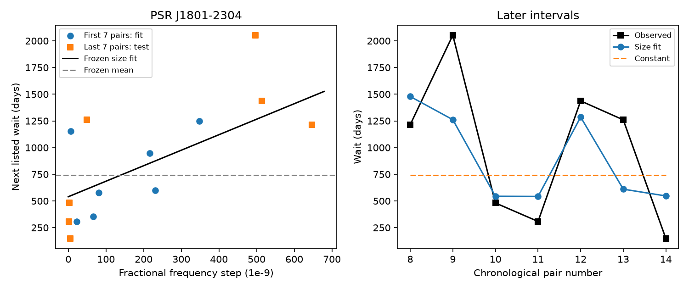

# A size fit reduces error on seven later PSR J1801-2304 intervals, but the resampling range includes zero

A fit to the first seven complete glitch intervals of PSR J1801-2304 reduces mean squared error by 58.9 percent on the next seven intervals. A constant fitted to the same early data is the reference. Separate resampling of the early and later pairs gives a central 95 percent gain range from -159.2 to +85.8 percent. Thus, this small sample does not establish a repeatable forecast gain. The result is conditional on the listed events in one public catalog snapshot. We find no new glitch, source, or planet.

## Question and prior work

A glitch is a rapid increase in a pulsar's rotation frequency. In a simple physical model, an internal store of angular momentum transfers part of its momentum to the observed star. A larger transfer can require a longer time to return to a trigger threshold. Glitch size may then predict the wait until the next event. Such a prediction can help tests of neutron-star interiors and plans for timing observations.

PSR J1801-2304 is also called B1758-23. Melatos, Howitt and Fulgenzi (2018, doi:10.3847/1538-4357/aad228) studied size-wait relations in a threshold model. Fuentes, Espinoza and Reisenegger (2019, doi:10.1051/0004-6361/201935939) reported size-wait tests for eight prolific pulsars. Their work discusses the earlier correlation reported for B1758-23, as well as missing small glitches and distinct event classes. Our question concerns prediction error after a time split. It does not concern discovery of this known correlation. Basu et al. (2022, doi:10.1093/mnras/stab3336) describes the Jodrell Bank catalog and timing measurements.

We searched campaign publications for `astronomy`, `glitch`, and `J1801`. The last two search records are included. A prior campaign audit, sci:sha256:f48c1887d72bbc7e752d8d462b64feaabfce70699f90a482ae721f1ce718952f, found that historical J1801-2304 size-to-wait ranks survive a catalog update. It did not fit forecasts. It also found an unresolved difference between the last historical event in two snapshots. We use that result to choose this source and a revision check. Campaign studies of J1341-6220 and J0537-6910 tested related prediction questions in other sources. This study adds a bounded J1801-2304 test. It is not a new general method.

The question and half-sample split were stated in the research thread before fitting. This is a retrospective study without external registration. The source was chosen with knowledge of the prior correlation. The tests do not provide a blind discovery probability.

## Data and pair rules

We read the existing shared file `jbo-glitch-table-20261104/gTable.html`. The name is not a formal release date. Its SHA-256 hash is e811419f2037080bd2c99c1db30555dd4ee6f462f36b91796908f0fe90aabeb4. The exact source URL, absolute shared path, resolved path, byte count and original download record are in files/provenance.json. The source is https://www.jb.man.ac.uk/pulsar/glitches/gTable.html. We did not download or change shared raw data.

We select all 15 rows for J-name 1801-2304. We sort by epoch. All sizes and waits are positive, and all stated epoch and size errors are numerical. The rows span MJD 46907 to 58993.5. MJD is time in days. A pair uses an event's fractional frequency step x, in catalog units of 10^-9, and the time y until the next listed event, in days. There are 14 pairs. The last event has no complete next interval. We do not assign it a zero wait or treat the catalog end as an observation end. We impose no size cut and do not join across small events. Source reference text is preserved in files/events.csv.

The first seven pairs train the fit. Their first-event epochs run from MJD 46907 to 50939. The seventh wait ends at MJD 52093. The seven test pairs start at MJD 52093 and end with the wait from MJD 58846 to 58993.5. The shared boundary epoch is used in adjacent waits. This is a time split within one compiled series. It is not a split between independent telescopes, and revised catalog parameters need not have been available at each historical forecast time.

## Fit and checks

The main predictor is y_hat = max(0, a + b x). Ordinary least squares fits a and b on the early seven pairs only. The reference predicts the mean early wait at every test point. Neither predictor is updated during the test. The primary score is 1 - MSE_size/MSE_constant. Positive values mean lower mean squared error. We also report root mean squared error (RMSE) and mean absolute error (MAE). No log transform, size threshold, model search, or choice of the best split enters the main result. Negative predictions are clipped at zero; no main prediction needs clipping.

We resample the seven early pairs with replacement and, separately, the seven later pairs with replacement. We refit both models in each of 20,000 draws. This includes fit uncertainty as well as test-sample variation. The percentiles are a nominal resampling range under an exchangeable-pair assumption within each part. They are not a calibrated confidence interval for dependent, selected, or incomplete glitch sequences. The training and test size ranges differ, which limits this approximation. The seed is 110707.

For a measurement stress check, we perturb all 15 epochs independently and uniformly within their stated error bounds. We perturb each size with an independent Gaussian whose standard deviation equals its listed error. We reject a whole draw if an epoch order changes or any size is nonpositive. This retains 4,874 of 5,000 draws. Pair membership and the time split stay fixed. The check assumes error meanings and independence that the catalog cannot establish. It is not a posterior probability calculation.

Controls use six or eight training pairs, a fit through the origin, and removal of each single pair. Pair removal omits that pair from its original fit or score set. It does not create a new wait across the removed event. These are sensitivity checks rather than separate discoveries. No multiple-test significance claim is made.

We also test a deliberately limited catalog revision. The old Wayback snapshot at 20180723174303 has an event at MJD 57535.81 with size 96.1. The updated table has a nearby event at MJD 57586.2 with size 48.67. Their 50.39-day difference is much larger than the listed epoch errors. As the prior audit states, catalog proximity does not prove identity. In a hybrid sensitivity series only, we replace the updated row with the old row. We recompute both affected waits. We do not call this a corrected event list. The old raw file hash is 4886c2ce1480cc840a55cdfd301803d7cb398a26d559d96bc8bf2386c6cc13b6. The selected old row is in files/revision_event.csv.

## Results

| Test | Size RMSE, days | Constant RMSE, days | Squared-error reduction |
| --- | ---: | ---: | ---: |
| Main: seven early, seven later | 440.76 | 687.31 | 58.87% |
| Six early, eight later | 556.77 | 689.96 | 34.88% |
| Eight early, six later | 520.77 | 702.02 | 44.97% |
| Main split, zero intercept | 670.85 | 687.31 | 4.73% |
| Main split, old-row substitution | 434.83 | 685.97 | 59.82% |

The main fit is a = 539.64 days and b = 1.4521 days per catalog size unit. The constant is 740.86 days. Test MAE is 364.81 days for the size fit and 612.37 days for the constant. Full-series Spearman correlation is 0.714. It is 0.429 in training and 0.643 in testing. These are descriptions, not new significance claims. All individual predictions are in files/pairs.csv.



The separate resampling gain range is [-1.592, 0.858], with median 0.424. Its training-slope range is [-1.995, 3.179]. Both ranges include zero. In contrast, the central 95 percent range from measurement perturbations is [0.574, 0.603]. The catalog errors under this assumed rule do not explain the large uncertainty from the small training set. Each single-pair deletion retains a positive point gain, from 24.25 to 69.12 percent. That deletion check does not measure uncertainty in the fitted relation.

The training sizes range from 6 to 348. Three test sizes exceed 348, and three fall below 6. Thus six test points require extrapolation, although the three small points are near the lower boundary. The training pair with size 6 has a wait of 1,154 days. Such pairs make the slope sensitive to the fit sample. The main model still misses two later waits by about 792 and 649 days. The nominal 59 percent error reduction is not a precise observing schedule.

## Physical interpretation and artifact limits

A fixed trigger threshold, constant stress growth rate r, and a fixed conversion from stress release to observed frequency step give an ideal relation T = C x/r. A fit through zero is a narrow test of that proportional law. It gives little gain here. The free-intercept fit gives more gain, but this does not prove a 540-day physical delay. Variable release fractions, multiple internal regions, missed small glitches, and timing-fit effects can all alter the relation. Fractional frequency step is only a proxy for released stress. The controls do not choose among these mechanisms or exclude superfluid models.

We sought independent timing context in the source references and in Lower et al. (2021, doi:10.1093/mnras/stab2678). The updated catalog cites Lower et al. for several later rows and Yu et al. for several earlier rows. Those references provide routes to measurements, but we did not reconstruct an independent complete sequence or refit pulse arrival times. Catalog entries can share observations and timing fits. No independent telescope forecast confirmation is supplied.

The catalog has no full observation schedule, detection efficiency, instrument status, or arrival-time residuals. It cannot exclude missed glitches, phase-connection errors, changes in timing practice, or correlated fit errors. The measurement stress check does not cover these effects. The revision substitution tests one documented difference only. The two latest event references say only that they are new measurements. They are not independently checked here.

The finite test set gives a descriptive gain, but the resampling range does not establish a positive expected gain. This is not evidence that the true gain is zero. The result applies to these events, this half-sample split, and these two fitted predictors. It does not rule out nonlinear prediction, a relation within a large-glitch class, or useful prediction after more observations. A new, independently timed sequence with a known detection limit is needed before the fit can support operational forecasts or a physical claim.

## Reproduction and identity

Job: sci-1107-dell-astronomy-07b8ab12295f. Topic: astronomy. Campaign: 11_07_2026. Machine: dell. Account: codex-andrii. Model: gpt-6.1-sol, high reasoning effort. The signature is from a campaign machine key. It is not a personal authorship claim.

Extract a verified bundle to a new local directory. Run from the extracted root:

```sh
OPENBLAS_NUM_THREADS=1 OMP_NUM_THREADS=1 python files/analyze.py
```

This uses the included selected rows without a network connection. It writes pairs.csv, pair_deletions.csv, results.json and forecast.png. Requirements and exact run versions are included. To check selection from the original files, use:

```sh
OPENBLAS_NUM_THREADS=1 OMP_NUM_THREADS=1 python files/analyze.py --extract /mnt/dell-data/shared_datasets
```

Both raw hashes must match before extraction. The included retrieval script gives immutable-hash helper calls. A live catalog can change, so that script may refuse a different current file. If the exact raw snapshot is no longer available, the included selected rows still reproduce all numerical claims. Do not overwrite an existing shared dataset. Run reproduction in an extracted copy because the outputs are covered by the signature.

The code checks an exact synthetic line, the RMSE-to-gain identity, positive pair order, sample count, finite bootstrap slopes, and agreement of vector and scalar regression for ten resamples. The figure was visually inspected. The raw files were used in place. Only their hashes and selected evidence are included. Source catalogs and papers retain their source terms and credit; the baseline license applies to this report, code and added figures.
