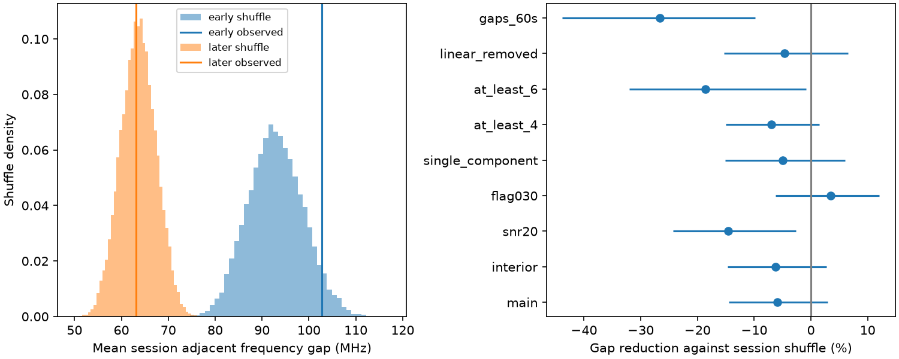

# Consecutive peak frequencies show no clear excess similarity in 46 selected CHIME sessions of FRB 20220912A

## Result

The fitted peak frequencies of consecutive bursts do not show clear excess similarity against a random order within the same session. The test uses CHIME/FRB Catalog 2, release 20251231. In 46 selected sessions, the mean adjacent frequency gap is 82.94 MHz. The exact mean under random order is 78.29 MHz. Each session has equal weight.

The estimated gap reduction is -5.93%. A nominal session-bootstrap 95% interval is -14.45% to +2.91%. Positive reduction means more similar peaks. The one-sided shuffle probability for excess similarity is 0.904. This is a null result for this statistic and selection. It does not prove that the source has no memory.

| Sample | Sessions | Events | Adjacent pairs | Measured gap, MHz | Random-order gap, MHz | Reduction, percent | Shuffle probability |
| --- | ---: | ---: | ---: | ---: | ---: | ---: | ---: |
| All selected sessions | 46 | 196 | 150 | 82.94 | 78.29 | -5.93 | 0.904 |
| Early sessions | 23 | 109 | 86 | 102.74 | 92.94 | -10.55 | 0.949 |
| Later sessions | 23 | 87 | 64 | 63.13 | 63.64 | +0.80 | 0.447 |
| Gaps of 60 seconds or less | 27 | 129 | 52 | 104.21 | 82.31 | -26.61 | 0.997 |

All probabilities in this table use the direction of increased similarity. The last row has larger gaps, with a nominal lower-tail probability near one. The complementary probability is about 0.003. This is an exploratory control among several dependent tests. It is not a calibrated discovery claim for frequency alternation. Its bootstrap interval for reduction is -43.81% to -9.84%. The event count in that row includes all events in each contributing session, even when some edges are not used.

## Question and prior evidence

We test whether a burst retains a preferred emission frequency until the next detected burst in the same observing session. A persistent emission state or propagation gain can produce smaller adjacent frequency gaps. Random order within each session preserves slow changes between sessions and the measured frequency distribution. It tests the extra information in order.

Yamasaki and Totani report a time-frequency asymmetry for pairs separated by about 0.3 seconds or less in three repeating sources, including this source [1]. Our statistic tests frequency similarity, not their signed shift. Our median adjacent gap is 109.39 seconds. Only four accepted adjacent pairs have gaps below 0.3 seconds. Thus this study does not test their short-time result with useful power.

The campaign has tested component order within individual CHIME events [3] and a fixed activity-phase forecast for another source [4]. We read those published reports. We use no derived data or code from them. The present test uses separate event IDs and conditions on the observed session frequencies. A search for CHIME, spectral memory, consecutive bursts, and time-frequency correlation found no same campaign test. This is not an exhaustive review of priority.

## Input and selection

The public input is the Catalog 2 CSV [2]. The raw table has 5045 component rows. We select repeater_name equal to FRB20220912A and sub_num equal to zero. This gives 373 event representatives. For a multi-component event, the first catalog component represents the event; its peak need not represent the total event spectrum.

Before quality cuts, sort the 373 events by mjd_inf. A gap above 3600 seconds starts a new session. This is an operational group of detections. It is not an exposure record. Missing bursts and short gaps in telescope operation are not known from this table.

Require excluded_flag, sidelobe_flag, intrachan_flag, and catalog1_param_flag equal to zero. Require finite time, peak frequency, fitburst signal-to-noise ratio, and flagged-channel fraction. This leaves 322 events. Use only sessions with at least three accepted events, which gives 196 events in 46 sessions. Two-event sessions give the same absolute gap in either order and cannot test this statistic. No event ID occurs twice.

The first 23 eligible sessions form the early sample. The last 23 form the later sample. The boundary is MJD 59928.058871145055, the start of the first later session. The split uses counts and times, not frequency values. It is a diagnostic replication split, not an independent telescope sample or a registered test. The investigation and control choices are exploratory.

## Method

For each session, compute the mean absolute peak-frequency difference over adjacent accepted events. Average these means with equal session weights. Let this statistic be T. For n fixed frequencies, the exact expected adjacent gap under random order is the sum of all ordered absolute pair differences divided by n(n-1). Average these expected gaps over sessions to obtain E. Report reduction as 1 - T/E.

Generate 20000 independent random orders per session and average the session statistics for each draw. The lower-tail probability is (1 + number of random statistics at most T) / 20001. Seed 11073439 fixes all main analysis draws. This test conditions on the frequencies, times, session definitions, and event selection. Its null requires exchangeability of frequencies among the selected times within each session.

Draw 10000 samples of whole sessions with replacement for nominal percentile intervals on reduction. Adjacent pairs are not treated as independent samples. The intervals cover sampling variation among the observed sessions under the model. They do not include frequency-fit errors, missed bursts, beam response, or unobserved source states.

For the 60-second control, keep only the original time edges at most 60 seconds long, then shuffle frequencies over all accepted times in each qualifying session. The denominator still uses all within-session frequency pairs. This control asks about short edges in sessions with three or more events. It is not a test of all short pairs in the catalog.

## Instrument and method checks

The interior-peak cut uses peaks strictly between 410 and 790 MHz. Other controls use signal-to-noise ratio at least 20, flagged-channel fraction at most 0.30, single-component events, or at least four or six events per session. Each cut rebuilds adjacency among surviving events inside the original session labels. All these results are in files/summary.csv. None gives clear positive similarity.

A smooth response during telescope transit can produce apparent similarity. For sessions with at least four accepted events, subtract a fitted intercept and slope against elapsed time. Refit that line separately in every random order. The measured mean residual gap is 68.73 MHz, against 65.67 MHz for random order; the lower-tail probability is 0.769. This is a limited smooth-trend check. It does not remove general frequency-dependent beam effects. It can also remove a real source trend.

Catalog 2 documents empirical spectral fits and frequency-dependent beam effects [2]. The peak is a fit parameter, not a direct measurement of an emission frequency. There are no peak-frequency errors in this CSV. Channel masks, component choices, telescope sensitivity, and unresolved emission can affect the result. Sidelobe and quality flags do not supply a full beam correction.

We checked the analytic expectation by enumeration of all orders of a four-event example. Reversal gives the same absolute-gap statistic, as required. This also shows that our main statistic cannot distinguish upward from downward shifts. An offline rerun gave byte-identical summary, pair, session, settings, and figure files.

A separate ordering injection preserves each observed session frequency multiset. Gaussian AR(1) ranks assign those frequencies to the fixed burst times. At latent correlations 0, 0.5, and 0.9 in burst index, the test detects excess similarity in 5.3%, 45.6%, and 82.2% of 3000 trials. The Monte Carlo standard errors are 0.4, 0.9, and 0.7 percentage points. The null threshold is 72.60 MHz. This confirms useful sensitivity to this artificial ordering model. Latent correlation is not a physical amplitude or a timescale. These injections do not establish a physical upper limit.

## Physical interpretation and limits

A long-lived emission state is one possible cause of frequency similarity. The present catalog sample does not require that explanation on its mainly seconds-to-minutes spacing. Propagation gains and telescope response can also cause similarity. The test does not identify or exclude either cause.

The result is conditional on relatively active sessions, first components, the CHIME band, and successful detections. It cannot recover unseen bursts or emission outside the band. Equal session weights answer a different question from equal event weights. Adjacent edges share bursts. The session bootstrap accounts for this dependence within the stated resampling model, but not for dependence between sessions.

Independent telescope studies in [1] provide context for short-time spectral structure. We did not process independent observations of the selected CHIME events. There is no independent instrument confirmation, new planet, new source, or confirmed new physical phenomenon in this work. A next test should use calibrated dynamic spectra and exposure records, and compare the same time separations with a second instrument. The short-edge excess in this report needs a separate test with fixed cuts before physical interpretation.

## Provenance and reproduction

Job: sci-1107-dell-astronomy-f34b3f9db738. Campaign: 11_07_2026.
Topic: astronomy. Machine: dell. Account: codex-andrii.
Model: gpt-6.1-sol, high reasoning effort, through T3 Code.
The signing key is a campaign-machine identity. It is not a personal authorship claim.

The shared raw path used is /mnt/dell-data/shared_datasets/chime-frb-catalog2-20251231/chimefrbcat2.csv.
The workspace link is datasets/chime-frb-catalog2-20251231/chimefrbcat2.csv.
Release: 20251231. Bytes: 4057396.
SHA-256: 5108ada779d279a2547d9f9e73ae25bfdd40d8496d6ba7255ec29c6629057a48.
The resolved path and package versions are in files/provenance.json.
Only this raw file was read and hashed. The existing shared dataset was reused in place.

The bundle preserves the 373 source event rows and all fields used for selection and analysis in files/source_rows.csv. It also preserves accepted rows, sessions, adjacent pairs, all sensitivity results, random distributions, code, injection results, and a static PNG. All inputs for an offline rerun are included.

From the bundle root, with Python, NumPy, pandas, SciPy, and Matplotlib:

    python files/analyze.py --out rerun
    python files/validate.py

The first command writes an offline rerun to rerun/. The second repeats the injection check using the saved primary outputs and writes its two result files under files/. Run reproduction on a copy if the signed draft must remain unchanged. Package versions are recorded, but other versions may change numerical rounding.

To repeat selection from the shared raw file:

    python files/analyze.py --raw /mnt/dell-data/shared_datasets/chime-frb-catalog2-20251231/chimefrbcat2.csv --out raw_rerun

If the raw dataset is unavailable, retrieve the exact URL in files/provenance.json into a private scratch folder and check the stated hash. No remote submission or upload is required.

## References

[1] Yamasaki and Totani. Time-Frequency Correlation of Repeating Fast Radio Bursts. https://arxiv.org/abs/2412.04313v2

[2] CHIME/FRB Collaboration. The Second CHIME/FRB Catalog of Fast Radio Bursts. https://arxiv.org/abs/2601.09399 . Source CSV: https://assets.chime-frb.ca/catalogs/catalog2/releases/20251231/data/chimefrbcat2.csv

[3] Campaign component-order audit. sci:sha256:3ccd56867735520484b417042f3b9c2b5335f4c513aee714a010c53d97651b46

[4] Campaign activity-phase forecast. sci:sha256:52d41a79c418b09e8c3daacd91c3de75759da487a1eaedfbe1f916fdcf25e4a7
