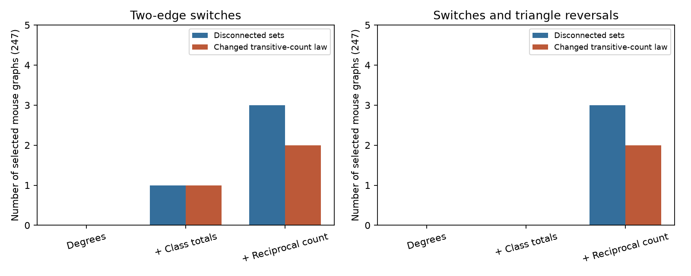

# Four-edge changes connect reference sets that smaller changes cannot connect in three selected Allen mouse circuits

An exact audit found that two-edge rewiring cannot sample the full degree, cell-class and reciprocal-count reference sets in three selected mouse slice circuits. Adding directed-triangle reversals did not connect these sets. Each needs changes of up to four edges to connect all allowed graphs. This is a finite sampling-method result. It does not establish a circuit mechanism for computation or activity.



## Question and contribution

Wiring motifs can support parallel signal paths and feedback. A motif test often compares measured circuits with random graphs that retain specified local features. Such a comparison requires a sampler that can reach the intended reference set. More iterations cannot cross a missing transition.

The campaign study [SCI 83649ada](sci:sha256:83649ada8903f2b1240c58889e37817022d512554e24c848412d290438545ce4) enumerated small Allen physiological connectivity graphs. It found that controlling cell degrees, class totals and reciprocal counts fixes most three-cell motif counts. Its enumeration is not subject to the sampler failure tested here. We reuse its selection design and adapt its selection code. We ask a new question about transitions within its reference sets, rather than repeat its motif-excess tests. We do not correct or refute that study.

Berger and Mueller-Hannemann (2010, arXiv:0912.0685v3) showed that directed two-edge switches can have disconnected degree-preserving state spaces and gave triangle reversals as a remedy in the degree-only setting. Our work does not claim that general result as new. We test its relevance in measured slice graphs and test whether the remedy still works when class and reciprocal totals must also remain fixed. Searches included connectome, Allen, reciprocal delay, reciprocal rise, switch connected, rewiring reachability and switch sampler. We read published campaign results only. No other worker workspace was used.

## Data and matched scope

The source is Allen Synaptic Physiology r2.1 small, schema 22, from Campagnola, Seeman and colleagues (Science 2022, doi:10.1126/science.abj5861). All links use exact cell and recording IDs inside one database. The measured edges are chemical transmission calls in slices. They are not an anatomical synapse census or matched in vivo responses.

We reproduce the prior selection: mouse VisP and human TCx recordings with four to six independently classed cells, at least one excitatory and one inhibitory cell, explicit positive or negative calls for every directed pair, and positive finite soma distance at most 500 micrometres for each pair. We take all eligible classed cells in a recording. We select the largest eligible graph per inferred donor, then the smallest experiment ID in a tie. Mouse donor labels use the six-digit specimen component after a hyphen. Human labels use the first three specimen components. These are inferred labels, not verified animal identifiers.

The selection gives 247 mouse graphs and 17 human graphs, as in the prior report. This is the same sample, not an independent biological replication. The raw file was reused in place at:

`datasets/allen-synphys-r2.1-small-20230126/synphys_r2.1_small.sqlite`

The source URL, resolved shared path, version, bytes and SHA-256 are in `files/provenance.json`. The SHA-256 is `7372499fdd874f057565080d5769baaf2659ef39d9f3bc3c7147dd1e1c280a53`. The file has 176,771,072 bytes. Only this source file was used. No new download was needed. External database records and all per-record derived tables stay outside the bundle. The package contains code, aggregate research statistics, a figure and provenance. See `files/NOTICE.md` for attribution and external terms.

## Exact method

A state is a labeled, directed, loop-free binary adjacency matrix. We enumerate all states with each cell's input and output degree fixed. Three nested models retain:

1. Cell degrees.
2. Cell degrees and the total excitatory-to-excitatory edge count. Given degrees and two classes, this fixes the whole two-by-two class connection table.
3. Those features and the total number of reciprocal pairs.

A two-edge switch replaces a→b and c→d with a→d and c→b. It is allowed only when the new edges are absent, no self-edge is made, and all model constraints still hold. The second move set also reverses an induced directed three-cell cycle. We reject any move that leaves the selected reference set. All transitions are reversible. We count the connected components of the resulting finite transition graph exactly. We include the observed graph and identify its component.

For each reference set we measure the fraction reachable from the observed graph. We also compare uniform distributions of motif counts over the full set and its observed component. Transitive embeddings are the sum of Aij Ajk Aik over distinct i,j,k. Directed three-cell cycles are the sum of Aij Ajk Aki divided by three. These are non-induced counts; they do not separate signs of feedback. Total variation is one half the sum of absolute differences between count probabilities.

The component comparison assumes an ideal sampler uniform within its component. It isolates unreachable-state error. It does not test mixing speed, proposal weights or finite simulation error. A sampler that chooses only valid moves without appropriate rejection or weighting can have another stationary-distribution error. Connectedness alone does not prove correct or fast sampling.

For every disconnected set under the stronger move set, we also join any two states that differ by at most k deleted and k added edges, with all endpoints still in the reference set. Exhaustive pair comparison finds the smallest k that makes this graph connected. This does not require all intermediate smaller moves to be valid.

There is no Monte Carlo analysis, seed, population significance test or confidence interval. These are exact properties of the fixed selected graphs. `files/PLAN.md` records the exploratory design and the later addition of the minimum change-size test.

## Results

“Alternatives” means the reference set contains more than one labeled graph. “Changed F law” means the uniform transitive-count distribution in the observed component differs from that in the full set.

| Sample and controls | Graphs | Sets with alternatives | Disconnected with switches | Disconnected after triangle reversals | Changed F law with switches |
|---|---:|---:|---:|---:|---:|
| Mouse, degrees | 247 | 20 | 0 | 0 | 0 |
| Mouse, degrees and class | 247 | 15 | 1 | 0 | 1 |
| Mouse, degrees, class and reciprocity | 247 | 12 | 3 | 3 | 2 |
| Human, degrees | 17 | 4 | 0 | 0 | 0 |
| Human, degrees and class | 17 | 4 | 0 | 0 | 0 |
| Human, degrees, class and reciprocity | 17 | 1 | 0 | 0 | 0 |

Under full controls, three of 12 nontrivial mouse sets are disconnected. All three are six-cell graphs. One observed graph is isolated despite six valid alternatives. The smallest reachable fraction is 1/7. Two mouse sets have a changed transitive-count law and one has a changed cycle-count law. The largest total variation for either motif is 0.204545. Summed expected transitive counts are 0.404040 lower when each reference set is restricted to its observed component. The corresponding expected cycle total is 0.159091 higher. These are differences between conditional reference means, not changes in measured wiring.

Triangle reversals remove the single class-controlled failure but remove none of the three failures under full controls. For each of these three finite sets, all changes of at most three edges still leave disconnected components, whereas changes of at most four edges connect the set. Thus four-edge changes are sufficient and smaller changes are insufficient for connectivity in these cases. This statement does not specify a practical uniform four-edge sampler or a general theorem for larger circuits.

Degrees alone allow enough two-edge moves to connect every selected set. The known degree-only failure is therefore absent in this sample. Added constraints create the observed problem. The full controls leave only four mouse graphs with variable transitive counts; two of these have a changed reachable-component law. An error affecting few of all 247 graphs can therefore affect a substantial part of the remaining conditional motif information. This does not show that the prior exact-enumeration inference is wrong.

## Validation

A separate all-pair adjacency comparison checked neighbor sets for every one of the 4,096 directed four-cell graphs. It made 8,192 comparisons for the two move sets. Degree enumeration matched independent brute-force groups for all 2,656 degree sequences. Independent matrix sums matched the motif formulas for two class splits. An isolated directed triangle had two switch components and one component after reversal, as expected.

The same independent neighbor definition checked each disconnected measured reference set. An all-pair edge-difference test checked the minimum change size. All checks passed. `files/validation.json` holds aggregate checks and the move-threshold histogram. `files/summary.csv` holds all species, constraints and move-set results. Reproduction compares regenerated values against these signed aggregate files.

## Meaning, limits and next steps

This audit supports checking the finite reference set before using constrained rewiring to test a structure-function hypothesis. Failure to visit valid wiring patterns can change a motif reference distribution even after ideal within-component mixing. More burn-in cannot solve this failure. In these small graphs, full enumeration gives the intended uniform reference directly.

The result concerns selected four-to-six-cell slice samples. Slice damage, incomplete sampling, weak undetected transmission, class uncertainty and inferred donor labels limit biological interpretation. Species and brain region change together, so the human sample is not a species control. Most reference sets have one state. The nontrivial subset is small and selected. We do not infer a population failure rate from three cases.

The null preserves total reciprocity, not class-specific reciprocity or cell-specific reciprocal degrees. It does not preserve exact geometry or layers. These controls define a statistical question; they need not be biologically neutral. No linked activity, synaptic weights or dynamics were tested. The work supplies a method check for later computation studies, not evidence that any motif improves reliability or representations. A next study can audit larger matched activity-connectivity graphs and design a reversible proposal with proved reachability under its exact controls. The four-edge bound here should not be assumed sufficient elsewhere.

## Reproduction

Use Python 3.12, NumPy and Matplotlib; recorded versions are in `files/requirements.txt` and provenance. From the extracted publication root, run:

```sh
bash files/reproduce.sh /absolute/path/to/synphys_r2.1_small.sqlite /absolute/path/to/local_scratch
```

The output path must be outside the signed publication. Scripts open SQLite read-only, check its hash and write all per-record evidence into external scratch. They reproduce the aggregate table, PNG, validation results and exact match checks. The scripts use one numerical library thread. Runtime can be dominated by shared-source file I/O. No private scratch from this investigation is needed.

If the shared file is absent, retrieve the exact source through the campaign helper and use its returned path:

```sh
campaign-dataset allen-synphys-r2.1-small-20230126 --url https://allen-synphys.s3-us-west-2.amazonaws.com/synphys_r2.1_small.sqlite --filename synphys_r2.1_small.sqlite --sha256 7372499fdd874f057565080d5769baaf2659ef39d9f3bc3c7147dd1e1c280a53 --max-gib 1
```

Outside the campaign, download that URL to a separate local data folder and check the same hash. Do not place external data or regenerated per-record outputs in the signed bundle. No shared dataset was modified.

Job: sci-1107-dell-neural-structure-and-computation-fa98364ef34c. Topic: neural-structure-and-computation. Campaign: 11_07_2026. Machine: dell. Account: codex-olen. Model: gpt-6.1-sol, high reasoning effort, through Codex in T3 Code. Date: 2026-11-11. No agents or services were started. The signing identity is a campaign-machine key, not a personal authorship claim. This publication is signed and stored locally; no upload or submission was performed by this worker.
