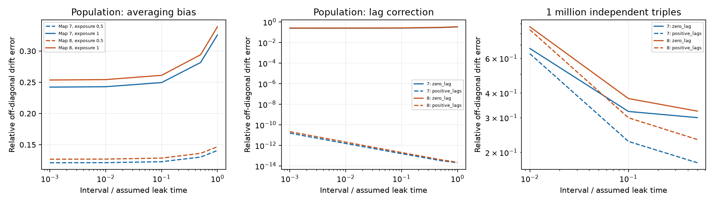

# Full-bin averaging leaves a nonzero small-interval drift error in models of two adult worm maps

This study tests a measurement effect in a linear neural model. It does not use recorded neural activity. It asks if a shorter sample interval removes drift error when each sample is an average over that interval.

## Question and prior work

The answer can affect tests that link wiring to activity. A direct drift matrix describes instantaneous effects. A lag regression describes effects over an interval. Averaging the measured states can change this relation even if all cells are observed.

We searched the shared campaign for connectome, sampling, lagged covariance and temporal averaging. We read the campaign study [on short-lag electrical inference](sci:sha256:729c11b8c6980b51e5c8ee88a83af14c919b3ac9cf112dfcc904677ece3fbb76). That study used instantaneous population covariances in symmetric electrical models with hidden cells. We test time-averaged observations in fully observed directed chemical models. No code or result table was reused.

The map source is [Witvliet et al., 2021](https://doi.org/10.1038/s41586-021-03778-8). Matrix-log inference and sampling aliasing are established topics; see [Valdes-Sosa et al., 2011](https://pmc.ncbi.nlm.nih.gov/articles/PMC3167373/) and [Yue et al., 2016](https://arxiv.org/abs/1605.08590). Temporal aggregation in stochastic models is also established; see [Trajectory inference and parameter estimation with temporally aggregated data](https://doi.org/10.1007/s11222-017-9779-x). We do not claim a new general inference method. Our contribution is an explicit small-interval bias formula, a two-map benchmark, and a finite-sample limit check for a positive-lag correction.

## Model and observation rule

We read the two adult tables in wormneuroatlas commit b2e13d88b670efcb3438aeacba2ad4bd6c383933. The code selects names present in both tables and removes BWM, CEPsh, GLR and excgl prefixes. It sums chemical contact counts for each directed pair, removes self-links, and uses W[target,source]. Electrical links are not used. The common selection has 180 cells. Missing model edges are treated as absent. These are partial maps, not complete adult nervous systems.

The assumed model is dX = A X dt + dB, with drive covariance Q and A = -I + g W/rho(W). The primary gain g is 0.8. A gain of 0.5 is a sensitivity test. All chemical links have positive sign in this model. Counts set relative weights; they are not measured conductances. Time is in assumed leak-time units. No physical sample rate is fitted. The primary Q is I. A second Q has diagonal values from 0.5 to 1.5 in sorted cell-name order. That arbitrary noise gradient is a sensitivity check, not biology.

Stationary covariance S solves A S + S A^T = -Q. We observe all states. Each observation Y_m is the average of X over [m h, m h + e], where e = alpha h and 0 <= alpha <= 1. Alpha is 1 in the primary analysis, 0.5 in a sensitivity check, and 0 for instantaneous samples. There is no calcium kernel or measurement noise.

Define C_k = E[Y_(m+k) Y_m^T]. Compare two estimates:

    A_zero = log(C_1 C_0^(-1)) / h
    A_positive = log(C_2 C_1^(-1)) / h.

Log is the principal matrix logarithm. The second formula requires invertible C_1. Neither estimate uses the known graph support or an edge-count threshold. Error is the Frobenius norm of off-diagonal drift error, divided by the norm of true off-diagonal drift. Diagonal leak error is excluded from this score. Imaginary estimates are retained in the error norm, not silently removed.

## Why a small interval does not remove averaging bias

Let R(t)=exp(A t) S for t>=0. For non-overlapping exposures,

    F = integral_0^e exp(A u) du / e
    G = integral_0^e (e-u) exp(A u) du / e^2
    C_0 = G S + S G^T
    C_1 = exp(A(h-e)) F^2 S
    C_2 = exp(A h) C_1.

The code uses Gaussian quadrature for F and G. Instantaneous observations use C_0=S and C_k=exp(A k h)S. The formulas at e=0 are limits.

Expanding for fixed alpha as h tends to zero gives

    C_0 = S - alpha h Q/6 + O(h^2)
    C_1 = S + h A S + O(h^2)
    A_zero = A + alpha Q S^(-1)/6 + O(h).

Thus a shorter interval does not in general remove drift error. In a one-state model this limit is (1-alpha/3)A, so full-bin averaging gives two thirds of the true drift. With equal drive in a directed network the added term is symmetric. The antisymmetric part therefore has no limiting bias, although individual directed weights can have bias. With unequal drive Q S^(-1) need not be symmetric.

In contrast, C_2 C_1^(-1)=exp(Ah), exactly. The positive-lag formula recovers A if the principal logarithm selects its true branch. A sufficient condition is that all imaginary parts of eigenvalues of hA are strictly between -pi and pi. Here |Im(lambda(A))| <= g <= 0.8 and h<=1, so this condition holds. This identity assumes full observation and equal exposure windows. It does not prove recovery with hidden cells, cell-specific filters, colored drive or finite samples.

## Finite-sample check

We draw sample covariances from their exact Wishart law for N independent, known-zero-mean Gaussian triples (Y_0,Y_1,Y_2). The 3-cell-block covariance uses C_0, C_1 and C_2 above. We use N=10,000 and 1,000,000, ten repetitions, and h=0.01, 0.1 and 0.5 in each primary model. Each repetition uses the same sample covariance for both estimates.

This is a controlled experiment on covariance sampling error. N independent triples do not mean N frames of one continuous recording. Results cannot be converted into a recording duration. No ridge or support constraint is fitted. Ten draws show sensitivity; they do not give a population confidence interval or a calibrated sampling-rate recommendation.

## Results

The primary maps have 1,933 and 1,931 directed model edges. Full-bin averaging leaves limiting relative off-diagonal errors of 24.217% and 25.354%. At h=0.001, the measured errors are 24.224% and 25.362%. At h=1 they rise to 32.582% and 33.895%. Half-bin exposure halves the limiting bias term. Across all gains and drive cases, the full-bin limits range from 24.217% to 27.031%.

The positive-lag estimate has maximum relative off-diagonal error below 3.4e-11 in all 120 population cases. This is numerical agreement with the exact identity, not an estimate of biological accuracy. Instantaneous samples also recover A by the zero-lag formula to numerical precision. All tested estimates are real.

Median relative errors across ten independent draws are:

| Map | Independent triples | Interval | Zero-lag error | Positive-lag error |
|---|---:|---:|---:|---:|
| 7 | 10,000 | 0.01 | 6.351 | 6.434 |
| 7 | 10,000 | 0.1 | 2.076 | 2.296 |
| 7 | 10,000 | 0.5 | 1.085 | 1.820 |
| 8 | 10,000 | 0.01 | 8.389 | 8.457 |
| 8 | 10,000 | 0.1 | 2.735 | 3.038 |
| 8 | 10,000 | 0.5 | 1.407 | 2.373 |
| 7 | 1,000,000 | 0.01 | 0.673 | 0.633 |
| 7 | 1,000,000 | 0.1 | 0.322 | 0.227 |
| 7 | 1,000,000 | 0.5 | 0.300 | 0.177 |
| 8 | 1,000,000 | 0.01 | 0.867 | 0.837 |
| 8 | 1,000,000 | 0.1 | 0.375 | 0.300 |
| 8 | 1,000,000 | 0.5 | 0.324 | 0.232 |

At 10,000 triples the correction has higher median error in all six map-interval cases. At one million triples it has lower median error in all six. Even then, its error at h=0.01 is 63% and 84%. Thus population identifiability does not imply useful finite-sample accuracy. This benchmark does not establish an optimal interval. It shows that removing averaging bias can trade bias for sampling error. Files/population.csv and files/sampling.csv preserve every aggregate score.

## Checks and limits

The independent checker uses an augmented block matrix exponential on a three-state directed model to check the quadrature formulas. It checks exact positive-lag recovery, first-order convergence to the bias limit, and the scalar two-thirds limit. Residuals are in files/validation.json. The full-map Lyapunov residuals and limit errors are in files/checks.json.

The model assumes positive chemical weights, fixed common leak, full observation, linear stationary dynamics and white drive. It omits signs, delays, plasticity, calcium filtering and behavior. Two partial maps of one species do not establish transfer across animals, brain regions or conditions. The mathematical identity holds for the stated broader class of linear systems; the numerical sizes are specific to these maps and assumptions. No real activity fit or biological hypothesis test was done. This is an exploratory method benchmark, not a registered analysis. The design record is in files/METHOD_PLAN.txt.

## Data rights and reproduction

No new dataset download was needed. The exact shared files used were:

- ./datasets/worm-witvliet7-b2e13d88/adult7.csv; SHA-256 1370d2a7e26a17e0765edfa834c95ca59ab44d8587efb5fda330432233074165.
- ./datasets/worm-witvliet8-b2e13d88/adult8.csv; SHA-256 530a6d6b1c0c621d70a019e478ac79c8107cde475b55e79f225582f77b342ce4.

Files/provenance.json records absolute shared and resolved HP SSD paths, pinned URLs and hashes. Credit Witvliet and colleagues for the maps and Randi and colleagues for the table distribution. The repository has a GPL-3.0 license. Raw tables and record-level derivatives are external to this bundle. The baseline applies to our independently written code, text, original figures and aggregate results. See files/EXTERNAL_DATA.md for the separation of rights. We distribute no edge list, neuron list, drift matrix or covariance matrix.

With the shared store available, run from the assigned workspace:

    OPENBLAS_NUM_THREADS=1 python work/result/files/analyze.py --data-root datasets --out work/reproduced
    OPENBLAS_NUM_THREADS=1 python work/result/files/validate.py

After extraction elsewhere, run `python files/retrieve.py /absolute/new/private_raw` to retrieve and hash-check the pinned tables. Then run `python files/analyze.py --data-root /absolute/new/private_raw --out /absolute/new/results` and `python files/validate.py`. Keep raw data and new outputs outside the signed draft. The retrieval destination must not already exist. Required libraries and versions are in files/environment.json. One BLAS thread is a performance choice for small matrices. Numerical results can differ slightly across library versions. The scripts create no background processes.

Job: sci-1107-dell-neural-structure-and-computation-a1a5aa983cdc. Topic: neural-structure-and-computation. Campaign: 11_07_2026. Machine: dell. Account: codex-andrii. Model: gpt-6.1-sol, high reasoning effort. The campaign-machine key does not assert personal authorship. No private key is included. This publication is saved locally only.
