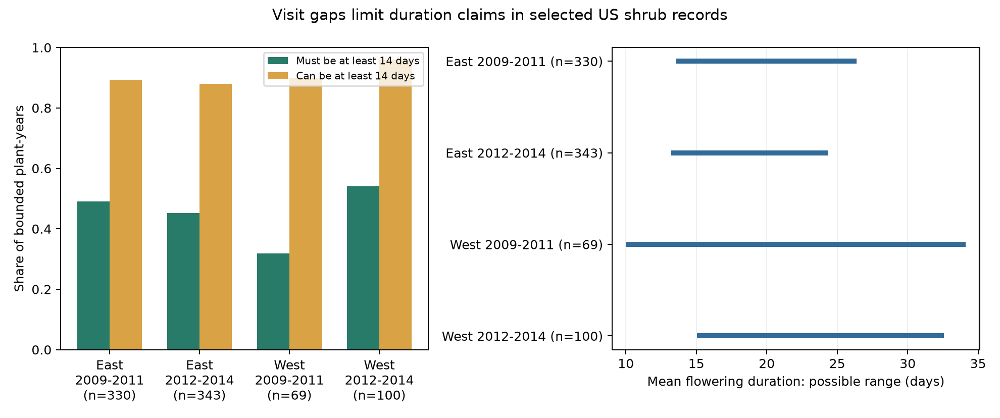

# Visit gaps left two-week flowering duration uncertain in 361 of 842 selected US shrub records in 2009-2014

## Question and result

Can modern public shrub records identify flowering duration well enough to support later tests of warming and floral resource timing? Can a report of full bloom reduce uncertainty in the two endpoint dates?

We found 842 plant-years with usable first-bloom and end-bloom brackets at 231 sites. In 361 cases, the records permit durations below 14 days and durations of at least 14 days. The sample mean can range from 13.50 to 26.75 days. The mean is over records, not over equally weighted sites. Adding full-bloom reports narrows the duration bound in only one of 802 usable cases. This is a null result for most of the proposed gain from an intermediate stage. It does not mean that full-bloom data have no other use.

These are sharp bounds conditional on correct reports and one ordered flowering episode. They do not show that any particular unobserved duration occurred. They are not confidence intervals. Four descriptive checks use separate geographic regions and disjoint years. They show that the ambiguity occurs in each sample. They are not independent probability samples or a test of a climate trend.

## Prior work and contribution

Rosemartin et al. (2015; doi:10.1038/sdata.2015.38) describe the source archive and its phase rules. The modern records include the time since a prior absence report. Denny et al. (2014; doi:10.1007/s00484-014-0789-5) describe repeated status monitoring. Their method preserves absence as well as presence. The review Ten best practices for effective phenological research (doi:10.1007/s00484-023-02502-7) explains why observation timing needs care.

We ran `sci search "phenology climate pollution" --in ./campaign --json` before the precise question was selected. Local search verifies the campaign archive and did not finish in this run. We stopped it after metadata inspection and the focused signed reads. We also inspected public bundle metadata and read the signed campaign study on visit gaps and bloom spread (SCI db8025ca3889d7b0db5c1280e6b8b866e462a91ad57bc04af050a685bba30ff4). That study uses variation among plants. Here we use time between stages within the same plant. We also read the historical flowering-duration study (SCI 5a23ffe0e5491f35b5f3e80c36d022f5ae770f19e75d6e30afb36aec2f232a0c). It reported uncertain warmth links. Our study uses actual modern observation brackets, not hypothetical delay caps or a historical weather regression. The raw archive overlaps, so this is not an independent data replication. The question and threshold were chosen during this exploratory investigation.

The contribution is a small inspectable method and data audit. We give exact bounds for duration and show the limited gain from a third ordered stage. This can guide future climate studies that need a duration outcome. We do not claim a new general theory of interval censoring.

## Data and selection

The sole analysis source is the ScienceBase version 13 workbook, `observation_data` sheet. Its shared path is `/mnt/dell-data/shared_datasets/usanpn-lilac-honeysuckle-v13-sciencebase/lilac_honeysuckle_v13.xlsx`. The SHA-256 is `d052a8742ed6141d408e1c0b4592b19c7ae8f0416c7384e1f16064337f9b0edd`. The file was read in place. The source URL, measured hash, file size and software versions are in files/provenance.json. The included modern source extract permits offline checks. No raw download or shared-data change was needed. A monthly weather file was inspected during question selection but was not used in this analysis.

We combine the modern submission channels, Dataset_ID -9999 and 3. We retain the groups First bloom, Full bloom, and End bloom, which give 3,997 source rows. The key is Site_ID, Species_ID, Individual_ID and Onset_Year. If any stage has repeated records, we remove that whole plant-year. This removes 114 keys across these three stages. We do not select a convenient onset from a repeated episode.

We require latitude 24 to 50 N, longitude 125 to 66 W, a two-character state field, and years 2009 to 2014. The table includes 1,258 retained first-bloom records before the endpoint bracket rule. Of these, 842 have valid first and end brackets. Each bracket needs day of year in 1 to 366, a positive prior-No gap no greater than the Yes day, and Multiple_FirstY equal to zero. The rule permits a prior-No day of zero at the year boundary. No unbracketed endpoint is replaced with a date estimate. Full bloom is optional and uses the same rule. We retain flagged dates in the main analysis and remove flags in a check.

The bounded sample has 492 common lilac records (Species_ID 36), 296 cloned lilac records (35), and 54 Arnold Red honeysuckle records (20). These are planted indicator shrubs. The duration runs between protocol thresholds, not the lifetime of each flower and not the exact period of nectar supply. First bloom is the modern open-flowers threshold; end bloom is the end-of-flowering threshold. These thresholds differ between lilac and honeysuckle. We do not compare species means as a biological effect.

West means longitude below -100; East means longitude at or above -100. These labels do not name legacy programs. The two periods are 2009-2011 and 2012-2014. Sites may occur in both periods. Coordinates and plant identities are accepted as recorded.

## Method and proof

Let U be the first Yes day and g be days since the prior No. At integer-day resolution, the transition is in [L,U], with L = U - g + 1. The No day is excluded. A one-day gap identifies the day.

Write the first-bloom interval as [F_L,F_U] and the end-bloom interval as [E_L,E_U]. Assume F is no later than E. The duration D = E - F has sharp bounds:

`D_lower = max(0, E_L - F_U)`

`D_upper = E_U - F_L`

A pair is feasible when F_L is no later than E_U. All retained pairs are feasible. The upper bound is reached by choosing the earliest first bloom and latest end bloom. For the lower bound, use the common day if the intervals overlap; otherwise choose the latest possible first bloom and earliest possible end bloom. Thus both endpoints can be attained.

Now add full bloom M in [M_L,M_U] and assume F <= M <= E. Feasibility requires `max(F_L,M_L) <= min(M_U,E_U)`. The sharp lower bound becomes:

`D_lower_order = max(0, max(E_L,M_L) - min(F_U,M_U))`

The upper bound stays `E_U - F_L`. The earliest feasible end and latest feasible first give the lower bound when separated. If their ranges overlap, choose a common date that is also allowed by the middle interval. Earliest first and latest end still permit a middle date under the feasibility rule, so the upper bound does not decrease.

The mean bounds are averages of individual lower and upper bounds. The threshold-share bounds are the share with lower bound at least 14 and the share with upper bound at least 14. These are sharp when no further link between plant dates is assumed. Fourteen days is an interpretable two-week threshold chosen for this audit. It is not a validated threshold for pollinators. The same tables permit other thresholds.

Correct status reports, correct identities and one sequential flowering episode are necessary assumptions. A false No, a missed earlier episode, or distinct seasonal episodes can invalidate a bracket. Multiple-onset flags reduce this concern but cannot remove it. Modern phase thresholds permit the assumed order; the archive does not prove that every individual report is correct. We do not assume that dates inside a bracket are equally likely, that visits are random, or that missing endpoints are random.

## Results

| Region | Years | First-bloom records | Bounded pairs | Sites | Must be at least 14 days | Can be at least 14 days | Median bound width, days | Mean bound, days |
| --- | --- | ---: | ---: | ---: | ---: | ---: | ---: | --- |
| East | 2009-2011 | 477 | 330 | 128 | 162 | 294 | 5.0 | 13.76 to 26.19 |
| East | 2012-2014 | 506 | 343 | 115 | 155 | 302 | 6.0 | 13.41 to 24.20 |
| West | 2009-2011 | 122 | 69 | 37 | 22 | 62 | 16.0 | 10.20 to 33.94 |
| West | 2012-2014 | 153 | 100 | 28 | 54 | 96 | 12.0 | 15.24 to 32.38 |
| All | 2009-2014 | 1258 | 842 | 231 | 393 | 754 | 7.0 | 13.50 to 26.75 |

The two-week classification is uncertain in 132 of 330 early eastern records, 147 of 343 later eastern records, 40 of 69 early western records, and 42 of 100 later western records. Each sample therefore has unresolved duration at this scale. The western samples have wider median bounds, but species mix, sites and visits differ. This is not evidence for a regional biological effect.

Across the full bounded sample, 393 records require at least two weeks, 754 permit at least two weeks, and 88 cannot reach two weeks. The median reported Yes-to-Yes duration is 18 days. The median bound width is seven days; 410 records have width greater than seven days. The reported date difference is not generally the midpoint of its bound and need not be the actual duration.

Of 802 pairs with usable full-bloom brackets, none violates the ordered-stage feasibility condition. The full-bloom report raises a lower duration bound in one case and never narrows the upper bound, as the formula predicts. Thus a third stage generally cannot repair weak endpoint resolution in this archive.

A flag-removal check retains 799 pairs. Their mean bound is 13.34 to 26.21 days; 346 still have uncertain two-week classification. Requiring both endpoint gaps to be at most seven days retains 480 pairs at 121 sites. Their mean bound is 16.78 to 20.03 days, with 89 uncertain two-week cases and median width three days. This is consistent with improved date resolution from shorter visit gaps. It does not show that the filter gives a representative sample or that visits cause a biological duration change.

## Limits and next use

We stop before a weather regression. The six modern years and selected endpoints do not establish a climate-change signal. Narrower gaps can improve resolution, but removing long gaps changes which plants and sites contribute. Missing endpoints could depend on plant condition, weather or observer availability. These bounds apply to the retained records only; they are not population bounds for unobserved plants. Wider population bounds would need assumptions about missing records.

A future analysis can combine these brackets with fixed weather windows and explicit selection checks. An interval-censored model would need assumptions about observation and event times. Our bounds instead retain all possible dates under the stated report assumptions. They cannot identify a temperature or pollution effect, native biodiversity change, species distribution shift, pollinator overlap, or a causal mechanism. Shared visits can link errors across stages and plants; our bounds allow arbitrary date dependence and do not estimate its cause. Within-day timing and errors in the phase reports remain outside the bounds.

## Validation and reproduction

`files/analyze.py` builds the source extract from the raw workbook or runs offline from `files/modern_source.csv`. It produces all tables and the figure. The script checks the formulas by exhaustive enumeration of 850 small middle-stage cases. `files/check_evidence.py` checks the bounds for all 842 records by a separate feasible-first-date calculation. The raw source hash and source-extract check are in provenance.json. Output hashes are in files/output_hashes.json. See files/REPRODUCE.md for commands. No significance test or sampling confidence interval is reported because these are exact archive counts and conditional date bounds.

Campaign: 11_07_2026. Job: sci-1107-dell-climate-pollution-biodiversity-50f4e4885c8a. Topic: climate-pollution-biodiversity. Machine: dell. Account: codex-andrii. Model: gpt-6.1-sol, high reasoning effort, through the Codex harness in T3 Code. Analysis date: 2026-11-08. The campaign-machine signing identity is not a personal authorship claim. The bundle is kept in the local campaign. It is not submitted to a remote index.
