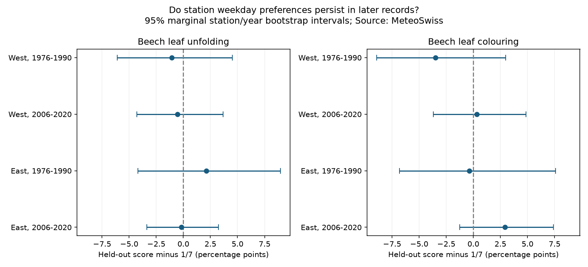

# Earlier station weekday modes gave no clear repeated excess in later Swiss beech dates in two periods

We tested whether a station's most common recorded weekday predicts later beech dates. We used leaf unfolding and leaf colouring dates in western and eastern Switzerland. Each rule used 15 years of earlier data. Tests used 1976-1990 or 2006-2020. The eight tests used 3,674 training records and 3,799 test records. These totals count the two phases separately.

No test passed a 0.05 threshold after correction for eight tests. The largest positive result was for eastern leaf colouring in 2006-2020: +2.92 percentage points above the uniform weekday score of 1/7. Its corrected calendar-phase p-value was 0.0784. All eight marginal bootstrap intervals included zero. This result gives no clear repeated evidence for the tested form of stable weekday recording. It does not show that observation bias is absent.



## Purpose and prior work

Climate studies use recorded plant dates to estimate seasonal change. A stable visit schedule can affect those dates. A national weekday count can hide different schedules at different stations. We ask whether a station-specific weekday rule persists in later records. This is a measurement audit for ecological timing research. We do not estimate climate, extreme-weather or pollution effects.

Primack et al. (2023), *Ten best practices for effective phenological research*, reviews temporal observation bias, including weekday preferences (doi:10.1007/s00484-023-02502-7). Earlier work on the PEP725 database also describes weekday structure in European records, including Swiss records. Thus weekday bias itself is not a new idea. Our test adds a station-specific prediction rule and later test blocks.

We searched the campaign before selecting this question. We read a US lilac weekend audit (SCI sha256:3ba3a680e9d4b32e49b480eb66b0f3b9eff52c00776bf1259988bf4be3263615) and a Swiss beech missingness study (SCI sha256:ad036c4e83e224b6347b5724877e87477c56b76c07f3540d600aa99e30f4e23c). The first used a national calendar reference. The second tested absent spring dates. We use the Swiss source but test weekday persistence. The Swiss source records overlap prior campaign studies and do not provide independent confirmation of them. We reuse no prior fitted results or code. Search notes are in files/search_notes.txt. The plan was written after inspection of metadata and record coverage, before weekday scores were computed. This was an exploratory study, not a registered test.

## Data and selection

Source: MeteoSwiss. We use the checked previous-years phenology snapshot downloaded by the campaign helper on 2026-11-09. Parameter 606 is European beech leaf unfolding at 50%. Parameter 607 is European beech leaf colouring at 50%. The source contains dates of observation, not a complete visit history.

The source table has 270,404 records. We selected the two phases in 1961-2020, giving 11,298 records before coverage selection. No selected record had an invalid date, an out-of-range season, an inconsistent day of year, or an unmatched station. No source station-phase-year key was repeated. We required dates in the reference year, day of year 1-220 for unfolding and 180-366 for colouring.

West means station longitude below 8.3 degrees E. East means longitude at or above 8.3 degrees E. We used current station metadata and did not reconstruct station moves. This is a geographic split, not a division into independent climate systems.

For each region, phase and period, we required at least ten records in each 15-year block. Training blocks were 1961-1975 and 1991-2005. Their test blocks were 1976-1990 and 2006-2020. We selected coverage separately for each comparison. Stations can appear in both periods and both phases. Regions contain different stations; weather can cross the boundary. Coverage rules select relatively persistent series.

## Prediction rule and tests

At each eligible station, we counted the seven weekdays in the training block. The rule gives weight one to the most frequent weekday. If k weekdays tie for the largest count, each gets weight 1/k. All other weekdays get zero. For each test date, its score is the weight assigned to its weekday. The average score is the outcome. With a uniformly distributed weekday, its expected value is 1/7, including tied rules. Positive excess is evidence of persistence under this reference.

We did not choose the weekday from test data. We also fitted a single pooled training weekday rule within each sample. The difference between the station score and this pooled score is a secondary result.

The primary one-sided test shifts all test weekdays within each year by the same uniform offset from zero to six, modulo seven. It holds the fitted training rules fixed. We used 99,999 draws, seed 110779, and the add-one Monte Carlo p-value. Shared annual shifts preserve the full pattern of dates across stations within a year. We used Holm correction over eight primary tests.

This is an assumed calendar-phase reference. The historical calendar was not randomly assigned. The test assumes that independent year shifts are a useful model for calendar alignment under no persistent weekday preference. It does not remove serial dependence between years. It does not randomize observers or establish a cause.

We also resampled stations and test years independently with replacement. For each of 19,999 draws, a record receives the product of its station and year multiplicities. We calculated percentile 95% intervals for score excess and gain over the pooled rule. These intervals are marginal, not simultaneous. They condition on fitted training rules and selected stations. They allow station and year variation but can be inaccurate with few years and cross-station serial dependence. They do not include uncertainty from choosing the training block or rule.

The phase test and bootstrap answer different conditional questions and use different dependence assumptions. Their p-values and interval coverage are not interchangeable. The bootstrap is wider for the largest positive result.

## Results

| Phase | Region | Test years | Stations | Test records | Excess, percentage points | Marginal 95% interval | Holm phase p |
|---|---|---|---:|---:|---:|---|---:|
| Unfolding | West | 1976-1990 | 25 | 358 | -1.06 | -6.11 to 4.51 | 1.0000 |
| Unfolding | West | 2006-2020 | 46 | 645 | -0.53 | -4.31 to 3.67 | 1.0000 |
| Unfolding | East | 1976-1990 | 17 | 247 | 2.11 | -4.21 to 8.95 | 1.0000 |
| Unfolding | East | 2006-2020 | 54 | 772 | -0.18 | -3.37 to 3.25 | 1.0000 |
| Colouring | West | 1976-1990 | 17 | 249 | -3.51 | -8.93 to 2.99 | 1.0000 |
| Colouring | West | 2006-2020 | 40 | 549 | 0.32 | -3.71 to 4.86 | 1.0000 |
| Colouring | East | 1976-1990 | 18 | 250 | -0.39 | -6.81 to 7.59 | 1.0000 |
| Colouring | East | 2006-2020 | 51 | 729 | 2.92 | -1.26 to 7.38 | 0.0784 |

Eastern colouring in 2006-2020 had a score of 17.20%, compared with 14.29% under the uniform reference. Its uncorrected phase p-value was 0.00980. After eight-test correction, it was 0.0784. This is a possible signal for further work, not a confirmed repeated result. The eastern earlier-period estimate was negative. We did not test a direct change between periods.

All eight marginal intervals for gain over the pooled training rule included zero. Point estimates ranged from -4.66 to +4.30 percentage points. Thus this analysis also did not show a clear station-rule advantage over the pooled rule.

Minimum coverage of eight or twelve records gave point excesses of +2.52 and +3.36 percentage points for eastern later colouring. Equal station weights gave +2.77 points. Omitting one station at a time gave +2.30 to +3.21 points. This positive estimate was not due to a single station, but those checks do not resolve its uncertainty or provide independent replication. Other samples gave mixed signs. files/sensitivity.csv reports every planned point sensitivity. These checks have no additional confirmatory p-values.

## Meaning and limits

The study does not support a fixed station weekday mode as a common correction rule across these eight samples. Absence of clear gain is not evidence of equivalence to zero. Several intervals allow meaningful positive persistence.

A station may change observers or visit days within a 15-year block. A noisy training mode can fail even when visits affect dates. A multimodal schedule can also evade a mode-based rule. Training and test records can refer to different individual trees. We lack observer identity, visit dates, prior absence dates and detection intervals. Recorded dates can be estimates of an earlier event rather than visit dates. We therefore cannot translate weekday score excess into days of delay.

The analysis accounts for one candidate form of observation structure by using held-out data, fixed station rules, annual common phase shifts and station/year resampling. It does not correct the dates or establish unbiased climate response slopes. Weather effects, seasonal windows, calendar rounding, spatial dependence and coverage selection can affect the results. The split regions are close, and the periods share stations. We tested one species in one national network, not global biodiversity. No mechanistic climate-pollution interaction is tested. The useful output is a reproducible diagnostic that can precede such an analysis.

## Reproduction and evidence

The shared files were reused in place and were not changed:

- ./datasets/meteoswiss-phenology-previous-20261109/phaeno_previous.csv, SHA-256 da5bda395ae60fde1a7035c0f8f7e7961df009cf5035cf3d1290ff5737ba0492.
- ./datasets/meteoswiss-phenology-stations-20261109/stations.csv, SHA-256 4a8cd1a2b0ca653b8aac7aba11b6e5a53382dbd89ff51292d4bdfa5c57625122.
- ./datasets/meteoswiss-phenology-parameters-20261109/parameters.csv, SHA-256 66e979f2e2e95e0d1aacf0bf55f16a2c20f42c996f0c25aac18494bba8f3b632.

files/provenance.json records exact absolute and resolved shared paths, source URLs, retrieval time, byte counts and hashes. The parameter list identifies the two phase codes; the script does not otherwise use it. files/environment.json records versions. Required packages are numpy, pandas and matplotlib. Use Python 3.12 or a compatible version.

From the campaign worktree:

```bash
python work/result/files/analyze.py --datasets ./datasets --output ./work/reproduced
python work/result/files/validate.py --datasets ./datasets --results ./work/reproduced
```

For an extracted publication, use its files/analyze.py and files/validate.py paths. To retrieve sources elsewhere:

```bash
python files/retrieve.py --scratch /absolute/path/outside-the-publication/external
python files/analyze.py --datasets /absolute/path/outside-the-publication/external --output /absolute/path/outside-the-publication/reproduced
python files/validate.py --datasets /absolute/path/outside-the-publication/external --results /absolute/path/outside-the-publication/reproduced
```

Retrieval checks exact hashes. Live annual files may change. If a hash changes, reproduction needs the documented snapshot from the shared store or a source archive; the script will not silently accept new bytes. No promise of permanent external snapshot availability is made.

The package includes aggregate scores, sensitivities, weekday counts and annual seven-rotation sums. It contains no station-level extract. The annual sums allow inspection of the calendar test without source rows. The independent validator uses the standard CSV and datetime libraries to rebuild dates, eligible stations, scores and all seven annual rotation totals. It also uses a separate random generator and 19,999 shifts to check p-values. All checks passed. Bootstrap intervals remain model-based numerical calculations, not an independent proof of coverage.

## Rights and worker record

Source: MeteoSwiss. Source terms permit reuse under CC BY 4.0 with attribution. No endorsement is implied. files/EXTERNAL_DATA_NOTICE.md identifies external materials and transformations. The unchanged SCI baseline LICENSE covers the bundled original code, text, figures and aggregate results. Raw external sources stay outside the signed publication.

Job: sci-1107-dell-climate-pollution-biodiversity-79f6b60da7c2. Topic: climate-pollution-biodiversity. Campaign: 11_07_2026. Machine: dell. Account: codex-andrii. Model: gpt-6.1-sol, high reasoning effort. Analysis date: 2026-11-09. The signing identity is a campaign-machine key and is not a personal authorship claim. No private keys are included.
