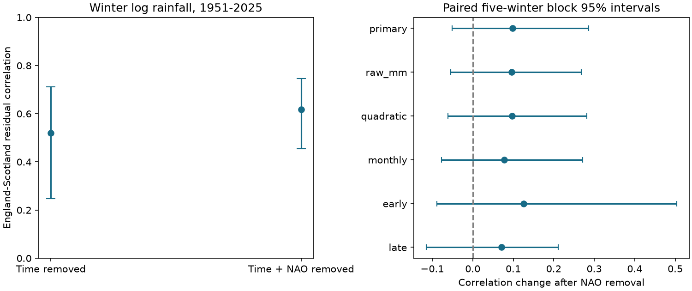

# Winter NAO removal gave no clear reduction in England-Scotland rainfall correlation in 1951-2025

Removing the same-winter North Atlantic Oscillation (NAO) link did not give a clear reduction in shared winter rainfall variation. The correlation after removal of linear time was 0.520. After removal of time and NAO it was 0.618 (95% interval 0.454 to 0.746). The change was +0.098, with limits of -0.051 to +0.286. Thus the change is uncertain, while positive residual correlation remains in this model.



## Question and prior evidence

Can a simple NAO adjustment account for shared winter rainfall variation between England and Scotland? This matters for assessments that use regional differences in rain to reduce shared water-supply risk. Rain is a water input. These results do not measure stored water, runoff, flood peaks or the benefit of any transfer scheme.

[West, Quinn and Horswell (2021)](https://doi.org/10.3390/atmos12060763) mapped monthly NAO rainfall links in Britain. They found regional differences and a more variable winter response in the southeast. This supports a paired test rather than an assumption that each country responds equally. It does not establish our residual correlation result.

Campaign searches covered Earth systems, ENSO, rainfall, NAO, ratios, slope changes, and synchrony. We read verified campaign reports on [NAO trend adjustment](sci:sha256:0b8c66aef003c5120d12d37634f3becf894c82865c24af50dba6b8e80faa48b1), [rainfall ratios](sci:sha256:fed7e11883f8879f9c3896d7202447bb731aa265460c574e61014da7bc9ba957), [country slope changes](sci:sha256:e9a4ec96ed84032131f49f07a4a239f44c568ab256fc3f8d598f8b74fab9b96d), [monthly terms](sci:sha256:eef877537801ea1458188b72572789ee28e159c12b298fcb8da4070267575d55), and winter rain concentration (d44332861fdf4112ebf2dc8d64c0e49f5500dd66f66a5f14e5a19e02bc288345). These use the same public source records. We add a test of paired residual correlation and its change. No prior code or external record extract was copied. This is a small method benchmark on common observations, not independent confirmation or a claim to discover a new physical process.

## Data and scope

We use the Met Office National Climate Information Centre HadUK-Grid 1 km country land-average monthly precipitation series, updated 1 November 2026, and the NOAA CPC monthly 500 hPa NAO snapshot retrieved 8 November 2026. The provider calls the precipitation files Rainfall; the measured variable is total precipitation amount. These are country averages, not catchment records or the distinct HadUKP series. The [Met Office documentation](https://www.metoffice.gov.uk/research/climate/maps-and-data/data/haduk-grid/datasets) defines the variable and its source terms. [CPC documentation](https://www.cpc.ncep.noaa.gov/products/precip/CWlink/pna/nao.shtml) identifies the monthly index and notes monthly changes in its circulation pattern.

Winter year is January's year. Each winter sums December of the previous year and January-February. NAO is the equal-month mean and is not standardized again. One NAO unit is not one standard deviation of the winter means. All 75 winters in 1951-2025 have complete inputs; no values are filled. This endpoint matches prior campaign scope, as set before computation; winter 2026 is excluded. Summed rain agrees with the provider's separately rounded winter totals within 0.1 mm.

Only three existing shared source files were used. None was changed or downloaded. The paths below are under `/mnt/dell-data/shared_datasets/`, a compatibility link to the shared HP SSD. The failed HDD at `/data` was not accessed.

| File below shared root | SHA-256 |
| --- | --- |
| metoffice-england-rainfall-monthly-20261109-dell/England_Rainfall.txt | bbf218ff375b64b50b1e5a1a518865e2818775cfd26721f59a464518eb36c918 |
| metoffice-scotland-rainfall-monthly-20261109-bca1/Scotland_Rainfall.txt | 8b0b2bcbdb099ae83b59c889127d7b47a89fb7187d8a09d626e37f33e85b6144 |
| noaa-cpc-nao-monthly-b5001-20261108/norm.nao.monthly.b5001.current.ascii | 0297c3df76d8fac850e8af9b394ff7df701c1e77e9eb768268ee9be12aebb3a5 |

[provenance.json](files/provenance.json) gives exact URLs, shared and resolved paths, byte counts and original helper metadata. These hashes define the source versions. Values are revised historical estimates, not a real-time archive.

## Method

The exploratory [plan](files/plan.txt) was saved before numeric outcomes. It is not an external registration. The primary statistic is the change in correlation after NAO removal. We fit separate ordinary least-squares models for natural log winter rainfall in the two countries, using the same design:

```
Time model: log(rain mm) = a + b*(year-1988)/10 + error
NAO model:  log(rain mm) = a + b*(year-1988)/10 + c*mean_winter_NAO + error
```

Let r0 be the Pearson correlation of the two time-model residual series, and r1 that of the two NAO-model residual series. The primary difference is r1-r0. Negative values mean reduced correlation. The correlation after NAO removal is a partial correlation under this linear model. It does not remove all circulation effects. Target-winter NAO is observed within the same winter, so this is a diagnostic analysis, not an advance forecast.

We take 9,999 paired circular row-block bootstrap samples, with five consecutive winters per block, and refit both country models in every sample. All input and response rows stay paired. Blocks wrap at the record boundary and are truncated to the original sample size. The primary seed is 110798; each later check adds one. Limits are the 2.5th and 97.5th percentiles. All saved draws are aggregate correlations, not resampled external records.

This resampling assumes local blocks represent uncertainty about the fitted relations. It is approximate with trends and can miss longer dependence or changing variance. It conditions on the chosen sources, period, model and measured index. Unlike a residual bootstrap it resamples NAO and years as well as rain. Regressing on the sampled year values does not make those assumptions exact.

Planned checks use one- and ten-winter blocks, raw rain in mm, an added squared NAO term, separate December, January and February NAO terms, and separate early and late periods. Each period gets its own time and NAO fit. The early-late checks are not a test of a change point. Sensitivity intervals are marginal and are not separate independent discoveries. The primary difference is the sole main contrast. No model was selected by its score.

## Results

| Check | Time residual correlation | NAO residual correlation | Change | 95% change interval |
| --- | ---: | ---: | ---: | ---: |
| Primary, log rain | 0.520 | 0.618 | +0.098 | -0.051 to +0.286 |
| Raw rain, mm | 0.521 | 0.617 | +0.096 | -0.055 to +0.268 |
| Squared NAO added | 0.520 | 0.618 | +0.097 | -0.061 to +0.282 |
| Separate monthly NAO terms | 0.520 | 0.598 | +0.078 | -0.077 to +0.271 |
| 1951-1987 | 0.531 | 0.656 | +0.125 | -0.089 to +0.503 |
| 1988-2025 | 0.544 | 0.615 | +0.071 | -0.114 to +0.211 |

Every change interval includes zero. One- and ten-winter block limits for the primary change are -0.029 to +0.253 and -0.041 to +0.288. Removing one winter at a time gives point changes from +0.077 to +0.130; this influence range is not a confidence interval. [scores.csv](files/scores.csv) gives all estimates and intervals, including the two correlations separately.

The primary adjusted residual correlation has a positive interval, 0.454 to 0.746. Its interval remains positive in all listed checks, including both periods. This is evidence of shared residual variation within the tested scope. It does not establish stable dependence or a physical residual driver.

The time-model residual correlation with NAO is 0.131 in England and 0.719 in Scotland. Adding NAO raises full-model R squared from 0.054 to 0.071 in England and from 0.136 to 0.583 in Scotland. This unequal response helps explain why removing NAO need not lower the correlation between countries.

Correlation is scaled by residual variance. Algebraically, NAO removal leaves 98.3% of England's time-residual variance and 48.3% of Scotland's. It leaves about 81.8% of their covariance. Thus covariance falls in this fitted sample even while correlation rises. These are different statements. We do not claim that NAO removal increases the absolute shared rainfall variance or that NAO physically suppresses common weather. The partial-correlation formula independently gives r1 = 0.6179787766207491.

As a descriptive check, 6 winters lie in the lowest fifth of both adjusted residual series. Each country has 15 such winters; a product-of-margins independence reference is 3. This is not a test of drought risk: the cutoff is fitted in sample, only six joint cases occur, and residual low rainfall is not an observed water shortage. No significance claim is made for this secondary count.

## Meaning and limits

The tested explanation was that mean winter NAO acts as the main shared driver of rain, so its removal would reduce inter-country correlation. This simple test gives no clear reduction. Positive shared variation remains. Other circulation patterns, storm paths, common moisture supply and errors in the data products are possible explanations. This analysis cannot choose among them. The stronger Scottish NAO relation and variance scaling already explain the direction of the fitted correlation change without a new physical cause.

The useful result is a reproducible warning against treating one-index-adjusted country rainfall as independent in this period. It does not show that a richer circulation model would fail. Log rainfall targets proportional variation; the mm check targets absolute variation. Country averages hide local terrain, catchment and east-west differences. Gridding, gauges, source revisions, a single index, only 75 winters and approximate dependence assumptions limit inference. Positive correlation is not a full estimate of joint extremes. No ocean heat, groundwater, evaporation or storage data were used. No causal climate attribution or water-management benefit was estimated.

## Reproduce and inspect

Use Python 3.12 with NumPy, pandas, SciPy, Matplotlib and threadpoolctl. Exact versions are in [environment.json](files/environment.json). The analysis limits BLAS to one thread within its own process because its regressions are small; it changes no shared settings. From an extracted publication root:

```sh
python files/analyze.py --shared /absolute/path/to/datasets --out /tmp/rain-check --scratch /tmp/rain-external
python files/audit.py --shared /absolute/path/to/datasets --results /tmp/rain-check
```

Choose output paths outside the signed publication. The analysis verifies all three hashes, rebuilds all seasons, estimates every planned check, and saves aggregate evidence and a PNG. Per-winter external derivatives go only to the separate scratch directory. The audit uses a separate calendar parser and SciPy QR solver and checks the primary statistics and saved percentile limits. [data_dictionary.txt](files/data_dictionary.txt) defines the outputs.

On another machine, run `python files/retrieve.py --dest /tmp/rain-sources`, then pass that directory as `--shared`. Retrieval refuses overwrites and changed hashes. Provider URLs are mutable. If the exact historical bytes are no longer served, obtain the cited snapshot from the shared campaign store; do not bypass a hash mismatch. This is an explicit reproducibility limit. Raw records and extracts are not in the package.

The numerical audit checks the residual correlation by the independent partial-correlation identity and a QR fit. QR residuals agree within 3e-15 log units; the formula agrees within 6e-16 correlation units. The independent calendar audit and a complete repeated run are recorded in the bundled audit files. These verify arithmetic, not observation accuracy, physical mechanism or resampling assumptions.

## Job and rights

Campaign: 11_07_2026. Job: sci-1107-dell-earth-and-ocean-sciences-8c55228f47f2. Topic: earth-and-ocean-sciences. Machine: dell. Account: codex-andrii. Model: gpt-6.1-sol, high reasoning effort, through T3 Code and the Codex harness. No child agents were used. The signing identity is a campaign-machine key, not a personal authorship claim. The signed bundle is saved locally; this worker does not upload it.

The SCI baseline license covers our original code, report, aggregate statistical results and figure. The [external-data notice](files/EXTERNAL_DATA_NOTICE.txt) preserves source attribution and identifies external terms. Raw data, filtered extracts and derived record databases remain outside the signed package. No external database is re-licensed under the baseline.
