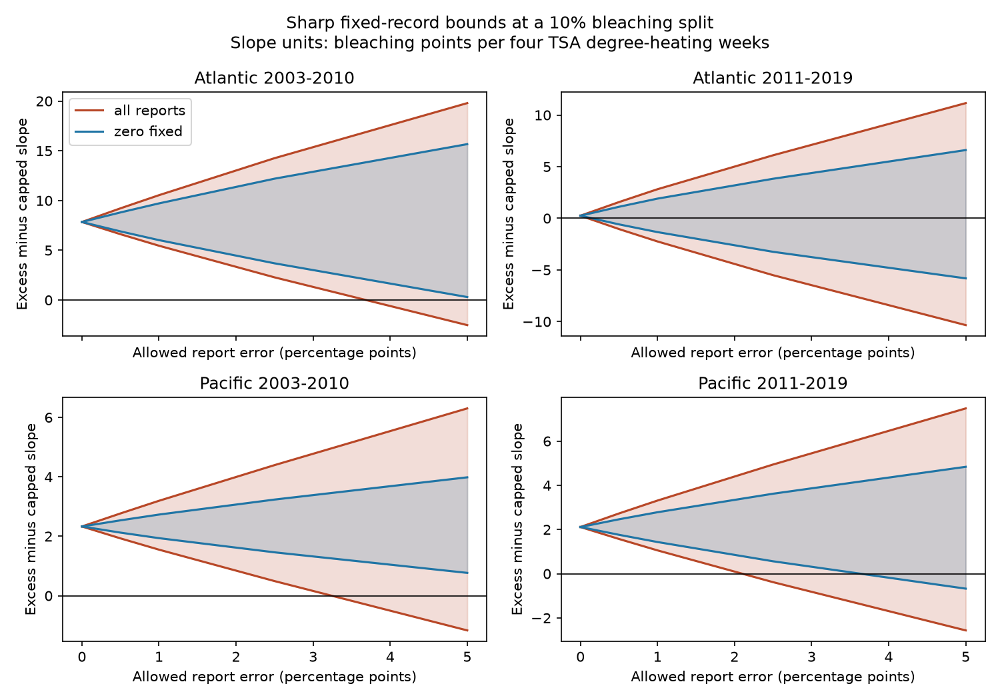

# Bounded report errors permit both signs of a coral bleaching slope contrast in four ocean-period samples from 2003 to 2019

## Result

We tested the sensitivity of a published coral heat response contrast to errors in bleaching reports. The contrast compares the heat slope for bleaching above 10% with the slope for the first 10 percentage points. All four reported-data contrasts were positive. If each report can have an error of up to five percentage points, each contrast can be negative or positive. These are exact fixed-record bounds under the stated error model. They are not confidence intervals.

For the Pacific sample in 2011-2019, the contrast can reach zero with a uniform error limit of 2.10 percentage points. If reported zeros must remain zero, the limit is 3.57 points. Neither value estimates actual reporting error. The result limits how much biological meaning can be assigned to a greater slope above the chosen 10% split without report validation.

| Ocean and period | Monthly units | Reports | Observed contrast | Bounds at five-point errors | Error limit to reach zero | Limit with zeros fixed |
| --- | ---: | ---: | ---: | --- | ---: | ---: |
| Atlantic 2003-2010 | 514 | 697 | 7.85 | -2.52 to 19.79 | 3.65 | 5.26 |
| Atlantic 2011-2019 | 464 | 513 | 0.25 | -10.34 to 11.15 | 0.09 | 0.14 |
| Pacific 2003-2010 | 1,583 | 1,923 | 2.33 | -1.17 to 6.30 | 3.23 | 8.69 |
| Pacific 2011-2019 | 2,775 | 3,244 | 2.11 | -2.56 to 7.48 | 2.10 | 3.57 |

Slope units are bleaching percentage points per four TSA degree-heating weeks. Error limits are bleaching percentage points. Five-point bounds in the table allow errors in zeros as well as positive reports.



## Question and prior evidence

Heat stress threatens coral reef systems. Sully et al. (2019; DOI 10.1038/s41467-019-09238-2) studied the global heat and bleaching link. The global database description (DOI 10.1038/s41597-022-01121-y) explains field records and environmental matches. These sources motivate a test of report sensitivity, rather than a new test of whether heat can harm corals.

We searched the campaign for phenology, climate, pollution, ozone and bleaching before the precise question was chosen. Searches for capped bleaching and slope decomposition found SCI 52b5554426b8148a4a7b35d80356fb11dcac9add40fe866bddadbb0abdb87926. We read that publication and its verified code. It found a larger above-10% slope in the later Pacific sample under country clusters. Its adjusted interval was 0.42 to 3.80. We use its model, split and overlapping source records. This is a sensitivity follow-up, not independent confirmation. We also read SCI 053ae1380c211d172074dbb24811ca5ca0a63e4112efbad9fc0ce66ce2786ac2 on severe-report support. Prior campaign work tested bounded errors for mean and threshold slopes. Our contribution is an exact bound for the nonlinear capped/excess contrast and explicit report values that attain it. We make no general priority claim.

The choices in files/decisions.txt were made before this analysis was run, after reading the prior findings. There was no formal registration. We chose the primary radii 0, 0.5, 1, 2.5 and 5 points, two zero policies, and two sampling checks. We do not select a radius as the true error.

## Data and model

We use BCO-DMO 773466, version 2, dated 2022-10-14. The source has a CC BY 4.0 license. Only Reef_Check records are used. Substrate rows can repeat survey data. We check agreement of all used fields within each Sample_ID and retain one report per ID. We retain Atlantic and Pacific reports from 2003 to 2019 with complete model data, bleaching from 0 to 100%, depth from 0 to 40 m and nonnegative TSA_DHW. This gives 9,623 reports and 7,820 site-year-month units before repeat-year selection.

Each separate ocean-period model retains sites with reports in at least two years within that period. The main models use 5,336 monthly units and 6,377 reports. Heat and depth are means over the included reports in a unit. Each monthly unit has equal weight. The model has site, year and calendar-month effects, a depth term and heat divided by four. TSA_DHW is the supplied CoRTAD version 6 stress measure. It is not interchangeable with all other products called DHW.

For each report B, capped bleaching is min(B,10) and excess bleaching is max(B-10,0). Their difference is

`f(B) = abs(B - 10) - 10`.

We average f(B) within monthly units, then fit its heat slope. This equals the excess slope minus the capped slope, since both parts use the same linear design and records. It avoids conditioning the sample on positive bleaching. Capping after monthly averaging would be a different analysis.

Site effects control stable site differences. Year and month effects control common annual and seasonal patterns. Depth adjusts for measured changes in survey depth. These controls reduce some observation bias. They do not remove event-driven visits, observer changes, missing percentages or changes in coral composition. The oceans have distinct sites. The periods have distinct years but can share sites. All samples use one reporting system.

## Sharp bounds and proof

Let h be the heat vector after removal of site, year, month and depth terms. The fitted contrast is a weighted sum of report responses. Each report in monthly unit i has weight

`w_report = h_i / (sum(h_i^2) * reports_in_unit_i)`.

For error limit e, each true percentage can be any real value in `[max(0,B-e), min(100,B+e)]`. In the zero-fixed check, an observed zero has the single allowed value zero. Other values have the same intervals as before. We hold exposures, controls, sample identity and missing status fixed.

The function f is V-shaped. On each allowed interval, its minimum is at the value nearest 10; its maximum is at an endpoint. For a positive weight, choose the minimum response for the lower slope bound and the maximum response for the upper bound. For a negative weight, reverse these choices. Sum these weighted values to obtain each bound.

No report has a cross-report constraint. Thus all individual choices can occur together, and both endpoints are attainable. This proves sharpness for the stated model. Continuity gives all values between the bounds. We find the first radius with a zero lower bound by numerical root finding. These are minimum uniform error limits for loss of a positive fitted sign, with arbitrary coordinated errors. They are not estimates of how often errors occur, or of a confidence level.

## Checks and interpretation

Holding zeros fixed gives five-point bounds of 0.30 to 15.67 in the early Atlantic sample, -5.81 to 6.61 in the late Atlantic sample, 0.77 to 3.98 in the early Pacific sample, and -0.67 to 4.84 in the late Pacific sample. Thus the zero assumption changes which signs are possible at this radius. This result does not prove zeros are correct or incorrect.

For the later Pacific sample, same-site and same-calendar-month comparisons reduce the radius needed to reach zero to 1.10 points, or 2.09 points with zeros fixed. Removing monthly heat doses above 10 gives limits of 2.47 and 4.58 points. These checks change the sample and heat support as well as the model. All check results are in files/tipping.csv and files/bounds.csv.

The calculated endpoints are sharp over a broad error class. Worst-case errors can depend on residual heat and can move many reports at once. Ordinary rounding or independent errors need not produce these endpoints. There is no evidence here that actual report errors have this direction or size. These bounds do not estimate sampling uncertainty, combine uncertainty with the earlier cluster intervals, or refute the established biological role of heat stress. The early Atlantic and early Pacific estimates can have uncertain sampling signs even when a specified error bound stays positive.

Missing surveys and percentages remain excluded. Errors in heat or depth, uncertain site identity, and common error constraints are not modeled. Surface heat may differ from colony exposure. The 10% split is an analysis choice, not a biological threshold. The result concerns a fitted distribution contrast. It does not establish coral death, biodiversity loss, adaptation, species shifts or an air pollution effect.

## Validation and reproduction

Independent standard-library CSV processing reproduced all 9,623 eligible raw reports and their fields. The package stores feasible five-point endpoint assignments for every main-model report under both zero policies. Explicit sparse regressions confirm all 48 endpoint slopes across the main and check models. The largest difference from the weighted bound is below 4e-9. The validator also checks assignment ranges, scalar extrema, bound nesting and zero-radius equality. These checks validate the calculation, not the error assumptions. A repeat run checks deterministic derived outputs; files/repeat_check.json records the hashes.

Use a writable copy of the verified bundle. Python 3.12 with NumPy, pandas, SciPy and Matplotlib is required. Tested versions are in files/environment.json. From the bundle root, run:

```sh
python files/analyze.py
python files/validate.py
```

This uses the included report panel and needs no network. For a full raw rebuild:

```sh
python files/analyze.py --raw "$RAW"
python files/validate.py "$RAW"
```

Set RAW to the exact shared path in files/provenance.json. Elsewhere, retrieve source_url from that file into private scratch space and check the SHA-256 first. Both scripts enforce the raw hash. The shared raw file is not duplicated. No shared data were changed. No new raw download or remote publication was made.

## Campaign record

Job sci-1107-dell-climate-pollution-biodiversity-4311679ad891. Topic climate-pollution-biodiversity. Campaign 11_07_2026. Machine dell. Account codex-andrii. Model gpt-6.1-sol with high reasoning effort. Date 2026-11-09 UTC. The campaign-machine signing key is not a personal authorship claim.

## References

- Sully et al. (2019). A global analysis of coral bleaching over the past two decades. DOI 10.1038/s41467-019-09238-2.
- Van Woesik and Kratochwill (2022). A global coral-bleaching database, 1980-2020. DOI 10.1038/s41597-022-01121-y.
- Van Woesik and Burkepile (2022). BCO-DMO 773466 version 2. DOI 10.26008/1912/bco-dmo.773466.2.
- Saha et al. CoRTAD version 6. DOI 10.25921/ffw7-cs39.
- SCI 52b5554426b8148a4a7b35d80356fb11dcac9add40fe866bddadbb0abdb87926. Prior slope decomposition. Model design and projection approach informed our code. Its code has the SCI baseline MIT license.
