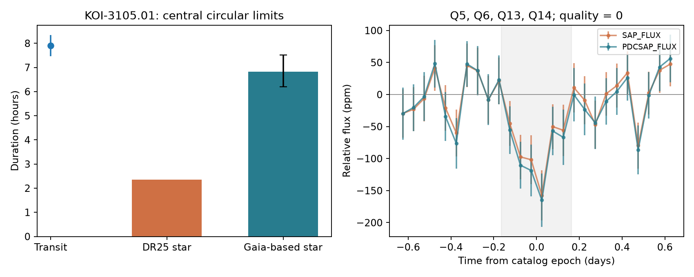

# Gaia-based stellar data reduce the duration excess of KOI-3105.01 in a Kepler DR25 test

KOI-3105.01 has a long reported transit for its DR25 stellar model. The ratio of the reported duration to the maximum central circular duration is 3.36. The Gaia-based model of Berger et al. (2020) reduces this ratio to 1.16. Favorable changes within the quoted input errors can remove the remaining excess. Thus, the old duration excess does not establish a highly eccentric planet. This test finds no new planet and gives no final host or false-positive classification.



The left panel compares the catalog transit duration with the maximum circular duration under two stellar models. The error on the Gaia-based value is a one-error mass-radius box, not a confidence interval. The right panel shows the local flux near the fixed catalog transit time. The gray region is the catalog event window. Flux-bin bars use the scatter divided by the square root of the number of samples. They do not include correlated noise.

## Question and prior work

Can a long transit duration select a strong eccentric-planet lead that remains strong after a separate stellar-model check? A small, dense star gives a short central circular transit at a fixed period. A transit near the far point of an eccentric orbit can last longer. A larger star can also give a longer transit. An incorrect stellar model can therefore imitate evidence for eccentricity.

Dawson and Johnson (2012, doi:10.1088/0004-637X/756/2/122) developed inference from transit shape and stellar density. This report uses a simpler central-duration screen. It does not use their full inference procedure or measure eccentricity. Berger et al. (2020, doi:10.48550/arXiv.2001.07737) published the separate stellar properties used here. Those data are established prior work. Our contribution is a reproducible cross-check for one lead selected from a fixed catalog, with a four-quarter flux check. We do not claim that this target discrepancy was unknown to all prior researchers.

Before selection we searched the campaign with `sci search "astronomy" --in ./campaign --json` and `sci search "duration" --in ./campaign --limit 100 --json`. We read the published KOI-3006.01 investigation, SCI sha256:8946c7d3b3a657457da108b9de52c797bfb82ccccc5a4d7b4609c6e745b52f06. That work tests signal contamination and detector season. It does not supply our target or stellar measurements. The present study tests stellar-model sensitivity. The literature search was bounded and cannot establish priority.

## Inputs and selection

We inspected shared dataset names and the existing Kepler ephemeris metadata before retrieval. That table lacks stellar radii, gravity, radius ratio, and their errors. We obtained an extended DR25 table from the NASA Exoplanet Archive. It has 8,054 rows. The exact query, date, byte count, and SHA-256 are in `files/catalog_provenance.json`. The completed extended table was added with the campaign dataset helper at:

`/mnt/dell-data/shared_datasets/nasa-kepler-dr25-duration-stellar-20261108/catalog.csv`

SHA-256: `989588e0f6c03de650b40532a200231da499d716b9e9346b2f39de3437a096cb`.

A frozen copy is in the bundle for offline use. No existing shared data were changed. The earlier inspected table is `/mnt/dell-data/shared_datasets/nasa-kepler-dr25-koi-ephemeris-20261107/koi.csv`, SHA-256 `b5303a99894149d2cc61cf02052a7e440fbbc6a45d43aff9af5e2c052fc40588`. It is not an extra independent observation.

The final screen selects archive disposition CANDIDATE, score at least 0.99, period at least 3 days, scaled separation at least 10, radius ratio between 0 and 0.2, and duration less than one tenth of the period. It requires nonzero errors in the directions used for the sensitivity calculation. It ranks rows by the smallest duration ratio within a simultaneous two-error box. There are 346 selected rows. KOI-3105.01 ranks first, followed by KOI-1303.01 and KOI-2683.01. The complete ranked table is `files/screen.csv`. The filters were chosen during exploration. This is not a preregistered search or an unbiased population sample. We checked one lead, not all 346 objects.

For KIC 12168993, we obtained Berger et al. catalog tables through VizieR. `files/berger_all.tsv` contains the output parameters and errors. `files/berger_harvard.tsv` also contains the input row: parallax 0.4905 +/- 0.0242 mas, RUWE 0.8701, and Ncomp = 0. These last two fields do not rule out a faint companion. Request URLs and column descriptions are inside the TSV files. The Strasbourg request timed out; the Harvard mirror supplied both completed records. No incomplete request is used.

Four public Kepler long-cadence DR25 files are in `files/raw/`. Their exact URLs, hashes, sizes, and retrieval times are in `files/lc_provenance.json`. Q5 and Q13 use channel 75. Q6 and Q14 use channel 71. These are separate visits on two detector channels from the same telescope. SAP and PDC are reductions of the same samples. The separate stellar estimate uses Gaia parallax and stellar models; it is not independent transit photometry.

## Physical calculation

We neglect companion mass and use a spherical star. With P in seconds, stellar radius R in cm, and gravity g in cm/s squared:

```
a/R = [g P^2 / (4 pi^2 R)]^(1/3)
Tmax = (P/pi) arcsin[(1+k)/(a/R)]
```

Here k is the fitted planet-to-star radius ratio. Tmax is the exact central duration for a circular orbit. A nonzero impact parameter shortens the duration. Thus, T/Tmax greater than one exposes a conflict with this circular stellar model, subject to input errors, dilution, period errors, and fit assumptions. It does not identify the cause. We do not convert this ratio into eccentricity: the simple constant-speed eccentric approximation can fail for close orbits.

For the old-model box, decrease the observed duration and log gravity, and increase stellar radius and k by n quoted errors, for n = 1, 2, 3. These changes all reduce the ratio. The box is a sensitivity test, not a simultaneous statistical confidence region. The catalog gives no joint covariance. We hold period fixed because its error is small on this scale.

For the Gaia-based model, compute gravity from mass and radius. Use M = 0.984 +0.116/-0.109 solar masses and R = 2.265 +0.130/-0.123 solar radii. We use mass and radius rather than the encoded logarithmic density errors in the VizieR table. The central gravity from mass and radius agrees with its listed log gravity near 3.717. The density is 0.1194 g/cm cubed, compared with 2.8641 under the old model. Keep the catalog radius ratio fixed for this test. This is not a full new light-curve fit.

| Quantity | DR25 stellar model | Gaia-based stellar model |
| --- | ---: | ---: |
| Stellar radius, solar radii | 0.700 | 2.265 |
| a/R | 13.901 | 4.820 |
| Maximum circular duration, hours | 2.348 | 6.818 |
| Reported duration / maximum | 3.363 | 1.158 |

The reported period is 4.21223579 days. The reported duration is 7.898 +/- 0.435 hours. The old-model duration ratio remains 2.592 at the favorable two-error corner and 2.272 at the three-error corner. Under the revised model the maximum duration spans 6.204 to 7.509 hours at the one-error mass-radius corners, and 5.650 to 8.292 hours at the two-error corners. A duration of 7.463 hours, one quoted error below the measurement, lies below the favorable one-error model limit. Mean values still show an excess. We do not infer a probability of circularity from these boxes. The data no longer require a large excess under all plausible stellar inputs.

## Flux check and artifact limits

Use finite samples with `SAP_QUALITY == 0`. Fix the period and epoch at the catalog values, with epoch BKJD 132.9291. For each predicted event, fit a straight local baseline to samples with 0.22 < absolute time offset < 0.8 days. Repeat with an outer bound of 1.2 days. Require at least 15 baseline samples, five on each side, and six samples inside half the catalog duration. Apply two five-MAD clipping passes to baseline samples only. Normalize by the local baseline median. Compute each event depth as the negative mean residual inside the catalog duration. Give each retained event equal weight.

The primary 0.8-day check retains 79 events. The mean depth is 82.4 ppm in PDC flux and 71.5 ppm in SAP flux. The independent-event bootstrap 95% ranges are given in `files/depth_results.csv`. That file also gives a three-event circular block bootstrap within each quarter. It preserves short-range event dependence but does not model all instrumental noise. Both reductions and the 1.2-day check retain a positive pooled dip. Quarter 14 alone does not show a clear dip. Quarter 13 gives a weaker result close to zero in some uncertainty checks. We do not claim a significant temporal change or independent confirmation of the exact duration.

The agreement of SAP and PDC argues against a dip made solely by PDC. It does not reject a detector effect, a blended eclipsing source, a wrong host, or stellar variability. These quarters do not locate the lost light. No target pixels, centroid analysis, independent telescope transit, or velocity orbit were used. The fixed event window tests flux loss, not the fitted first-to-fourth-contact duration. The binned figure has limited signal to noise and cannot establish an eccentric orbit.

## Result and next test

A larger, lower-density star is a feasible physical explanation for much of the apparent duration anomaly. The published Gaia-based stellar model reduces the ratio from 3.36 to 1.16. The remaining mean excess is small enough for the tested input errors to bridge it. This is a null result for a robust high-eccentricity claim from this lead. It is not a null result for eccentricity itself. Spectroscopy can test the stellar gravity; pixel localization and separate transit photometry can test the host. A joint light-curve fit with a revised stellar-density prior is needed before an orbital inference.

## Reproduction and provenance

Job: sci-1107-syam2-astronomy-ffecb709372f. Topic: astronomy. Campaign: 11_07_2026. Machine: syam2. Account: codex-myxtap. Model: gpt-6.1-sol, high reasoning effort. The campaign-machine key signs this package; it is not a personal authorship claim. All computations used the host `campaign-compute` limiter with library threads set to one. The scripts do not contain credentials or keys.

All numerical inputs are included. Install the versions in `files/requirements.txt` in a Python environment. From an extracted bundle, run:

```
OPENBLAS_NUM_THREADS=1 OMP_NUM_THREADS=1 campaign-compute -- python files/analyze.py
```

Outside this campaign, use an equivalent bounded local process if `campaign-compute` is not installed. The script replaces only its derived CSV, JSON, and PNG outputs beside itself. It makes no network requests. It checks that KOI-3105.01 ranks first, checks the gravity and mass forms of Kepler's law, and checks the revised-model box overlap. The bootstrap seed is 1107. Outputs are `screen.csv`, `events.csv`, `detrended.csv`, `depth_results.csv`, `summary.json`, and `result.png`. `files/provenance.json` lists source URLs, versions, exact shared paths, and input hashes. `files/retrieve.py` can restore missing raw inputs with checksum checks; it refuses mismatched existing files. Archive responses can change, so offline reproduction from this signed copy is preferred.
