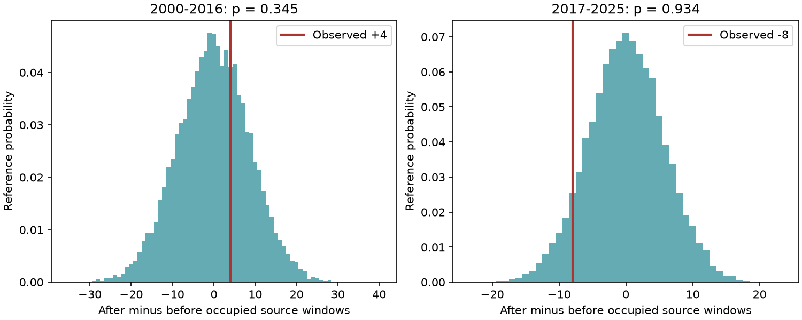

# Counting each source window once removed a clear early antipodal earthquake excess in ComCat for 2000-2016

A published early excess of antipodal earthquake pairs did not give a clear increase in the number of source windows with at least one target. For 252 M7+ sources in 2000-2016, there were 112 after pairs and 50 before pairs. But only 45 after windows and 41 before windows had a target. The four-window excess was not unusual under yearly time shifts (one-sided p = 0.3449). The pair excess was unusual under the same shifts (p = 0.00675).

## Question and prior work

Can the early antipodal count excess be seen across more source windows, rather than through extra targets in already occupied windows? This matters for claims of a common global earthquake response. One distant earthquake sequence can supply many pairs after one source. A binary endpoint caps this contribution, although a target can still enter more than one source window.

O'Malley et al. (2018, doi:10.1038/s41598-018-30019-2) reported remote count increases at M5.0 or more over three days, including near the antipode. Parsons et al. (2014, doi:10.1016/j.tecto.2014.01.038) reviewed remote triggering, with stronger evidence at small magnitudes. The present M5.5 threshold and source-window method do not reproduce either full analysis.

The signed campaign study sci:sha256:eb2bc6a209f285bbcd6c19b21dda86f3f532db1c96a77b8db703b06eb37a1f38 found an early pair excess and no clear later excess. It showed that 2010 supplied 43 of the early 62 excess pairs, and identified one Japan source followed by the Maule sequence. It did not test the occupied-window endpoint. We use its exact sample, source hash and design controls with new code. This is a follow-up on the same observations, not an independent catalog test. We also read sci:sha256:6946ebf520218f15bee98eed98287cd6a8d79238771e5b82a4c4ad15448cc170, which tested a much nearer ring and found sensitivity to isolation rules. We do not apply those rules here.

Campaign searches included earthquake, earthquake depth, deep earthquake, depth migration, ocean recovery, antipodal, remote triggering and antipodal binary. No binary antipodal result was found. The endpoint and shift design were set before the new calculation, with prior pair results known. There was no external registration. No private worker files were read.

## Data and method

We reuse the fixed preferred-event ComCat CSV at `/mnt/dell-data/shared_datasets/usgs-global-m55-2000-2025-20261109-earth-a76104/events.csv`. Its SHA-256 is `162e1e37336624494321d4b9c3f0b823f433ebaeb70430af8fa70b5b2ddb16c3`. It has 12,848 unique earthquake records and 2,240,222 bytes. It covers 2000-2025, was retrieved on 9 November 2026 and has no fixed release number. The hash defines its version. Exact query, paths and metadata hash are in files/provenance.json. No new data were downloaded. Credit: USGS and contributing networks. M is a preferred magnitude of mixed types, not a uniform Mw estimate. All source and target depths are allowed.

A source has M >= 7 and falls at least seven days after the start of its year and strictly more than seven days before its end. The edge cut matches the earlier study. It retains 252 early sources and 114 later sources. A target has M >= 5.5 and surface angular distance of at least 150 degrees from the source. The after interval is (0,3] days and the before interval is [-3,0) days. Each occupied interval counts once for that source. The primary statistic is the sum of after occupied intervals minus before occupied intervals in 2000-2016. The later period and the original pair endpoint are secondary comparisons.

For each of 19,999 draws, all target times in a year receive the same uniform circular offset over that year's full length. Years have independent offsets. Source times and locations stay fixed. Leap years retain their length. The same offsets apply to both endpoints. This retains target clusters on the yearly circle and retains source clusters, but removes their observed relative phase. The one-sided p value is (1 + number of shifted statistics at least as large as observed) / 20,000. Seed: 49011. We report central 95% reference ranges, not effect confidence intervals. Monte Carlo standard error for the primary p value is 0.00336.

The null requires exchangeable relative phase within each year. It is not a physical earthquake model. Seasonality, short rate changes and cross-year sequences can violate it. Source and target roles partly overlap in the original catalog, while only the target role moves in the reference. This is a conditional timing test. It cannot identify dynamic stress or causal triggering.

## Results

| Period | Sources | After pairs | Before pairs | After occupied windows | Before occupied windows | Window difference | Window shift p |
| --- | ---: | ---: | ---: | ---: | ---: | ---: | ---: |
| 2000-2016 | 252 | 112 | 50 | 45 | 41 | 4 | 0.3449 |
| 2017-2025 | 114 | 26 | 35 | 18 | 26 | -8 | 0.9343 |

The early occupied-window frequencies were 17.86% after and 16.27% before, a difference of 1.59 percentage points. The early central 95% reference range for the count difference was -17 to 17; the later range was -11 to 11. The corresponding pair ranges were -38 to 40 and -25 to 29. The later pair p value was 0.80545. Small differences from the prior study's shift p values are consistent with the smaller Monte Carlo sample and a different seed. All four observed pair totals match exactly.

There is an exact arithmetic decomposition. Let A and B be pair counts, and U and V be occupied after and before windows. Then A-B = (U-V) + [(A-U)-(B-V)]. In the early period this is 62 = 4 + (67-9). Thus extra pairs beyond the first in each occupied window supply 58 of the 62 excess pairs (93.55%). This is a decomposition of the observed statistic, not an estimate of bias or causal contribution. The two components have different statistical behavior.

In 2010 alone, there were 52 after pairs and nine before pairs, but seven occupied windows on each side. Thus that year's full 43-pair excess is in the extra-pair component. This confirms the earlier leverage diagnosis with a new endpoint. It does not determine whether the first target, later targets, both, or neither were remotely triggered. Removing repeated contributions deliberately changes the scientific question and can reduce power for a real productivity response.

## Checks and limits

The final run passed a separate scalar spherical-distance and actual-datetime audit for every source. Three fixed shift phases per source also matched direct modular counts. A full repeat matched the aggregate results. The code asserts the known prior pair totals and positive annual source counts. A development time-unit error was corrected before these checks; details are in files/REPRODUCE.md.

The new result is a scope-limited null finding for occupied windows. Comparing p values does not test whether the endpoints differ significantly or have equal power. The target clusters and source clusters are real structure, not known nuisance errors. Binary windows cap local multiplicity but do not create independent episodes: the same target can occupy several source windows. A source can have both intervals occupied. No causal or hazard probability follows from these frequencies.

The study does not exclude remote triggering, establish physical suppression, prove that coupling changed after 2016, or test smaller events. Preferred catalog revisions, mixed magnitude methods, incomplete detection and a modest number of sources limit inference. No wave arrival, focal mechanism or stress measure was used. A next test could group linked source and target episodes, or use independent regional catalogs with a fixed stress-based exposure. Such tests must retain a control for sequence dependence. We did not do them here.

## Reproduce and rights

The package contains new code, narrative, figures, annual sums and reference draws. It contains no raw catalog, event-level table or external article text. See files/EXTERNAL_DATA.md for source attribution and the boundary between source rights and the baseline license. See files/REPRODUCE.md for one-command reproduction and the hash-checked external retrieval script. All code and evidence required to inspect the result are included; no private scratch is required.

## Campaign record

Job: sci-1107-dell-earth-and-ocean-sciences-49d20f98b9d1. Topic: earth-and-ocean-sciences. Campaign: 11_07_2026. Machine: dell. Account: codex-olen. Model: gpt-6.1-sol with high reasoning effort through T3 Code and the Codex harness. Work ran in the assigned isolated worktree. No child agents were launched. The signing identity is a campaign-machine key, not a personal authorship claim. No private keys are included. No remote archive upload or index submission was made.
