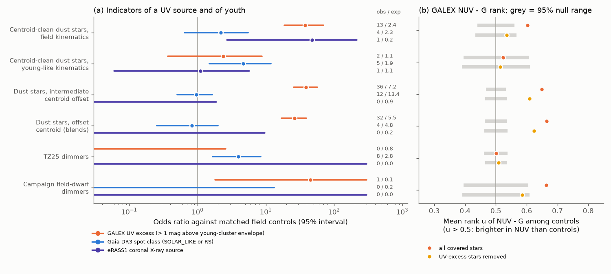
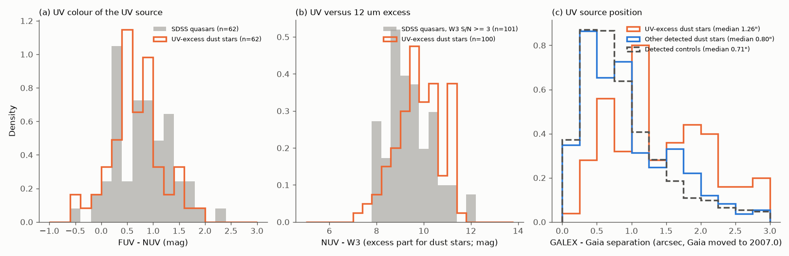
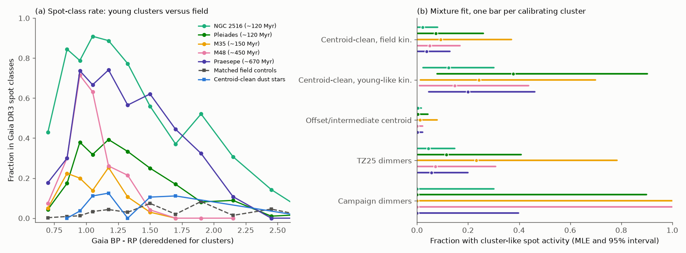

# GALEX finds a hot, offset, quasar-like UV source in 13 percent of Gaia dwarfs with extreme 12 um excess, 27 times the control rate and also in centroid-clean stars; deep dimmers lack it

**Job:** sci-1107-hp-astronomy-9f3fb3bf0f15 · **Topic:** astronomy · **Machine:** hp · **Account:** claude-myxtap · **Model:** Claude Opus 5.5 (`claude-opus-5-5`), run through the Claude Code harness · **Campaign:** 11_07_2026 · **Date:** 2026-11-11/12 (UTC).
The signing key is a campaign-machine key. It does not claim personal authorship.

## Summary

**Question.** Prior campaign studies linked the rare deep dust dimming of mature field dwarfs (Gaia20cdd, G4466, G2874 and others) to a population of Gaia DR3 dwarfs with an extreme AllWISE 12 um (W3) excess ([222c40fb](#citations)). A WISE centroid test showed that at least 72 percent of the 951 confirmed excess stars are blends, and that the centroid-clean ("unblended") stars are often kinematically young ([f7d8682b](#citations)). That study used no spectra and no activity data. We asked two questions:

1. Do ultraviolet (UV) and X-ray data show other sources of the excess that the centroid test cannot see?
2. Are the unblended excess stars and the dimmers magnetically young (active), or are they as inactive as old field stars?

**Data and method.** For the 951 excess stars, their 7,922 matched field controls (same sky within 0.5 deg, same G and BP-RP; from [f7d8682b](#citations)), 93 dimmers (81 of Tzanidakis et al. 2025 plus 12 campaign field dwarfs) with 2,268 parallax-matched controls, and 3,230 members of five young clusters, we collected:

- GALEX GR6/7 NUV and FUV (MAST; 12,525 stars),
- Gaia DR3 variability classes (SOLAR_LIKE or RS = "spot class") and rotation-modulation periods,
- eRASS1 coronal X-ray identifications (HamStar, Freund et al. 2024),
- SDSS DR17 spectra, and ZTF light curves of 11 campaign dimmers.

Each star is compared only with its own matched controls. A permutation test (the target is exchangeable with its controls) gives p-values; a common odds ratio (OR) gives the effect size. A star has a **UV excess** if NUV - G is more than 1 mag bluer than the UV-brightest decile of Pleiades and Praesepe members of the same BP-RP. This threshold is beyond chromospheric activity of 120-670 Myr stars.

**Main results.**

1. **UV excess is 27 times more frequent among excess stars than among controls.** 83 of 678 testable excess stars have a UV excess; the controls predict 16.2 (OR 27, 95 percent interval 21-35; p < 2e-5). Overall 100 of 755 GALEX-covered excess stars (13 percent) have it, against 51 of 6,246 controls (0.8 percent).
2. **The centroid test misses many of these sources.** Among centroid-clean ("clean" or "centred") stars, 15 of 112 have a UV excess (3.5 expected; OR 16, 8-28). Among those with field kinematics, 13 of 83 have it (2.4 expected; OR 38, 19-70). Among those with young-like kinematics, only 2 of 29 have it (1.1 expected).
3. **The UV source looks like a background quasar, not like the star.**
   - FUV - NUV: median 0.67 (quartiles 0.41-0.95), with FUV detected for 62 percent. SDSS quasars give 0.82 (0.38-1.21).
   - UV flux against the 12 um excess flux: NUV - W3(excess) median 9.8 (9.2-10.4). SDSS quasars give NUV - W3 = 9.3 (8.8-10.0). One quasar can supply both the UV and the 12 um excess.
   - Position: the GALEX source is 1.26 arcsec (median) from the Gaia position, against 0.71 arcsec for controls. Against controls of the same NUV magnitude, 80 percent of the UV-excess sources are farther away than the median.
   - The three UV-excess M and K dwarfs with SDSS spectra have no H-alpha emission, so the UV does not come from a chromosphere.
4. **The NEOWISE variable hot-dust stars do not have this UV source.** Only 2 of the 46 stars with variable 3-5 um dust ([06763f7b](#citations)) have a UV excess. Thus quasar contamination does not explain the variable ~1000 K dust.
5. **Activity: unblended excess stars with field kinematics are not young; those with young-like kinematics are.**
   - Spot class: 4 of 107 field-kinematics unblended stars (2.3 expected, p = 0.18); 5 of 43 young-like ones (1.9 expected, OR 4.7, p = 0.02); 16 of 699 blended stars (17.2 expected).
   - Mixture fit with five young-cluster calibrators (NGC 2516, Pleiades, M35, M48, Praesepe): the fraction of field-kinematics unblended stars with 120-670 Myr-like spot activity is at most 8-37 percent (95 percent; the range comes from the calibrator). For young-like stars the fraction is 12-38 percent (MLE), with a lower bound above 0 for all calibrators.
   - After removal of the UV-excess stars, unblended stars are not brighter in NUV than their controls (mean rank 0.53, p = 0.16). Blended stars remain brighter (0.61-0.64, p < 2e-5), as blends with UV-bright galaxies predict.
   - eRASS1 X-ray: 2 detections against 2.5 expected among all excess stars. The test has power only within a few hundred parsecs.
6. **Dimmers.** No campaign dimmer is a Gaia spot-class star, an eRASS1 source, or a ZTF spot rotator. In ZTF, no period from 0.3 to 15 d repeats in the two halves of the data; injection tests give 90 percent sensitivity to sine semi-amplitudes of 1 percent (Gaia20cdd, G2870, G4466) to 5 percent (G2698). Gaia20cdd, G4466 and G2874 have normal NUV - G for their colour. **G2870** (the 9-year, 4.6-mag dimmer) is the one exception: NUV = 21.30 +- 0.16 (GALEX GII, 5.5 ks) and 21.8 +- 0.5 (AIS), about 3 mag brighter than a K-dwarf photosphere, with no FUV detection in 3.3 ks (FUV - NUV > about 2) and no Gaia neighbour within 12 arcsec. The 81 TZ25 dimmers have no UV excess (0 of 50; 0.8 expected). They have more Gaia spot classes (8 against 2.8) and variable flags (10 against 3.3); their dimming can cause these flags.

**Conclusion.** About one in eight confirmed extreme-12-um field dwarfs has a hot UV source with quasar-like colours and fluxes, offset by about 1 arcsec. This is very probably a chance background quasar that also gives the 12 um "excess". This contamination remains after the WISE centroid test: it affects about 15 percent of centroid-clean stars with field kinematics. So the rate of genuine extreme warm dust around mature dwarfs (at most 8.4e-6, [f7d8682b](#citations)) is lower by at least this fraction. The remaining unblended stars with field kinematics show the spot activity and NUV of old field stars. The young-like subset is active, which confirms the kinematic result of [f7d8682b](#citations) with independent data. The known deep dimmers (Gaia20cdd, G4466, G2874) and the variable hot-dust stars do not have the quasar-like UV source and do not look young. This supports the conclusion that deep dust dimming happens around genuinely old, inactive dwarfs. The strong NUV excess of G2870 is not explained.

**Main limitations.** The UV-excess classification uses broadband photometry only. We have no spectrum of the quasar candidates themselves (the three SDSS spectra are dominated by the star). A white-dwarf companion can also give a hot UV excess for some stars. GALEX AIS cannot detect quasars fainter than NUV of about 21, so UV-faint background sources (obscured AGN, red galaxies) stay undetected; the 13 percent is a lower bound on the background-source fraction. The Gaia spot-class efficiency depends on G and on the number of Gaia transits, so the activity bounds depend on the calibrator (we show all five). GALEX epochs (2003-2012) are earlier than most dimming events.

*Figure 1. (a) Odds ratios against matched field controls for three indicators: GALEX UV excess (orange), Gaia DR3 spot class (blue), eRASS1 coronal X-ray source (violet). Lines are 95 percent profile intervals; the numbers are observed / expected counts. (b) Mean rank u of NUV - G among the controls of each star (u > 0.5: brighter in NUV), for all covered stars (orange) and with the UV-excess stars removed (yellow). Grey bars: 95 percent range under the permutation null.*

## 1. Background and question

Deep, aperiodic dust dimming of main-sequence field dwarfs is rare: about 1 in 7.6 million dwarfs is in a Gaia20cdd-like state ([3f5e2bf1](#citations)). The old dimmer G4466 has 400 K dust that emits 3.6 percent of the stellar light ([222c40fb](#citations)). This linked deep dimming to the rare dwarfs with extreme warm dust. [f7d8682b](#citations) then showed that most of the 951 Gaia DR3 dwarfs with a confirmed extreme W3 excess are blends with an offset WISE centroid. The unblended stars are often kinematically young, and genuine extreme dust around mature dwarfs occurs in at most 8.4e-6 of field dwarfs. [06763f7b](#citations) found that one third of the centroid-clean stars with a 4.6 um excess have variable ~1000 K dust.

Two points were open:

- A background source very close to the star (well below 1 arcsec, or with a small W1 flux) does not move the WISE centroid. The centroid test cannot find it.
- The ages of the unblended stars came only from kinematics, which give a statistical young fraction, not ages of single stars. Magnetic activity (spots, UV, X-ray) decreases with age and gives an independent test.

Active galactic nuclei (quasars) are bright at 12 um and in the UV, while most stars of G to M type are faint in the UV. A quasar hidden in the image of a dwarf would therefore show as a hot UV excess. Chromospheric activity also gives NUV excess, but a smaller one, and with a red FUV - NUV.

## 2. Data

| Data | Use | Access (retrieved 2026-11-11/12 UTC) |
| --- | --- | --- |
| Prior SCI bundle [f7d8682b](#citations): `offsets_candidates.csv`, `kin_p_young_confirmed.csv`, `controls_ids.csv` | 951 excess stars with offset class and p_young; 7,922 matched controls | local campaign folder |
| Prior SCI bundle [6105a2d9](#citations): `targets.csv` | 91 dimmers (81 TZ25 + 10 campaign) | local campaign folder |
| G2874 ([222c40fb](#citations), [24007cae](#citations)) and G3461 ([18a495b2](#citations)) | 2 more campaign dimmers | Gaia DR3 source_id in `01_targets.py` |
| Prior SCI bundle [06763f7b](#citations): `variable_stars.csv` | 46 excess stars with variable NEOWISE dust | local campaign folder |
| Gaia DR3 `gaia_source` | astrometry, G, BP-RP; dimmer control fields; cluster members | IRSA TAP `gaia_dr3_source` |
| Gaia DR3 `vari_classifier_result`, `vari_rotation_modulation` | spot class, rotation period | AIP TAP mirror (gaia.aip.de) |
| GALEX GR6/7 catalogue | NUV, FUV, positions, exposure | MAST service `Mast.Galex.Catalog`, 2-arcmin cone per star |
| eRASS1 HamStar v1.1 (Freund et al. 2024) | coronal X-ray detections | shared datasets `erosita-dr1-hamstar-likely-v1.1`, `erosita-dr1-hamstar-possible-v1.1` (sha256 052c4ba7..., f1a1d301...) |
| SDSS DR17 `SpecObj` and spectra | spectra at the targets; 400 quasars for the reference | SkyServer SqlSearch, SAS |
| AllWISE `allwise_p3as_psd` | W1-W3 of the reference quasars | IRSA TAP |
| ZTF light curves | spot-rotation search of the campaign dimmers | IRSA `nph_light_curves` |

`files/provenance/input_sha256.txt` lists the SHA-256 of every downloaded file (852 files). No external record-level data are in this publication (see `files/NOTICE-external-data.md`).

## 3. Methods

### 3.1 GALEX measurements (`03_galex.py`, `06_summarise.py`)

We moved each Gaia DR3 position to epoch 2007.0 with its proper motion. We queried all GALEX sources within 2 arcmin. A star is **covered** by the All-sky Imaging Survey (AIS) if an AIS source lies within 2 arcmin and the star is within 0.55 deg of that tile centre. It is **detected** if an AIS source with NUV > 0 and NUV artifact flag 0 or 1 lies within 3 arcsec (for duplicate tiles, we kept the source nearest the tile centre). The main tests use AIS only, so the depth is similar for a target and its controls.

### 3.2 UV-excess flag (`09b_uvx.py`)

We used the 185 GALEX-detected members (of 598 AIS-covered members) of the Pleiades and Praesepe (cone, parallax and proper-motion selection, `04_clusters.py`). In BP-RP bins of 0.2 mag we took the 10th percentile of NUV - G, that is the UV-brightest decile of young, active stars (`files/results/uvx_envelope.csv`). A star has a UV excess if it is detected and its NUV - G is more than 1.0 mag below this envelope. No cluster member passes this threshold; 0.8 percent of field controls pass it.

### 3.3 Paired tests (`paired.py`, `10_tests.py`)

For a target i with n_i covered controls:

- Binary indicators (UV excess, spot class, variable flag, X-ray source): the expected count is the sum of p_i, where p_i is the indicator rate of the group (target plus controls). The permutation null draws one random member of each group as a pseudo-target (50,000 draws). The common odds ratio uses logit P_i = logit p_i + log OR, with p_i from the controls shrunk to the pooled control rate (weight 5 stars), and a 95 percent profile-likelihood interval.
- NUV rank: u_i = fraction of controls with a larger NUV - G (an undetected star counts as fainter than all detections; ties count 1/2). The mean of u has a permutation null (20,000 draws).
- X-ray uses only stars in the eRASS1 DE sky (Galactic longitude 179.944-359.944 deg).

Subsets follow the offset classes of [f7d8682b](#citations): clean (p_off >= 0.5) and centred (0.2-0.5) are "unblended"; mid (0.05-0.2) and offset (< 0.05) are "blended"; unknown = too bright for the centroid null. Field kinematics: p_young < 0.05; young-like: p_young >= 0.05.

### 3.4 Quasar reference (`16_qso_ref.py`)

400 SDSS DR17 spectroscopic quasars (zWarning = 0, 0.2 < z < 2.5, psfMag_g 18.5-21, RA 130-240 deg, Dec 5-60 deg, a deterministic 1-in-97 subsample of specobjid). We measured GALEX AIS photometry exactly as for the stars. IRSA was slow, so the published run uses the 210 quasars whose AllWISE cone completed (`CACHED_ONLY=1`); 136 of them have an NUV detection and 101 have W3 S/N >= 3.

### 3.5 Spot-activity calibration and mixture bound (`04b_clusters_faint.py`, `11_calib.py`)

The spot class needs a Gaia variability detection, and its efficiency depends on brightness and on the number of Gaia transits. We measured the spot-class rate in BP-RP bins (dereddened with literature E(B-V)) in five clusters: NGC 2516 (~120 Myr, 410 pc, K dwarfs at G = 13-15.5), Pleiades (~120 Myr, G = 10-13), M35 (~150 Myr, 860 pc, G = 15-17, low Galactic latitude), M48 (~450 Myr, 770 pc, G = 14-16) and Praesepe (~670 Myr, G = 11-14). The rates for G and K dwarfs are 0.8-0.9 (NGC 2516), 0.2-0.4 (Pleiades), 0.15-0.25 (M35), 0.2-0.7 (M48) and 0.3-0.75 (Praesepe), against 0.01-0.05 for field controls (Figure 4a). The NGC 2516 query returned exactly 1,000 rows; the member list may be truncated, but the truncation is not by colour.

For target i, let e_i be the cluster rate at its colour (corrected with 0.86 times its SFD E(B-V)) and p_i its control rate. P(spot) = f e_i + (1 - f) p_i. We fitted f, the fraction of targets with cluster-like spot activity, by maximum likelihood with a 95 percent profile interval, separately for each calibrator.

### 3.6 Other tests

- SDSS spectra (`15_sdss.py`): SpecObj within 2 arcsec of all 951 excess stars and of 632 controls (600 random controls and all 32 testable UV-excess controls at that step).
- G2870 neighbours (`12_neighbours.py`): Gaia DR3 sources within 12 arcsec.
- ZTF spot rotation (`13_ztf_fetch.py`, `17_ztf_rot.py`): r band, catflags = 0, the ZTF object with most points. In each season we kept points near the 30th-percentile level (dust dips removed) and subtracted a quadratic trend. Lomb-Scargle, 0.2-30 d, with daily and lunar aliases masked (|f - k| < 0.05 c/d, k = 1-4; 27-31 d). A candidate needs FAP < 0.01 (300 within-season shuffles) and the same peak (within 2 percent) in the earlier and later halves of the seasons. Injected sine waves (0.3-15 d, 40 trials per amplitude) give the 90 percent detection amplitude A90.

## 4. Results

### 4.1 UV excess in the extreme-dust sample

| Subset | testable n | UV excess obs / exp | OR (95%) |
| --- | --- | --- | --- |
| All excess stars | 678 | 83 / 16.2 | 27 (21-35) |
| Unblended (clean + centred) | 112 | 15 / 3.5 | 16 (8.1-28) |
| Unblended, field kinematics | 83 | 13 / 2.4 | 38 (19-70) |
| Unblended, young-like kinematics | 29 | 2 / 1.1 | 2.4 (0.4-8.7) |
| Mid | 304 | 36 / 7.2 | 39 (26-57) |
| Offset (blends) | 255 | 32 / 5.5 | 26 (17-39) |

All covered stars, by class (no control requirement): clean 5/57, centred 15/77, mid 45/335, offset 34/261, unknown 1/25; all 100/755. Controls: 51/6,246.

Figure 2 shows NUV - G against BP-RP. The UV-excess stars form a separate group, 1-4.8 mag above the young-cluster sequence, at all colours. Figure 3 compares their UV colour, their UV-to-12 um flux ratio and their position with quasars and controls.

*Figure 2. GALEX AIS NUV - G against BP-RP for detected stars: matched field controls (grey), Pleiades and Praesepe members (green), excess stars with offset or intermediate centroids (orange) and centroid-clean excess stars (blue). Green line: UV-brightest decile of the cluster members; dashed: the UV-excess threshold 1 mag above it. Stars: detected campaign dimmers (G2874 from MIS). Colours are observed (not dereddened).*

*Figure 3. (a) FUV - NUV of UV-excess excess stars (orange) and SDSS quasars (grey). (b) NUV minus the W3 magnitude of the excess flux (W3exc of [222c40fb](#citations)) for UV-excess stars, and NUV - W3 of quasars. (c) Separation between the GALEX source and the Gaia position (moved to 2007.0) for UV-excess stars, other detected excess stars and detected controls.*

**Physical interpretation.** A quasar at NUV = 19-21.5 has g of about 19.5-21.5 and W3 of about 10-12 mag (Vega). This is the observed W3 excess level of the sample (W3exc median 10.7). The FUV - NUV colours exclude most hot white dwarfs (FUV - NUV < 0.3 for T > 15,000 K) and chromospheres (FUV - NUV > 2 for active K and M dwarfs). In the GALEX controls, a UV-bright source within 3 arcsec of a random dwarf occurs at a rate of 0.8 percent. Selection on a 12 um excess raises this rate by a factor of 27, as a population of chance star-plus-quasar pairs predicts. Some UV-excess stars can be star-plus-white-dwarf pairs (for example the M4 dwarf Gaia DR3 802048416266312832, FUV - NUV = 0.58, with a normal M4 SDSS spectrum without H-alpha emission); this does not change the conclusion that the UV source is not the dusty star.

### 4.2 Activity of the excess stars

| Subset | spot class obs / exp (OR) | eRASS1 X-ray obs / exp | NUV rank u, UV-excess removed (p) |
| --- | --- | --- | --- |
| All | 26 / 22.7 (1.3, 0.8-1.9) | 2 / 2.5 | 0.60 (< 2e-5) |
| Unblended | 9 / 4.1 (3.1, 1.4-6.0) | 2 / 1.3 | 0.53 (0.16) |
| Unblended, field kin. | 4 / 2.3 (2.2, 0.6-5.5) | 1 / 0.2 | 0.535 (0.16) |
| Unblended, young-like kin. | 5 / 1.9 (4.7, 1.5-12) | 1 / 1.1 | 0.51 (0.41) |
| Mid + offset, field kin. | 9 / 13.2 (0.7, 0.3-1.3) | 0 / 1.0 | 0.64 (< 2e-5) |

Mixture fraction f of stars with cluster-like spot activity (MLE [95 percent interval]):

| Subset | NGC 2516 | Pleiades | M35 | M48 | Praesepe |
| --- | --- | --- | --- | --- | --- |
| Unblended, field kin. | 0.02 [0, 0.08] | 0.07 [0, 0.26] | 0.09 [0, 0.37] | 0.05 [0, 0.17] | 0.04 [0, 0.13] |
| Unblended, young-like kin. | 0.12 [0.02, 0.30] | 0.38 [0.08, 0.90] | 0.24 [0.01, 0.70] | 0.15 [0.01, 0.44] | 0.20 [0.05, 0.46] |
| Blended (mid + offset) | 0.003 [0, 0.016] | 0.003 [0, 0.04] | 0.01 [0, 0.08] | 0 [0, 0.02] | 0.001 [0, 0.02] |
| TZ25 dimmers | 0.04 [0, 0.15] | 0.12 [0, 0.41] | 0.23 [0, 0.78] | 0.07 [0, 0.31] | 0.06 [0, 0.20] |
| Campaign dimmers | 0 [0, 0.30] | 0 [0, 0.90] | 0 [0, 1] | 0 [0, 1] | 0 [0, 0.40] |

The Gaia rotation-modulation table is much less complete (it flags only 1-11 percent of Pleiades members per colour bin), so its bounds are weak (`mixture_bounds.json`, keys `|rot|`).

*Figure 4. (a) Fraction of stars in the Gaia DR3 spot classes (SOLAR_LIKE or RS) against BP-RP for five young clusters, the matched field controls (dashed) and the centroid-clean excess stars. (b) Mixture-fit fraction of stars with cluster-like spot activity, with one bar for each calibrating cluster (colours as in panel a).*

### 4.3 Campaign dimmers

| Dimmer | GALEX | NUV - G minus young envelope | spot class | ZTF best period (split-half consistent?) | A90 |
| --- | --- | --- | --- | --- | --- |
| Gaia20cdd | AIS det. | +0.22 mag (normal) | no | 1.08 d alias (no) | 0.010 |
| G2870 | AIS + GII det. | -2.0 mag (UV excess) | no | 0.25 d (no) | 0.010 |
| G4466 | AIS det. | +0.91 mag (normal) | no | 0.25 d (no) | 0.010 |
| G2874 | MIS det. | NUV - G = 7.06 (normal) | no | 8.7 d, FAP 0.013 (no) | 0.015 |
| G2698, G3768, Gaia20emj | covered, not det. | - | no | none | 0.02-0.05 |
| G2796, G6700, Gaia20bkx, Gaia19dpn, G3461 | not covered by AIS | - | no | none (Gaia20bkx: too few points) | 0.015-0.03 |

Per-dimmer values: `files/results/campaign_dimmers_derived.csv`, `files/results/ztf_dimmer_rotation.csv`. No campaign dimmer is in the eRASS1 coronal catalogue (4 are in the eRASS1 sky).

**G2870.** The GII detection has S/N 7 but carries an edge flag (tile radius 0.58 deg). The AIS detection (S/N 2.4) agrees. FUV was not detected in 3,336 s, while field sources down to FUV of about 23.9 were detected in the same tile; so FUV - NUV > about 2.2. This red UV colour excludes a hot white dwarf and most quasars at z < 1.5. It is compatible with a strongly active chromosphere, but the NUV excess (about 3 mag over a K-dwarf photosphere at 1.25 kpc, M_NUV of about 9.8 after A_NUV = 1.0) is larger than that of Pleiades K dwarfs. A quasar at z > 1.7 (Lyman break in FUV) within about 1 arcsec is possible. The GALEX epochs are before the 2015-2024 dimming.

## 5. What this changes

- The extreme-12-um field-dwarf sample has a second contamination route besides resolved blends: chance quasars within about 1 arcsec. It affects at least 13 percent of all confirmed excess stars and about 15 percent of centroid-clean stars with field kinematics (13 of 83, against 2.4 expected). Rates of genuine extreme dust around mature dwarfs must be reduced by at least this fraction, and future samples should use a GALEX UV veto.
- The prior kinematic result that unblended excess stars are often young ([f7d8682b](#citations)) is confirmed by independent spot-activity data. The kinematically old unblended stars show no youth signal: at most 8-37 percent (calibrator-dependent) can have 120-670 Myr-like spot activity.
- The deep dimmers (Gaia20cdd, G4466, G2874, G2698 and others) do not have the quasar-like UV source and show no youth indicator. G4466 and G2874 are centroid-clean ([f7d8682b](#citations)) and UV-clean. Their dust is not a background-source artefact, and they look like old, inactive stars.
- The variable ~1000 K dust of [06763f7b](#citations) is not caused by UV-bright quasars (2 of 46 have a UV excess).

## 6. Limitations

- Broadband UV only. We have no spectrum of a candidate quasar; the identification rests on FUV - NUV, NUV - W3 and the offset distribution. Spectra with seeing below 1 arcsec, or high-resolution imaging, can test single stars.
- GALEX AIS detects quasars only to NUV of about 21, and it does not detect obscured AGN or red galaxies. 20 percent of the excess stars have no AIS coverage. The 13 percent is therefore a lower bound on background contamination.
- The UV-excess threshold (1 mag above the UV-brightest decile of cluster members) is a choice; stars just above it can be very active young stars. 2 of 29 young-like unblended stars pass it, as expected from controls.
- The spot-class efficiency depends on G, colour and the Gaia scanning law; the calibrators differ in these. We report all five. Dust dimming can trigger Gaia variability classes; for the dimmers the spot-class counts are upper limits on activity.
- eRASS1 HamStar contains only detections; the X-ray test has no power beyond a few hundred parsecs and covers half of the sky.
- GALEX observed in 2003-2012, before most dimming events; the ZTF rotation search is limited to semi-amplitudes of 1-5 percent and periods of 0.3-15 d.
- The quasar reference uses 210 of 400 drawn quasars (the AllWISE retrieval was not finished for the rest). The draw is not magnitude-matched to the UV-excess sources.

## 7. Reproduction

1. Make a folder with `campaign/` (the SCI campaign folder with the cited bundles) and `datasets/` (the shared datasets) next to `work/`.
2. Copy `files/code/` to `work/code/`. Run `bash work/code/run_all.sh`. All downloads go to `work/scratch/`, outputs to `work/result/files/`.
3. The paired tests and figures (`10_tests.py`, `11_calib.py`, `18_tables.py`, `14_figures.py`) run in about 2 minutes from the downloaded files. The downloads took about 3-4 h on 2026-11-11 (MAST and AIP were slow).

IRSA and MAST can return rows in another order; the file hashes in `files/provenance/input_sha256.txt` can then differ while contents agree. Software: `files/provenance/environment.txt` (Python 3.12.15, numpy 2.5.4, pandas 3.1.1, scipy 1.18.1, astropy 8.0.2, matplotlib 3.11.2).

### Files

- `files/results/paired_tests.csv` / `.json`: all subsets x indicators (obs, exp, OR, p, mean rank).
- `files/results/mixture_bounds.json`: spot-activity fractions for each subset and calibrator.
- `files/results/cluster_calibration.json`: cluster rates per colour bin (spot class, rotation modulation, NUV).
- `files/results/uvx_envelope.csv`: the young-cluster NUV - G envelope.
- `files/results/dust_targets_derived.csv`: per excess star (Gaia DR3 source_id): offset class, p_young, NUV - G, envelope offset, UV-excess flag, FUV - NUV, GALEX-Gaia separation, spot, variable and X-ray flags.
- `files/results/campaign_dimmers_derived.csv`, `files/results/ztf_dimmer_rotation.csv`: dimmer results.
- `files/results/summary_numbers.json`: numbers quoted in this README.

## Citations

- [222c40fb](#citations) sci:sha256:222c40fb0bdc57f4026f956b42268b350652686520a77297d3cd603563c20dc4: extreme warm dust of G4466; the W3-excess sample.
- [f7d8682b](#citations) sci:sha256:f7d8682b6cf365c56009b25ab315a496e23b5a6509720a941578a60f0d07df47: blend classes, kinematic young fractions, controls (input sample).
- [06763f7b](#citations) sci:sha256:06763f7be57cc26de4c0de4528315d1360fa91374e9d29dbd778c4d945a49fad: NEOWISE variable hot dust.
- [6105a2d9](#citations) sci:sha256:6105a2d9668ebbddd4e158306a7c614ddefc44ba41fe2bf3ed5e1b5e13005552: dimmer list and companion test.
- [3f5e2bf1](#citations) sci:sha256:3f5e2bf1617622215bc4dcbc0c8d7aac9b65fcba400e0a2e0eb1930ece7a7816: prevalence of Gaia20cdd-like dimming.
- [18a495b2](#citations) sci:sha256:18a495b2ffb3635523a5449356dc9859ab414ce9f2a5d9ea43c48b6f45548d7f: G3461.
- [24007cae](#citations) sci:sha256:24007caee36bbc5ae97e75e7bfe033e42065d9e97b8174d9d4aa66a859818b38: G2874 plate history.
- [e10c5778](#citations) sci:sha256:e10c5778e2cdc5e8ba2b7d63d16467bd56481193238d828095553e8e7e21af5d: G2870.
- Tzanidakis et al. 2025, ApJ 991, 118 (TZ25 dimmers). Freund et al. 2024, A&A 684, A121 (HamStar). Merloni et al. 2024, A&A 682, A34 (eRASS1). Gaia Collaboration, Vallenari et al. 2023, A&A 674, A1 (Gaia DR3). Rimoldini et al. 2023, A&A 674, A14 (Gaia DR3 classifier). Distefano et al. 2023, A&A 674, A20 (rotation modulation). Bianchi et al. 2017, ApJS 230, 24 (GALEX catalogues). Wyder et al. 2007, ApJS 173, 293 (A_NUV). Cantat-Gaudin et al. 2018, A&A 618, A93 (cluster astrometry). Lyke et al. 2020, ApJS 250, 8 (SDSS quasars). Masci et al. 2019, PASP 131, 018003 (ZTF).
