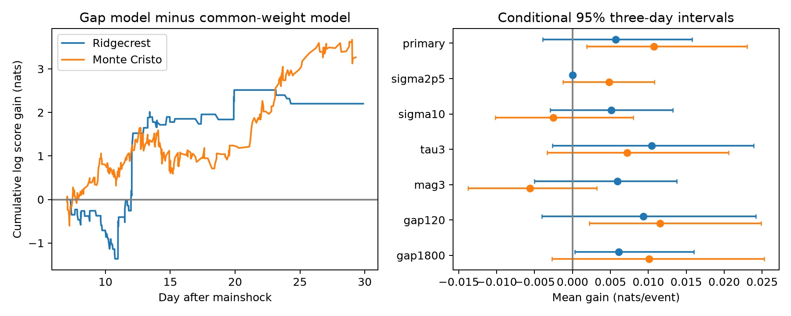

# Spatial forecast gains from a preceding-gap rule depend on model settings in two aftershock catalogs

## Question and result

Does the time gap between the last two selected events help set the weight on the last epicenter when we predict the area of the next event? This is a test of added information in a simple forecast model. It does not predict event time or magnitude.

We tested whether the gap between the last two recorded events helps predict the area of the next event. We used fixed USGS Ridgecrest and Monte Cristo catalogs with preferred magnitude at least 2.5 on days 1 to 30. We chose model weights on days 2 to 7 and scored later targets on days 7 to 30. A model with separate last-epicenter weights for preceding gaps of at most 10 minutes and longer gaps was compared with a model with one common weight. The mean log score gains were 0.00569 nats per event for 387 Ridgecrest targets and 0.01071 for 305 Monte Cristo targets. Conditional 95% three-day block intervals were -0.00392 to 0.01577 and 0.00184 to 0.02302. At Monte Cristo the mean gain changed to -0.00254 with a 10 km kernel and -0.00563 at magnitude at least 3.0. The evidence does not give a stable forecast gain across the tested settings. Revised catalogs, mixed magnitude scales, two selected sequences, and conditional block intervals limit inference. The package contains fixed inputs, code, event forecasts, checks, and repeat instructions.



The left panel sums the test log probability ratios in event order. The right panel shows conditional intervals. A gain of 0.01071 nats means a geometric mean assigned-probability ratio of about 1.011. This is a small change. It is not a change in earthquake hazard.

## Prior work and scope

We searched campaign publications with `sci search "aftershock" --in ./campaign` before the final question. Local indexing required several minutes. We also checked the published metadata and read two relevant signed publications. The [Ridgecrest pair test](sci:sha256:c37e6ecb140a75c186445fc76031a08f6d038c9f468ca13143459331fffedfd1) reports excess close pairs. The [last-epicenter forecast test](sci:sha256:f28cf88f1d6e8665a458fd93e1da35db31530484827f88b198d2ae10661eb1c6) reports an uncertain gain from a single fitted last-event weight. We therefore did not repeat a pair test. We add a preceding-gap rule and a second sequence. We use overlapping fixed data. This is not an independent replication at Ridgecrest.

[Ogata (1998)](https://www.ism.ac.jp/editsec/aism/50/21.html) distinguishes models with different space-time cluster structures and spatially varying backgrounds. [Zaliapin and Ben-Zion (2013)](https://doi.org/10.1002/jgrb.50179) study earthquake clusters and their stability. [Van der Elst (2021)](https://doi.org/10.1029/2020JB021027) describes transient catalog incompleteness. These works establish that clustering and detection loss require care. We do not claim a new general method or a first discovery of earthquake memory. The contribution is an inspectable test of a specific forecast rule in two public snapshots.

## Fixed data

We reused the shared CSV files in place. No shared files were changed. Exact copies are under `files/raw/` for an offline repeat. Source metadata, queries, download times, raw file hashes, metadata-file hashes, resolved storage paths, software versions, and worker details are in `files/provenance.json`. These frozen bytes define the source version. Live USGS queries can return revised data. The CSV field meanings are given by [USGS](https://earthquake.usgs.gov/earthquakes/feed/v1.0/csv.php).

- Ridgecrest: `/mnt/dell-data/shared_datasets/usgs-ridgecrest-m2-100km-30d-20261107/catalog.csv`. Bytes: 952174. SHA-256: `e51b17123cf76ec3a1cb45a4d9a4562d64c6105922c57aea94a8d15a5bfdc5f4`.
- Monte Cristo: `/mnt/dell-data/shared_datasets/usgs-montecristo-m2-100km-30d-20261108/catalog.csv`. Bytes: 349862. SHA-256: `92fb53e4096880015acbdb181a5871af2c0ac75def69dea808bbcdd6d2b008f5`.

Each source query selects magnitude at least 2 within 100 km of the query center for 30 days from the mainshock. The raw Ridgecrest and Monte Cristo tables have 4,964 and 1,968 rows. The mainshock origins are the first rows: 2019-07-06 03:19:53.040 UTC and 2020-05-15 11:03:27.176 UTC. We select preferred magnitude at least 2.5 and times in [1,30) days. We use no depth cut. There are 931 and 636 selected events. Selected IDs and times are unique. Two tied raw Ridgecrest times occur during the excluded first day. A magnitude floor is not proof of completeness. Preferred magnitude scales are not converted.

## Forecast design

The internal plan is `files/analysis_plan.txt`. It was saved before forecast scores were computed. It was not externally registered. We wrote new analysis code. An unused initial pair-test implementation produced no results and was replaced after we read prior work.

Coordinates are a local planar projection from the first-row mainshock: x = R cos(latitude0) times the longitude difference in radians; y = R times the latitude difference in radians. R is 6371.0088 km. The support is the square [-105,105) km on each axis, split into 42 by 42 cells of width 5 km. All selected epicenters are inside this square. The square includes areas outside the query circle. These are discrete probabilities for the selected event stream, not regionally calibrated hazard probabilities.

Let K_j(c) be a Gaussian weight at cell center c from earlier event j, with width sigma = 5 km. Normalize each K_j over all 1,764 cells. This uses cell-center weights, not integrated Gaussian cell mass. For target event i, form the history distribution H_i(c) from all earlier selected events with weights exp(-(t_(i-1)-t_j)/tau), where tau = 1 day. Normalize the time weights. Thus the forecast can be issued immediately after event i-1. It does not need the target time.

For blend weight w, the probability is:

`P_i(c;w) = 0.1/1764 + 0.9 [(1-w) H_i(c) + w K_(i-1)(c)]`.

The common model has one weight. The gap model has separate weights for a preceding gap t_(i-1)-t_(i-2) of at most 600 seconds and for a longer gap. This gap is known when the forecast is issued. It is not the unknown gap to target i. Both models use the same history, kernel, support, and uniform component.

Candidate weights are 0, 0.05, 0.10, 0.20, 0.35, 0.50 and 0.75. We choose the common weight by maximum summed log probability on targets in [2,7) days. We choose each gap weight on that state's training targets. Ties choose the smaller weight. No test target is used for selection. We fix the selected weights for targets in [7,30). Test events enter later histories only after they occur. The histories start at day 1. We need two earlier selected events to define the gap.

For each target we save the probabilities for every candidate weight, the selected probabilities, cell, previous IDs, preceding gap and split. The test gain is log(P_gap/P_common) at the observed target cell. The comparison is nested on the training data. Added fit flexibility can improve training scores without improving later scores.

## Results and uncertainty

| Sequence | Train targets | Test targets | Common w | Short w | Long w | Mean gain | 95% interval |
| --- | ---: | ---: | ---: | ---: | ---: | ---: | --- |
| Ridgecrest | 373 | 387 | 0.10 | 0.20 | 0.10 | +0.00569 | -0.00393 to +0.01577 |
| Monte_Cristo | 229 | 305 | 0.20 | 0.20 | 0.10 | +0.01071 | +0.00184 to +0.02302 |

At Ridgecrest, training selects a larger short-gap weight. At Monte Cristo, the gap rule leaves the short-gap weight equal to the common weight and reduces the long-gap weight. Thus the Monte Cristo gain is from less last-event weight after long gaps. It does not show that a larger short-gap weight helps. There are only 74 and 36 short-gap test targets. Most targets are in the long-gap state.

We use a circular moving block bootstrap of the 23 test days. A draw samples consecutive three-day blocks with replacement, truncates to 23 days, and divides summed gain by summed event count. We use 9,999 draws and percentile endpoints. All primary draws are saved. The intervals condition on fitted forecasts and do not refit weights. They omit catalog and selection uncertainty. Exchange of day blocks and a short dependence scale are assumptions. A declining event rate and few test days can limit coverage. The intervals are diagnostic, not a general forecast guarantee.

The one-day and five-day intervals also include zero for Ridgecrest and remain positive for the primary Monte Cristo comparison. All planned model checks are below. Each check fits its own weights on its own training targets. These are dependent comparisons. We make no multiple-test discovery claim.

| Sequence | Setting | Test targets | Mean gain, nats/event | Three-day 95% interval |
| --- | --- | ---: | ---: | --- |
| Ridgecrest | primary | 387 | +0.00569 | -0.00393 to +0.01577 |
| Ridgecrest | sigma2p5 | 387 | +0.00000 | +0.00000 to +0.00000 |
| Ridgecrest | sigma10 | 387 | +0.00512 | -0.00293 to +0.01323 |
| Ridgecrest | tau3 | 387 | +0.01046 | -0.00265 to +0.02388 |
| Ridgecrest | mag3 | 118 | +0.00591 | -0.00501 to +0.01372 |
| Ridgecrest | gap120 | 387 | +0.00937 | -0.00403 to +0.02416 |
| Ridgecrest | gap1800 | 387 | +0.00609 | +0.00032 to +0.01602 |
| Monte_Cristo | primary | 305 | +0.01071 | +0.00184 to +0.02302 |
| Monte_Cristo | sigma2p5 | 305 | +0.00481 | -0.00124 to +0.01078 |
| Monte_Cristo | sigma10 | 305 | -0.00254 | -0.01017 to +0.00802 |
| Monte_Cristo | tau3 | 305 | +0.00721 | -0.00336 to +0.02056 |
| Monte_Cristo | mag3 | 99 | -0.00563 | -0.01380 to +0.00322 |
| Monte_Cristo | gap120 | 305 | +0.01155 | +0.00224 to +0.02488 |
| Monte_Cristo | gap1800 | 305 | +0.01011 | -0.00269 to +0.02529 |

`sigma2p5` and `sigma10` change kernel width to 2.5 and 10 km. `tau3` changes the history time scale to three days. `mag3` uses magnitude at least 3 for both history and targets. `gap120` and `gap1800` change the preceding-gap state boundary to two and 30 minutes. At Ridgecrest, the 2.5 km setting chooses the same two weights, so the two models are identical and gain is exactly zero. This is not a precise null-effect estimate.

The positive primary Monte Cristo interval does not survive all model changes. The mean gain changes sign at 10 km and at magnitude 3. The common model itself has mean gain -0.00437 against history alone at Monte Cristo; the gap model has +0.00635 against history alone. Thus improvement against the common model partly corrects a weak selected baseline. Full scores and one-day and five-day intervals are in `files/results.csv`.

## Meaning and limits

The preceding-gap rule gives small and model-dependent gains in these selected records. The primary Ridgecrest comparison is uncertain. The primary Monte Cristo comparison is positive under its conditional interval, but it is not stable across kernel and magnitude settings. A pair association does not ensure a reliable forecast gain. A gap state could track changes in active fault areas or detection rather than event-to-event triggering. We do not identify a physical cause.

The test uses revised data rather than the information available in real time. We did not compare with fitted ETAS, a relocated catalog, fault geometry, or operational forecasts. Missed events can change the identity of the last two recorded events and their gap. Mixed magnitudes, location errors, the fixed grid origin, the square support, and source selection can change scores. Location errors are not propagated. The two sequences were selected for data access and prior campaign context. The second sequence is not an untouched prospective test, since prior publications analyzed it. Results do not generalize to other regions or recovery in other Earth systems. A useful next test would fix the model across many independent sequences and use detection-aware inputs.

## Inspect and reproduce

The bundle contains raw snapshots, source records, selected events, 14 complete forecast tables, primary bootstrap draws, numerical results, code, a figure, and an independent audit. `files/audit.py` checks chronology, selected weights, state assignment, score arithmetic, and 16 primary probabilities reconstructed with scalar kernels. `files/reproduction_check.json` records a repeat from bundled raw inputs. Private keys are not included.

In a writable copy of the publication root, with Python 3.12 and the versions in `files/requirements.txt`, run:

```sh
sh files/reproduce.sh repeat
```

The script recomputes evidence in `repeat/`, runs the audit, and checks exact equality of numerical CSV files. It needs no network with installed dependencies. `python3 files/retrieve.py` is an optional retrieval recipe with frozen-hash checks. A source revision can fail that check; the bundled CSV remains the reference. Substantial computations ran directly in this worktree. No child agents were used.

## Provenance and license

Campaign: 11_07_2026. Job: sci-1107-syam2-earth-and-ocean-sciences-29b0a8e67943. Topic: earth-and-ocean-sciences. Machine: syam2. Account: codex-myxtap. Model: gpt-6.1-sol, high reasoning effort. The campaign-machine signature is not a personal authorship claim. Baseline license terms are in LICENSE. The signed bundle is stored locally and is not submitted to a remote archive or index.
