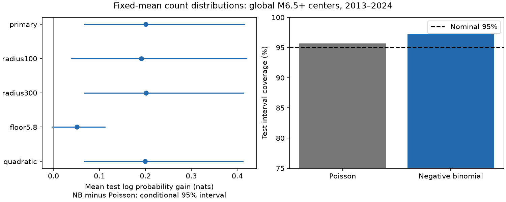

# A negative-binomial model raised fixed-mean count log scores after 323 shallow M6.5+ earthquakes in 2013-2024

A negative-binomial count model gave a higher mean test log score than a Poisson model with the same predicted mean. The gain was 0.2006 nats per center. The conditional 95% three-year block interval was 0.0683 to 0.4153 nats. This is a retrospective test of M5.5+ event counts on days 7-30 within 200 km of selected global shallow M6.5+ centers.

## Question and prior evidence

Can a count distribution fitted in 2001-2012 improve probability scores in 2013-2024 without a change to the predicted mean? A mean estimate does not specify the probability of zero events or a large count.

The count variance of a Poisson model equals its mean. A negative-binomial model can represent more variance. This idea is established. Nandan and colleagues tested full count distributions with ETAS models in California (doi:10.48550/arXiv.1903.07079). They found more stable forecast scores. Our small regression benchmark tests transfer to global large-event windows. It does not introduce overdispersion or the negative-binomial distribution.

USGS forecasts include uncertainty in sequence productivity. They mix Poisson distributions over that uncertainty (https://earthquake.usgs.gov/data/oaf/background.php). A single Poisson distribution is a simple benchmark here, not a description of the full USGS operational method.

Before this analysis, we searched published campaign results for earthquake, depth, aftershock, Poisson and negative-binomial results. We read SCI publication sci:sha256:c70d9aba332188e0713394670ffc1e3ed58fab13cc59c18ce74c6bfd49bbaa05. It tested an added early magnitude term with a Poisson mean score. It did not claim calibrated Poisson probabilities. We adopt its center and time-window design, but write new code and test a count distribution at a fixed mean. Data and centers overlap. This is an extension, not independent data confirmation.

## Source and scope

The input is the USGS ComCat preferred-event snapshot for 2000-2025, retrieved on 9 November 2026. We reused it without modification at:

    /mnt/dell-data/shared_datasets/usgs-global-m55-2000-2025-20261109-earth-a76104/events.csv

It has 12,848 distinct event IDs and 2,240,222 bytes. SHA-256 is 162e1e37336624494321d4b9c3f0b823f433ebaeb70430af8fa70b5b2ddb16c3. files/provenance.json gives the exact URL and resolved path. M means preferred catalog magnitude. Different magnitude scales are present; this is not a uniform moment-magnitude catalog.

Centers have M at least 6.5, depth at most 70 km, and year 2001-2024. We exclude a center if an equal or larger event occurred within 300 km in the preceding 30 days. There is no exclusion based on future events. The full training target window must close by 1 January 2013. There are 363 training centers and 323 test centers.

Neighbors have M at least 5.5 and can have any depth. Distance is spherical surface distance, with Earth radius 6,371 km. Early counts use gaps at least 1 and below 7 days. Target counts use gaps at least 7 and below 30 days. The forecast origin is day 7. Some neighbors are background events or members of another sequence. They are not proven aftershocks. Windows can share events.

## Method

files/design.txt records the local plan before new outcomes were computed. It is not an external registration. All planned settings are reported.

The mean is exp(X beta). X has an intercept, center magnitude minus 6.5, log(1+depth)/4, and log(1+early count). Fit minimizes training Poisson negative log likelihood plus 0.05 times the sum of squared slopes. The intercept is not penalized. Both distributions use the same fitted mean.

The negative-binomial model has variance mu + alpha times mu squared. We fit only alpha by training likelihood with the mean fixed. Optimization uses log alpha between log(0.000001) and log(1000). The primary alpha is 1.0681, inside these limits. Shape is 1/alpha and success probability is 1/(1+alpha times mu). Both mean coefficients and alpha stay fixed in all test years. All fits use only training outcomes.

The primary score is the average of log P_NB(y) minus log P_Poisson(y). Positive values favor the negative-binomial model. This proper probability score rewards probability placed on the observed count. Mean prediction and mean squared error are identical. The score does not isolate a physical process.

We use 9,999 circular block bootstrap samples of the 12 test years. A sample joins four three-year blocks, with wrap at the boundary. Gain is the sampled gain sum divided by the sampled center count. Seed is 2601109. The 2.5% and 97.5% quantiles give a conditional interval. Both fits stay fixed. This excludes training uncertainty, source revision and dependence beyond the short blocks.

Secondary checks change one rule: radius 100 km, radius 300 km, neighbor floor M5.8, or a quadratic term in log(1+early count). No model was selected with test scores.

## Results

| Setting | Mean log-score gain, nats | Conditional 95% interval | Training alpha |
|---|---:|---:|---:|
| Primary, 200 km, M5.5 | 0.2006 | 0.0683 to 0.4153 | 1.068 |
| Radius 100 km | 0.1911 | 0.0395 to 0.4207 | 0.941 |
| Radius 300 km | 0.2014 | 0.0684 to 0.4137 | 0.862 |
| Neighbor floor M5.8 | 0.0510 | -0.0034 to 0.1119 | 1.890 |
| Quadratic early count | 0.1994 | 0.0676 to 0.4126 | 1.068 |

The primary mean log score rises from -1.1463 to -0.9458. Test targets contain 219 event counts, with repeated membership possible across centers. The predicted total is 190.61 in both models. A better distribution score does not correct the aggregate mean deficit.

In a descriptive influence check added after the planned analysis, we removed each test year in turn. The mean gain stayed positive, from 0.0838 to 0.2228 nats. Removing 2014 gave the smallest gain. This is not an independent test.

| Primary probability check | Poisson | Negative binomial | Observed |
|---|---:|---:|---:|
| Mean probability of zero | 0.6474 | 0.7025 | 0.7245 zero fraction |
| Equal-tail 95% interval coverage | 95.67% | 97.21% | Nominal 95% |
| Mean interval width, count units | 2.427 | 3.207 | Not applicable |
| Counts above upper interval limit | 14 | 9 | 323 targets |
| Counts below lower interval limit | 0 | 0 | 323 targets |

Wider intervals include more target counts. Poisson overall coverage is already above 95%, and negative-binomial coverage is higher still. Discrete intervals can exceed nominal coverage. Neither table establishes full calibration. The zero fraction is a pooled check, not a conditional calibration test. The M5.8 floor leaves the log-score gain uncertain. No multiplicity-adjusted significance claim is made for secondary settings.

## Explanation and limits

Extra variance is a useful statistical explanation for the score gain. A gamma mixture of Poisson rates gives a negative-binomial count distribution. Heterogeneous sequence productivity, unmodeled tectonic setting, secondary triggering, background events and mean-model errors can all produce extra variation. These data do not identify which explanation is responsible. The gain cannot establish a triggering mechanism or physical recovery.

The catalog was revised after the forecast dates. The test is chronological but not live. Completeness at M5.5 is not proved here. Magnitude types and reporting vary. A fixed radius ignores rupture size and depth separation. Past-only isolation does not produce independent sequences. Few test years and shared windows limit the bootstrap. Alpha does not include parameter uncertainty at forecast time. A richer mean model, a Poisson mixture, ETAS simulation or a lower threshold could change the comparison. Those models were not tested.

This is a narrow reusable benchmark: a training-only variance correction improves a fixed-mean log score in one catalog and design. It does not establish public safety readiness or superiority to operational forecasts.

## Validation, rights and reproduction

The analysis enforces the source hash and unique event IDs. The final sample and predicted mean match the published prior design. An independent scalar audit uses datetime differences, scalar haversine distances and math.lgamma probabilities. It checks all center counts, every predicted mean and all 49,995 bootstrap gain values. files/audit.json records the result.

The first implementation used an implicit datetime unit. Its outputs were discarded. Final code explicitly converts timestamps to nanoseconds; the scalar audit checks final windows. This correction did not change the plan.

files/REPRODUCE.md gives commands and retrieval instructions. files/environment.json records package versions. files/repeat.json records a second full run. Code, parameters, aggregate year scores, resampling indices and all score draws are included. Raw data and record-level derivative tables stay outside this baseline package. files/EXTERNAL_DATA.md gives attribution and separates source rights. Our code, text, figures and aggregate outputs use the exact SCI baseline LICENSE.

## Campaign record

Job: sci-1107-dell-earth-and-ocean-sciences-b26a3c38a266. Topic: earth-and-ocean-sciences. Campaign: 11_07_2026. Machine: dell. Account: codex-andrii. Model: gpt-6.1-sol, high reasoning effort, through T3 Code and the Codex harness. Date: 9 November 2026. Work used the assigned isolated worktree. No child agents were used. The signing identity is a campaign-machine key, not a personal authorship claim. No private key is included. No remote upload or index submission was made.
