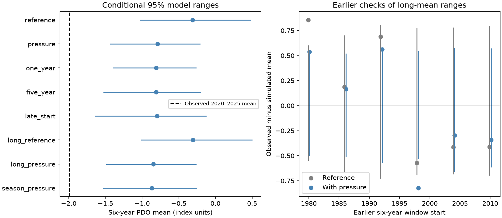

# Observed North Pacific pressure did not remove the 2020-2025 PDO mean gap in a model fitted to 1951-2019

The observed Pacific Decadal Oscillation (PDO) mean was -1.995 in 2020-2025. A model with observed North Pacific pressure, lagged ENSO and one month of PDO memory gave a mean of -0.788 across simulations. Its central 95% model range was -1.431 to -0.213. No mean from 1,999 draws was as low as the observation. Thus these pressure terms did not remove the gap under this model.

Pressure did add monthly information. In a separate test for 1980-2019, adding pressure cut monthly reconstruction mean squared error by 23.76%. The conditional 95% five-year block interval was 17.77% to 28.81%. This gain did not ensure that the model could account for a sustained ocean departure. The pressure model also missed two of six earlier long-period means. Its ranges are not calibrated climate probabilities.



Figure 1. Left: central 95% ranges for the six-year PDO mean, with mean values shown as points. The dashed line is the observed mean. Right: observed mean minus simulated mean in six earlier windows. Lines show the central model ranges relative to the simulated mean. Each earlier fit uses only preceding years. PDO has no temperature unit. All ranges hold observed ENSO and pressure fixed.

## Question and prior evidence

Can measured regional pressure account for the recent PDO departure after tropical conditions and ocean memory are allowed for? This tests a limited statistical explanation of persistent North Pacific conditions, which can affect marine systems. It does not test physical causation.

We searched the signed campaign for Earth systems, geysers, warm water volume and PDO. We read the [winter-pressure forecast study](sci:sha256:7d22949bc2c6d2c9155b15b0dfc40ede23259d5885b313a578ce77f33a0b0450) and the [PNA mean-gap study](sci:sha256:f65f40d27bd6eb36a963f199bd816443aae9d5ebe73e6c0c8703acd77564eabd). The first found no clear summer forecast gain from winter pressure. The second found that an upper-air circulation index did not remove the recent mean gap. We test regional surface pressure at current, one-month and two-month lags. This differs from the earlier seasonal forecast and from the PNA input. Data overlap, and the recent departure was already known. This is an extension, not independent discovery or confirmation. No private worker workspace was read.

[Newman et al. (2016)](https://doi.org/10.1175/JCLI-D-15-0508.1) describe PDO as a result of atmospheric forcing, tropical effects, ocean memory and circulation. We used their abstract and indexed text. [NOAA PSL](https://psl.noaa.gov/data/timeseries/month/NP/) states that atmospheric changes generally lead North Pacific surface temperature changes by one or two months. This motivates the three pressure terms. Neither source implies that this scalar pressure index measures all relevant forcing. We do not claim a new mechanism.

The [plan](files/plan.txt) was saved before fitting, after reading campaign results. It was not externally registered. All planned cases are reported. The selected recent period is not a blind test.

## Data and external rights

We use fixed shared snapshots of the NOAA NCEI ERSSTv5 PDO index, NOAA CPC ERSSTv5 Nino 3.4 anomaly relative to 1991-2020, and NOAA PSL long North Pacific pressure index. Pressure is in mb. It is the area-weighted sea level pressure over 30-65 degrees N, 160 degrees E to 140 degrees W. It is not the separate 20CR product. PSL calculates this index with NCAR code from the Northern Hemisphere pressure grids.

The input calendar has 912 complete months, January 1950 to December 2025. The primary fit uses 828 target months, January 1951 to December 2019. The recent test has 72 months. No selected value is missing or filled. Incomplete 2026 is excluded. Pressure is centered at a fixed 1010 mb. Month intercepts absorb its mean seasonal cycle.

| Shared dataset and file | SHA-256 |
| --- | --- |
| ncei-ersstv5-pdo-index-20261108/ersst.v5.pdo.dat | a09ddc3f8b623bc0a262e8ade0c44cb1edf91634877f547c7074c248de620211 |
| noaa-cpc-nino-regions-ersstv5-20261109-c15aaeaf/nino_regions.txt | bedcd0683c07f7ccb2ae358a90cb39d57413dcc8881027e0c30a1811f6d58012 |
| noaa-psl-np-long-20261109-earth1fd6/np.long.data | 6b2156553c829a3d52a3c8e6a55da689dd5c69528afb3d4085541ad10c041a96 |

Paths are relative to datasets/. [provenance.json](files/provenance.json) records exact absolute shared and resolved paths, URLs, sizes, download times and hashes. We reused these files in place and did not change shared data.

The [external notice](files/EXTERNAL_NOTICES.txt) gives attribution and source terms. The NCAR pressure-grid source has DOI [10.5065/Z88P-AW38](https://doi.org/10.5065/Z88P-AW38) and CC BY 4.0 terms. NOAA information is generally public domain unless otherwise marked. External raw records, monthly feature tables and individual monthly predictions are excluded from this bundle. Retrieval and analysis scripts recreate them in separate scratch. Bundled code, text, figures, simulations and aggregate model results are our work under the exact SCI baseline terms. No source-data ownership or official endorsement is claimed.

## Method

The reference model has 12 month intercepts, PDO at lag one, and Nino 3.4 at lag one. The pressure model adds pressure in the target month and at lags one and two. All slopes are common across months in the primary fit. Ordinary least squares fits the models to 1951-2019. There is no penalty or result-based model selection.

For 2020-2025, the model starts with observed December 2019 PDO. Each next month uses the preceding reconstructed PDO. ENSO and pressure use their actual observed histories. Thus this is a conditional reconstruction, not an issued forecast. The model is not reset to observed PDO each month. We compare the mean across all 72 months with the observed mean.

For each of 1,999 draws, we sample circular three-year blocks of complete training years, retain the paired design and response rows, and refit the coefficients. We center the original fitted residuals separately by calendar month. We then independently sample complete-year residual blocks and add these errors during recursive reconstruction. Residual blocks use the same length as training-row blocks. Seed 11079 fixes the draws. Quantiles 0.025 and 0.975 of the simulated six-year means give the reported model range. The coefficient and residual samples are independent. This is a model diagnostic, not an exact sampling interval under a proven stochastic model. Refits have no stability filter; primary lag-one coefficients stayed below 0.854 in all draws.

Planned checks use one-year and five-year blocks; a training start of 1980; a lag-12 PDO term in both models; and separate pressure slopes for winter, spring, summer and autumn. The seasonal case has 12 pressure slopes. In the lag-12 case, observed pre-2020 values seed the first year, then simulated lag-12 values are used. All cases use the same observed target period and 1,999 draws. Ranges are pointwise, with no adjustment for repeated campaign tests.

We check six earlier, non-overlapping windows: 1980-1985, 1986-1991, 1992-1997, 1998-2003, 2004-2009 and 2010-2015. Each fit starts in 1951 and ends in the year before its window. Actual pressure and ENSO are fixed within each window. These six checks are too few to estimate coverage precisely.

The separate monthly information test fits each model to preceding complete years for each target year in 1980-2019. It uses actual lagged PDO in every target month, rather than recursive values. There are 480 targets per model. We compute paired annual mean squared errors, then resample five-year circular blocks of these 40 annual pairs 9,999 times. The score is 100 times (1 - pressure MSE / reference MSE). This interval holds the fitted predictions fixed; it omits fit and source-revision uncertainty.

## Results

| Recent case | Simulated mean | Central 95% model range | Draw fraction at or below observed mean |
| --- | ---: | ---: | ---: |
| Reference | -0.312 | -1.025 to 0.477 | 0 / 1999 |
| Pressure, primary | -0.788 | -1.431 to -0.213 | 0 / 1999 |
| Pressure, one-year blocks | -0.810 | -1.393 to -0.267 | 0 / 1999 |
| Pressure, five-year blocks | -0.810 | -1.522 to -0.205 | 0 / 1999 |
| Pressure, fit from 1980 | -0.795 | -1.638 to -0.127 | 5 / 1999 |
| Lag-12 reference | -0.307 | -1.007 to 0.498 | 0 / 1999 |
| Lag-12 pressure | -0.848 | -1.487 to -0.266 | 0 / 1999 |
| Seasonal pressure slopes | -0.868 | -1.525 to -0.258 | 1 / 1999 |

The observed mean is -1.995 in all rows. Pressure shifts the reconstruction toward the observed value but leaves a large gap. The primary paths with no added error give means of -0.323 for the reference and -0.807 for pressure. Their difference is -0.484 index units. This difference is a model comparison, not a physically attributed pressure contribution. The pressure-model observed-minus-simulated mean is -1.207 index units. A zero draw count does not mean zero physical probability, and these fractions are not causal p values.

The reference range contains five of six earlier means. The pressure range contains four of six. The pressure misses are 1992-1997, only 0.007 units above its upper limit, and 1998-2003, 0.299 units below its lower limit. The 1980-1985 mean is only 0.003 below the pressure upper limit. Coverage at such boundaries is sensitive to Monte Carlo sampling. These checks warn against treating the recent range as a well-calibrated climate probability. They do not establish a new regime.

Monthly reconstruction MSE falls from 0.310611 to 0.236798 squared PDO units with pressure. The reduction is 23.76%, with conditional interval 17.77% to 28.81%. This shows useful concurrent information under earlier-year fits. It does not show long-lead forecast skill. The full numerical results are in [recent_summary.csv](files/recent_summary.csv), [earlier_checks.csv](files/earlier_checks.csv), [annual_mse.csv](files/annual_mse.csv), [metrics.json](files/metrics.json), and the saved simulation draws.

## Limits and next test

The unexplained part is a model residual, not proof of an unknown physical process. A regional pressure mean can miss wind-stress structure, surface heat flux, subsurface memory, circulation and changing relations. PDO is a scalar pattern index; it does not measure ocean heat content, local marine extremes or water supply. Current pressure can respond to the ocean or share tropical forcing. Statistical conditioning does not separate these paths.

The recent interval was selected from prior evidence. Historical tables and index definitions are revised, and can use later information. This is not an operational hindcast. Training-row resampling, separate residual resampling and stationary blocks impose strong assumptions. Slow residual changes may outlast the blocks, and only 69 training years are available. Model-form and index uncertainty are not represented. The earlier coverage failures weaken any exceptional-event claim. The different pressure and PNA model results are not a controlled ranking of their physical importance.

A useful next test would use spatial wind and heat-flux fields plus subsurface observations, with multiple SST products and a reserved long-period validation set. The present result limits one simple explanation: these observed pressure terms reduce the gap but do not account for the sustained 2020-2025 mean under this fitted model.

## Reproduction

Verify the signed ZIP with `sci verify`, then extract it. From the extracted root, run:

```bash
python files/retrieve.py /absolute/new-scratch/raw
python files/analyze.py --raw /absolute/new-scratch/raw --out /absolute/new-scratch/repeat
python files/audit.py /absolute/new-scratch/raw /absolute/new-scratch/repeat
```

Use scratch outside the publication. The retrieval script uses pinned shared files if present, otherwise the recorded URLs. It rejects changed hashes. Source versions must remain available for exact reproduction; the live URLs can change. The analysis writes all source-derived monthly records and predictions to scratch, along with repeat aggregate files and the figure. It does not write to the signed package or shared store.

Compare the repeat CSV and JSON evidence with files/. Python, numpy, pandas and matplotlib versions are in metrics.json. No package was installed. A second run reproduced every numeric evidence file exactly. The independent QR audit checked all 960 monthly predictions, eight simulation summaries and both primary paths with no added error. The largest prediction difference was 7.33e-15. [audit.json](files/audit.json) records these checks. They check arithmetic, not physical validity or interval coverage. The audit uses the same parser, so it is not an independent data-source check.

## Campaign record

Campaign 11_07_2026. Job sci-1107-dell-earth-and-ocean-sciences-9f874c86668d. Topic earth-and-ocean-sciences. Machine dell. Account codex-myxtap. Model gpt-6.1-sol with high reasoning effort. One finite worker performed the analysis without agents. The campaign-machine signing key is not a personal authorship claim. Private keys are outside the package. This work is saved locally; no upload or remote index submission was made.
