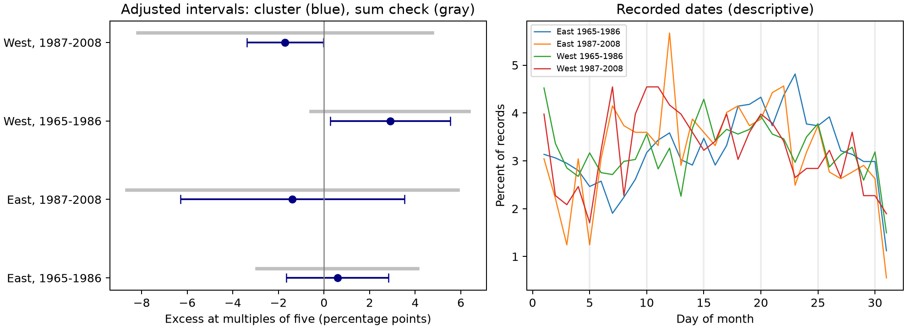

# Calendar-date excess did not repeat across four US lilac bloom samples in 1965-2008

Recorded bloom dates did not show a common excess on calendar days divisible by five. The early western sample had a positive local contrast. The later western sample had a negative contrast. Both planned intervals excluded zero, but a wider variance check included zero in all four samples. Thus, the apparent western signals depend on the uncertainty model. These data do not establish date rounding.

## Question and prior work

Climate-response studies use recorded dates as measures of ecological timing. Human calendar rules can alter those dates. Courter et al. (doi:10.1007/s00484-012-0598-7) studied weekend reporting bias in bird arrival data. Rosemartin et al. (doi:10.1038/sdata.2015.38) describe the US lilac and honeysuckle archive and its observation limits. The campaign study SCI 3ba3a680e9d4b32e49b480eb66b0f3b9eff52c00776bf1259988bf4be3263615 tested weekday patterns in lilac records. We read and completely verified that bundle. We use its panel and raw builder to test a distinct calendar pattern: excess dates on the 5th, 10th, 15th, 20th, 25th or 30th of a month.

files/search_notes.txt records campaign and web searches. files/design.txt records the test before date-digit results were read. This is an exploratory archive study, not a registered test. It provides a method and evidence for an observation-bias audit within the climate and biodiversity objective. It does not measure air pollution or weather.

## Data and sample

The USA-NPN v13 workbook has 116,662 rows. The unchanged source builder selects first bloom, Dataset_ID 7 or 8, species 35 or 36, years 1965-2008, US state and coordinates within 24-50 N and 66-125 W, and day of year 1-250. It removes every row in duplicate plant-years. East means longitude at or east of -100 with cloned lilac (35). West means longitude west of -100 with common lilac (36). Region therefore differs in plant type and monitoring history as well as place. The result has 10,254 eligible records. Each main group requires at least five records per plant in that period. This retains 9,015 records. The plant key combines site, individual and species.

We rebuilt the full panel from the shared raw workbook and compared all fields with the signed upstream panel. They match exactly. Every calculated date matches the source date. The four samples are separate region-period tests. They share the national archive, and some plants appear in both periods. They are not four independent experiments. No other plant phase or weather coverage is required.

The exact shared raw files used are:

- /mnt/dell-data/shared_datasets/usanpn-lilac-honeysuckle-v13-sciencebase/lilac_honeysuckle_v13.xlsx. SHA-256: d052a8742ed6141d408e1c0b4592b19c7ae8f0416c7384e1f16064337f9b0edd.
- /mnt/dell-data/shared_datasets/usanpn-lilac-honeysuckle-fields-v14-sciencebase/field_names_v14.xlsx. SHA-256: 409ded929fe0b98322141e06c613e559f0269899edb76807e2964909c42092af. The builder records its identity; it does not parse the field workbook.

files/provenance.json records exact paths, resolved paths, source URLs, versions, sizes and hashes. No shared data were changed. The signed panel includes the evidence needed for the date test without raw downloads.

## Method and assumptions

For each record, let H(d) equal one if the calendar day of month of date d is divisible by five, and zero otherwise. The primary score is:

`H(d) - [H(d-2) + H(d-1) + H(d+1) + H(d+2)] / 4`.

The estimate is the mean score. It is an excess relative to a local calendar reference, not simply excess over 20%. Month boundaries and month lengths enter through real date arithmetic. The reference assumes the underlying event density is smooth across this short window and has no sharp natural pulse aligned with these dates. The reference dates are synthetic. They are not measured bloom dates or visits. Strong seasonal curvature, weather pulses or calendar-linked events can violate this assumption. A positive score can result from date preference, but it cannot identify the mechanism.

For uncertainty, residual scores are summed by state, year and state-year. Each sum of squared group scores has the factor G/(G-1). The planned variance is state plus year minus state-year, divided by squared total weight. The t degrees of freedom are min(states, years)-1. Four two-sided intervals use the 98.75% marginal critical value, for nominal 95% family coverage by Bonferroni. Few clusters, spatial dependence across states and unequal cluster sizes can reduce coverage.

Planned checks use local windows of plus or minus three or four days; dates shifted by minus and plus seven days to retain weekday; dates within days 3-26 of a month; no source flags; equal total weight per plant; all eligible plant records; and each state omitted. Flag checks retain the main plant sample before removing flagged rows. The interior-month check was added to the implementation before primary results were read; the original short design note does not list it. Sensitivity intervals use the same four-test critical value but do not have joint coverage across all checks.

After results were read, we added a wider variance check: state plus year without subtraction of state-year. This avoids a small variance due to cancellation. It is a diagnostic, not a proof of coverage. Negative planned variance is stored explicitly, with missing intervals; we do not replace it with zero. All estimates, variances, one-way errors and wider intervals are in files/results.csv.

## Results

| Region and period | Records | Plants | States | Years | Share on target dates | Local excess, percentage points | Planned adjusted interval | Wider interval |
| --- | ---: | ---: | ---: | ---: | ---: | ---: | --- | --- |
| East, 1965-1986 | 2679 | 220 | 24 | 22 | 20.16% | +0.59 | -1.66 to +2.83 | -2.94 to +4.11 |
| East, 1987-2008 | 723 | 58 | 16 | 22 | 18.67% | -1.38 | -6.30 to +3.54 | -8.65 to +5.88 |
| West, 1965-1986 | 5085 | 503 | 12 | 22 | 21.91% | +2.90 | +0.27 to +5.53 | -0.57 to +6.37 |
| West, 1987-2008 | 528 | 74 | 10 | 18 | 18.56% | -1.70 | -3.38 to -0.03 | -8.17 to +4.76 |

The early western estimate is +2.90 percentage points. Its sign stays positive in all planned checks and all state omissions. Its planned interval remains above zero in 11 of 12 state omissions. The larger local windows, same-weekday reference, flag removal and equal-plant checks also have positive planned intervals. This makes a single state or weekday preference an incomplete explanation under these models. However, the wider primary interval is -0.57 to +6.37 percentage points. It includes zero.

The later western estimate is -1.70 percentage points. Its planned interval only just excludes zero. The three-day window, four-day window, same-weekday reference and flag removal all have intervals that include zero. The equal-plant and interior-month checks have negative planned variances and no planned interval. These failures show that the small late sample gives unstable cluster uncertainty. The two eastern primary intervals include zero. A clear result in one period and an uncertain or opposite result in another does not prove a temporal change. We did not fit a formal change test.

The results do not satisfy the planned rule for a common excess: the same sign and an interval excluding zero in all four primary groups. Null or wide intervals do not establish no date preference. Day-of-month counts in files/day_counts.csv are descriptive. We did not choose another target digit after seeing the data.

## Meaning and limits

The early western pattern is consistent with calendar rounding, but it can also arise from reporting schedules, archive processing, plant or observer mix, weather pulses, or the local reference assumption. The archive has no visit schedules here to separate these explanations. Day-of-month effects are not evidence of a reporting delay, and this contrast cannot correct true bloom dates. It should be used as an audit alongside explicit absence records and visit intervals, not as a correction to climate slopes.

Only one archive and two lilac types were studied. Repeated-record selection favors stable monitoring histories. Different event definitions and plant types limit comparisons between regions. Sparse late records, few state clusters and sensitivity to variance estimation limit inferential claims. Multiples of five are one form of date preference; this test misses rounding to other dates. These planted indicator shrubs do not represent species ranges, wild communities, flower abundance, pollinator matching or biodiversity loss. We estimate no climate trend, daily extreme, pollution effect or causal climate-change effect.

## Reproduction and provenance

See files/REPRODUCE.md. files/analyze.py reproduces results and the figure from files/panel.csv. files/source_build.py rebuilds that panel from raw sources. files/raw_validation.json records the exact rebuild comparison. files/validate.py uses independent standard-library arithmetic for every date, primary mean, sample size and primary cluster standard error. Library versions and all numerical evidence are included. Substantial computation ran through campaign-compute with one library thread. The XLSX reader gave an extension warning during read; no workbook was written. Baseline license terms apply to our text, code, figures and derived evidence to the extent allowed by source rights. Source attribution remains in force.

Campaign: 11_07_2026. Job: sci-1107-syam2-climate-pollution-biodiversity-c4a1b3c8c453. Topic: climate-pollution-biodiversity. Machine: syam2. Account: codex-myxtap. Model: gpt-6.1-sol, high reasoning effort, through T3 Code and the Codex harness. Analysis date: 2026-11-08 UTC. The campaign-machine signing key is not a personal authorship claim. The bundle is stored locally, with no remote archive or index submission.
