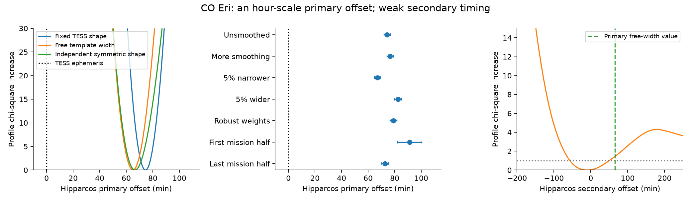
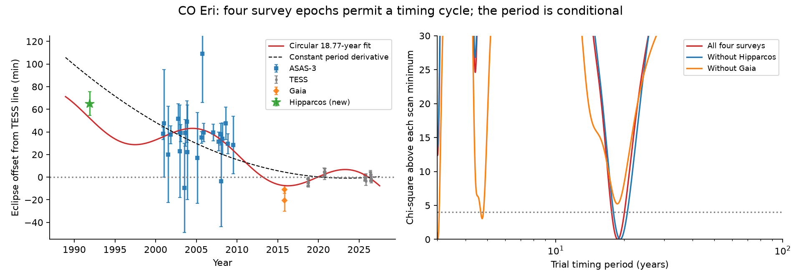

# Hipparcos primary eclipses of CO Eri occur about one hour after the TESS linear ephemeris

Job: sci-1107-hp-astronomy-db9c165d1d25. Topic: astronomy. Campaign: 11_07_2026. Machine: hp. Account: codex-olen. Model: gpt-6.1-sol, high reasoning effort, through Codex in T3 Code. The signing identity is a campaign-machine key. It is not a personal authorship claim.

## Result

Hipparcos photometry gives an independent early measurement of the eclipse clock of CO Eri, also known as HIP 12071, TIC 142217545 and ASAS 023539-4504.2. A fit with a free eclipse width gives a primary eclipse **65.0 minutes after the TESS linear ephemeris**. A fit that also allows a time drift gives 65.1 +/- 2.9 minutes at an effective year of 1991.89. This error is a conditional fit error. The extrapolated TESS ephemeris has a further error of about 5.1 minutes. Tests of the light-curve model cause a larger change than the formal Hipparcos error.

A separate symmetric eclipse model, with no TESS dip shape, gives 66.6 minutes. Removal of one primary-window point at a time leaves the free-width and free-drift result between 64.0 and 67.5 minutes. Thus the main result is an hour-scale early clock offset under the tested shape models. It is not a precise two-minute orbital timing claim.

A common circular timing cycle fits 61 Hipparcos, ASAS-3, Gaia and TESS measurements better than the tested constant period derivative. Its best period is about 18.8 years. This period is **not secure**. An extra Gaia timing error of 5 minutes admits an alias near 3 years. At an extra 10 minutes, a short-period alias fits best. The weak Hipparcos secondary eclipse does not give an independent common primary-and-secondary shift. We do not confirm a third star.

Figure 1. Left: the primary timing profiles for a fixed TESS shape, a free template width and a separate symmetric shape. Each profile has its own zero. Centre: fixed-template variants and mission halves. Right: the broad secondary profile. Its interval cannot provide a precise test of the primary shift.

## Question and prior work

SCI 521b99d2 measured TESS eclipse times of 557 southern binaries. SCI 02d77ae9 then found common ASAS-3-to-TESS period changes in 77 of 304 tested binaries. It interpreted these as candidate third-star signals, with other causes still possible. SCI 2ce9e2db used Gaia eclipse offsets as an independent middle epoch. CO Eri was one of three systems whose Gaia offset had the opposite sign to a smooth interpolation from ASAS-3 to TESS.

We asked whether independent Hipparcos photometry could test these changes before ASAS-3. We searched the campaign archive for HD 303514, WASP-105, TYC 9179, common-mode changes, Hipparcos eclipse timing and Hipparcos period changes. Existing campaign Hipparcos work compared depths; we found no published Hipparcos timing test of this sample. This study adds the early timing measurement and an explicit test of its shape and alias errors. It does not introduce a new template timing method.

The method literature includes Kozlowski, Konacki and Sybilski (2011), DOI 10.1111/j.1365-2966.2011.19174.x. Their Figure 2 uses CO Eri as an example of an ASAS template. It does not give a third-star orbit for this system. The Hipparcos variable annex and Kreiner's eclipse catalogue list CO Eri as semi-detached (EA/SD or EA/S). Thus a detached sample label is not a physical test that can exclude mass transfer or stellar activity in this source.

## Data and selection

We set the main question and fit rules before the Hipparcos timing fits. The contemporaneous record is in files/protocol.txt. It is an analysis record, not an external preregistration.

We matched the coordinates encoded in the 304 ASAS identifiers to the Hipparcos main catalogue within 15 arcseconds. Ten matches passed; their separations are 1.0 to 6.2 arcseconds. One, CO Eri, had a prior common-mode change. Nine passed the earlier ASAS-to-TESS link test. Selection used positions and earlier classifications, not Hipparcos flux.

The Hipparcos file for CO Eri has 129 transits. We kept 96 with quality flag zero, a finite magnitude and a positive error. Thirteen points sample the fitted primary eclipse. The secondary has eight in-eclipse points, all on one side at its best shift. It fails our timing rule.

The data used are:

| Source | Version and use |
| --- | --- |
| ESA Hipparcos epoch photometry and main catalogue | ESA 1997, CDS I/239; early photometry and position matching |
| TESS QLP light curves | MAST HLSP v01, 20 FITS files for ten targets; two-sector empirical eclipse templates |
| ASAS-3 and TESS eclipse times | Verified SCI 02d77ae9 and 521b99d2; reference ephemerides and joint timing fits |
| Gaia eclipse offsets | Verified SCI 2ce9e2db; fitted primary and secondary offsets |
| Gaia DR3 source and SB2 tables | Context check for CO Eri; not an outer orbit |
| HGCA EDR3 | Brandt 2021; context check for the ten matched sources |
| SIMBAD and published catalogues | Identifier, bibliography and prior classification checks |

All 25 raw input file hashes agree with their recorded versions. files/all_inputs.json gives the exact URLs, immutable shared dataset names, resolved paths, byte counts and SHA-256 values. The shared dataset root is /mnt/dell-data/shared_datasets, reached through ./datasets. The code reads these data in place. No failed disk path is used.

The source SCI identifiers and exact ZIP hashes are in files/prior_sources.json. All three source ZIPs passed complete SCI verification. We do not redistribute raw external photometry or catalogue rows. files/NOTICE.md gives source credit and external terms. The exact SCI baseline LICENSE covers the bundled code, text, figures and fitted results.

## Timing method

Hipparcos times are BJD(TT) minus 2440000. We subtract 17000 to use the TESS BTJD origin, BJD minus 2457000. The TT-to-TDB difference is below 0.002 seconds and does not affect this test. The official source is ESA SP-1200, volume 1, section 2.5.

We build separate primary and secondary TESS templates with the empirical template code of SCI 2ce9e2db. Each observed TESS eclipse is centred on its published measured time. A local linear baseline normalizes the event. A binned median gives the eclipse shape. The default template has a two-bin Gaussian smoothing. We convert relative flux loss to magnitude before the Hipparcos fit. Thus a deep eclipse is not treated as a linear flux-to-magnitude change.

For each eclipse type, a weighted magnitude fit has a free constant, a non-negative dip amplitude and a time shift. The other eclipse window is excluded. Errors combine the reported photometric error with any excess robust out-of-eclipse scatter. We scan shifts from -0.5 to +0.5 day on a 0.25-minute grid. We retain a timing result only if there are at least three in-eclipse points, both sides are sampled, the eclipse improves chi-square by at least 25, an alternate local minimum is worse by at least 9, and the one-unit interval stays within the scan. These rules retain seven timing measurements in five of the ten binaries. All successful and failed fits are in files/results/hip_results.json. This small set cannot calibrate a population rate.

The CO Eri primary needs a free width. At fixed TESS shape its shift is 74.5 +/- 2.5 minutes, with chi-square 85.75 for 58 samples and three parameters. A free width of 0.935 times the template width gives a shift of 65.0 minutes and chi-square 55.60 for 54 degrees of freedom. We profiled widths from 0.7 to 1.3. A Gaussian-shaped dip with free width, depth and shape exponent gives 66.6 minutes and chi-square 69.39. This model uses no TESS dip shape.

A fit with a free width and a linear time drift gives chi-square 55.21 for 53 degrees of freedom. Its drift is -2.9 +/- 4.9 minutes per year. The data do not require a Hipparcos-era drift. The effective timing epoch is set by the squared template derivative and the photometric errors.

## Shape and sampling checks

| Test | Primary offset, minutes |
| --- | ---: |
| Free template width | 65.0 |
| Independent symmetric dip | 66.6 |
| Free width and time drift | 65.1 +/- 2.9 |
| Fixed TESS shape | 74.5 +/- 2.5 |
| Unsmoothed template | 74.3 +/- 2.4 |
| More template smoothing | 76.5 +/- 2.4 |
| Template 5% narrower / wider | 67.0 / 82.5 |
| Robust residual weights | 79.0 +/- 2.6 |
| First / last mission half, fixed shape | 91.3 +/- 9.4 / 72.8 +/- 2.6 |
| One-point deletion, free width and drift | 64.0 to 67.5 |

The mission halves have uneven eclipse sampling. Their difference is not a secure time drift. The one-point deletion test removes each point within half a day of the primary phase, including baseline points. It does not remove whole correlated observing groups.

A noiseless injection test at the actual Hipparcos sampling recovers shifts of 0, 30, 65 and 90 minutes to the grid resolution and recovers an amplitude of 1.7. In 500 independent Gaussian noise trials, the one-unit fixed-shape interval covers the injected value in 66.6% of trials. The recovered shift has standard deviation 2.61 minutes. These checks validate the estimator under its noise model; they do not validate its stellar or colour model.

The secondary timing is not a confirmation. Its best shift is -10.5 minutes, with a broad one-unit interval of about -56.5 to +49.8 minutes. Alternate minima and one-sided eclipse sampling also fail the retention rules. A common Hipparcos shift cannot be measured precisely.

Among the nine prior link-test passes, V421 Pup has primary and secondary offsets of opposite sign in the default fit. We flag this as a differential timing or shape issue. We do not count it as evidence for a tertiary. The other sparse or failed measurements remain in the results.

## Four-survey timing models

Figure 2. Left: fitted eclipse times relative to the TESS reference line. The new Hipparcos primary measurement uses a 10-minute model allowance in addition to its fit error. The lines show the common primary timing term; the small fitted secondary correction is omitted from the lines. Right: circular period scans from 3 to 300 years, shown to 100 years. Each scan has its own minimum. The wider independent scan from 0.5 to 300 years is in files/results/wide_circular_profile.csv.

We use 34 TESS times and 24 ASAS-3 chunk times. We preserve the ASAS event weights when we average a model across each chunk. The TESS floor is one minute. ASAS errors have a three-minute floor and the published variance scale 2.693696. We add the Hipparcos primary at 65.0 minutes with an error of sqrt(2.8^2 + 10^2) minutes. We omit the weak Hipparcos secondary. Gaia contributes the two published offsets, -10.9 and -20.6 minutes. We multiply their errors by the published factor 1.28 and add a three-minute floor. We use the published mean Gaia epoch for both types. This is a finite-epoch approximation; the extra error tests assess part of this risk.

All models have a free common epoch and period, plus a free secondary offset and its linear drift. Candidate common terms are a constant period derivative, a cubic drift, one continuous period jump, a circular delay, and an eccentric Kepler delay. Linear coefficients are solved exactly. A circular delay is a candidate light-travel-time model, but the same curve does not prove that physical cause.

| Model | Chi-square | Degrees of freedom |
| --- | ---: | ---: |
| Linear ephemeris with secondary drift | 190.69 | 57 |
| Constant common period derivative | 123.01 | 56 |
| Cubic common timing drift | 116.94 | 55 |
| One abrupt common period change | 85.78 | 55 |
| Circular delay, period about 18.8 years | 51.44 | 54 |
| Eccentric delay branch, period 19.05 years, e = 0.8 | 38.26 | 52 |

The nominal circular scan has a one-parameter profile range of 17.6 to 20.0 years at delta chi-square less than 4. This is a conditional model contour, not a calibrated 95% orbit interval. A separate uniform-frequency scan from 0.5 to 300 years retains the same best branch. Its next circular minimum is near 3.011 years at chi-square 63.79. The eccentric scan covers 3 to 300 years and e up to 0.8. Its best eccentricity reaches the imposed bound. We did not complete a global eccentric search below three years. We do not use the eccentric amplitude to infer a mass.

The circular fit without Hipparcos predicts about 46 minutes at the Hipparcos epoch. Its delta-chi-square-less-than-4 solutions predict 38 to 58 minutes. The new measurement is consistent at this precision but is not an exact forecast success. Without Gaia, short aliases from about three to five years fit well. The small number of independent survey epochs limits the period test.

The Gaia error test is decisive for interpretation. Adding five minutes in quadrature to each Gaia error admits disjoint short-period solutions near three years within delta chi-square 4. Adding ten minutes moves the best circular period to about 3.02 years. In contrast, changing the Hipparcos model allowance from 5 to 30 minutes keeps the best long-period branch near 18.3 to 19.1 years under the default Gaia errors. Removing the secondary drift also leaves the default period near 18.8 years. See files/results/orbit_sensitivity.json. No noise-calibrated period-selection probability is claimed.

## Physical scope and limits

The direct measurement extends the CO Eri eclipse-clock evidence to 1991. It strengthens the evidence for a change relative to the TESS ephemeris. The four-survey data permit a common timing cycle and reject the tested simple drifts under the stated errors. They do not establish a third-star orbit.

CO Eri has a historical semi-detached classification. Mass transfer, magnetic changes, changing stellar surface structure and band-dependent eclipse shapes remain possible. No energy-budget or mass-transfer model was fitted. The weak Hipparcos secondary prevents an early common-mode test.

Gaia DR3 lists an inner SB2 solution near the 5.78-day eclipsing period; it is not an outer orbit. Its large goodness-of-fit value and the source RUWE make it unsuitable as a precise new outer-orbit constraint here. HGCA gives no significant acceleration for CO Eri under the catalogue chi-square threshold 11.8. This non-detection is not a useful exclusion: its Gaia proper-motion errors are large, the photocentre depends on light ratios, and HGCA and Gaia epoch photometry share an instrument. We do not fit a joint astrometric orbit.

The period scans are exploratory tests on selected known timing data. No new telescope observations were taken. The template variants and added error allowances are sensitivity tests, not a probability distribution of all systematic errors. A new well-sampled primary and secondary light curve, with a consistent band and timing model, would be more useful than a tighter formal fit to these few epochs. A reliable tertiary claim also needs independent velocity or resolved astrometric evidence.

## Reproduce

Python and package versions are in files/environment.json. Use at most two compute processes. Each numerical library uses one thread. No service, remote publication or remote index submission is needed.

From an extracted signed bundle, run:

    python files/code/reproduce.py --scratch /absolute/path/to/private-scratch --dataset-root /mnt/dell-data/shared_datasets --campaign-root /absolute/path/to/campaign

On another machine, omit --dataset-root and add --download. The three cited SCI ZIPs must be in the supplied campaign folder. The script verifies their signatures and exact hashes, checks all raw file hashes, rebuilds the sample and photometric extracts in scratch, repeats every fit and validation step, and writes figures in scratch/work/result/files/figures. It refuses to use the publication folder as scratch. It does not write to existing shared datasets.

For a quick inspection, files/results/hip_drift.json gives the main measurement; shape_results.json gives both shape profiles; free_width_influence.json gives each deletion result; hip_results.json includes every retained and rejected fit; orbit_results.json and orbit_sensitivity.json give the model tests. The CSV period profiles and figure code permit inspection without raw photometry. Raw inputs and scratch extracts are deliberately external. Reproduction does not depend on this private worktree surviving.
