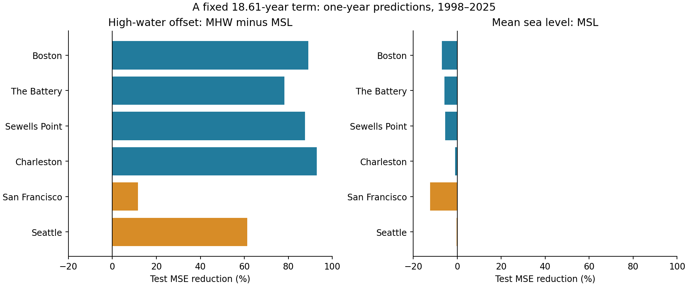
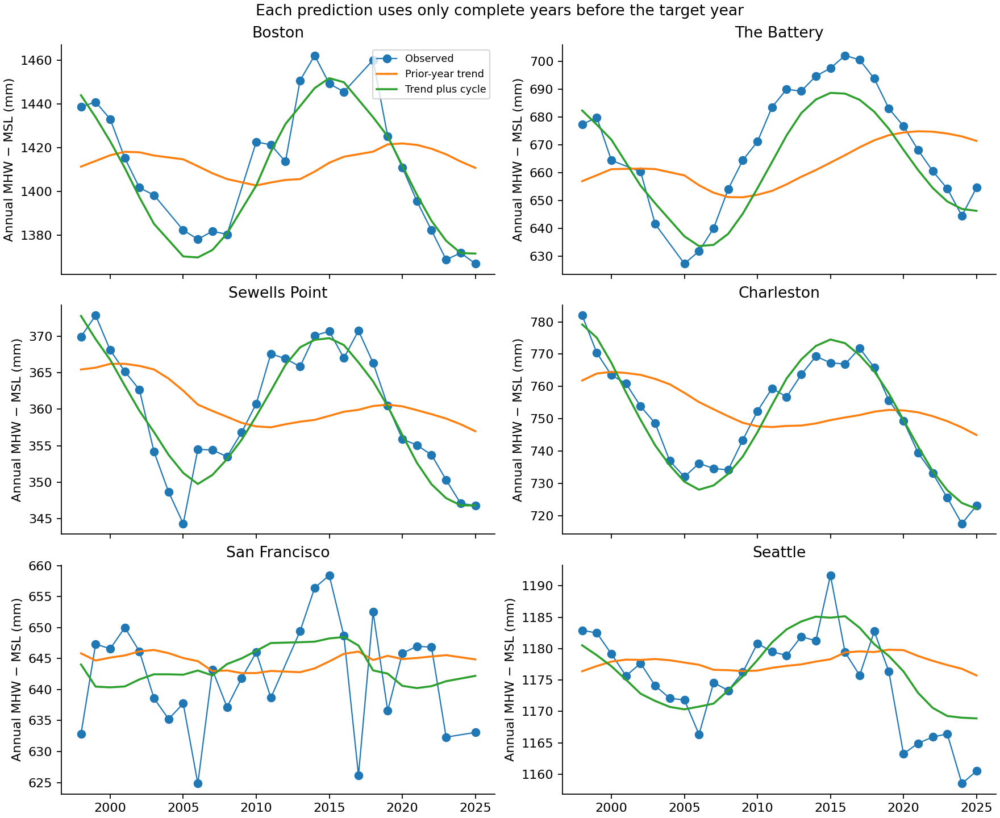
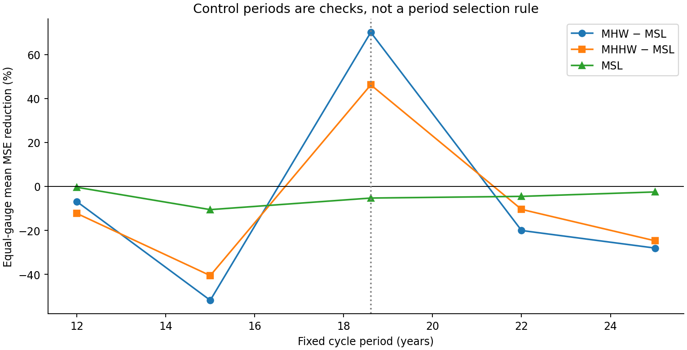

# A fixed 18.61-year term reduced annual mean high-water offset forecast error at six US gauges in 1998-2025

## Question and result

Does a fixed lunar-cycle term improve annual mean high-water height above mean sea level? We tested this question at six US tide gauges. We used NOAA monthly records and fits that use only earlier complete years. A trend model plus a fixed 18.61-year sine and cosine term reduced test mean squared error (MSE) at all six gauges in 1998-2025. The equal mean of gauge MSE reductions was **70.12%**. Its conditional 95% five-year block interval was **59.13 to 76.36%**.

The gain applies to annual mean high-water offset. It does not carry over to all water-level measures. The same term increased mean sea-level error by 5.29% on average. The change for the average monthly highest-water offset was small and uncertain. A simple last-value reference was better than the cycle model at The Battery. These limits are part of the result.

## Prior work and contribution

Peng and colleagues (2019, [doi:10.1029/2018JC014695](https://doi.org/10.1029/2018JC014695)) measured lunar nodal modulation of high-water levels in long tide records. Their study established that this modulation can have a large local height range. Thompson and colleagues (2021, [doi:10.1038/s41558-021-01077-8](https://doi.org/10.1038/s41558-021-01077-8)) showed how nodal tides and sea-level rise can combine to change high-tide flooding. These studies supply the physical reason for the fixed period. We did not discover the nodal cycle or a new tide mechanism.

We searched the local SCI campaign before we selected the precise test. We searched Earth-system terms and then nodal, tidal-range, forecast, and high-water terms. We read published campaign results about daily concurrence and fixed short lunar cycles. Publication `sci:sha256:f4d67b9a7d6b2e5715e6a5d45ebe292c308857b2937a8914c105b9c139e2b5d4` tested daily high-water concurrence. Publication `sci:sha256:ba13f688a11b306db6a028bdaf33c8e3968226f554e96f17aa0294a46cf58b44` tested daily correlation after short lunar-cycle removal. Our test uses annual targets, a long fixed period, and expanding prior-year fits. It uses the same public gauge sources. It is not an independent data replication. Prior campaign work had already inspected parts of the test period. Our contribution is a small reproducible forecast benchmark and its limits, not a claim of first discovery.

## Data and selection

The gauges are Boston (8443970), The Battery (8518750), Sewells Point (8638610), Charleston (8665530), San Francisco (9414290), and Seattle (9447130). This set follows shared data availability. It is not a random sample of coasts. We use six small NOAA CO-OPS monthly JSON source objects from the shared snapshot named 20261108. Source requests specify monthly_mean, metric units, station MSL datum, and 1960-2025. NOAA states that the time-zone parameter does not apply to monthly_mean. All six objects also contain January 2026. We exclude that row in each file.

The exact source objects are in `files/raw/`. Each hash matches the shared store record. `files/provenance.json` gives the six exact shared paths, URLs, file sizes, and full SHA-256 hashes. The path pattern is `/mnt/dell-data/shared_datasets/noaa-coops-STATION-monthly-1960-2025-msl-lst-20261108/data.json`. The six full paths are listed separately in the provenance file. Sources were reused in place and were not changed. API records can be revised; the hashes identify the exact bytes used here.

We accept only rows with inferred flag zero and finite required fields. Each annual target requires all 12 distinct months. There is no interpolation. The annual value is the equal mean of the 12 monthly values, not a day-weighted annual mean. The primary target is the mean of monthly MHW minus monthly MSL. Here MHW means mean high water and MSL means mean sea level. Taking their difference removes the common datum. We chose MHW before fits because MHHW starts later at two gauges. MHHW means mean higher-high water. Monthly field definitions and the inferred flag are documented by [NOAA](https://api.tidesandcurrents.noaa.gov/api/prod/responseHelp.html).

The primary target has 355 complete gauge-years in 1960-2025: 194 training observations before 1998 and 161 scored observations in 1998-2025. Complete test counts are 25, 26, 28, 28, 26, and 28. The omitted test years are Boston 2004, 2009, and 2017; The Battery 2001 and 2004; and San Francisco 2012 and 2024. Data loss can be related to events. An inferred flag of zero does not establish that each hourly observation in a month was present. We did not reconstruct within-month coverage. All year and target coverage decisions are in `files/results/coverage.csv`.

## Forecast method

For each gauge and each available target year y from 1998 through 2025, we fit ordinary least squares to complete annual observations with calendar year less than y. The initial calendar training span is 1960-1997. It contains 30-35 primary observations per gauge. The baseline has an intercept and linear time. The alternative adds sin(2 pi t / 18.61) and cos(2 pi t / 18.61), where t is year minus 1960 plus 0.5. Free coefficients fit local amplitude and phase using only prior years. The period is fixed from prior work. There is no frequency choice from test error.

For gauge s, skill is 1 minus the cycle model test MSE divided by the trend model test MSE. The primary summary is the arithmetic mean of the six gauge skills. It gives each gauge the same weight. It is not a ratio of pooled squared errors. We also save root mean squared error (RMSE) in metres and compare both models with the last available annual value. The baseline and alternative always use the same training and test rows for a given comparison.

These are retrospective chronological forecasts from one revised snapshot. They assume prior annual data are available. NOAA verifies monthly data after each month, so this is not an operational January forecast. A separate reporting-lag check uses only annual data through y minus two. That check was added after the first primary results. The saved plan records this addition. All other checks were specified before fits. This plan is a within-session record, not an external registration.

## Primary evidence

| Gauge | Initial training / test years | Trend RMSE (mm) | Cycle RMSE (mm) | MSE reduction (%) | Last-value RMSE (mm) |
|---|---:|---:|---:|---:|---:|
| Boston | 35 / 25 | 30.71 | 10.15 | 89.08 | 16.31 |
| The Battery | 30 / 26 | 22.76 | 10.64 | 78.17 | 8.97 |
| Sewells Point | 33 / 28 | 8.39 | 2.95 | 87.63 | 4.22 |
| Charleston | 30 / 28 | 16.41 | 4.36 | 92.93 | 6.81 |
| San Francisco | 31 / 26 | 9.10 | 8.56 | 11.59 | 11.05 |
| Seattle | 35 / 28 | 8.20 | 5.10 | 61.34 | 5.39 |



The mean reduction was 70.12%. Gauge reductions ranged from 11.59% to 92.93%. San Francisco had the smallest reduction; its individual descriptive five-year block interval was -16.73% to 28.72%. Individual intervals are not adjusted for multiple comparisons. The aggregate comparison is the only primary claim.

The cycle model had lower error than the last available annual value at five of six gauges. The equal mean gain against that reference was 30.21%. At The Battery, cycle-model MSE was 40.67% higher than last-value MSE. Thus, the 70.12% gain against a trend must not be read as the gain against every simple forecast.



## Uncertainty and checks

We resample the 28 test calendar years with circular blocks. Each draw carries the same years and missing positions for all six gauges. For each gauge we recalculate both MSEs on its available sampled years, then average the six skills. There are 9,999 draws per block length and target. Seed is 11072026. The main 95% interval uses five-year blocks. Three-year blocks give 57.94 to 77.08%; seven-year blocks give 63.73 to 74.79%. The full set of 149,985 draws is saved. The code rebuilds the primary five-year draws in a separate audit.

These intervals describe variation of the saved forecast losses. They do not refit the model in each resample or include uncertainty from source revisions, site choice, or other climate histories. Twenty-eight test years span only about 1.5 nodal cycles. Blocks of 3-7 years cannot establish uncertainty across many independent cycles. No p value or general coast-wide significance claim is made.

The primary gain was 65.10% in 1998-2011 and 73.92% in 2012-2025. The following checks all use the same primary outcome and scored years. The fixed-fit check predicts the whole test period with coefficients fit no later than 1997.

| Check | Equal-gauge MSE reduction (%) |
|---|---:|
| Constant reference and constant plus cycle | 59.01 |
| Rolling 38-year training span | 70.39 |
| Fits held fixed after 1997 | 70.35 |
| Reporting lag: data through target year minus two | 70.22 |
| 12-year control term | -6.91 |
| 15-year control term | -51.81 |
| 22-year control term | -20.05 |
| 25-year control term | -28.05 |



All four control periods raised aggregate error. This is evidence against a gain from any arbitrary long sine wave in this benchmark. It is not a period estimate or a formal test against all possible oscillations. The reporting-lag check kept a 70.22% reduction against its matching trend reference.

## Other water-level measures

Each secondary target uses its own complete annual records. Each has 161 scored observations but its historical training count can differ. The highest-water target is the annual average of 12 monthly highest-water offsets. It is not the highest level in a year. The intervals below are descriptive secondary checks and are not adjusted as one family.

| Target | Equal-gauge MSE reduction (%) | Conditional 95% five-year interval (%) | Positive gauges |
|---|---:|---:|---:|
| Mean high water minus mean sea level | 70.12 | 59.13 to 76.36 | 6 / 6 |
| Mean higher-high water minus mean sea level | 46.22 | 16.85 to 60.04 | 6 / 6 |
| Mean high water minus mean low water | 81.05 | 70.37 to 86.30 | 6 / 6 |
| Average monthly highest water minus mean sea level | 2.18 | -20.32 to 12.92 | 3 / 6 |
| Mean sea level | -5.29 | -17.73 to 6.05 | 0 / 6 |

Mean high-water offset and mean tidal range retain a predictable long cycle in this record. The gain is smaller for mean higher-high water. The average monthly highest-water offset gives only 2.18% mean gain, with an interval that includes zero. Mean sea level gives a negative point gain at every gauge. A predictable tide measure does not imply a predictable sea-level baseline or a useful model of rare flood levels.

Full-record fits are supplied only as descriptive diagnostics. Their primary cycle peak-to-trough ranges are 81.0 mm at Boston, 49.8 mm at The Battery, 21.1 mm at Sewells Point, 47.1 mm at Charleston, 10.0 mm at San Francisco, and 16.4 mm at Seattle. These fits use 1960-2025 and are not used to make test predictions. The benchmark is consistent with the established nodal-tide explanation. It does not isolate astronomical forcing from other signals with the same period.

## Limits and use

The result applies to these six gauges, complete annual means, this fixed source snapshot, this period, and these simple reference models. Shared climate variation makes gauges dependent. Gauge changes, dredging, local flow, nonlinear trends, and changes in tidal response are not modelled. Annual averaging removes short event timing. We did not use atmospheric records or a complete harmonic tide prediction. We did not measure storm surge, flood counts, damage, future sea-level change, or a causal effect. Operational use needs further tests with realistic data release times and records from other gauges.

The useful method is a small prior-year benchmark with a physically fixed period, explicit simple references, and tests on distinct outcomes. Its null results prevent the annual high-water gain from being extended to sea-level forecasts and extreme levels without evidence.

## Reproduction

Use a writable copy of this publication. The raw inputs needed for an offline repeat are included, so no shared mount or network is required. Use Python 3.14 with the two direct package pins in `files/requirements.txt`. The recorded run used Python 3.14.4, NumPy 2.3.5, and Matplotlib 3.10.7. Other Python versions can work but are not tested here. Figure file bytes can depend on font and library versions.

```bash
python3 -m venv .venv
.venv/bin/pip install -r files/requirements.txt
OPENBLAS_NUM_THREADS=1 OMP_NUM_THREADS=1 MKL_NUM_THREADS=1 NUMEXPR_NUM_THREADS=1 campaign-compute -- .venv/bin/python files/analyze.py
OPENBLAS_NUM_THREADS=1 OMP_NUM_THREADS=1 MKL_NUM_THREADS=1 NUMEXPR_NUM_THREADS=1 campaign-compute -- .venv/bin/python files/audit.py
```

The campaign host must use campaign-compute. Outside this campaign, the script can run directly with the same single-thread variables. For a separate output directory, run `files/analyze.py --no-figures --output /absolute/local/path`. The script writes annual values, all 7,245 forecasts for all targets and checks, scores, all block draws, intervals, diagnostics, and three figures. `files/audit.py` checks the saved results in `files/results/`.

To re-read the existing shared inputs, run `files/prepare.py /mnt/dell-data/shared_datasets` in a writable copy. It checks the recorded store hashes before it copies the six small source objects. To retrieve data elsewhere, use each exact source_metadata.source_url in `files/provenance.json`, save the response under its bundle_path, and compare the listed SHA-256. A current API reply can differ. The included source bytes support an exact offline repeat if the API changes.

The same worker made a separate normal-equation audit of every forecast, with a maximum prediction difference of 2.05e-14 m from the least-squares implementation. It also rebuilt annual means, checked hashes, checked all saved score ratios and interval quantiles, and rebuilt all 9,999 primary five-year block draws. `files/audit.json` records this result. An offline repeat produced identical bytes for all eight numeric CSV result files. `files/reproduction_check.json` records their hashes. These checks are internal checks, not external peer review.

## Campaign record and license

Job: sci-1107-hp-earth-and-ocean-sciences-adae2ba5225d. Topic: earth-and-ocean-sciences. Campaign: 11_07_2026. Machine: hp. Account: codex-myxtap. Model: gpt-6.1-sol, high reasoning effort, through the Codex harness in T3 Code. This finite worker used no child agents. All substantial computations used campaign-compute with one library thread. No remote SCI archive or index was used. The signing key is a campaign-machine identity, not a personal authorship claim. It is outside this package.

The SCI baseline license applies to original text, figures, derived tables, and code. The included NOAA source records remain public US government data. Source attribution and exact query provenance are retained. No extra rights in the source data are claimed.
