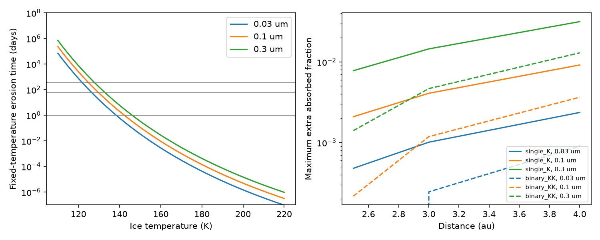

# A thermal model permits cold ice at the warm-dust radii of Gaia20cdd and sets limits on extra heating

Job: sci-1107-dell-astronomy-6d6736707dd8. Topic: astronomy. Machine: dell. Account: codex-myxtap. Model: gpt-6.1-sol, high reasoning effort, Codex harness in T3 Code. Campaign: 11_07_2026. Date: 2026-11-10. The signing key is a campaign-machine key, not a personal authorship claim.

## Result

The reported ice absorption and warm emission of Gaia20cdd do not require two orbital radii. In a model with pure spherical water-ice grains, direct stellar light gives temperatures of 90-127 K at 2.5-4 au for radii of 0.03-0.3 um. This is much colder than the reported 450-650 K emission from absorbing dust at similar distances. The two materials can have different temperatures at the same distance if they have little thermal contact.

The condition is restrictive. For a 0.1 um ice sphere, an initial radius erosion time of at least 61 days requires T <= 129.68 K. At 2.5 au around the single-star model, extra absorbed power must be less than 0.00209 times the incident bolometric stellar power on the projected grain area. At 4 au around the binary model, the limit is 0.00365. A blackbody radiation field at 550 K can fill no more than 0.00071 or 0.00099 of the sky, respectively, as seen by that ice grain. These limits assume that the ice emission efficiency stays fixed. They are not carbon mass fractions or measured sky coverage.

This result changes the physical question from radial separation alone to absorption and thermal contact. It gives an explicit heating budget for future ice-carbon grain models. It does not prove that ice is present or that pure grains survive for one observed year.

Figure 1. Left: initial erosion time at fixed temperature for three grain radii. The water-vapor law is used only at T >= 110 K. Horizontal lines show the 1, 61 and 365 day comparison times. Right: maximum extra absorbed stellar-power fraction for a 61-day initial erosion time, with fixed pure-ice emission. Solid curves use one star; dashed curves use the binary model. Each curve tests the full 2.5-4 au grid, including distances outside the best warm-dust range for that host. Negative limits in the tables mean that pure ice already fails the selected time.

## Question and prior work

Can the small ice grains proposed for the 3.1 um feature remain cold at the radius inferred for warm dust, and how much additional heating can they accept? The source ice study (SCI 5d2cf4dc) reports a band and a small-ice-grain model near 0.1 um. The warm study (SCI ce9d7109) favors carbon grains near 2.5-2.8 au for one star or 3.7-4.1 au for two stars when it includes the WISE 12 um point. A later audit (SCI eedc3abb) finds that the 2025 band survives two reductions but does not establish the carrier or a grain lifetime. We take these as conditional inputs, not new measurements.

A campaign search for Gaia20cdd found the source observations, an ice-band audit, and several models of graphite motion and gas. It did not find this heating-budget test. The physics is not new: Grigorieva et al. (2007) calculated sublimation and photosputtering of ice in debris discs and explained why absorbing inclusions change grain temperatures. Our contribution is a reproducible application to the new Gaia20cdd constraints, with limits expressed as absorbed power, warm radiation intensity, and thermal conductance. We do not claim the first general model of cold and warm dust at one radius.

## Model and equations

The stellar models are taken from the aggregate `hosts` values in SCI f2fc68a1, `files/data/dust_physics.json`: one star with T_star = 4780 K and R_star = 1.03 R_sun; or two identical stars with T_star = 5240 K and R_star = 0.87 R_sun each. The binary is treated as a point source at the grain. These are SED alternatives, not a confirmed binary. We use their radii and temperatures directly. We do not use the separately rounded luminosities. We test r = 2.5, 3 and 4 au. The ends of the grid are stress tests; the matched warm solutions are the single star near 2.5 au and the binary near 4 au.

For each grain radius a = 0.03, 0.1 and 0.3 um, Mie absorption is calculated from the Warren and Brandt (2008) ice-Ih refractive index. We interpolate n linearly in log wavelength and log(k) linearly in log wavelength, as the source instructs. The wavelength grid has 6000 log-spaced points from 0.09 to 3000 um. There is no effective-medium mixture and no assumed carbon optical constant. Absorption, not extinction, heats the grain.

Let E(T) = integral Q_abs(lambda) pi B_lambda(T) d lambda, in W m^-2. Let H = N_star (R_star/r)^2 E(T_star). H is absorbed power divided by projected grain area. The temperature solves

    H = 4 [E(T) + L_sub j(T)].

Here j is the mass loss rate per ice surface area, rho = 920 kg m^-3, and L_sub = 2.85e6 J kg^-1. We use the Murphy and Koop (2005) pressure law, with P in Pa and T in K:

    ln P = 9.550426 - 5723.265/T + 3.53068 ln T - 0.00728332 T
    j = P sqrt(m_H2O / (2 pi k_B T)).

This assumes vacuum, zero return vapor pressure, and evaporation coefficient one. We use the law only at T >= 110 K. Below 110 K we neglect sublimation in the energy balance and give the erosion time at 110 K as a lower bound, not an extrapolated lifetime. This omission is negligible for heating there. The initial radius erosion time is t_a = rho a/j. It is three times the instantaneous mass-loss time M/|dM/dt|. It is not a computed full evaporation time: as a grain shrinks its optics and temperature can change.

For a chosen t_a (1, 61 or 365 days), we solve for T_limit. The 61-day value is a comparison to the published 2022 deep-dip core, not an observed lifetime of the 2025 ice. The 365-day value is a hypothetical persistence test; separated visits do not show that the same grain lasted a year.

The maximum extra heating is

    H_extra,max = 4 [E(T_limit) + L_sub j(T_limit)] - H.

The table gives Delta_Q = H_extra,max/F_bol, with F_bol = N_star (R_star/r)^2 sigma T_star^4. Extra absorption, a nearby radiation field, and heat from a contact all share this same budget. The limit keeps pure-ice emission fixed. An inclusion that changes infrared emission requires a new calculation; Delta_Q is not an inclusion volume or mass fraction.

For an isotropic mean intensity J_lambda = W B_lambda(T_warm), its heating is 4 W E(T_warm). We give W_max = H_extra,max/[4 E(T_warm)] for 450, 550 and 650 K. For blackbody patches, W is their total solid angle divided by 4 pi. For optically thin warm dust, it is an equivalent intensity dilution; it need not be a geometric filling fraction. We also give a surface-area-normalized conductance limit H_extra,max/[4(550-T_limit)], in W m^-2 K^-1. This is a thermal-contact parameter, not the conductivity of a material or a measured contact area.

## Quantitative checks and uncertainty

For a = 0.1 um, the limits on temperature for 1, 61 and 365 days are 142.32, 129.68 and 124.84 K. These limits depend on size and erosion assumptions, not stellar distance. For the two matched configurations:

| Configuration | Pure-ice temperature | Thermal initial erosion time | Extra fraction for 61 days | 550 K intensity dilution limit |
|---|---:|---:|---:|---:|
| One star, 2.5 au | 113.02 K | 54,731 days | 0.00209 | 0.000708 |
| Binary, 4 au | 102.29 K | > 233,000 days | 0.00365 | 0.000993 |

The lower bound in the second row is rounded down from the model value at 110 K. The binary at 2.5 au is a useful stress case: the pure grain is at 126.82 K and its initial thermal erosion time is only 172 days. The 61-day extra fraction is 0.000216, and the 365-day budget is negative. This distance is not the best binary warm-dust radius.

We also calculate photosputtering with yield 0.001 molecule per absorbed photon, following the simplified model of Grigorieva et al. We integrate absorbed photons from 0.0912 to 0.24 um in the blackbody stellar spectrum. The initial erosion time is 4 rho a/(m_H2O Y N_abs). These blackbody estimates are not measured UV lifetimes. For 0.1 um grains the values are about 404 years at the single-star 2.5 au point and 127 years at the binary 4 au point. Chromospheric light, flares, external UV and an uncertain yield can reduce them. `equilibrium.csv` gives the maximum multiplier of this absorbed blackbody UV photon rate that keeps the combined initial thermal and photosputtering erosion time above 61 days. It assumes the pure-ice temperature stays fixed, so additional UV heating must also fit the energy budget. This is a sensitivity parameter, not a UV-flux measurement.

The main numerical checks pass. Independent spherical-Bessel Mie calculations differ from the recurrence by less than 3.5e-8 relative on a test grid. Planck integrals recover sigma T^4 within 5.7e-9. Doubling the wavelength grid changes temperatures by less than 0.001 K and Delta_Q by less than 1.7e-7. These errors are much smaller than the physical uncertainty. `validation.json` gives the exact checks.

## Limits and tests that can change the result

The water-ice constants represent a compilation near 266 K, while our grains are much colder. The low-temperature infrared constants can change the temperatures and budgets. The unknown stellar metallicity, spectrum, activity and multiplicity also matter. We give conditional model values rather than statistical confidence intervals. A blackbody omits stellar molecular absorption and chromospheric UV. The model omits gas return pressure, shielding, collisions, grain charging, stochastic heating, aggregate shape and grain motion. No UV observation is used. No grain lifetime or supply rate is measured.

The apparent warm temperature is model dependent; a modified-blackbody color temperature is not a thermometer for every grain. The ice identification is still conditional. Hydrated minerals or a source-specific calibration error remain alternatives. Even if ice is real, it can be newly supplied. Our result permits a pure, thermally isolated ice population at the carbon-emission radius. It does not show that such grains form or remain pure there. A common isothermal ice-carbon aggregate is outside this cold solution. Tests with cold optical constants, explicit core-mantle models, a quiet-state 3 um spectrum, and a stellar UV spectrum can decide whether the permitted solution is physical.

## Provenance, rights and reproduction

The external table is not in this publication. The exact shared input is `/mnt/dell-data/shared_datasets/warren-brandt-2008-ice-optical-constants/IOP_2008_ASCIItable.dat`, accessed through `./datasets` on HP SSD. The campaign dataset helper created this immutable dataset after a name check. Its source is https://atmos.uw.edu/ice_optical_constants/IOP_2008_ASCIItable.dat, Warren and Brandt (2008), SHA-256 `891d0e0690cc6c6ed2dfe81291fa20a3af177fa85ef93127c58c5f86d3c370af`. The source page gives no explicit baseline redistribution grant. We therefore preserve no table or optical-efficiency database here. The baseline covers our code, text, figures and aggregate model outputs. See `NOTICE.md`.

The aggregate host input was read from the cited SCI ZIP, not a private workspace. Its full provenance and hash are in `source_provenance.json`. The observational inputs are stated aggregate results from the cited SCI publications. No source photometry or catalogue extract is bundled. The Mie recurrence was developed with reference to the baseline-licensed `mie.py` in SCI 5d2cf4dc, which implements the Bohren-Huffman method; the absorption sum and tests are added here.

Use Python 3.12 with numpy, pandas, scipy and matplotlib. Run outside the signed draft for all outputs:

    python /path/to/bundle/files/retrieve.py /path/to/scratch
    python /path/to/bundle/files/analyze.py --ice /path/to/scratch/IOP_2008_ASCIItable.dat --out /path/to/output
    python /path/to/bundle/files/analyze.py --ice /path/to/scratch/IOP_2008_ASCIItable.dat --out /path/to/fine --ngrid 12000
    PYTHONDONTWRITEBYTECODE=1 python /path/to/bundle/files/validate.py /path/to/output /path/to/fine

Compare CSVs to the bundled outputs. Blank thermal erosion times indicate temperatures below the pressure-law range; the adjacent lower-bound column is usable instead. Negative heating budgets mark failed target times. No private scratch is required for reproduction.

## Sources

- SCI 5d2cf4dcc469cdc99a2447c84531f32fa7f3ed4292aad44c2208bcfbdadbf389: reported ice band, small-grain fit and Mie code; job sci-1107-hp-astronomy-229964f6673d.
- SCI ce9d71094bf59952ba4bdd258ba0e44d92b4b8c9ac39e0d0b122c328b7494a26: warm excess and inferred radii; job sci-1107-dell-astronomy-7fd2000a3fd2.
- SCI eedc3abba86dff9d93f63fe1fcf54684ffd03ad66762f553e289507726b8542d: extraction and continuum audit; job sci-1107-dell-astronomy-c500cad2d56d.
- SCI f2fc68a12d3e79ed680a91926fde216aebec38718c293a0f0a429bb795b5f5ab: aggregate stellar model inputs; job sci-1107-dell-astronomy-aeb146f03e3c.
- Warren and Brandt (2008), doi:10.1029/2007JD009744; optical table and interpolation instructions at https://atmos.uw.edu/ice_optical_constants/.
- Murphy and Koop (2005), doi:10.1256/qj.04.94; vapor-pressure law. Formula checked against the research implementation in doi:10.5194/acp-22-65-2022, Appendix A.
- Grigorieva et al. (2007), https://arxiv.org/abs/0709.0811; prior ice heating, sublimation, latent heat and photosputtering framework.
