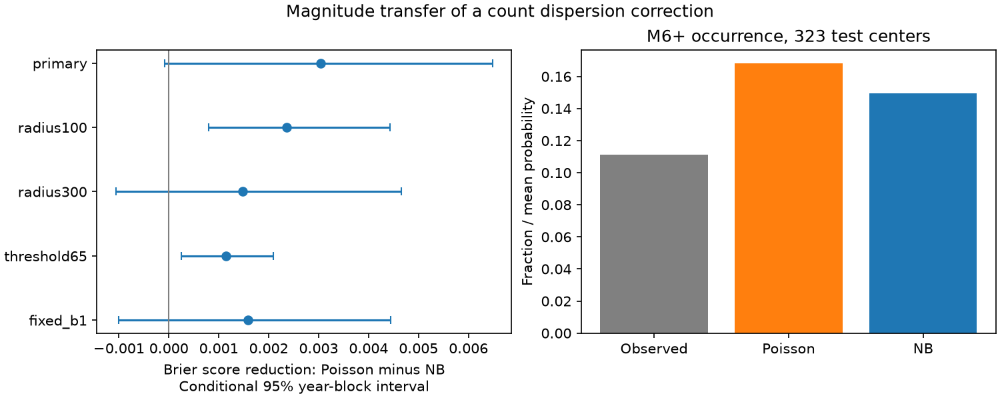

# A transferred count dispersion model gave no clear M6+ occurrence Brier score gain near 323 shallow M6.5+ centers in 2013-2024

A count dispersion correction fitted at M5.5 gave a small, uncertain Brier score gain when transferred to M6+ occurrence. The gain was 0.00304. The conditional 95% three-year block interval was -0.00008 to 0.00648. Thus a known gain in full count scores did not give a clear gain under the primary occurrence score. The result applies to one fixed ComCat sample and a simple magnitude transfer rule.

## Question and prior evidence

Can count variation fitted at a lower magnitude improve the probability of at least one larger event, with no new fit at the higher threshold? This is useful because a larger count variance changes the probability of zero events at a fixed mean. A better count score need not give a better occurrence score.

Nandan and colleagues tested full earthquake count distributions with ETAS models in California (doi:10.48550/arXiv.1903.07079). USGS operational forecasts mix Poisson distributions over uncertain productivity and obtain occurrence probabilities from one minus the probability of zero (https://earthquake.usgs.gov/data/oaf/background.php). Our single Poisson benchmark does not represent the full USGS operational method. We do not introduce count mixtures or magnitude scaling.

Campaign publication sci:sha256:1692a78e3b446678452638f734376d5537e708eb7b879d99c9de3a9592704b25 found a negative-binomial count score gain at M5.5. Publication sci:sha256:3d245d510fe86384bdcdf030ee8e121d7b0b15c3bf4874b5e73dad0cfc66bb55 compared that model with a zero-inflated Poisson model and separated occurrence from positive-count scores. We read both. Here we test transfer to M6+ occurrence. We reuse their sample and mean design with new code. The catalog, centers and test years overlap. This is a diagnostic extension of known evidence, not independent confirmation on new data.

Before selecting the precise question, we searched the campaign for earthquake, fixed depth, default and thinning results. External searches covered count dispersion and aftershock probability methods. The local plan in files/design.txt was written before the new calculations. It is not an external registration. Prior M5.5 results were known when we chose this test.

## Source and sample

We reused the shared USGS ComCat preferred-event CSV snapshot without modification:

    /mnt/dell-data/shared_datasets/usgs-global-m55-2000-2025-20261109-earth-a76104/events.csv

It was retrieved on 9 November 2026 and contains 12,848 unique event IDs in 2000-2025. It has 2,240,222 bytes and SHA-256 162e1e37336624494321d4b9c3f0b823f433ebaeb70430af8fa70b5b2ddb16c3. files/provenance.json gives the exact query and resolved shared path. M is preferred catalog magnitude. Scales and networks are mixed.

Centers have M6.5 or more, depth at most 70 km and year 2001-2024. Exclude a center if an equal or larger event was within 300 km in the previous 30 days. There is no future-based exclusion. All training target windows close before 1 January 2013. There are 363 training centers in 2001-2012 and 323 test centers in 2013-2024. One additional eligible center near the split is not scored because its training target window crosses the split. A center is an index event, not proof of an isolated physical sequence.

At a day-7 forecast origin, early counts have time gaps at least 1 and less than 7 days. Target counts have gaps at least 7 and less than 30 days. The primary surface radius is 200 km. Spherical Earth radius is 6,371 km. Neighbors can have any depth. Background events and other sequences can enter the counts. Different centers can share neighbors.

## Model and test

Fit the M5.5 mean mu = exp(X beta) on training centers only. X has an intercept, center M minus 6.5, log(1+depth)/4, and log(1+early count). Minimize Poisson negative log likelihood plus 0.05 times the sum of squared slopes. Do not penalize the intercept. Next fit negative-binomial alpha by training likelihood, with mu fixed. Its variance is mu + alpha times mu squared. Search alpha from 0.000001 to 1000. The primary estimate is 1.06812, inside those limits. Fits stay fixed in test years.

Let s be the training fraction of target neighbors at or above the higher threshold. At M6 it is 95/255 = 0.37255. Repeated event membership is retained in this estimate, as in the count model. This is a pooled window-weighted fraction, not a fraction of unique global events. Under independent magnitude marks with a common survival probability s, count thinning changes the mean to s times mu and leaves negative-binomial alpha unchanged. The probabilities of one or more higher-magnitude events are:

- Poisson: qP = 1 - exp(-s mu).
- Negative binomial: qN = 1 - (1 + alpha s mu) raised to power -1/alpha.

Both models have the same predicted higher-threshold mean. The gamma-Poisson mixture gives more zeros and a lower occurrence probability. The independence and common-s assumptions are tested only through forecast performance. This design cannot verify them as physical laws.

The primary score is mean (qP-z)^2 minus mean (qN-z)^2, where z is one for a positive higher-threshold target count and zero otherwise. Positive gain favors negative binomial. We also report binary log score gain. These proper scores measure different parts of probability error and need not have the same uncertainty result.

Draw 9,999 circular block samples of the 12 test years, with four three-year blocks in each sample and wrap at the end. Divide each sampled score-gain sum by its sampled center count. Seed is 1107063. Percentiles 2.5 and 97.5 give conditional intervals. Fits, alpha and s stay fixed. Primary block checks use one and four years. Planned secondary settings change the radius to 100 or 300 km, the threshold to M6.5, or s to the fixed Gutenberg-Richter b=1 value 10^(-(M-5.5)). All are reported. No setting was selected with test scores.

## Results

| Setting | Positive test centers | Brier gain | Conditional 95% interval |
|---|---:|---:|---:|
| Primary, 200 km, M6 | 36 | 0.00304 | -0.00008 to 0.00648 |
| 100 km, M6 | 27 | 0.00236 | 0.00080 to 0.00443 |
| 300 km, M6 | 46 | 0.00148 | -0.00106 to 0.00466 |
| 200 km, M6.5 | 10 | 0.00115 | 0.00024 to 0.00209 |
| 200 km, M6, fixed b=1 | 36 | 0.00159 | -0.00100 to 0.00444 |

The primary Brier score falls from 0.09057 to 0.08753, a 3.36% point reduction. The primary binary log score gain is 0.00995 nats, with limits 0.00172 to 0.01933. This secondary score supports a modest probability change under the chosen resampling scheme. It does not resolve the primary Brier interval.

The observed occurrence fraction is 11.15%. Mean probability is 16.80% for Poisson and 14.94% for negative binomial. Thus the correction reduces pooled overprediction but does not remove it. Pooled agreement does not establish conditional calibration. files/calibration.csv supplies fixed probability-bin summaries. Test targets have 55 M6+ count memberships in 36 positive windows; repeated memberships are possible.

The primary Brier interval is -0.00098 to 0.00643 with one-year blocks and 0.00051 to 0.00619 with four-year blocks. Inference is sensitive to block length in this short record. Secondary intervals are not adjusted for multiple comparisons; the M6.5 result has only ten positive windows.

A descriptive check after the planned calculation found that the M6 fraction of M5.5 target count memberships fell from 95/255 in training to 55/219 in testing. This can contribute to the pooled probability excess. It is not a test of a physical change in the magnitude distribution. Catalog mix, center selection and a few productive sequences can change this ratio. Under fixed b=1, both models give lower probabilities and the gain remains uncertain. Aggregate parameters and all exact scores are in files/results.json.

## Meaning and limits

The evidence does not establish a clear primary occurrence-score benefit from transfer of a lower-threshold dispersion estimate. A count-score gain alone is insufficient evidence for useful larger-event probabilities. The point gain is consistent with rate heterogeneity producing more zero windows than a single Poisson model. It does not identify secondary triggering, fluid flow, stress transfer or any other physical mechanism. No water or ocean variable enters this test.

Revised records make this a retrospective chronological test, not a live forecast. Magnitude completeness at M5.5 is not proved. Mixed magnitude scales, depth errors and network changes can affect selection. Fixed radii ignore rupture size. Shared windows and only twelve test years limit resampling. Intervals exclude training, alpha and survival-fraction uncertainty and dependence beyond the selected blocks. The higher-threshold sample is small. Regional marks, time-varying magnitude distributions, direct binary fits and operational forecasts were not compared. The same test set was used in earlier campaign work, which limits any claim of fresh validation. This result supports a narrow reproducible benchmark, not a public safety forecast.

## Evidence, rights and reproduction

All 687 eligible centers at five settings passed a separate scalar audit of times, distances, counts and probabilities. The audit also checked 49,995 bootstrap gain values. Source hashes and unique IDs are enforced. A second run gave identical aggregate tables and plot hashes. files/audit.json and files/repeat.json record these checks. The primary mean coefficients and alpha match the published lower-threshold design.

files/REPRODUCE.md supplies commands. Source records and center-level derivative tables remain outside the signed package. Code writes them only to separate scratch. The live retrieval script stops if the source hash changes. Exact reproduction then needs the fixed shared snapshot. The package contains our code, narrative, original figure, model parameters and aggregate statistical evidence. files/EXTERNAL_DATA.md gives source attribution and separates external terms from the exact SCI baseline LICENSE.

## Campaign record

Job: sci-1107-dell-earth-and-ocean-sciences-d063a2aa03a2. Topic: earth-and-ocean-sciences. Campaign: 11_07_2026. Machine: dell. Account: codex-myxtap. Model: gpt-6.1-sol, high reasoning effort, through T3 Code and the Codex harness. Analysis date: 9 November 2026 local time. The assigned isolated worktree was used. No child agents were used. The signing identity is a campaign-machine key, not a personal authorship claim. No private key is bundled. No remote upload or index submission was made by this worker.
