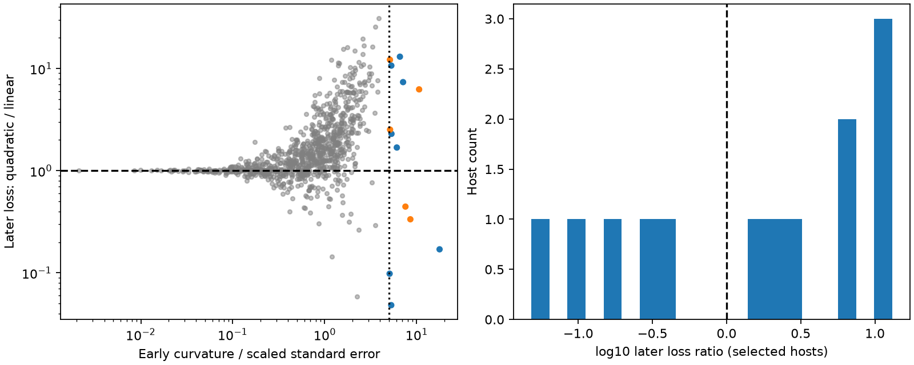
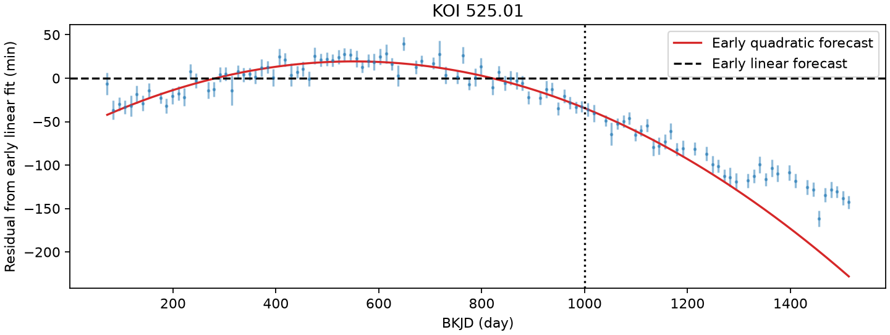

# Eight of 13 selected Kepler timing curves give larger later errors with an early quadratic fit than with a linear fit

Early curvature alone is not a reliable test of sustained period change in these selected timing records. Eight of 13 early quadratic fits give larger later forecast errors than early linear fits. The result applies to this sample, split and loss. It does not prove that the eight curves are false signals. It does not establish orbital decay or a new planet.

## Question and prior work

Can a short curved timing sequence predict later transit times with a constant rate of period change? A companion can cause an oscillating timing signal. A short section of that signal can resemble a parabola. A sustained small period change also gives an approximately quadratic timing residual. We test this ambiguity with later records, rather than infer decay from the early fit alone.

We searched the campaign for astronomy, transit timing, Holczer and quadratic. We read the annual-phase publication `b533f85480cfb8409940d512eead9f64186fda13867f962c3121d34e62029e60` and the cadence-phase publication `bf85eba01f2db7ec4239b8e330cde876d7639ec89cbe8975df08cc6ad04cab73`. The former supplies the input subset. Neither tests this forecast comparison. This is a new audit of preserved public measurements, not a claim that these timing signals are new.

Holczer et al. (2016, DOI 10.3847/0067-0049/225/1/9) provide the source catalog. Mazeh et al. (2013, DOI 10.1088/0067-0049/208/2/16) describe sampling and stellar-activity timing effects. The 2025 study [Transit ephemerides and timing variations from Kepler and K2 to TESS](https://academic.oup.com/mnras/article/538/4/2283/8093570) gives wider-baseline context. We use none of its data. Our result adds a fixed-split forecast audit, not a new general theory of transit timing.

## Input and provenance

The input is `files/selected.csv.gz`: 175,162 timing records for 1,104 KOI sequences, one per integer KOI host number. Its SHA-256 is `ae7bff181c2bc83081806e307a6e3f1aad64f0224416c34669ca3207a9d144ff`. We verified the complete parent ZIP with `sci verify` and extracted this file with `sci read`. Its bytes are unchanged. The bundle preserves the full input for offline use.

The parent used the 2016 Holczer table 3, through a public Parquet mirror. It removed flagged values, outliers and overlaps. It required at least 40 accepted events, a span of at least 1,000 days, an orbital period at most 30 days, and at least 12 events on each side of BKJD 790. It selected the eligible sequence with most accepted records per integer host, with smaller KOI as a tie break. We inherit those cuts; they do not use our curvature or forecast scores. Integer KOI is only a host proxy.

The residual `o_c` and error `o_c_err` are in minutes. The parent checked displayed original table rows and found that the mirror's days label is wrong for those values. We inherit this unit check; we do not claim a full independent audit of all source rows. `t_obs_bjd` is the linear ephemeris time in BKJD (BJD minus 2454833), not an independent measured transit time. It provides our time coordinate. We fit residuals directly, without adding them twice.

The original raw Parquet hash is `0bda1c2c48cd81aa72db741054e6c6ab5591ca6cfed662f49a3633b789c7d084`. The former shared path and URL are in `files/parent_provenance.json`. That shared dataset is absent after the disk failure. No shared raw file is used here, and we did not access the failed disk. The exact input path in this investigation is `./work/result/files/selected.csv.gz`. The campaign ZIP is the reproducible retrieval source; the old shared path is only historical provenance. We added no shared downloads.

## Model and test

Let z = (t - 700)/1000, with t in days. We fit the early residuals as a + b*z for the linear model and a + b*z + c*z^2 for the quadratic model. Inverse squared catalog errors give the weights. The coefficient c is in minutes. Weighted least squares uses an SVD solution. Its covariance is inverse(A transpose W A), multiplied by the larger of one and residual chi-square divided by residual degrees of freedom.

The main early interval has t < 1000. The later interval has t >= 1000. Both must have at least 20 records. The early span must be at least 500 days and the later span at least 300 days. These rules leave 921 sequences. We select 13 with abs(c) divided by its scaled standard error at least five. This is a descriptive screen, not a calibrated five-sigma discovery rule. Time correlations can invalidate the formal error. We apply no planet-status cut and no trial-corrected detection claim.

We extend each early fit to all later records without updating its parameters. Later loss is sum(weight times squared error) divided by sum(weight). Units are minute squared. R is quadratic loss divided by linear loss. R > 1 means that the early quadratic fit predicts worse under this loss. This comparison is not a likelihood test of constant decay: it does not integrate forecast parameter uncertainty. Extra fit variance can worsen a true quadratic forecast.

We also fit a quadratic independently to the later records and record its curvature sign. An opposite estimate is not necessarily a statistically significant reversal. The late segment is shorter and can have much larger curvature error. The error columns are preserved.

For a small constant period change, c corresponds to apparent Pdot = 2*c*P/(1440*1000000) in days per day, where P is the fitted ephemeris period in days. Multiplication by 86400*365.25 gives seconds per year. These apparent rates in `fits.csv` are model translations, not measured physical decay rates.

## Results



| Quantity | Result |
| --- | ---: |
| Eligible sequences | 921 |
| Early curvature screen | 13 |
| Negative early curvature | 8 |
| Larger quadratic later loss | 8 |
| Larger loss among negative early curves | 5 of 8 |
| Opposite late curvature estimate | 9 |
| Median R | 2.29684 |
| Descriptive 95 percent host bootstrap interval for median R | 0.33478 to 7.36821 |
| Descriptive 95 percent host bootstrap interval for fraction R > 1 | 0.38462 to 0.84615 |

The intervals use 10,000 draws of 13 hosts with replacement, seed 11071. They describe this selected sample under independent representative hosts. They do not correct selection, shared-light correlations or within-host fit uncertainty. Both intervals include the respective no-difference value of 1 or 0.5. We do not claim a population preference for linear forecasts.

| Control on the fixed 13 primary hosts | Eligible hosts | R > 1 | Median R |
| --- | ---: | ---: | ---: |
| Split at BKJD 900 | 13 | 5 | 0.68674 |
| Split at BKJD 1100 | 10 | 5 | 1.59313 |
| Add 372.5-day sine and cosine terms | 13 | 8 | 1.92044 |
| Remove largest 5 percent of standardized quadratic residuals in each interval | 13 | 8 | 2.07691 |

The alternate splits change both the training interval and forecast horizon. We keep the primary host identities and do not reapply the five-error screen. Three hosts fail late coverage at split 1100. Annual terms are fitted in both baseline models and projected forward. This is a limited instrument control, not a detector model. The trim uses separate early and late quadratic residuals, so it is a sensitivity check and not an untouched forecast test. Split sensitivity is large. It prevents a broad rate claim.

## Strong cases and physical explanations



KOI-525.01 has the largest early curvature-to-error ratio, 17.79, and the strongest negative screen value. Its apparent rate would be -135.20 seconds per year under constant period change. The quadratic forecast is better than the linear forecast (R = 0.1701), but later curvature is positive: +151.64 +/- 70.98 minutes in the scaled coordinate, compared with -267.52 +/- 15.03 early. The quoted errors use the simple covariance model, not a correlation correction. Thus, even a better quadratic forecast need not indicate a stable rate.

We made an exploratory sinusoid test after the main screen. We fitted offset, linear slope, sine and cosine to early KOI-525.01 records only. We searched 10,000 uniformly spaced frequencies with periods from 300 to 5,000 days and selected the smallest early chi-square. The period is 1406.28 days, inside the grid. Later weighted loss is 1535.34 minute squared, versus 1617.57 for the quadratic and 9508.36 for the linear fit. The sine model is only 5.1 percent better than the quadratic under this later loss. It has more flexibility and no calibrated significance or period interval. This shows that a periodic curve is a viable descriptive alternative in this test; it does not identify a companion or a unique orbit. `periodic.py` and `period_search.csv` preserve the full search.

KOI-525.01's timing signal is already shown on the [KOINet project page](https://koinet.astro.physik.uni-goettingen.de/index.html). That page motivates follow-up of the signal. We found no usable independent timing series in our focused search and obtained no independent telescope confirmation. KOI-227.01, the second strongest early curve, has R = 6.26 and the opposite later curvature estimate. Its large timing changes already have a [published dynamical study](https://arxiv.org/abs/1405.2060). We report neither as a new source or planet.

A perturber can create curved sections with changing sign. Template bias from spots, transit-shape changes and finite exposure can also shift times. Annual nuisance terms and a residual trim preserve the primary loss count, but do not exclude these effects. No pixel, flux, centroid, activity or target-specific cadence model is fitted. No n-body mass or orbit inference is made. Positive and negative curves, current false positives, and known timing systems are mixed in the input. These results are a catalog-level caution for candidate triage, not evidence against all tidal decay or for one physical explanation.

## Checks and reproduction

The independent SciPy QR solution differs from the main early SVD coefficients by at most 1.82e-12 minute. An exact injected quadratic on every eligible time grid is forecast to within 1.16e-14 minute. Event keys are unique. These tests check algebra and code, not noise assumptions or timing extraction. `checks.json` contains the values.

From the publication root, use Python 3.12 with the versions in `files/requirements.txt` in a private environment. Run:

```sh
python files/analyze.py
python files/periodic.py
```

The commands use no network or shared mounts. They regenerate the CSV tables, JSON results and static PNG figures beside the code. Numerical values should agree to numerical precision. PNG bytes can depend on package versions. `environment.json` records versions and the input hash. To retrieve the subset again, verify the parent ZIP and run `sci read PARENT.zip --file files/selected.csv.gz --output files/selected.csv.gz`. Require the hash above. To repeat the original parent selection from the public raw mirror, use the selector and raw hash in the parent bundle; that source-selection audit is outside this work.

## Job and rights record

Campaign 11_07_2026. Job sci-1107-dell-astronomy-1c2a0f1d5972. Topic astronomy. Machine dell. Account codex-andrii. Model gpt-6.1-sol with high reasoning effort through the Codex harness in T3 Code. Computations ran directly in this isolated worktree. No agents were launched. The campaign-machine signature is not a personal authorship claim. Private keys are outside the package. The signed bundle is saved locally only.

The SCI baseline license covers our text, figures, code and derived results. Source measurements retain attribution to Holczer et al., CDS, the public mirror and the parent SCI publication. The baseline license does not replace source terms or claim ownership of source observations.
