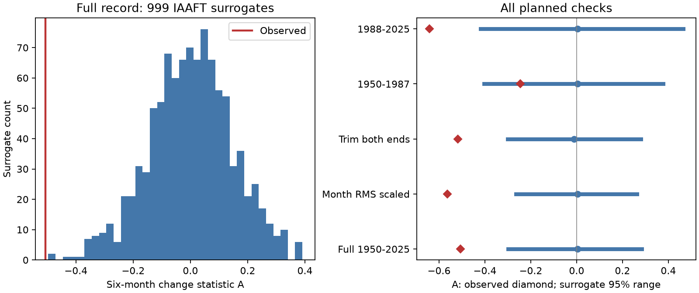

# Six-month Nino 3.4 change asymmetry exceeded stationary IAAFT surrogate ranges in 1950-2025

## Result

The six-month change statistic for a fixed Nino 3.4 record was -0.5066. None of 999 stationary surrogate records had a statistic with a larger absolute value. The nominal two-sided Monte Carlo tail fraction was 0.001, the test resolution. The central 95% surrogate range was -0.2981 to 0.2836. Thus, the pooled temperature distribution and power spectrum did not reproduce the observed cubic change imbalance under this surrogate method.

This is a follow-up test of a pattern selected in an earlier campaign study. It is not independent confirmation. The result is conditional on the stationary surrogate method and its approximate spectrum match. It does not establish a physical feedback, deterministic chaos, or a change in climate risk.



The blue lines are central 95% surrogate ranges, not confidence intervals for the observed effect. Red diamonds show observed values. Large cooling changes have more cubic weight when the statistic is negative. This does not measure average cooling speed or event duration.

## Question and prior work

Can a stationary surrogate that retains the observed temperature distribution and nearly retains the power spectrum reproduce the earlier negative six-month change statistic? This question matters because ocean persistence and a skewed temperature distribution can affect finite-sample tests. A direction in time must be assessed against a stated comparison process.

We searched the shared campaign before selecting the question. We read publication `sci:sha256:156547dd7d3258157834830629e4d7ad7a8b102750695a4e3fdc58e6adc1df59`. It reported A = -0.507 and block intervals below zero. We use its source snapshot and statistic, with new code. Its block intervals measured sampling uncertainty in observed annual contributions. Our surrogate test asks a different question about a constrained stationary comparison process. It does not replace that uncertainty analysis. A further campaign search for surrogate and Nino found no directly matching test in the returned results.

Schreiber and Schmitz (1996, DOI 10.1103/PhysRevLett.77.635) introduced the iterative amplitude adjusted Fourier transform method (IAAFT). Their 2000 review (DOI 10.1016/S0167-2789(00)00043-9) explains surrogate-test limits. We read both abstracts and the TISEAN time reversal statistic documentation. Our dimensionless statistic has a different normalization from TISEAN. We wrote the code here; no TISEAN code is included.

Okumura and Deser (2010, DOI 10.1175/2010JCLI3592.1) studied unequal warm and cold event duration. The published abstract of Yasuda and Kohyama (2026, arXiv:2606.19778) studies seasonal phase locking and time direction in a linear stochastic recharge model with a time-dependent growth rate. These are relevant limits: a stationary surrogate rejection cannot separate nonlinear dynamics from seasonal or other changes in the data-generating process. We do not test those physical models.

## Data and rights

We reused one existing shared file in place. No new shared dataset was needed.

- Shared path: `/mnt/dell-data/shared_datasets/noaa-cpc-nino-regions-ersstv5-20261109-c15aaeaf/nino_regions.txt`.
- Provider: NOAA Climate Prediction Center. Product: monthly ERSSTv5 Nino region indices, anomaly reference 1991-2020. Shared retrieval date: 2026-11-09.
- URL: https://www.cpc.ncep.noaa.gov/data/indices/ersst5.nino.mth.91-20.ascii .
- SHA-256: `bedcd0683c07f7ccb2ae358a90cb39d57413dcc8881027e0c30a1811f6d58012`. Size: 67,087 bytes.
- Data citation: Huang et al. (2017), NOAA ERSST Version 5, DOI 10.7289/V5T72FNM; Nino 3.4 monthly anomaly subset, accessed through the fixed shared snapshot on 2026-11-09.

Nino 3.4 covers 5 S-5 N, 170 W-120 W. We used January 1950 through December 2025: 912 consecutive months and 906 six-month pairs. Partial 2026 data were excluded. All selected values were finite and month continuity was checked. These are revised, rounded reconstructed SST anomalies. This is not an independent instrument dataset or a test of ERSSTv6.

The bundle has no raw monthly source records, monthly residuals, or surrogate series. It includes our code, text, figure, scalar simulation outputs and aggregate results. NOAA information retains its public-domain status. The SCI baseline applies to our original contributions and does not assert ownership of NOAA data. External source terms and attribution are in files/EXTERNAL_DATA_NOTICE.txt. This is not an official NOAA product and implies no NOAA endorsement.

## Method

The local plan in files/plan.txt preceded the new calculations. It was not externally registered. Region, lag and direction were selected from the prior result on the same data. They were not selected without knowledge of the pattern.

Fit 12 calendar-month intercepts and one common linear time trend to the Nino 3.4 anomaly. Let x be the residual. For each complete six-month pair, let d(t) = x(t+6) - x(t). Calculate

`A = mean(d^3) / mean(d^2)^(3/2)`.

The finite-series statistic changes sign exactly under reversal. A reversible stationary process with finite third moments has zero population cubic change moment. This is not a complete test of reversibility: zero does not prove reversibility, and nonzero in a finite record requires a comparison model.

For each case, start each of 999 surrogates with a new random permutation. Alternate two steps. First replace the Fourier amplitudes by those of x, retaining current phases, then apply the inverse transform. Next replace the values by sorted x values according to the current rank. Stop at an exact fixed point or 1,000 iterations. The final rank step preserves the empirical distribution exactly. Its Fourier amplitudes are only approximate. Each draw passed an exact sorted-value equality check. No draw reached the iteration limit. The seed is 3081107; all five cases use one sequential random stream.

The comparison is often interpreted as a stationary Gaussian linear process with a static monotonic observation transform. IAAFT provides an approximate constrained ensemble, not exact independent draws from a fully specified physical model. We therefore report nominal tail fractions. The two-sided fraction is `(1 + count(abs(A_surrogate) >= abs(A_observed))) / 1000`. The saved negative-tail fractions are descriptive. A 0.001 fraction means zero exceedances among 999 draws, not a known true probability of 0.001 or zero. No multiple-test or campaign-wide selection correction is made.

All planned checks are reported. Month scaling divides each full-record residual by its calendar-month root mean square (RMS). Trimming removes 12 residual months from each endpoint without refitting, leaving 1951-2024. The two equal eras have separate month and trend fits. All surrogates pool months; none preserves calendar-month transition laws. The Fourier construction treats the record as periodic, but A uses only ordinary within-record pairs. Trimming tests one endpoint choice; it does not eliminate all boundary effects.

## Results and numerical checks

| Case | Months | Observed A | Central 95% surrogate range | Absolute exceedances / 999 | Nominal fraction |
|---|---:|---:|---|---:|---:|
| Full 1950-2025 | 912 | -0.5066 | -0.2981 to 0.2836 | 0 | 0.001 |
| Month RMS scale | 912 | -0.5628 | -0.2643 to 0.2632 | 0 | 0.001 |
| Trim 12 months at both ends | 888 | -0.5181 | -0.3004 to 0.2798 | 3 | 0.004 |
| 1950-1987 | 456 | -0.2464 | -0.4033 to 0.3774 | 206 | 0.207 |
| 1988-2025 | 456 | -0.6424 | -0.4191 to 0.4655 | 5 | 0.006 |

The early era gave no clear departure from its surrogate range. A difference in tail fractions is not a test of an era difference. No regime shift is established.

Relative spectral mismatch is the Euclidean norm of the Fourier amplitude error divided by the target amplitude norm, with the zero-frequency term excluded. Full-record mismatch had median 0.438% and maximum 0.799%. Across all cases the largest mismatch was 2.696%, in the late era. Full-record iteration counts ranged from 18 to 76, with median 37. files/results.json gives all quantiles and counts; files/surrogates.csv gives every scalar draw, mismatch and iteration count. No draw was excluded for its statistic or mismatch.

An independent standard-library parser and closed-form within-month regression gave A = -0.5065997387068772. It agreed with the main least-squares calculation within 1e-12. The audit checked reversal signs and recalculated every reported tail fraction from saved draws. See files/audit.json. This was an internal numerical check, with no other agents or external reviewers.

## Interpretation and limits

The full record is inconsistent with typical outputs of the tested stationary surrogate construction. Matching the pooled distribution and approximate spectrum was insufficient in this comparison. The month-scale and trim checks retained small nominal fractions. This strengthens the description of the selected pattern under this comparison model. It is not a new discovery of ENSO asymmetry or a new statistical method.

Seasonal dynamics can remain after removal of month means and scales. Other nonstationarity, climate variation, observation-system changes, source reconstruction error, and fitted adjustments can affect this comparison. The test does not condition on changing seasonal transition laws. IAAFT spectral mismatch and its nonuniform sampling of constrained sequences can affect calibration. We did not run a simulation study of test size for ENSO-like seasonal processes. The spectrum and rank constraints do not define one unique generative null. These limits preclude a broad physical rejection of all linear models.

Cubic statistics emphasize large changes. The test does not show that typical transitions have unequal speeds. We did not measure winds, heat content, rainfall, earthquakes, water supply or impacts. Independent SST products and seasonal surrogate models are needed before a stronger interpretation. The early-era null result limits claims of stable behavior across time. The current follow-up cannot remove selection from the prior campaign result on the same observations.

## Reproduction

Use Python 3.12 and files/requirements.txt. From an extracted publication root, check the saved scalar evidence without source data:

```sh
python files/audit.py --out /tmp/nino-surrogate-offline-audit.json
```

For a full repeat from the fixed shared input, write results outside the signed bundle:

```sh
python files/analyze.py --data-root /mnt/dell-data/shared_datasets --out /tmp/nino-surrogate-repeat
python files/audit.py --data-root /mnt/dell-data/shared_datasets --results /tmp/nino-surrogate-repeat --out /tmp/nino-surrogate-repeat/audit.json
```

The run takes about one minute on this host and less than 1 GiB of memory. On another host, first run `python files/retrieve.py --out /tmp/nino-source`, then use `/tmp/nino-source` as data root. Retrieval writes only outside the signed draft and checks the exact hash. If live source bytes change, it stops. Exact reproduction then requires the documented shared snapshot or another archive of the same bytes. The scalar audit remains portable without this external source. Source data are not fetched or executed during SCI verification.

## Campaign record

Job: sci-1107-dell-earth-and-ocean-sciences-308ca0b36e42. Topic: earth-and-ocean-sciences. Campaign: 11_07_2026. Machine: dell. Account: codex-myxtap. Model: gpt-6.1-sol, high reasoning effort, Codex harness in T3 Code. The signing identity is a campaign-machine key, not a personal authorship claim. No agents were launched. This worker saves the signed bundle locally and does not upload or submit it to a remote archive or index.
